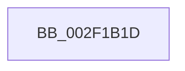

# sub_002F1B1D

- RVA: `0x002F1B1D`–`0x002F1B40` (길이 `35` bytes)
- VA: `0x00000001402F1B1D`
- 실행 섹션: `.text`
- PDB 이름 있음: `아니요`; PDB Function 태그: `아니요`
- unwind 정보 RVA: `0x00071E5C`
- 디코드: `7`개 명령, `35/35` bytes 표시
- 미해석 바이트: `0` (있으면 어셈블리에 `.byte`로 보존)

> 이 문서는 커널 이미지의 기계어와 PDB 기호를 분석해 생성했습니다. 4번과 5번은 함수 원형과 자료형을 바이너리 사용 방식에서 추정한 C 해석이며 원본 소스 복구 결과는 아닙니다.

## 1. Dependencies

- 직접 호출 지점: **1**; 고유 호출 대상: **1**
- 직접 호출자로 확인된 함수: **0**
- RIP 상대 이미지 참조: **0**

### Outgoing calls
- `0x002F1B22` → [ExFreePoolWithTag](../../poolcode/B8/ExFreePoolWithTag_function_00B82870.md) (function, `0x00B82870`)

### Direct callers
- 이 함수 시작 RVA로 연결되는 직접 call은 확인되지 않았습니다. 간접 호출은 완전히 역산할 수 없습니다.

### Static image references
- 디코드된 RIP-relative 메모리 참조가 없습니다.

## 2. Other-region calls and transfers

- 다른 실행 섹션으로 향하는 call: **1**
  - `0x002F1B22` → [ExFreePoolWithTag](../../poolcode/B8/ExFreePoolWithTag_function_00B82870.md) (`.text` → `POOLCODE`)
- call이 아닌 외부 분기/꼬리 이동: **1**
  - `0x002F1B3A` → [sub_002F1C24](Unknown_function_002F1C24.md) (`tail-transfer`)

## 3. Assembly (complete function range)

```asm
002F1B1D  33 D2                           xor edx, edx
002F1B1F  49 8B CC                        mov rcx, r12
002F1B22  E8 49 0D 89 00                  call 0x140b82870
002F1B27  4C 8B A4 24 08 01 00 00         mov r12, qword ptr [rsp + 0x108]
002F1B2F  45 85 ED                        test r13d, r13d
002F1B32  4C 8B AC 24 00 01 00 00         mov r13, qword ptr [rsp + 0x100]
002F1B3A  0F 85 E4 00 00 00               jne 0x1402f1c24
```

## 4. C-style interpretation (structured pseudocode)

```c
__int64 __fastcall sub_002F1B1D(__int64 a1, int a2, __int64 a3, __int64 a4, __int64 a5, __int64 a6, __int64 a7, __int64 a8, __int64 a9, __int64 a10, __int64 a11, __int64 a12, __int64 a13, __int64 a14, __int64 a15, __int64 a16, __int64 a17, __int64 a18, __int64 a19, __int64 a20, __int64 a21, __int64 a22, __int64 a23, __int64 a24, __int64 a25, __int64 a26, __int64 a27, __int64 a28, __int64 a29, __int64 a30, __int64 a31, __int64 a32, __int64 a33)
{
    __int64 result;

    a2 = 0;
    result = ExFreePoolWithTag(v_r12, a2, a3, a4);
}
```

## 5. (Beta) C Style

```c
int64_t sub_002F1B1D(int64_t Arg1, int32_t Arg2, int64_t Arg3, int64_t Arg4, uint64_t Arg5, uint64_t Arg6, uint64_t Arg7, uint64_t Arg8, uint64_t Arg9, uint64_t Arg10, uint64_t Arg11, uint64_t Arg12, uint64_t Arg13, uint64_t Arg14, uint64_t Arg15, uint64_t Arg16, uint64_t Arg17, uint64_t Arg18, uint64_t Arg19, uint64_t Arg20, uint64_t Arg21, uint64_t Arg22, uint64_t Arg23, uint64_t Arg24, uint64_t Arg25, uint64_t Arg26, uint64_t Arg27, uint64_t Arg28, uint64_t Arg29, uint64_t Arg30, uint64_t Arg31, int64_t Arg32, int64_t Arg33)
{
    int64_t result;

    Arg2 = 0;
    result = ExFreePoolWithTag(local_r12, Arg2, Arg3, Arg4);
}
```

## 6. Execution-region graph

[열기: 2D/3D 그래프와 함수 탐색 컨트롤 패널](../../../control-panel.html?section=text&rva=0x002F1B1D&view=graph)

- 2D 그래프는 위에서 아래로 흐르고, 3D 그래프는 빈 공간을 드래그해 회전합니다. Shift+드래그는 이동, 휠은 확대·축소, 함수 노드 선택은 대상 보고서 이동입니다.

### Static fallback


