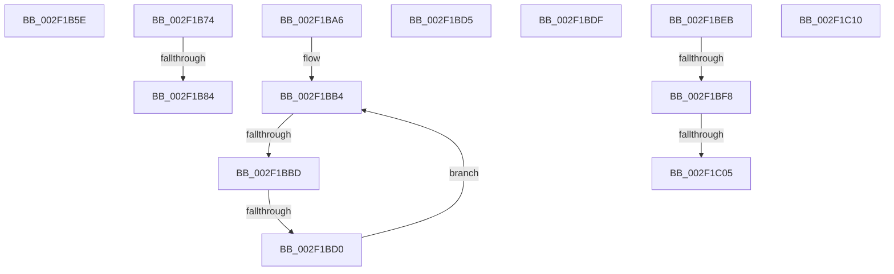

# sub_002F1B5E

- RVA: `0x002F1B5E`–`0x002F1C24` (길이 `198` bytes)
- VA: `0x00000001402F1B5E`
- 실행 섹션: `.text`
- PDB 이름 있음: `아니요`; PDB Function 태그: `아니요`
- unwind 정보 RVA: `0x00071E88`
- 디코드: `40`개 명령, `198/198` bytes 표시
- 미해석 바이트: `0` (있으면 어셈블리에 `.byte`로 보존)

> 이 문서는 커널 이미지의 기계어와 PDB 기호를 분석해 생성했습니다. 4번과 5번은 함수 원형과 자료형을 바이너리 사용 방식에서 추정한 C 해석이며 원본 소스 복구 결과는 아닙니다.

## 1. Dependencies

- 직접 호출 지점: **2**; 고유 호출 대상: **2**
- 직접 호출자로 확인된 함수: **0**
- RIP 상대 이미지 참조: **5**

### Outgoing calls
- `0x002F1B8F` → [MmUnlockLoadedModuleListShared](MmUnlockLoadedModuleListShared_function_002F2230.md) (function, `0x002F2230`)
- `0x002F1BC3` → [MiImageContainsVa](../4B/MiImageContainsVa_function_004B1874.md) (function, `0x004B1874`)

### Direct callers
- 이 함수 시작 RVA로 연결되는 직접 call은 확인되지 않았습니다. 간접 호출은 완전히 역산할 수 없습니다.

### Static image references
- `0x002F1B74` → RVA `0x00E681A0` (`.data`; read)
- `0x002F1BA6` → RVA `0x00FC6B20` (`ALMOSTRO`; read)
- `0x002F1BDF` → RVA `0x00E302C0` (`.data`; read/write)
- `0x002F1BEB` → RVA `0x00E0AA1C` (`.data`; read)
- `0x002F1BF8` → RVA `0x00F475DC` (`.data`; read)

## 2. Other-region calls and transfers

- 다른 실행 섹션으로 향하는 call: **0**
- call이 아닌 외부 분기/꼬리 이동: **11**
  - `0x002F1B6F` → [sub_002F1861 + 0x138](Unknown_function_002F1861.md) (`tail-transfer`)
  - `0x002F1B7E` → [sub_002F1861 + 0x162](Unknown_function_002F1861.md) (`tail-transfer`)
  - `0x002F1BA1` → [sub_002F1861 + 0x29F](Unknown_function_002F1861.md) (`tail-transfer`)
  - `0x002F1BB7` → [sub_002F1861 + 0x138](Unknown_function_002F1861.md) (`tail-transfer`)
  - `0x002F1BCA` → [sub_002F1861 + 0x14A](Unknown_function_002F1861.md) (`tail-transfer`)
  - `0x002F1BDA` → [sub_002F1861 + 0x200](Unknown_function_002F1861.md) (`tail-transfer`)
  - `0x002F1BE6` → [sub_002F1861 + 0x297](Unknown_function_002F1861.md) (`tail-transfer`)
  - `0x002F1BF2` → [sub_002F1861 + 0x6F](Unknown_function_002F1861.md) (`tail-transfer`)
  - `0x002F1BFF` → [sub_002F1861 + 0x6F](Unknown_function_002F1861.md) (`tail-transfer`)
  - `0x002F1C0B` → [sub_002F1861 + 0x29A](Unknown_function_002F1861.md) (`tail-transfer`)
  - `0x002F1C1F` → [sub_002F1861 + 0xB6](Unknown_function_002F1861.md) (`tail-transfer`)

## 3. Assembly (complete function range)

```asm
002F1B5E  8B 7C 24 4C                     mov edi, dword ptr [rsp + 0x4c]
002F1B62  0F B7 EA                        movzx ebp, dx
002F1B65  48 89 6C 24 58                  mov qword ptr [rsp + 0x58], rbp
002F1B6A  66 89 54 24 3A                  mov word ptr [rsp + 0x3a], dx
002F1B6F  E9 25 FE FF FF                  jmp 0x1402f1999
002F1B74  F7 05 22 66 B7 00 00 00 40 00   test dword ptr [rip + 0xb76622], 0x400000
002F1B7E  0F 85 3F FE FF FF               jne 0x1402f19c3
002F1B84  0F B6 4C 24 30                  movzx ecx, byte ptr [rsp + 0x30]
002F1B89  41 BD 01 00 00 00               mov r13d, 1
002F1B8F  E8 9C 06 00 00                  call 0x1402f2230
002F1B94  48 8B 5C 24 60                  mov rbx, qword ptr [rsp + 0x60]
002F1B99  45 33 FF                        xor r15d, r15d
002F1B9C  44 8B 74 24 48                  mov r14d, dword ptr [rsp + 0x48]
002F1BA1  E9 5A FF FF FF                  jmp 0x1402f1b00
002F1BA6  4C 8B 05 73 4F CD 00            mov r8, qword ptr [rip + 0xcd4f73]
002F1BAD  49 83 C0 10                     add r8, 0x10
002F1BB1  49 8B 18                        mov rbx, qword ptr [r8]
002F1BB4  49 3B D8                        cmp rbx, r8
002F1BB7  0F 84 DC FD FF FF               je 0x1402f1999
002F1BBD  49 8B D1                        mov rdx, r9
002F1BC0  48 8B CB                        mov rcx, rbx
002F1BC3  E8 AC FC 1B 00                  call 0x1404b1874
002F1BC8  85 C0                           test eax, eax
002F1BCA  0F 85 DB FD FF FF               jne 0x1402f19ab
002F1BD0  48 8B 1B                        mov rbx, qword ptr [rbx]
002F1BD3  EB DF                           jmp 0x1402f1bb4
002F1BD5  0F B7 54 24 38                  movzx edx, word ptr [rsp + 0x38]
002F1BDA  E9 82 FE FF FF                  jmp 0x1402f1a61
002F1BDF  F0 FF 05 DA E6 B3 00            lock inc dword ptr [rip + 0xb3e6da]
002F1BE6  E9 0D FF FF FF                  jmp 0x1402f1af8
002F1BEB  44 38 3D 2A 8E B1 00            cmp byte ptr [rip + 0xb18e2a], r15b
002F1BF2  0F 85 D8 FC FF FF               jne 0x1402f18d0
002F1BF8  44 38 3D DD 59 C5 00            cmp byte ptr [rip + 0xc559dd], r15b
002F1BFF  0F 85 CB FC FF FF               jne 0x1402f18d0
002F1C05  41 BD 01 00 00 00               mov r13d, 1
002F1C0B  E9 EB FE FF FF                  jmp 0x1402f1afb
002F1C10  41 0F B7 EF                     movzx ebp, r15w
002F1C14  66 44 89 7C 24 3A               mov word ptr [rsp + 0x3a], r15w
002F1C1A  48 89 6C 24 58                  mov qword ptr [rsp + 0x58], rbp
002F1C1F  E9 F3 FC FF FF                  jmp 0x1402f1917
```

## 4. C-style interpretation (structured pseudocode)

```c
__int64 __fastcall sub_002F1B5E(__int64 a1, unsigned __int16 a2, __int64 a3, __int64 a4)
{
    unsigned __int8 v_stack_p30;
    unsigned __int16 v_stack_p38;
    unsigned __int16 v_stack_p3A;
    unsigned int v_stack_p48;
    unsigned int v_stack_p4C;
    unsigned __int64 v_stack_p58;
    unsigned __int64 v_stack_p60;

    v_stack_p58 = a2;
    v_stack_p3A = a2;
}
```

## 5. (Beta) C Style

```c
int64_t sub_002F1B5E(int64_t Arg1, uint16_t Arg2, int64_t Arg3, int64_t Arg4)
{
    uint8_t v_stack_p30;
    uint16_t v_stack_p38;
    uint16_t v_stack_p3A;
    uint32_t v_stack_p48;
    uint32_t v_stack_p4C;
    uint64_t v_stack_p58;
    uint64_t v_stack_p60;

    v_stack_p58 = Arg2;
    v_stack_p3A = Arg2;
}
```

## 6. Execution-region graph

[열기: 2D/3D 그래프와 함수 탐색 컨트롤 패널](../../../control-panel.html?section=text&rva=0x002F1B5E&view=graph)

- 2D 그래프는 위에서 아래로 흐르고, 3D 그래프는 빈 공간을 드래그해 회전합니다. Shift+드래그는 이동, 휠은 확대·축소, 함수 노드 선택은 대상 보고서 이동입니다.

### Static fallback


