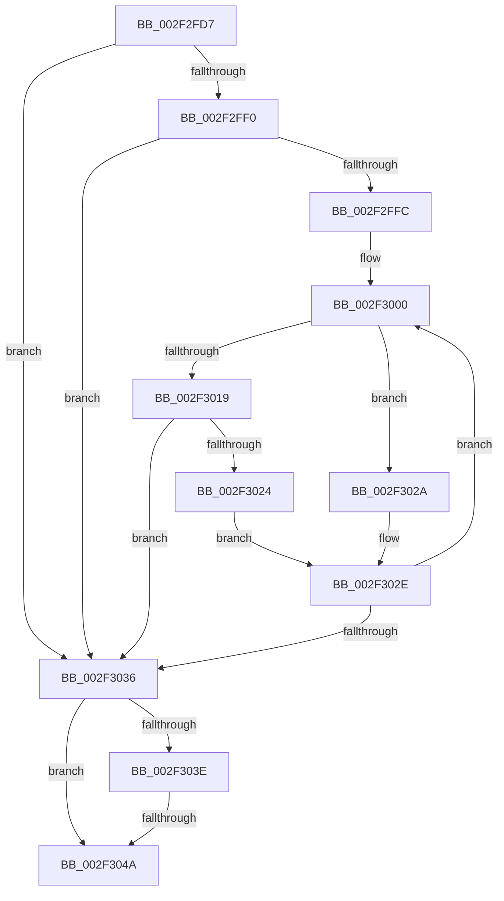

# sub_002F2FD7

- RVA: `0x002F2FD7`–`0x002F304F` (길이 `120` bytes)
- VA: `0x00000001402F2FD7`
- 실행 섹션: `.text`
- PDB 이름 있음: `아니요`; PDB Function 태그: `아니요`
- unwind 정보 RVA: `0x00071FC0`
- 디코드: `37`개 명령, `120/120` bytes 표시
- 미해석 바이트: `0` (있으면 어셈블리에 `.byte`로 보존)

> 이 문서는 커널 이미지의 기계어와 PDB 기호를 분석해 생성했습니다. 4번과 5번은 함수 원형과 자료형을 바이너리 사용 방식에서 추정한 C 해석이며 원본 소스 복구 결과는 아닙니다.

## 1. Dependencies

- 직접 호출 지점: **0**; 고유 호출 대상: **0**
- 직접 호출자로 확인된 함수: **0**
- RIP 상대 이미지 참조: **0**

### Outgoing calls
- 직접 디코드된 call 명령이 없습니다.

### Direct callers
- 이 함수 시작 RVA로 연결되는 직접 call은 확인되지 않았습니다. 간접 호출은 완전히 역산할 수 없습니다.

### Static image references
- 디코드된 RIP-relative 메모리 참조가 없습니다.

## 2. Other-region calls and transfers

- 다른 실행 섹션으로 향하는 call: **0**
- call이 아닌 외부 분기/꼬리 이동: **1**
  - `0x002F3044` → [sub_002F319C](Unknown_function_002F319C.md) (`tail-transfer`)

## 3. Assembly (complete function range)

```asm
002F2FD7  48 89 7C 24 50                  mov qword ptr [rsp + 0x50], rdi
002F2FDC  48 8D 04 40                     lea rax, [rax + rax*2]
002F2FE0  49 2B D8                        sub rbx, r8
002F2FE3  44 8B 14 86                     mov r10d, dword ptr [rsi + rax*4]
002F2FE7  48 8D 3C 86                     lea rdi, [rsi + rax*4]
002F2FEB  49 3B DA                        cmp rbx, r10
002F2FEE  73 46                           jae 0x1402f3036
002F2FF0  44 8D 42 FE                     lea r8d, [rdx - 2]
002F2FF4  45 8B D9                        mov r11d, r9d
002F2FF7  45 85 C0                        test r8d, r8d
002F2FFA  78 3A                           js 0x1402f3036
002F2FFC  0F 1F 40 00                     nop dword ptr [rax]
002F3000  43 8D 14 03                     lea edx, [r11 + r8]
002F3004  D1 FA                           sar edx, 1
002F3006  48 63 C2                        movsxd rax, edx
002F3009  48 8D 0C 40                     lea rcx, [rax + rax*2]
002F300D  48 8D 3C 8E                     lea rdi, [rsi + rcx*4]
002F3011  8B 0C 8E                        mov ecx, dword ptr [rsi + rcx*4]
002F3014  48 3B D9                        cmp rbx, rcx
002F3017  72 11                           jb 0x1402f302a
002F3019  8B 47 0C                        mov eax, dword ptr [rdi + 0xc]
002F301C  44 8B D1                        mov r10d, ecx
002F301F  48 3B D8                        cmp rbx, rax
002F3022  72 12                           jb 0x1402f3036
002F3024  44 8D 5A 01                     lea r11d, [rdx + 1]
002F3028  EB 04                           jmp 0x1402f302e
002F302A  44 8D 42 FF                     lea r8d, [rdx - 1]
002F302E  44 8B D1                        mov r10d, ecx
002F3031  45 3B C3                        cmp r8d, r11d
002F3034  7D CA                           jge 0x1402f3000
002F3036  41 8B C2                        mov eax, r10d
002F3039  48 3B D8                        cmp rbx, rax
002F303C  72 0C                           jb 0x1402f304a
002F303E  8B 47 04                        mov eax, dword ptr [rdi + 4]
002F3041  48 3B D8                        cmp rbx, rax
002F3044  0F 82 52 01 00 00               jb 0x1402f319c
002F304A  48 8B 7C 24 50                  mov rdi, qword ptr [rsp + 0x50]
```

## 4. C-style interpretation (structured pseudocode)

```c
__int64 __fastcall sub_002F2FD7(__int64 a1, __int64 a2, __int64 a3, int a4, __int64 a5, __int64 a6, __int64 a7, __int64 a8, __int64 a9, __int64 a10)
{
    __int64 v_rbx;
    unsigned __int64 v_stack_p50;

    v_stack_p50 = v_rdi;
    v_rbx = (v_rbx) - (a3);
    if (v_rbx >= ((unsigned int)(*(unsigned int *)(v_rsi + result + result * 2 * 4)))) goto loc_002F3036;
    if (sign_flag) goto loc_002F3036;
loc_002F3000:
    a2 = (unsigned int)(((unsigned int)(a4) + a2 - 2 * 1) >> (1));
    if (v_rbx < ((unsigned int)(*(unsigned int *)(v_rsi + (int)((unsigned int)(a2)) + (int)((unsigned int)(a2)) * 2 * 4)))) goto loc_002F302A;
    if (v_rbx < ((unsigned int)(*(unsigned int *)(v_rsi + (int)((unsigned int)(a2)) + (int)((unsigned int)(a2)) * 2 * 4 + 12)))) goto loc_002F3036;
    goto loc_002F302E;
loc_002F302A:
loc_002F302E:
    if (((unsigned int)(a2 - 1)) >= ((unsigned int)(a2 + 1))) goto loc_002F3000;
loc_002F3036:
    if (v_rbx < ((unsigned int)((unsigned int)((unsigned int)((unsigned int)((unsigned int)(*(unsigned int *)(v_rsi + (int)((unsigned int)(a2)) + (int)((unsigned int)(a2)) * 2 * 4)))))))) goto loc_002F304A;
loc_002F304A:
    return (unsigned int)(*(unsigned int *)(v_rsi + (int)((unsigned int)(a2)) + (int)((unsigned int)(a2)) * 2 * 4 + 4));
}
```

## 5. (Beta) C Style

```c
int64_t sub_002F2FD7(int64_t Arg1, void *Arg2, int64_t Arg3, int32_t Arg4, uint64_t Arg5, uint64_t Arg6, uint64_t Arg7, uint64_t Arg8, uint64_t Arg9, int64_t Arg10)
{
    uint8_t *arg2 = (uint8_t *)Arg2;

    int64_t local_rbx;
    uint64_t v_stack_p50;

    v_stack_p50 = local_rdi;
    local_rbx = (local_rbx) - (Arg3);
    if (local_rbx >= ((uint32_t)(*(uint32_t *)(local_rsi + result + result * 2 * 4)))) goto loc_002F3036;
    if (sign_flag) goto loc_002F3036;
loc_002F3000:
    Arg2 = (uint32_t)(((uint32_t)(Arg4) + Arg2 - 2 * 1) >> (1));
    if (local_rbx < ((uint32_t)(*(uint32_t *)(local_rsi + (int32_t)((uint32_t)(arg2)) + (int32_t)((uint32_t)(arg2)) * 2 * 4)))) goto loc_002F302A;
    if (local_rbx < ((uint32_t)(*(uint32_t *)(local_rsi + (int32_t)((uint32_t)(arg2)) + (int32_t)((uint32_t)(arg2)) * 2 * 4 + 0xC)))) goto loc_002F3036;
    goto loc_002F302E;
loc_002F302A:
loc_002F302E:
    if (((uint32_t)(Arg2 - 1)) >= ((uint32_t)(Arg2 + 1))) goto loc_002F3000;
loc_002F3036:
    if (local_rbx < ((uint32_t)((uint32_t)((uint32_t)((uint32_t)((uint32_t)(*(uint32_t *)(local_rsi + (int32_t)((uint32_t)(arg2)) + (int32_t)((uint32_t)(arg2)) * 2 * 4)))))))) goto loc_002F304A;
loc_002F304A:
    return (uint32_t)(*(uint32_t *)(local_rsi + (int32_t)((uint32_t)(arg2)) + (int32_t)((uint32_t)(arg2)) * 2 * 4 + 0x4));
}
```

### 관측된 메모리 오프셋

구조체 형식이 확인되지 않은 접근은 인자 기준의 오프셋으로만 기록했습니다.

| 기준 인자 | 오프셋 표현 | 폭 (bit) | 접근 |
|---|---:|---:|---|
| `Arg2` | `- 0x2` | `32` | `R` |

## 6. Execution-region graph

[열기: 2D/3D 그래프와 함수 탐색 컨트롤 패널](../../../control-panel.html?section=text&rva=0x002F2FD7&view=graph)

- 2D 그래프는 위에서 아래로 흐르고, 3D 그래프는 빈 공간을 드래그해 회전합니다. Shift+드래그는 이동, 휠은 확대·축소, 함수 노드 선택은 대상 보고서 이동입니다.

### Static fallback


