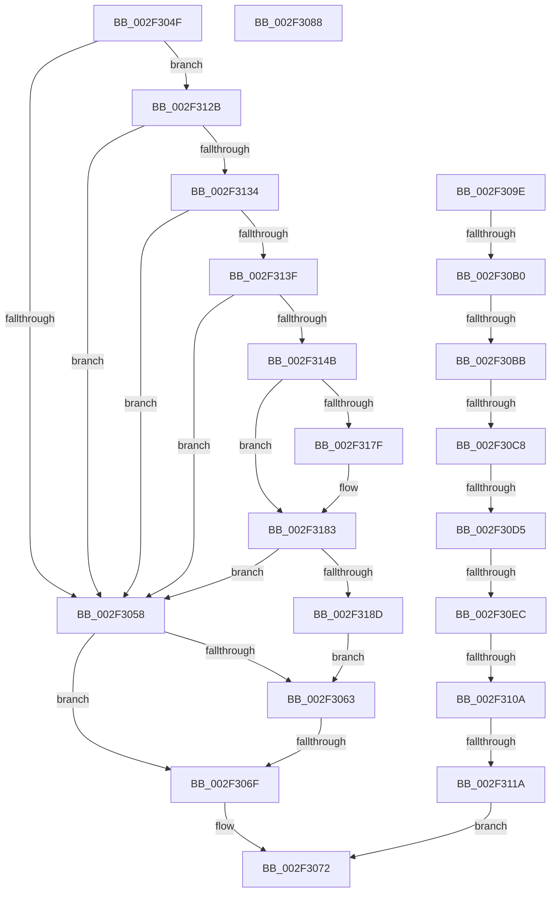

# sub_002F304F

- RVA: `0x002F304F`–`0x002F319C` (길이 `333` bytes)
- VA: `0x00000001402F304F`
- 실행 섹션: `.text`
- PDB 이름 있음: `아니요`; PDB Function 태그: `아니요`
- unwind 정보 RVA: `0x00071FD4`
- 디코드: `83`개 명령, `333/333` bytes 표시
- 미해석 바이트: `0` (있으면 어셈블리에 `.byte`로 보존)

> 이 문서는 커널 이미지의 기계어와 PDB 기호를 분석해 생성했습니다. 4번과 5번은 함수 원형과 자료형을 바이너리 사용 방식에서 추정한 C 해석이며 원본 소스 복구 결과는 아닙니다.

## 1. Dependencies

- 직접 호출 지점: **1**; 고유 호출 대상: **1**
- 직접 호출자로 확인된 함수: **0**
- RIP 상대 이미지 참조: **3**

### Outgoing calls
- `0x002F3091` → [RtlpxLookupFunctionTable](RtlpxLookupFunctionTable_function_002F3610.md) (function, `0x002F3610`)

### Direct callers
- 이 함수 시작 RVA로 연결되는 직접 call은 확인되지 않았습니다. 간접 호출은 완전히 역산할 수 없습니다.

### Static image references
- `0x002F30A3` → RVA `0x01201940` (`CFGRO`; read)
- `0x002F30BB` → RVA `0x01201950` (`CFGRO`; read)
- `0x002F30C8` → RVA `0x01201948` (`CFGRO`; read)

## 2. Other-region calls and transfers

- 다른 실행 섹션으로 향하는 call: **0**
- call이 아닌 외부 분기/꼬리 이동: **9**
  - `0x002F3069` → [sub_002F31A4 + 0xCB](Unknown_function_002F31A4.md) (`tail-transfer`)
  - `0x002F3099` → [RtlLookupFunctionEntry + 0x77](RtlLookupFunctionEntry_function_002F2F30.md) (`tail-transfer`)
  - `0x002F30AA` → [sub_002F31A4 + 0x7C](Unknown_function_002F31A4.md) (`tail-transfer`)
  - `0x002F30B5` → [RtlLookupFunctionEntry + 0x27](RtlLookupFunctionEntry_function_002F2F30.md) (`tail-transfer`)
  - `0x002F30C2` → [sub_002F31A4](Unknown_function_002F31A4.md) (`tail-transfer`)
  - `0x002F30CF` → [sub_002F31A4](Unknown_function_002F31A4.md) (`tail-transfer`)
  - `0x002F30E6` → [sub_002F31A4](Unknown_function_002F31A4.md) (`tail-transfer`)
  - `0x002F3104` → [sub_002F31A4 + 0x75](Unknown_function_002F31A4.md) (`tail-transfer`)
  - `0x002F3114` → [sub_002F31A4 + 0x75](Unknown_function_002F31A4.md) (`tail-transfer`)

## 3. Assembly (complete function range)

```asm
002F304F  4D 85 C9                        test r9, r9
002F3052  0F 85 D3 00 00 00               jne 0x1402f312b
002F3058  49 8B 17                        mov rdx, qword ptr [r15]
002F305B  49 8B C9                        mov rcx, r9
002F305E  4D 85 C9                        test r9, r9
002F3061  74 0C                           je 0x1402f306f
002F3063  41 8B 41 08                     mov eax, dword ptr [r9 + 8]
002F3067  A8 01                           test al, 1
002F3069  0F 85 00 02 00 00               jne 0x1402f326f
002F306F  48 8B C1                        mov rax, rcx
002F3072  48 8B 5C 24 58                  mov rbx, qword ptr [rsp + 0x58]
002F3077  48 8B 74 24 60                  mov rsi, qword ptr [rsp + 0x60]
002F307C  4C 8B 74 24 68                  mov r14, qword ptr [rsp + 0x68]
002F3081  48 83 C4 40                     add rsp, 0x40
002F3085  41 5F                           pop r15
002F3087  C3                              ret
002F3088  CC                              int3
002F3089  48 8D 54 24 20                  lea rdx, [rsp + 0x20]
002F308E  48 8B CB                        mov rcx, rbx
002F3091  E8 7A 05 00 00                  call 0x1402f3610
002F3096  48 8B F0                        mov rsi, rax
002F3099  E9 09 FF FF FF                  jmp 0x1402f2fa7
002F309E  41 80 78 07 00                  cmp byte ptr [r8 + 7], 0
002F30A3  4C 8D 1D 96 E8 F0 00            lea r11, [rip + 0xf0e896]
002F30AA  0F 85 70 01 00 00               jne 0x1402f3220
002F30B0  41 80 78 06 00                  cmp byte ptr [r8 + 6], 0
002F30B5  0F 84 9C FE FF FF               je 0x1402f2f57
002F30BB  48 3B 1D 8E E8 F0 00            cmp rbx, qword ptr [rip + 0xf0e88e]
002F30C2  0F 83 DC 00 00 00               jae 0x1402f31a4
002F30C8  48 3B 1D 79 E8 F0 00            cmp rbx, qword ptr [rip + 0xf0e879]
002F30CF  0F 82 CF 00 00 00               jb 0x1402f31a4
002F30D5  41 0F B6 48 05                  movzx ecx, byte ptr [r8 + 5]
002F30DA  44 8B 15 5F E8 F0 00            mov r10d, dword ptr [rip + 0xf0e85f]
002F30E1  8B D1                           mov edx, ecx
002F30E3  41 3B D2                        cmp edx, r10d
002F30E6  0F 83 B8 00 00 00               jae 0x1402f31a4
002F30EC  8B C2                           mov eax, edx
002F30EE  48 03 C0                        add rax, rax
002F30F1  4D 8B 4C C3 20                  mov r9, qword ptr [r11 + rax*8 + 0x20]
002F30F6  4D 8B 44 C3 18                  mov r8, qword ptr [r11 + rax*8 + 0x18]
002F30FB  41 8B 01                        mov eax, dword ptr [r9]
002F30FE  49 03 C0                        add rax, r8
002F3101  48 3B D8                        cmp rbx, rax
002F3104  0F 82 0F 01 00 00               jb 0x1402f3219
002F310A  41 8B 41 04                     mov eax, dword ptr [r9 + 4]
002F310E  49 03 C0                        add rax, r8
002F3111  48 3B D8                        cmp rbx, rax
002F3114  0F 83 FF 00 00 00               jae 0x1402f3219
002F311A  FE C1                           inc cl
002F311C  49 8B C1                        mov rax, r9
002F311F  41 88 4E 05                     mov byte ptr [r14 + 5], cl
002F3123  4D 89 07                        mov qword ptr [r15], r8
002F3126  E9 47 FF FF FF                  jmp 0x1402f3072
002F312B  4D 85 F6                        test r14, r14
002F312E  0F 84 24 FF FF FF               je 0x1402f3058
002F3134  41 80 7E 06 00                  cmp byte ptr [r14 + 6], 0
002F3139  0F 85 19 FF FF FF               jne 0x1402f3058
002F313F  41 8B 0E                        mov ecx, dword ptr [r14]
002F3142  83 F9 0C                        cmp ecx, 0xc
002F3145  0F 83 0D FF FF FF               jae 0x1402f3058
002F314B  8D 41 01                        lea eax, [rcx + 1]
002F314E  8B D1                           mov edx, ecx
002F3150  41 89 06                        mov dword ptr [r14], eax
002F3153  48 03 C9                        add rcx, rcx
002F3156  49 8B 07                        mov rax, qword ptr [r15]
002F3159  49 89 44 CE 18                  mov qword ptr [r14 + rcx*8 + 0x18], rax
002F315E  48 8D 42 02                     lea rax, [rdx + 2]
002F3162  48 03 C0                        add rax, rax
002F3165  4D 89 0C C6                     mov qword ptr [r14 + rax*8], r9
002F3169  49 8B 07                        mov rax, qword ptr [r15]
002F316C  41 8B 11                        mov edx, dword ptr [r9]
002F316F  41 8B 49 04                     mov ecx, dword ptr [r9 + 4]
002F3173  48 03 D0                        add rdx, rax
002F3176  48 03 C8                        add rcx, rax
002F3179  49 3B 56 08                     cmp rdx, qword ptr [r14 + 8]
002F317D  73 04                           jae 0x1402f3183
002F317F  49 89 56 08                     mov qword ptr [r14 + 8], rdx
002F3183  49 3B 4E 10                     cmp rcx, qword ptr [r14 + 0x10]
002F3187  0F 86 CB FE FF FF               jbe 0x1402f3058
002F318D  49 89 4E 10                     mov qword ptr [r14 + 0x10], rcx
002F3191  49 8B C9                        mov rcx, r9
002F3194  49 8B 17                        mov rdx, qword ptr [r15]
002F3197  E9 C7 FE FF FF                  jmp 0x1402f3063
```

## 4. C-style interpretation (structured pseudocode)

```c
__int64 __fastcall sub_002F304F(__int64 a1, __int64 a2, __int64 a3, __int64 a4, __int64 a5, __int64 a6, __int64 a7, __int64 a8, __int64 a9, __int64 a10, __int64 a11, __int64 a12, __int64 a13)
{
    __int64 result;
    __int64 v_rsp;
    unsigned __int64 v_stack_p68;

    if (a4 != 0) goto loc_002F312B;
loc_002F3058:
    if (a4 == 0) goto loc_002F306F;
loc_002F3063:
loc_002F306F:
loc_002F3072:
    v_rsp = (v_rsp) + (64);
    return a4;
loc_002F312B:
    if (a13 == 0) goto loc_002F3058;
    if ((*(unsigned __int8 *)(a13 + 6)) != 0) goto loc_002F3058;
    if (((unsigned int)((unsigned int)(*(unsigned int *)(a13)))) >= 12) goto loc_002F3058;
    *(unsigned int *)(a13) = (unsigned int)((unsigned int)(*(unsigned int *)(a13)) + 1);
    a1 = ((unsigned int)(*(unsigned int *)(a13))) + ((unsigned int)(*(unsigned int *)(a13)));
    *(unsigned __int64 *)(a13 + a1 * 8 + 24) = *(unsigned __int64 *)(v_r15);
    result = ((unsigned int)((unsigned int)((unsigned int)(*(unsigned int *)(a13)))) + 2) + ((unsigned int)((unsigned int)((unsigned int)(*(unsigned int *)(a13)))) + 2);
    *(unsigned __int64 *)(a13 + result * 8) = a4;
    a2 = ((unsigned int)(*(unsigned int *)(a4))) + (*(unsigned __int64 *)(v_r15));
    a1 = ((unsigned int)(*(unsigned int *)(a4 + 4))) + (*(unsigned __int64 *)(v_r15));
    if (a2 < (*(unsigned __int64 *)(a13 + 8))) {
        *(unsigned __int64 *)(a13 + 8) = a2;
    }
    if (a1 <= (*(unsigned __int64 *)(a13 + 16))) goto loc_002F3058;
    *(unsigned __int64 *)(a13 + 16) = a1;
    goto loc_002F3063;
}
```

## 5. (Beta) C Style

```c
int64_t sub_002F304F(int64_t Arg1, int64_t Arg2, int64_t Arg3, int64_t Arg4, uint64_t Arg5, uint64_t Arg6, uint64_t Arg7, uint64_t Arg8, uint64_t Arg9, uint64_t Arg10, int64_t Arg11, int64_t Arg12, int64_t Arg13)
{
    int64_t result;
    int64_t local_rsp;
    uint64_t v_stack_p68;

    if (Arg4 != 0) goto loc_002F312B;
loc_002F3058:
    if (Arg4 == 0) goto loc_002F306F;
loc_002F3063:
loc_002F306F:
loc_002F3072:
    local_rsp = (local_rsp) + (64);
    return Arg4;
loc_002F312B:
    if (Arg13 == 0) goto loc_002F3058;
    if ((*(uint8_t *)(Arg13 + 0x6)) != 0) goto loc_002F3058;
    if (((uint32_t)((uint32_t)(*(uint32_t *)(Arg13)))) >= 12) goto loc_002F3058;
    *(uint32_t *)(Arg13) = (uint32_t)((uint32_t)(*(uint32_t *)(Arg13)) + 1);
    Arg1 = ((uint32_t)(*(uint32_t *)(Arg13))) + ((uint32_t)(*(uint32_t *)(Arg13)));
    *(uint64_t *)(Arg13 + Arg1 * 8 + 0x18) = *(uint64_t *)(local_r15);
    result = ((uint32_t)((uint32_t)((uint32_t)(*(uint32_t *)(Arg13)))) + 2) + ((uint32_t)((uint32_t)((uint32_t)(*(uint32_t *)(Arg13)))) + 2);
    *(uint64_t *)(Arg13 + result * 8) = Arg4;
    Arg2 = ((uint32_t)(*(uint32_t *)(Arg4))) + (*(uint64_t *)(local_r15));
    Arg1 = ((uint32_t)(*(uint32_t *)(Arg4 + 0x4))) + (*(uint64_t *)(local_r15));
    if (Arg2 < (*(uint64_t *)(Arg13 + 0x8))) {
        *(uint64_t *)(Arg13 + 0x8) = Arg2;
    }
    if (Arg1 <= (*(uint64_t *)(Arg13 + 0x10))) goto loc_002F3058;
    *(uint64_t *)(Arg13 + 0x10) = Arg1;
    goto loc_002F3063;
}
```

## 6. Execution-region graph

[열기: 2D/3D 그래프와 함수 탐색 컨트롤 패널](../../../control-panel.html?section=text&rva=0x002F304F&view=graph)

- 2D 그래프는 위에서 아래로 흐르고, 3D 그래프는 빈 공간을 드래그해 회전합니다. Shift+드래그는 이동, 휠은 확대·축소, 함수 노드 선택은 대상 보고서 이동입니다.

### Static fallback


