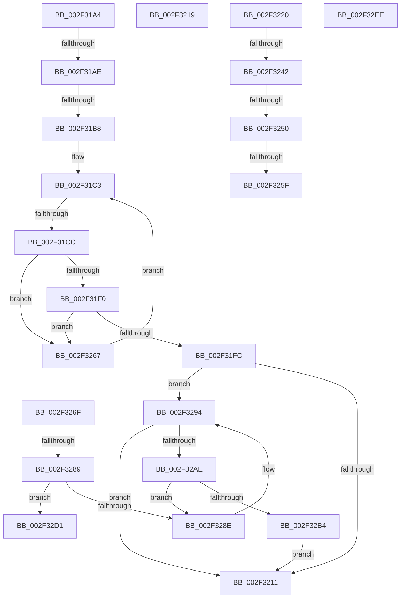

# sub_002F31A4

- RVA: `0x002F31A4`–`0x002F32F6` (길이 `338` bytes)
- VA: `0x00000001402F31A4`
- 실행 섹션: `.text`
- PDB 이름 있음: `아니요`; PDB Function 태그: `아니요`
- unwind 정보 RVA: `0x00071FFC`
- 디코드: `85`개 명령, `338/338` bytes 표시
- 미해석 바이트: `0` (있으면 어셈블리에 `.byte`로 보존)

> 이 문서는 커널 이미지의 기계어와 PDB 기호를 분석해 생성했습니다. 4번과 5번은 함수 원형과 자료형을 바이너리 사용 방식에서 추정한 C 해석이며 원본 소스 복구 결과는 아닙니다.

## 1. Dependencies

- 직접 호출 지점: **1**; 고유 호출 대상: **1**
- 직접 호출자로 확인된 함수: **0**
- RIP 상대 이미지 참조: **1**

### Outgoing calls
- `0x002F328E` → [ExRaiseDatatypeMisalignment](../../page/89/ExRaiseDatatypeMisalignment_function_00899FD0.md) (function, `0x00899FD0`)

### Direct callers
- 이 함수 시작 RVA로 연결되는 직접 call은 확인되지 않았습니다. 간접 호출은 완전히 역산할 수 없습니다.

### Static image references
- `0x002F3225` → RVA `0x01201945` (`CFGRO`; read)

## 2. Other-region calls and transfers

- 다른 실행 섹션으로 향하는 call: **1**
  - `0x002F328E` → [ExRaiseDatatypeMisalignment](../../page/89/ExRaiseDatatypeMisalignment_function_00899FD0.md) (`.text` → `PAGE`)
- call이 아닌 외부 분기/꼬리 이동: **12**
  - `0x002F31A8` → [RtlLookupFunctionEntry + 0x27](RtlLookupFunctionEntry_function_002F2F30.md) (`tail-transfer`)
  - `0x002F31B2` → [RtlLookupFunctionEntry + 0x27](RtlLookupFunctionEntry_function_002F2F30.md) (`tail-transfer`)
  - `0x002F31C6` → [RtlLookupFunctionEntry + 0x27](RtlLookupFunctionEntry_function_002F2F30.md) (`tail-transfer`)
  - `0x002F3214` → [sub_002F304F + 0x23](Unknown_function_002F304F.md) (`tail-transfer`)
  - `0x002F321B` → [sub_002F304F + 0x94](Unknown_function_002F304F.md) (`tail-transfer`)
  - `0x002F323C` → [sub_002F304F + 0x61](Unknown_function_002F304F.md) (`tail-transfer`)
  - `0x002F324A` → [sub_002F304F + 0x61](Unknown_function_002F304F.md) (`tail-transfer`)
  - `0x002F3259` → [sub_002F304F + 0x61](Unknown_function_002F304F.md) (`tail-transfer`)
  - `0x002F3262` → [sub_002F304F + 0x23](Unknown_function_002F304F.md) (`tail-transfer`)
  - `0x002F3283` → [sub_002F304F + 0x20](Unknown_function_002F304F.md) (`tail-transfer`)
  - `0x002F32E9` → [sub_002F304F + 0x20](Unknown_function_002F304F.md) (`tail-transfer`)
  - `0x002F32F1` → [sub_002F304F + 0x20](Unknown_function_002F304F.md) (`tail-transfer`)

## 3. Assembly (complete function range)

```asm
002F31A4  49 3B 5E 08                     cmp rbx, qword ptr [r14 + 8]
002F31A8  0F 82 A9 FD FF FF               jb 0x1402f2f57
002F31AE  49 3B 5E 10                     cmp rbx, qword ptr [r14 + 0x10]
002F31B2  0F 83 9F FD FF FF               jae 0x1402f2f57
002F31B8  41 0F B6 56 04                  movzx edx, byte ptr [r14 + 4]
002F31BD  45 8B 0E                        mov r9d, dword ptr [r14]
002F31C0  44 8B C2                        mov r8d, edx
002F31C3  45 3B C1                        cmp r8d, r9d
002F31C6  0F 83 8B FD FF FF               jae 0x1402f2f57
002F31CC  41 8B C0                        mov eax, r8d
002F31CF  48 03 C0                        add rax, rax
002F31D2  41 8B C8                        mov ecx, r8d
002F31D5  4D 8B 5C C6 18                  mov r11, qword ptr [r14 + rax*8 + 0x18]
002F31DA  48 8D 41 02                     lea rax, [rcx + 2]
002F31DE  48 03 C0                        add rax, rax
002F31E1  4D 8B 14 C6                     mov r10, qword ptr [r14 + rax*8]
002F31E5  41 8B 02                        mov eax, dword ptr [r10]
002F31E8  49 03 C3                        add rax, r11
002F31EB  48 3B D8                        cmp rbx, rax
002F31EE  72 77                           jb 0x1402f3267
002F31F0  41 8B 42 04                     mov eax, dword ptr [r10 + 4]
002F31F4  49 03 C3                        add rax, r11
002F31F7  48 3B D8                        cmp rbx, rax
002F31FA  73 6B                           jae 0x1402f3267
002F31FC  FE C2                           inc dl
002F31FE  41 88 56 04                     mov byte ptr [r14 + 4], dl
002F3202  4D 89 1F                        mov qword ptr [r15], r11
002F3205  41 8B 42 08                     mov eax, dword ptr [r10 + 8]
002F3209  A8 01                           test al, 1
002F320B  0F 85 83 00 00 00               jne 0x1402f3294
002F3211  49 8B C2                        mov rax, r10
002F3214  E9 59 FE FF FF                  jmp 0x1402f3072
002F3219  FF C2                           inc edx
002F321B  E9 C3 FE FF FF                  jmp 0x1402f30e3
002F3220  41 C6 40 07 00                  mov byte ptr [r8 + 7], 0
002F3225  0F B6 05 19 E7 F0 00            movzx eax, byte ptr [rip + 0xf0e719]
002F322C  48 03 C0                        add rax, rax
002F322F  49 8B 54 C3 18                  mov rdx, qword ptr [r11 + rax*8 + 0x18]
002F3234  49 8B 44 C3 20                  mov rax, qword ptr [r11 + rax*8 + 0x20]
002F3239  48 85 C0                        test rax, rax
002F323C  0F 84 6E FE FF FF               je 0x1402f30b0
002F3242  8B 08                           mov ecx, dword ptr [rax]
002F3244  48 03 CA                        add rcx, rdx
002F3247  48 3B D9                        cmp rbx, rcx
002F324A  0F 82 60 FE FF FF               jb 0x1402f30b0
002F3250  8B 48 04                        mov ecx, dword ptr [rax + 4]
002F3253  48 03 CA                        add rcx, rdx
002F3256  48 3B D9                        cmp rbx, rcx
002F3259  0F 83 51 FE FF FF               jae 0x1402f30b0
002F325F  49 89 17                        mov qword ptr [r15], rdx
002F3262  E9 0B FE FF FF                  jmp 0x1402f3072
002F3267  41 FF C0                        inc r8d
002F326A  E9 54 FF FF FF                  jmp 0x1402f31c3
002F326F  48 8D 48 FF                     lea rcx, [rax - 1]
002F3273  48 B8 FF FF FE FF FF 7F 00 00   movabs rax, 0x7ffffffeffff
002F327D  48 03 CA                        add rcx, rdx
002F3280  48 3B D0                        cmp rdx, rax
002F3283  0F 87 E6 FD FF FF               ja 0x1402f306f
002F3289  F6 C1 03                        test cl, 3
002F328C  74 43                           je 0x1402f32d1
002F328E  E8 3D 6D 5A 00                  call 0x140899fd0
002F3293  CC                              int3
002F3294  4C 8D 50 FF                     lea r10, [rax - 1]
002F3298  48 B8 FF FF FE FF FF 7F 00 00   movabs rax, 0x7ffffffeffff
002F32A2  4D 03 D3                        add r10, r11
002F32A5  4C 3B D8                        cmp r11, rax
002F32A8  0F 87 63 FF FF FF               ja 0x1402f3211
002F32AE  41 F6 C2 03                     test r10b, 3
002F32B2  75 DA                           jne 0x1402f328e
002F32B4  48 BA 00 00 FF FF FF 7F 00 00   movabs rdx, 0x7fffffff0000
002F32BE  49 8B CA                        mov rcx, r10
002F32C1  4C 3B D2                        cmp r10, rdx
002F32C4  90                              nop
002F32C5  48 0F 43 CA                     cmovae rcx, rdx
002F32C9  0F B6 09                        movzx ecx, byte ptr [rcx]
002F32CC  E9 40 FF FF FF                  jmp 0x1402f3211
002F32D1  48 BA 00 00 FF FF FF 7F 00 00   movabs rdx, 0x7fffffff0000
002F32DB  48 8B C1                        mov rax, rcx
002F32DE  48 3B CA                        cmp rcx, rdx
002F32E1  90                              nop
002F32E2  48 0F 43 C2                     cmovae rax, rdx
002F32E6  0F B6 00                        movzx eax, byte ptr [rax]
002F32E9  E9 81 FD FF FF                  jmp 0x1402f306f
002F32EE  49 8B C9                        mov rcx, r9
002F32F1  E9 79 FD FF FF                  jmp 0x1402f306f
```

## 4. C-style interpretation (structured pseudocode)

```c
__int64 __fastcall sub_002F31A4(void)
{
    __int64 result;
    __int64 v_r10;

loc_002F31C3:
    result = ((unsigned int)((unsigned int)((unsigned int)((unsigned int)(*(unsigned __int8 *)(v_r14 + 4)))))) + ((unsigned int)((unsigned int)((unsigned int)((unsigned int)(*(unsigned __int8 *)(v_r14 + 4))))));
    result = ((unsigned int)((unsigned int)((unsigned int)((unsigned int)(*(unsigned __int8 *)(v_r14 + 4))))) + 2) + ((unsigned int)((unsigned int)((unsigned int)((unsigned int)(*(unsigned __int8 *)(v_r14 + 4))))) + 2);
    result = ((unsigned int)(*(unsigned int *)(*(unsigned __int64 *)(v_r14 + result * 8)))) + (*(unsigned __int64 *)(v_r14 + result * 8 + 24));
    if (v_rbx < result) goto loc_002F3267;
    result = ((unsigned int)(*(unsigned int *)(*(unsigned __int64 *)(v_r14 + result * 8) + 4))) + (*(unsigned __int64 *)(v_r14 + result * 8 + 24));
    if (v_rbx >= result) goto loc_002F3267;
    a2 = (unsigned __int8)((*(unsigned __int8 *)(v_r14 + 4)) + 1);
    *(unsigned __int8 *)(v_r14 + 4) = (unsigned __int8)(a2);
    *(unsigned __int64 *)(v_r15) = *(unsigned __int64 *)(v_r14 + result * 8 + 24);
    if ((((unsigned __int8)((unsigned int)(*(unsigned int *)(*(unsigned __int64 *)(v_r14 + result * 8) + 8)))) & (1)) != 0) goto loc_002F3294;
loc_002F3211:
loc_002F3267:
    a3 = (unsigned int)(((unsigned int)((unsigned int)(*(unsigned __int8 *)(v_r14 + 4)))) + 1);
    goto loc_002F31C3;
loc_002F328E:
    result = ExRaiseDatatypeMisalignment((unsigned int)((unsigned int)((unsigned int)((unsigned int)(*(unsigned __int8 *)(v_r14 + 4))))), a2, a3, (unsigned int)(*(unsigned int *)(v_r14)));
loc_002F3294:
    v_r10 = (result - 1) + (*(unsigned __int64 *)(v_r14 + result * 8 + 24));
    if ((*(unsigned __int64 *)(v_r14 + result * 8 + 24)) > result) goto loc_002F3211;
    if ((((unsigned __int8)(v_r10)) & (3)) != 0) goto loc_002F328E;
    a1 = v_r10;
    if (v_r10 >= a2) { a1 = a2; }
    goto loc_002F3211;
}
```

## 5. (Beta) C Style

```c
void sub_002F31A4(void)
{
    int64_t result;
    int64_t local_r10;

loc_002F31C3:
    result = ((uint32_t)((uint32_t)((uint32_t)((uint32_t)(*(uint8_t *)(local_r14 + 0x4)))))) + ((uint32_t)((uint32_t)((uint32_t)((uint32_t)(*(uint8_t *)(local_r14 + 0x4))))));
    result = ((uint32_t)((uint32_t)((uint32_t)((uint32_t)(*(uint8_t *)(local_r14 + 0x4))))) + 2) + ((uint32_t)((uint32_t)((uint32_t)((uint32_t)(*(uint8_t *)(local_r14 + 0x4))))) + 2);
    result = ((uint32_t)(*(uint32_t *)(*(uint64_t *)(local_r14 + result * 8)))) + (*(uint64_t *)(local_r14 + result * 8 + 0x18));
    if (local_rbx < result) goto loc_002F3267;
    result = ((uint32_t)(*(uint32_t *)(*(uint64_t *)(local_r14 + result * 8) + 0x4))) + (*(uint64_t *)(local_r14 + result * 8 + 0x18));
    if (local_rbx >= result) goto loc_002F3267;
    a2 = (uint8_t)((*(uint8_t *)(local_r14 + 0x4)) + 1);
    *(uint8_t *)(local_r14 + 0x4) = (uint8_t)(a2);
    *(uint64_t *)(local_r15) = *(uint64_t *)(local_r14 + result * 8 + 0x18);
    if ((((uint8_t)((uint32_t)(*(uint32_t *)(*(uint64_t *)(local_r14 + result * 8) + 0x8)))) & (1)) != 0) goto loc_002F3294;
loc_002F3211:
loc_002F3267:
    a3 = (uint32_t)(((uint32_t)((uint32_t)(*(uint8_t *)(local_r14 + 0x4)))) + 1);
    goto loc_002F31C3;
loc_002F328E:
    result = ExRaiseDatatypeMisalignment((uint32_t)((uint32_t)((uint32_t)((uint32_t)(*(uint8_t *)(local_r14 + 0x4))))), a2, a3, (uint32_t)(*(uint32_t *)(local_r14)));
loc_002F3294:
    local_r10 = (result - 1) + (*(uint64_t *)(local_r14 + result * 8 + 0x18));
    if ((*(uint64_t *)(local_r14 + result * 8 + 0x18)) > result) goto loc_002F3211;
    if ((((uint8_t)(local_r10)) & (3)) != 0) goto loc_002F328E;
    a1 = local_r10;
    if (local_r10 >= a2) { a1 = a2; }
    goto loc_002F3211;
}
```

## 6. Execution-region graph

[열기: 2D/3D 그래프와 함수 탐색 컨트롤 패널](../../../control-panel.html?section=text&rva=0x002F31A4&view=graph)

- 2D 그래프는 위에서 아래로 흐르고, 3D 그래프는 빈 공간을 드래그해 회전합니다. Shift+드래그는 이동, 휠은 확대·축소, 함수 노드 선택은 대상 보고서 이동입니다.

### Static fallback


