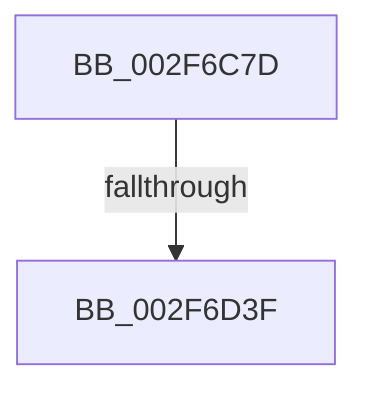

# sub_002F6C7D

- RVA: `0x002F6C7D`–`0x002F6D74` (길이 `247` bytes)
- VA: `0x00000001402F6C7D`
- 실행 섹션: `.text`
- PDB 이름 있음: `아니요`; PDB Function 태그: `아니요`
- unwind 정보 RVA: `0x000722F0`
- 디코드: `56`개 명령, `247/247` bytes 표시
- 미해석 바이트: `0` (있으면 어셈블리에 `.byte`로 보존)

> 이 문서는 커널 이미지의 기계어와 PDB 기호를 분석해 생성했습니다. 4번과 5번은 함수 원형과 자료형을 바이너리 사용 방식에서 추정한 C 해석이며 원본 소스 복구 결과는 아닙니다.

## 1. Dependencies

- 직접 호출 지점: **1**; 고유 호출 대상: **1**
- 직접 호출자로 확인된 함수: **0**
- RIP 상대 이미지 참조: **1**

### Outgoing calls
- `0x002F6D0D` → [MiSystemCacheVaControlArea](../34/MiSystemCacheVaControlArea_function_00348200.md) (function, `0x00348200`)

### Direct callers
- 이 함수 시작 RVA로 연결되는 직접 call은 확인되지 않았습니다. 간접 호출은 완전히 역산할 수 없습니다.

### Static image references
- `0x002F6D26` → RVA `0x00E30088` (`.data`; read)

## 2. Other-region calls and transfers

- 다른 실행 섹션으로 향하는 call: **0**
- call이 아닌 외부 분기/꼬리 이동: **2**
  - `0x002F6D39` → [sub_002F7743](Unknown_function_002F7743.md) (`tail-transfer`)
  - `0x002F6D72` → [sub_002F6D74 + 0x3](Unknown_function_002F6D74.md) (`tail-transfer`)

## 3. Assembly (complete function range)

```asm
002F6C7D  49 89 7B E8                     mov qword ptr [r11 - 0x18], rdi
002F6C81  0F 57 C0                        xorps xmm0, xmm0
002F6C84  4D 89 63 E0                     mov qword ptr [r11 - 0x20], r12
002F6C88  48 8B F9                        mov rdi, rcx
002F6C8B  4D 89 6B D8                     mov qword ptr [r11 - 0x28], r13
002F6C8F  40 B6 01                        mov sil, 1
002F6C92  4D 89 73 D0                     mov qword ptr [r11 - 0x30], r14
002F6C96  49 BA F8 FF FF FF 7F 00 00 00   movabs r10, 0x7ffffffff8
002F6CA0  4D 89 7B C8                     mov qword ptr [r11 - 0x38], r15
002F6CA4  45 33 E4                        xor r12d, r12d
002F6CA7  4C 89 4C 24 60                  mov qword ptr [rsp + 0x60], r9
002F6CAC  45 33 FF                        xor r15d, r15d
002F6CAF  45 8B C8                        mov r9d, r8d
002F6CB2  44 89 44 24 28                  mov dword ptr [rsp + 0x28], r8d
002F6CB7  48 C1 EF 09                     shr rdi, 9
002F6CBB  45 33 C0                        xor r8d, r8d
002F6CBE  49 23 FA                        and rdi, r10
002F6CC1  49 BB 00 00 00 00 80 F6 FF FF   movabs r11, 0xfffff68000000000
002F6CCB  0F 11 44 24 68                  movups xmmword ptr [rsp + 0x68], xmm0
002F6CD0  40 88 74 24 21                  mov byte ptr [rsp + 0x21], sil
002F6CD5  45 33 ED                        xor r13d, r13d
002F6CD8  44 89 44 24 2C                  mov dword ptr [rsp + 0x2c], r8d
002F6CDD  C6 44 24 20 11                  mov byte ptr [rsp + 0x20], 0x11
002F6CE2  49 8B C3                        mov rax, r11
002F6CE5  4C 8D 72 FF                     lea r14, [rdx - 1]
002F6CE9  48 03 F8                        add rdi, rax
002F6CEC  4C 03 F1                        add r14, rcx
002F6CEF  49 C1 EE 09                     shr r14, 9
002F6CF3  4D 23 F2                        and r14, r10
002F6CF6  49 8B C3                        mov rax, r11
002F6CF9  48 8B D7                        mov rdx, rdi
002F6CFC  4C 03 F0                        add r14, rax
002F6CFF  48 C1 EA 09                     shr rdx, 9
002F6D03  49 23 D2                        and rdx, r10
002F6D06  49 8B C3                        mov rax, r11
002F6D09  48 8B 04 02                     mov rax, qword ptr [rdx + rax]
002F6D0D  E8 EE 14 05 00                  call 0x140348200
002F6D12  48 89 44 24 38                  mov qword ptr [rsp + 0x38], rax
002F6D17  BA FF 03 00 00                  mov edx, 0x3ff
002F6D1C  0F B7 40 3C                     movzx eax, word ptr [rax + 0x3c]
002F6D20  66 23 C2                        and ax, dx
002F6D23  0F B7 C8                        movzx ecx, ax
002F6D26  48 8B 05 5B 93 B3 00            mov rax, qword ptr [rip + 0xb3935b]
002F6D2D  48 8B 04 C8                     mov rax, qword ptr [rax + rcx*8]
002F6D31  48 89 44 24 48                  mov qword ptr [rsp + 0x48], rax
002F6D36  49 3B FE                        cmp rdi, r14
002F6D39  0F 86 04 0A 00 00               jbe 0x1402f7743
002F6D3F  48 8B 4C 24 60                  mov rcx, qword ptr [rsp + 0x60]
002F6D44  41 8B C0                        mov eax, r8d
002F6D47  4C 8B BC 24 10 01 00 00         mov r15, qword ptr [rsp + 0x110]
002F6D4F  4C 8B B4 24 18 01 00 00         mov r14, qword ptr [rsp + 0x118]
002F6D57  4C 8B AC 24 20 01 00 00         mov r13, qword ptr [rsp + 0x120]
002F6D5F  4C 8B A4 24 28 01 00 00         mov r12, qword ptr [rsp + 0x128]
002F6D67  48 8B BC 24 30 01 00 00         mov rdi, qword ptr [rsp + 0x130]
002F6D6F  48 85 C9                        test rcx, rcx
002F6D72  74 03                           je 0x1402f6d77
```

## 4. C-style interpretation (structured pseudocode)

```c
__int64 __fastcall sub_002F6C7D(__int64 a1, __int64 a2, int a3, __int64 a4, __int64 a5, __int64 a6, __int64 a7, __int64 a8, __int64 a9, __int64 a10, __int64 a11, __int64 a12, __int64 a13, __int64 a14, __int64 a15, __int64 a16, __int64 a17, __int64 a18, __int64 a19, __int64 a20, __int64 a21, __int64 a22, __int64 a23, __int64 a24, __int64 a25, __int64 a26, __int64 a27, __int64 a28, __int64 a29, __int64 a30, __int64 a31, __int64 a32, __int64 a33, __int64 a34, __int64 a35, __int64 a36, __int64 a37, __int64 a38)
{
    __int64 result;
    __int64 v_r12;
    __int64 v_r13;
    __int64 v_r14;
    __int64 v_r15;
    __int64 v_rdi;
    unsigned __int8 v_stack_p20;
    unsigned __int8 v_stack_p21;
    unsigned int v_stack_p28;
    unsigned int v_stack_p2C;
    unsigned __int64 v_stack_p38;
    unsigned __int64 v_stack_p48;
    unsigned __int64 v_stack_p60;

    *(unsigned __int64 *)(v_r11 - 24) = v_rdi;
    *(unsigned __int64 *)(v_r11 - 32) = v_r12;
    *(unsigned __int64 *)(v_r11 - 40) = v_r13;
    *(unsigned __int64 *)(v_r11 - 48) = v_r14;
    *(unsigned __int64 *)(v_r11 - 56) = v_r15;
    v_r12 = 0;
    v_stack_p60 = a4;
    v_r15 = 0;
    v_stack_p28 = a3;
    v_rdi = (a1) >> (9);
    a3 = 0;
    v_rdi = (v_rdi) & (v_r10);
    a13 = v_xmm0;
    v_stack_p21 = 1;
    v_r13 = 0;
    v_stack_p2C = 0;
    v_stack_p20 = 17;
    v_rdi = (v_rdi) + (v_r11);
    v_r14 = (a2 - 1) + (a1);
    v_r14 = (v_r14) >> (9);
    v_r14 = (v_r14) & (v_r10);
    v_r14 = (v_r14) + (v_r11);
    a2 = (v_rdi) >> (9);
    a2 = (a2) & (v_r10);
    result = MiSystemCacheVaControlArea(a1, a2, a3, (unsigned int)(a3));
    v_stack_p38 = result;
    result = (unsigned __int16)((*(unsigned __int16 *)(result + 60)) & ((unsigned __int16)((unsigned int)(0x3FFULL))));
    v_stack_p48 = *(unsigned __int64 *)(*(unsigned __int64 *)(v_rip + 11768667) + (unsigned __int16)(result) * 8);
}
```

## 5. (Beta) C Style

```c
int64_t sub_002F6C7D(int64_t Arg1, void *Arg2, int32_t Arg3, int64_t Arg4, uint64_t Arg5, uint64_t Arg6, uint64_t Arg7, uint64_t Arg8, uint64_t Arg9, uint64_t Arg10, uint64_t Arg11, int64_t Arg12, int64_t Arg13, uint64_t Arg14, uint64_t Arg15, uint64_t Arg16, uint64_t Arg17, uint64_t Arg18, uint64_t Arg19, uint64_t Arg20, uint64_t Arg21, uint64_t Arg22, uint64_t Arg23, uint64_t Arg24, uint64_t Arg25, uint64_t Arg26, uint64_t Arg27, uint64_t Arg28, uint64_t Arg29, uint64_t Arg30, uint64_t Arg31, uint64_t Arg32, uint64_t Arg33, int64_t Arg34, int64_t Arg35, int64_t Arg36, int64_t Arg37, int64_t Arg38)
{
    uint8_t *arg2 = (uint8_t *)Arg2;

    int64_t result;
    int64_t local_r12;
    int64_t local_r13;
    int64_t local_r14;
    int64_t local_r15;
    int64_t local_rdi;
    uint8_t v_stack_p20;
    uint8_t v_stack_p21;
    uint32_t v_stack_p28;
    uint32_t v_stack_p2C;
    uint64_t v_stack_p38;
    uint64_t v_stack_p48;
    uint64_t v_stack_p60;

    *(uint64_t *)(local_r11 - 0x18) = local_rdi;
    *(uint64_t *)(local_r11 - 0x20) = local_r12;
    *(uint64_t *)(local_r11 - 0x28) = local_r13;
    *(uint64_t *)(local_r11 - 0x30) = local_r14;
    *(uint64_t *)(local_r11 - 0x38) = local_r15;
    local_r12 = 0;
    v_stack_p60 = Arg4;
    local_r15 = 0;
    v_stack_p28 = Arg3;
    local_rdi = (Arg1) >> (9);
    Arg3 = 0;
    local_rdi = (local_rdi) & (local_r10);
    Arg13 = v_xmm0;
    v_stack_p21 = 1;
    local_r13 = 0;
    v_stack_p2C = 0;
    v_stack_p20 = 17;
    local_rdi = (local_rdi) + (local_r11);
    local_r14 = (Arg2 - 1) + (Arg1);
    local_r14 = (local_r14) >> (9);
    local_r14 = (local_r14) & (local_r10);
    local_r14 = (local_r14) + (local_r11);
    Arg2 = (local_rdi) >> (9);
    Arg2 = (Arg2) & (local_r10);
    result = MiSystemCacheVaControlArea(Arg1, Arg2, Arg3, (uint32_t)(Arg3));
    v_stack_p38 = result;
    result = (uint16_t)((*(uint16_t *)(result + 0x3C)) & ((uint16_t)((uint32_t)(0x3FFULL))));
    v_stack_p48 = *(uint64_t *)(*(uint64_t *)(v_rip + 0xB3935B) + (uint16_t)(result) * 8);
}
```

### 관측된 메모리 오프셋

구조체 형식이 확인되지 않은 접근은 인자 기준의 오프셋으로만 기록했습니다.

| 기준 인자 | 오프셋 표현 | 폭 (bit) | 접근 |
|---|---:|---:|---|
| `Arg2` | `- 0x1` | `64` | `R` |

## 6. Execution-region graph

[열기: 2D/3D 그래프와 함수 탐색 컨트롤 패널](../../../control-panel.html?section=text&rva=0x002F6C7D&view=graph)

- 2D 그래프는 위에서 아래로 흐르고, 3D 그래프는 빈 공간을 드래그해 회전합니다. Shift+드래그는 이동, 휠은 확대·축소, 함수 노드 선택은 대상 보고서 이동입니다.

### Static fallback


