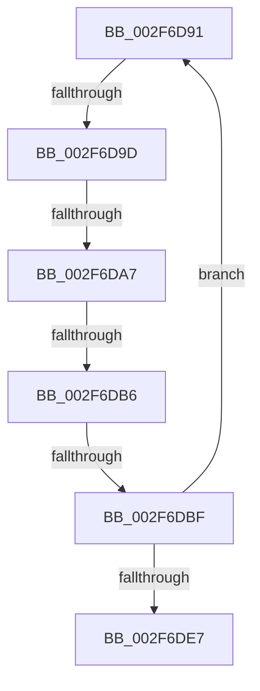

# sub_002F6D91

- RVA: `0x002F6D91`–`0x002F6DF4` (길이 `99` bytes)
- VA: `0x00000001402F6D91`
- 실행 섹션: `.text`
- PDB 이름 있음: `아니요`; PDB Function 태그: `아니요`
- unwind 정보 RVA: `0x00072328`
- 디코드: `20`개 명령, `99/99` bytes 표시
- 미해석 바이트: `0` (있으면 어셈블리에 `.byte`로 보존)

> 이 문서는 커널 이미지의 기계어와 PDB 기호를 분석해 생성했습니다. 4번과 5번은 함수 원형과 자료형을 바이너리 사용 방식에서 추정한 C 해석이며 원본 소스 복구 결과는 아닙니다.

## 1. Dependencies

- 직접 호출 지점: **0**; 고유 호출 대상: **0**
- 직접 호출자로 확인된 함수: **0**
- RIP 상대 이미지 참조: **0**

### Outgoing calls
- 직접 디코드된 call 명령이 없습니다.

### Direct callers
- 이 함수 시작 RVA로 연결되는 직접 call은 확인되지 않았습니다. 간접 호출은 완전히 역산할 수 없습니다.

### Static image references
- 디코드된 RIP-relative 메모리 참조가 없습니다.

## 2. Other-region calls and transfers

- 다른 실행 섹션으로 향하는 call: **0**
- call이 아닌 외부 분기/꼬리 이동: **5**
  - `0x002F6D97` → [sub_002F6E32](Unknown_function_002F6E32.md) (`tail-transfer`)
  - `0x002F6DA1` → [sub_002F6E32 + 0x616](Unknown_function_002F6E32.md) (`tail-transfer`)
  - `0x002F6DB0` → [sub_002F6E32 + 0x97](Unknown_function_002F6E32.md) (`tail-transfer`)
  - `0x002F6DB9` → [sub_002F6E32 + 0x97](Unknown_function_002F6E32.md) (`tail-transfer`)
  - `0x002F6DF2` → [sub_002F6DF4 + 0xD](Unknown_function_002F6DF4.md) (`tail-transfer`)

## 3. Assembly (complete function range)

```asm
002F6D91  48 8B 1F                        mov rbx, qword ptr [rdi]
002F6D94  F6 C3 01                        test bl, 1
002F6D97  0F 84 95 00 00 00               je 0x1402f6e32
002F6D9D  41 F6 C1 04                     test r9b, 4
002F6DA1  0F 85 A1 06 00 00               jne 0x1402f7448
002F6DA7  33 C0                           xor eax, eax
002F6DA9  48 83 C7 08                     add rdi, 8
002F6DAD  45 85 E4                        test r12d, r12d
002F6DB0  0F 85 13 01 00 00               jne 0x1402f6ec9
002F6DB6  48 85 C0                        test rax, rax
002F6DB9  0F 85 0A 01 00 00               jne 0x1402f6ec9
002F6DBF  44 8B 4C 24 28                  mov r9d, dword ptr [rsp + 0x28]
002F6DC4  48 BA FF FF FF FF FF 00 00 00   movabs rdx, 0xffffffffff
002F6DCE  49 B8 28 00 00 00 00 DE FF FF   movabs r8, 0xffffde0000000028
002F6DD8  49 BA 00 00 00 00 00 DE FF FF   movabs r10, 0xffffde0000000000
002F6DE2  49 3B FE                        cmp rdi, r14
002F6DE5  76 AA                           jbe 0x1402f6d91
002F6DE7  48 8B 9C 24 38 01 00 00         mov rbx, qword ptr [rsp + 0x138]
002F6DEF  4D 85 ED                        test r13, r13
002F6DF2  74 0D                           je 0x1402f6e01
```

## 4. C-style interpretation (structured pseudocode)

```c
__int64 __fastcall sub_002F6D91(__int64 a1, __int64 a2, __int64 a3, unsigned __int8 a4, unsigned int a5, __int64 a6, __int64 a7, __int64 a8, __int64 a9, __int64 a10, __int64 a11, __int64 a12, __int64 a13, __int64 a14, __int64 a15, __int64 a16, __int64 a17, __int64 a18, __int64 a19, __int64 a20, __int64 a21, __int64 a22, __int64 a23, __int64 a24, __int64 a25, __int64 a26, __int64 a27, __int64 a28, __int64 a29, __int64 a30, __int64 a31, __int64 a32, __int64 a33, __int64 a34, __int64 a35, __int64 a36, __int64 a37, __int64 a38, __int64 a39)
{
    __int64 result;
    __int64 v_rdi;

    result = 0;
    v_rdi = (v_rdi) + (8);
    if (v_rdi <= v_r14) goto loc_002F6D91;
}
```

## 5. (Beta) C Style

```c
int64_t sub_002F6D91(int64_t Arg1, int64_t Arg2, int64_t Arg3, uint8_t Arg4, uint32_t Arg5, uint64_t Arg6, uint64_t Arg7, uint64_t Arg8, uint64_t Arg9, uint64_t Arg10, uint64_t Arg11, uint64_t Arg12, uint64_t Arg13, uint64_t Arg14, uint64_t Arg15, uint64_t Arg16, uint64_t Arg17, uint64_t Arg18, uint64_t Arg19, uint64_t Arg20, uint64_t Arg21, uint64_t Arg22, uint64_t Arg23, uint64_t Arg24, uint64_t Arg25, uint64_t Arg26, uint64_t Arg27, uint64_t Arg28, uint64_t Arg29, uint64_t Arg30, uint64_t Arg31, uint64_t Arg32, uint64_t Arg33, uint64_t Arg34, uint64_t Arg35, uint64_t Arg36, uint64_t Arg37, uint64_t Arg38, int64_t Arg39)
{
    int64_t result;
    int64_t local_rdi;

    result = 0;
    local_rdi = (local_rdi) + (8);
    if (local_rdi <= local_r14) goto loc_002F6D91;
}
```

## 6. Execution-region graph

[열기: 2D/3D 그래프와 함수 탐색 컨트롤 패널](../../../control-panel.html?section=text&rva=0x002F6D91&view=graph)

- 2D 그래프는 위에서 아래로 흐르고, 3D 그래프는 빈 공간을 드래그해 회전합니다. Shift+드래그는 이동, 휠은 확대·축소, 함수 노드 선택은 대상 보고서 이동입니다.

### Static fallback


