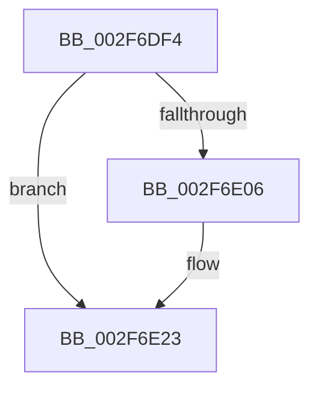

# sub_002F6DF4

- RVA: `0x002F6DF4`–`0x002F6E32` (길이 `62` bytes)
- VA: `0x00000001402F6DF4`
- 실행 섹션: `.text`
- PDB 이름 있음: `아니요`; PDB Function 태그: `아니요`
- unwind 정보 RVA: `0x00072350`
- 디코드: `15`개 명령, `62/62` bytes 표시
- 미해석 바이트: `0` (있으면 어셈블리에 `.byte`로 보존)

> 이 문서는 커널 이미지의 기계어와 PDB 기호를 분석해 생성했습니다. 4번과 5번은 함수 원형과 자료형을 바이너리 사용 방식에서 추정한 C 해석이며 원본 소스 복구 결과는 아닙니다.

## 1. Dependencies

- 직접 호출 지점: **2**; 고유 호출 대상: **2**
- 직접 호출자로 확인된 함수: **0**
- RIP 상대 이미지 참조: **0**

### Outgoing calls
- `0x002F6DFC` → [MiUnlockProtoPoolPage](../24/MiUnlockProtoPoolPage_function_00246090.md) (function, `0x00246090`)
- `0x002F6E1E` → [MiMakeSystemCacheRangeValid](../34/MiMakeSystemCacheRangeValid_function_00347440.md) (function, `0x00347440`)

### Direct callers
- 이 함수 시작 RVA로 연결되는 직접 call은 확인되지 않았습니다. 간접 호출은 완전히 역산할 수 없습니다.

### Static image references
- 디코드된 RIP-relative 메모리 참조가 없습니다.

## 2. Other-region calls and transfers

- 다른 실행 섹션으로 향하는 call: **0**
- call이 아닌 외부 분기/꼬리 이동: **1**
  - `0x002F6E2D` → [sub_002F6C7D + 0xC2](Unknown_function_002F6C7D.md) (`tail-transfer`)

## 3. Assembly (complete function range)

```asm
002F6DF4  0F B6 54 24 20                  movzx edx, byte ptr [rsp + 0x20]
002F6DF9  49 8B CD                        mov rcx, r13
002F6DFC  E8 8F F2 F4 FF                  call 0x140246090
002F6E01  45 85 E4                        test r12d, r12d
002F6E04  74 1D                           je 0x1402f6e23
002F6E06  41 8B CC                        mov ecx, r12d
002F6E09  48 8D 94 24 80 00 00 00         lea rdx, [rsp + 0x80]
002F6E11  48 C1 E1 03                     shl rcx, 3
002F6E15  45 8B C4                        mov r8d, r12d
002F6E18  48 2B F9                        sub rdi, rcx
002F6E1B  48 8B CF                        mov rcx, rdi
002F6E1E  E8 1D 06 05 00                  call 0x140347440
002F6E23  0F B6 74 24 21                  movzx esi, byte ptr [rsp + 0x21]
002F6E28  44 8B 44 24 2C                  mov r8d, dword ptr [rsp + 0x2c]
002F6E2D  E9 0D FF FF FF                  jmp 0x1402f6d3f
```

## 4. C-style interpretation (structured pseudocode)

```c
__int64 __fastcall sub_002F6DF4(__int64 a1, __int64 a2, __int64 a3, __int64 a4, __int64 a5, __int64 a6, __int64 a7, __int64 a8, __int64 a9, __int64 a10, __int64 a11, __int64 a12, __int64 a13, __int64 a14, __int64 a15, __int64 a16)
{
    __int64 result;
    __int64 v_rdi;
    unsigned __int8 v_stack_p20;
    unsigned __int8 v_stack_p21;
    unsigned int v_stack_p2C;

    result = MiUnlockProtoPoolPage(v_r13, v_stack_p20, a3, a4);
    if ((unsigned int)(v_r12) != 0) {
        a1 = (unsigned int)(v_r12);
        a2 = a16;
        a1 = (a1) << (3);
        a3 = (unsigned int)(v_r12);
        v_rdi = (v_rdi) - (a1);
        a1 = v_rdi;
        result = MiMakeSystemCacheRangeValid(a1, a2, a3, a4);
    }
}
```

## 5. (Beta) C Style

```c
int64_t sub_002F6DF4(int64_t Arg1, int64_t Arg2, int64_t Arg3, int64_t Arg4, uint64_t Arg5, uint64_t Arg6, uint64_t Arg7, uint64_t Arg8, uint64_t Arg9, uint64_t Arg10, uint64_t Arg11, uint64_t Arg12, uint64_t Arg13, uint64_t Arg14, uint64_t Arg15, int64_t Arg16)
{
    int64_t result;
    int64_t local_rdi;
    uint8_t v_stack_p20;
    uint8_t v_stack_p21;
    uint32_t v_stack_p2C;

    result = MiUnlockProtoPoolPage(local_r13, v_stack_p20, Arg3, Arg4);
    if ((uint32_t)(local_r12) != 0) {
        Arg1 = (uint32_t)(local_r12);
        Arg2 = Arg16;
        Arg1 = (Arg1) << (3);
        Arg3 = (uint32_t)(local_r12);
        local_rdi = (local_rdi) - (Arg1);
        Arg1 = local_rdi;
        result = MiMakeSystemCacheRangeValid(Arg1, Arg2, Arg3, Arg4);
    }
}
```

## 6. Execution-region graph

[열기: 2D/3D 그래프와 함수 탐색 컨트롤 패널](../../../control-panel.html?section=text&rva=0x002F6DF4&view=graph)

- 2D 그래프는 위에서 아래로 흐르고, 3D 그래프는 빈 공간을 드래그해 회전합니다. Shift+드래그는 이동, 휠은 확대·축소, 함수 노드 선택은 대상 보고서 이동입니다.

### Static fallback


