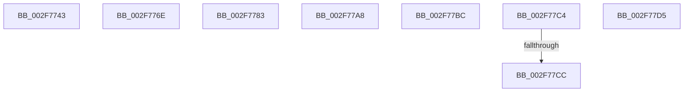

# sub_002F7743

- RVA: `0x002F7743`–`0x002F77E7` (길이 `164` bytes)
- VA: `0x00000001402F7743`
- 실행 섹션: `.text`
- PDB 이름 있음: `아니요`; PDB Function 태그: `아니요`
- unwind 정보 RVA: `0x0007239C`
- 디코드: `33`개 명령, `164/164` bytes 표시
- 미해석 바이트: `0` (있으면 어셈블리에 `.byte`로 보존)

> 이 문서는 커널 이미지의 기계어와 PDB 기호를 분석해 생성했습니다. 4번과 5번은 함수 원형과 자료형을 바이너리 사용 방식에서 추정한 C 해석이며 원본 소스 복구 결과는 아닙니다.

## 1. Dependencies

- 직접 호출 지점: **2**; 고유 호출 대상: **2**
- 직접 호출자로 확인된 함수: **0**
- RIP 상대 이미지 참조: **0**

### Outgoing calls
- `0x002F7776` → [MiUnlockProtoPoolPage](../24/MiUnlockProtoPoolPage_function_00246090.md) (function, `0x00246090`)
- `0x002F779B` → [MiMakeSystemCacheRangeValid](../34/MiMakeSystemCacheRangeValid_function_00347440.md) (function, `0x00347440`)

### Direct callers
- 이 함수 시작 RVA로 연결되는 직접 call은 확인되지 않았습니다. 간접 호출은 완전히 역산할 수 없습니다.

### Static image references
- 디코드된 RIP-relative 메모리 참조가 없습니다.

## 2. Other-region calls and transfers

- 다른 실행 섹션으로 향하는 call: **0**
- call이 아닌 외부 분기/꼬리 이동: **8**
  - `0x002F7769` → [sub_002F6D91](Unknown_function_002F6D91.md) (`tail-transfer`)
  - `0x002F777E` → [sub_002F6E32 + 0x61F](Unknown_function_002F6E32.md) (`tail-transfer`)
  - `0x002F77A3` → [sub_002F6E32 + 0x5B](Unknown_function_002F6E32.md) (`tail-transfer`)
  - `0x002F77B7` → [sub_002F6D91 + 0x16](Unknown_function_002F6D91.md) (`tail-transfer`)
  - `0x002F77BF` → [sub_002F6D91 + 0x2E](Unknown_function_002F6D91.md) (`tail-transfer`)
  - `0x002F77C6` → [sub_006DF29A + 0x67](../6D/Unknown_function_006DF29A.md) (`tail-transfer`)
  - `0x002F77D0` → [sub_002F6E32 + 0x2C1](Unknown_function_002F6E32.md) (`tail-transfer`)
  - `0x002F77E2` → [sub_002F6E32 + 0x746](Unknown_function_002F6E32.md) (`tail-transfer`)

## 3. Assembly (complete function range)

```asm
002F7743  48 89 9C 24 38 01 00 00         mov qword ptr [rsp + 0x138], rbx
002F774B  48 BA FF FF FF FF FF 00 00 00   movabs rdx, 0xffffffffff
002F7755  49 B8 28 00 00 00 00 DE FF FF   movabs r8, 0xffffde0000000028
002F775F  49 BA 00 00 00 00 00 DE FF FF   movabs r10, 0xffffde0000000000
002F7769  E9 23 F6 FF FF                  jmp 0x1402f6d91
002F776E  0F B6 54 24 20                  movzx edx, byte ptr [rsp + 0x20]
002F7773  49 8B CD                        mov rcx, r13
002F7776  E8 15 E9 F4 FF                  call 0x140246090
002F777B  45 33 ED                        xor r13d, r13d
002F777E  E9 CE FC FF FF                  jmp 0x1402f7451
002F7783  41 8B C4                        mov eax, r12d
002F7786  48 8D 94 24 80 00 00 00         lea rdx, [rsp + 0x80]
002F778E  48 C1 E0 03                     shl rax, 3
002F7792  48 8B CF                        mov rcx, rdi
002F7795  48 2B C8                        sub rcx, rax
002F7798  45 8B C4                        mov r8d, r12d
002F779B  E8 A0 FC 04 00                  call 0x140347440
002F77A0  45 33 E4                        xor r12d, r12d
002F77A3  E9 E5 F6 FF FF                  jmp 0x1402f6e8d
002F77A8  48 B8 FF FF FF FF FF FF FF 7F   movabs rax, 0x7fffffffffffffff
002F77B2  F0 48 21 46 18                  lock and qword ptr [rsi + 0x18], rax
002F77B7  E9 EB F5 FF FF                  jmp 0x1402f6da7
002F77BC  45 33 FF                        xor r15d, r15d
002F77BF  E9 FB F5 FF FF                  jmp 0x1402f6dbf
002F77C4  85 C9                           test ecx, ecx
002F77C6  0F 85 35 7B 3E 00               jne 0x1406df301
002F77CC  41 83 C8 08                     or r8d, 8
002F77D0  E9 1E F9 FF FF                  jmp 0x1402f70f3
002F77D5  8B 4C 24 2C                     mov ecx, dword ptr [rsp + 0x2c]
002F77D9  85 C9                           test ecx, ecx
002F77DB  0F 49 C8                        cmovns ecx, eax
002F77DE  89 4C 24 2C                     mov dword ptr [rsp + 0x2c], ecx
002F77E2  E9 91 FD FF FF                  jmp 0x1402f7578
```

## 4. C-style interpretation (structured pseudocode)

```c
__int64 __fastcall sub_002F7743(void)
{
    unsigned __int64 v_stack_p138;
    unsigned __int8 v_stack_p20;
    unsigned int v_stack_p2C;
    unsigned __int64 v_stack_p80;

    v_stack_p138 = v_rbx;
}
```

## 5. (Beta) C Style

```c
void sub_002F7743(void)
{
    uint64_t v_stack_p138;
    uint8_t v_stack_p20;
    uint32_t v_stack_p2C;
    uint64_t v_stack_p80;

    v_stack_p138 = local_rbx;
}
```

## 6. Execution-region graph

[열기: 2D/3D 그래프와 함수 탐색 컨트롤 패널](../../../control-panel.html?section=text&rva=0x002F7743&view=graph)

- 2D 그래프는 위에서 아래로 흐르고, 3D 그래프는 빈 공간을 드래그해 회전합니다. Shift+드래그는 이동, 휠은 확대·축소, 함수 노드 선택은 대상 보고서 이동입니다.

### Static fallback


