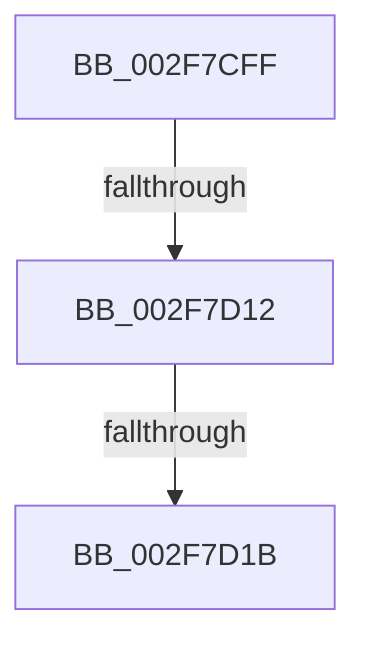

# sub_002F7CFF

- RVA: `0x002F7CFF`–`0x002F7D3D` (길이 `62` bytes)
- VA: `0x00000001402F7CFF`
- 실행 섹션: `.text`
- PDB 이름 있음: `아니요`; PDB Function 태그: `아니요`
- unwind 정보 RVA: `0x0007244C`
- 디코드: `14`개 명령, `62/62` bytes 표시
- 미해석 바이트: `0` (있으면 어셈블리에 `.byte`로 보존)

> 이 문서는 커널 이미지의 기계어와 PDB 기호를 분석해 생성했습니다. 4번과 5번은 함수 원형과 자료형을 바이너리 사용 방식에서 추정한 C 해석이며 원본 소스 복구 결과는 아닙니다.

## 1. Dependencies

- 직접 호출 지점: **1**; 고유 호출 대상: **1**
- 직접 호출자로 확인된 함수: **0**
- RIP 상대 이미지 참조: **1**

### Outgoing calls
- `0x002F7D12` → [KeAreInterruptsEnabled](KeAreInterruptsEnabled_function_002F8060.md) (function, `0x002F8060`)

### Direct callers
- 이 함수 시작 RVA로 연결되는 직접 call은 확인되지 않았습니다. 간접 호출은 완전히 역산할 수 없습니다.

### Static image references
- `0x002F7D24` → RVA `0x00FC507C` (`ALMOSTRO`; read)

## 2. Other-region calls and transfers

- 다른 실행 섹션으로 향하는 call: **0**
- call이 아닌 외부 분기/꼬리 이동: **3**
  - `0x002F7D0C` → [sub_002F7E25](Unknown_function_002F7E25.md) (`tail-transfer`)
  - `0x002F7D19` → [sub_002F7D3D](Unknown_function_002F7D3D.md) (`tail-transfer`)
  - `0x002F7D37` → [sub_002F7FAE](Unknown_function_002F7FAE.md) (`tail-transfer`)

## 3. Assembly (complete function range)

```asm
002F7CFF  4C 89 7C 24 48                  mov qword ptr [rsp + 0x48], r15
002F7D04  45 0F 20 C7                     mov r15, cr8
002F7D08  41 80 FF 02                     cmp r15b, 2
002F7D0C  0F 83 13 01 00 00               jae 0x1402f7e25
002F7D12  E8 49 03 00 00                  call 0x1402f8060
002F7D17  84 C0                           test al, al
002F7D19  75 22                           jne 0x1402f7d3d
002F7D1B  65 48 8B 0C 25 E8 88 00 00      mov rcx, qword ptr gs:[0x88e8]
002F7D24  8B 05 52 D3 CC 00               mov eax, dword ptr [rip + 0xccd352]
002F7D2A  48 83 C1 50                     add rcx, 0x50
002F7D2E  48 8B D1                        mov rdx, rcx
002F7D31  48 2B D0                        sub rdx, rax
002F7D34  48 3B D3                        cmp rdx, rbx
002F7D37  0F 86 71 02 00 00               jbe 0x1402f7fae
```

## 4. C-style interpretation (structured pseudocode)

```c
__int64 __fastcall sub_002F7CFF(void)
{
    __int64 result;
    unsigned __int64 v_stack_p48;

    v_stack_p48 = v_r15;
    result = KeAreInterruptsEnabled(a1, a2, a3, a4);
    a1 = (*(unsigned __int64 *)(gs_base + (0 + 35048))) + (80);
    a2 = (a1) - ((unsigned int)(*(unsigned int *)(v_rip + 13423442)));
}
```

## 5. (Beta) C Style

```c
void sub_002F7CFF(void)
{
    int64_t result;
    uint64_t v_stack_p48;

    v_stack_p48 = local_r15;
    result = KeAreInterruptsEnabled(a1, a2, a3, a4);
    a1 = (*(uint64_t *)(gs_base + (0 + 0x88E8))) + (80);
    a2 = (a1) - ((uint32_t)(*(uint32_t *)(v_rip + 0xCCD352)));
}
```

## 6. Execution-region graph

[열기: 2D/3D 그래프와 함수 탐색 컨트롤 패널](../../../control-panel.html?section=text&rva=0x002F7CFF&view=graph)

- 2D 그래프는 위에서 아래로 흐르고, 3D 그래프는 빈 공간을 드래그해 회전합니다. Shift+드래그는 이동, 휠은 확대·축소, 함수 노드 선택은 대상 보고서 이동입니다.

### Static fallback


