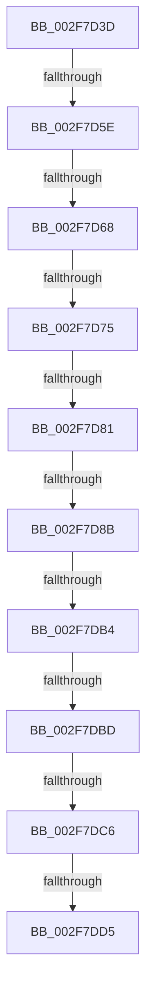

# sub_002F7D3D

- RVA: `0x002F7D3D`–`0x002F7DE0` (길이 `163` bytes)
- VA: `0x00000001402F7D3D`
- 실행 섹션: `.text`
- PDB 이름 있음: `아니요`; PDB Function 태그: `아니요`
- unwind 정보 RVA: `0x00072460`
- 디코드: `37`개 명령, `163/163` bytes 표시
- 미해석 바이트: `0` (있으면 어셈블리에 `.byte`로 보존)

> 이 문서는 커널 이미지의 기계어와 PDB 기호를 분석해 생성했습니다. 4번과 5번은 함수 원형과 자료형을 바이너리 사용 방식에서 추정한 C 해석이며 원본 소스 복구 결과는 아닙니다.

## 1. Dependencies

- 직접 호출 지점: **1**; 고유 호출 대상: **1**
- 직접 호출자로 확인된 함수: **0**
- RIP 상대 이미지 참조: **0**

### Outgoing calls
- `0x002F7D68` → [KeAreInterruptsEnabled](KeAreInterruptsEnabled_function_002F8060.md) (function, `0x002F8060`)

### Direct callers
- 이 함수 시작 RVA로 연결되는 직접 call은 확인되지 않았습니다. 간접 호출은 완전히 역산할 수 없습니다.

### Static image references
- 디코드된 RIP-relative 메모리 참조가 없습니다.

## 2. Other-region calls and transfers

- 다른 실행 섹션으로 향하는 call: **0**
- call이 아닌 외부 분기/꼬리 이동: **9**
  - `0x002F7D58` → [sub_002F7F7F](Unknown_function_002F7F7F.md) (`tail-transfer`)
  - `0x002F7D62` → [sub_002F7E81](Unknown_function_002F7E81.md) (`tail-transfer`)
  - `0x002F7D6F` → [sub_002F7E81 + 0x7B](Unknown_function_002F7E81.md) (`tail-transfer`)
  - `0x002F7D7B` → [sub_002F7E81 + 0x7B](Unknown_function_002F7E81.md) (`tail-transfer`)
  - `0x002F7D85` → [sub_002F7E81 + 0x36](Unknown_function_002F7E81.md) (`tail-transfer`)
  - `0x002F7DAE` → [sub_002F7F7F + 0x21](Unknown_function_002F7F7F.md) (`tail-transfer`)
  - `0x002F7DB7` → [sub_002F7F7F + 0x21](Unknown_function_002F7F7F.md) (`tail-transfer`)
  - `0x002F7DC0` → [sub_002F7F7F + 0x21](Unknown_function_002F7F7F.md) (`tail-transfer`)
  - `0x002F7DCF` → [sub_002F7FCA](Unknown_function_002F7FCA.md) (`tail-transfer`)

## 3. Assembly (complete function range)

```asm
002F7D3D  48 89 6C 24 40                  mov qword ptr [rsp + 0x40], rbp
002F7D42  65 48 8B 2C 25 88 01 00 00      mov rbp, qword ptr gs:[0x188]
002F7D4B  65 48 8B 04 25 A8 01 00 00      mov rax, qword ptr gs:[0x1a8]
002F7D54  48 39 45 28                     cmp qword ptr [rbp + 0x28], rax
002F7D58  0F 85 21 02 00 00               jne 0x1402f7f7f
002F7D5E  41 80 FF 02                     cmp r15b, 2
002F7D62  0F 83 19 01 00 00               jae 0x1402f7e81
002F7D68  E8 F3 02 00 00                  call 0x1402f8060
002F7D6D  84 C0                           test al, al
002F7D6F  0F 84 87 01 00 00               je 0x1402f7efc
002F7D75  44 0F 20 C0                     mov rax, cr8
002F7D79  3C 0F                           cmp al, 0xf
002F7D7B  0F 83 7B 01 00 00               jae 0x1402f7efc
002F7D81  F6 45 7D 01                     test byte ptr [rbp + 0x7d], 1
002F7D85  0F 85 2C 01 00 00               jne 0x1402f7eb7
002F7D8B  33 C0                           xor eax, eax
002F7D8D  38 85 DB 02 00 00               cmp byte ptr [rbp + 0x2db], al
002F7D93  0F 95 C0                        setne al
002F7D96  83 C0 03                        add eax, 3
002F7D99  89 06                           mov dword ptr [rsi], eax
002F7D9B  4C 8B 45 30                     mov r8, qword ptr [rbp + 0x30]
002F7D9F  48 8B 45 30                     mov rax, qword ptr [rbp + 0x30]
002F7DA3  48 8B 4D 38                     mov rcx, qword ptr [rbp + 0x38]
002F7DA7  48 8B 55 38                     mov rdx, qword ptr [rbp + 0x38]
002F7DAB  48 3B CA                        cmp rcx, rdx
002F7DAE  0F 85 EC 01 00 00               jne 0x1402f7fa0
002F7DB4  4C 3B C0                        cmp r8, rax
002F7DB7  0F 87 E3 01 00 00               ja 0x1402f7fa0
002F7DBD  48 3B C2                        cmp rax, rdx
002F7DC0  0F 83 DA 01 00 00               jae 0x1402f7fa0
002F7DC6  48 89 0F                        mov qword ptr [rdi], rcx
002F7DC9  49 89 06                        mov qword ptr [r14], rax
002F7DCC  48 3B C3                        cmp rax, rbx
002F7DCF  0F 87 F5 01 00 00               ja 0x1402f7fca
002F7DD5  48 3B 1F                        cmp rbx, qword ptr [rdi]
002F7DD8  0F 92 C0                        setb al
002F7DDB  48 8B 6C 24 40                  mov rbp, qword ptr [rsp + 0x40]
```

## 4. C-style interpretation (structured pseudocode)

```c
__int64 __fastcall sub_002F7D3D(__int64 a1, __int64 a2, __int64 a3, __int64 a4, __int64 a5, __int64 a6, __int64 a7, __int64 a8)
{
    __int64 result;
    unsigned __int64 v_stack_p40;

    v_stack_p40 = v_rbp;
    result = KeAreInterruptsEnabled(a1, a2, a3, a4);
    result = 0;
    result = ((*(unsigned __int8 *)(*(unsigned __int64 *)(gs_base + (0 + 392)) + 731)) != 0) ? 1 : 0;
    result = (unsigned int)((result) + (3));
    *(unsigned int *)(v_rsi) = (unsigned int)(result);
    *(unsigned __int64 *)(v_rdi) = *(unsigned __int64 *)(*(unsigned __int64 *)(gs_base + (0 + 392)) + 56);
    *(unsigned __int64 *)(v_r14) = *(unsigned __int64 *)(*(unsigned __int64 *)(gs_base + (0 + 392)) + 48);
    result = (v_rbx < (*(unsigned __int64 *)(v_rdi))) ? 1 : 0;
    return result;
}
```

## 5. (Beta) C Style

```c
int64_t sub_002F7D3D(int64_t Arg1, int64_t Arg2, int64_t Arg3, int64_t Arg4, uint64_t Arg5, uint64_t Arg6, uint64_t Arg7, int64_t Arg8)
{
    int64_t result;
    uint64_t v_stack_p40;

    v_stack_p40 = local_rbp;
    result = KeAreInterruptsEnabled(Arg1, Arg2, Arg3, Arg4);
    result = 0;
    result = ((*(uint8_t *)(*(uint64_t *)(gs_base + (0 + 0x188)) + 0x2DB)) != 0) ? 1 : 0;
    result = (uint32_t)((result) + (3));
    *(uint32_t *)(local_rsi) = (uint32_t)(result);
    *(uint64_t *)(local_rdi) = *(uint64_t *)(*(uint64_t *)(gs_base + (0 + 0x188)) + 0x38);
    *(uint64_t *)(local_r14) = *(uint64_t *)(*(uint64_t *)(gs_base + (0 + 0x188)) + 0x30);
    result = (local_rbx < (*(uint64_t *)(local_rdi))) ? 1 : 0;
    return result;
}
```

## 6. Execution-region graph

[열기: 2D/3D 그래프와 함수 탐색 컨트롤 패널](../../../control-panel.html?section=text&rva=0x002F7D3D&view=graph)

- 2D 그래프는 위에서 아래로 흐르고, 3D 그래프는 빈 공간을 드래그해 회전합니다. Shift+드래그는 이동, 휠은 확대·축소, 함수 노드 선택은 대상 보고서 이동입니다.

### Static fallback


