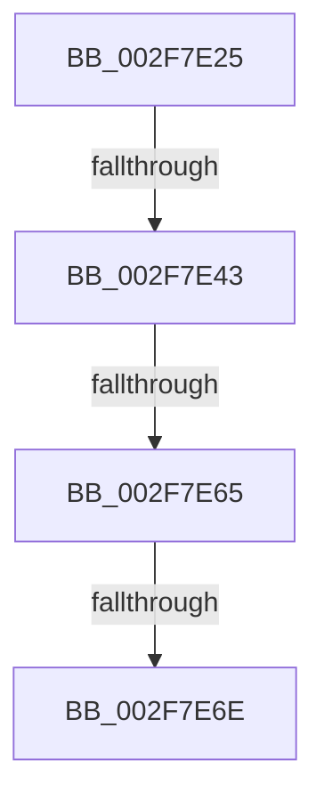

# sub_002F7E25

- RVA: `0x002F7E25`–`0x002F7E81` (길이 `92` bytes)
- VA: `0x00000001402F7E25`
- 실행 섹션: `.text`
- PDB 이름 있음: `아니요`; PDB Function 태그: `아니요`
- unwind 정보 RVA: `0x0007249C`
- 디코드: `20`개 명령, `92/92` bytes 표시
- 미해석 바이트: `0` (있으면 어셈블리에 `.byte`로 보존)

> 이 문서는 커널 이미지의 기계어와 PDB 기호를 분석해 생성했습니다. 4번과 5번은 함수 원형과 자료형을 바이너리 사용 방식에서 추정한 C 해석이며 원본 소스 복구 결과는 아닙니다.

## 1. Dependencies

- 직접 호출 지점: **0**; 고유 호출 대상: **0**
- 직접 호출자로 확인된 함수: **0**
- RIP 상대 이미지 참조: **2**

### Outgoing calls
- 직접 디코드된 call 명령이 없습니다.

### Direct callers
- 이 함수 시작 RVA로 연결되는 직접 call은 확인되지 않았습니다. 간접 호출은 완전히 역산할 수 없습니다.

### Static image references
- `0x002F7E2E` → RVA `0x00FC505C` (`ALMOSTRO`; read)
- `0x002F7E4C` → RVA `0x00FC507C` (`ALMOSTRO`; read)

## 2. Other-region calls and transfers

- 다른 실행 섹션으로 향하는 call: **0**
- call이 아닌 외부 분기/꼬리 이동: **4**
  - `0x002F7E3D` → [sub_002F7F63](Unknown_function_002F7F63.md) (`tail-transfer`)
  - `0x002F7E5F` → [sub_002F7CFF + 0x1C](Unknown_function_002F7CFF.md) (`tail-transfer`)
  - `0x002F7E68` → [sub_002F7CFF + 0x1C](Unknown_function_002F7CFF.md) (`tail-transfer`)
  - `0x002F7E7C` → [sub_002F7DE0](Unknown_function_002F7DE0.md) (`tail-transfer`)

## 3. Assembly (complete function range)

```asm
002F7E25  65 48 8B 14 25 58 91 00 00      mov rdx, qword ptr gs:[0x9158]
002F7E2E  8B 05 28 D2 CC 00               mov eax, dword ptr [rip + 0xccd228]
002F7E34  48 8B CA                        mov rcx, rdx
002F7E37  48 2B C8                        sub rcx, rax
002F7E3A  48 3B CB                        cmp rcx, rbx
002F7E3D  0F 86 20 01 00 00               jbe 0x1402f7f63
002F7E43  65 48 8B 0C 25 E8 88 00 00      mov rcx, qword ptr gs:[0x88e8]
002F7E4C  8B 05 2A D2 CC 00               mov eax, dword ptr [rip + 0xccd22a]
002F7E52  48 83 C1 50                     add rcx, 0x50
002F7E56  48 8B D1                        mov rdx, rcx
002F7E59  48 2B D0                        sub rdx, rax
002F7E5C  48 3B D3                        cmp rdx, rbx
002F7E5F  0F 87 B6 FE FF FF               ja 0x1402f7d1b
002F7E65  48 3B D9                        cmp rbx, rcx
002F7E68  0F 83 AD FE FF FF               jae 0x1402f7d1b
002F7E6E  C7 06 0A 00 00 00               mov dword ptr [rsi], 0xa
002F7E74  B0 01                           mov al, 1
002F7E76  49 89 09                        mov qword ptr [r9], rcx
002F7E79  49 89 10                        mov qword ptr [r8], rdx
002F7E7C  E9 5F FF FF FF                  jmp 0x1402f7de0
```

## 4. C-style interpretation (structured pseudocode)

```c
__int64 __fastcall sub_002F7E25(__int64 a1, __int64 a2, __int64 a3, __int64 a4)
{
    a1 = (*(unsigned __int64 *)(gs_base + (0 + 37208))) - ((unsigned int)(*(unsigned int *)(v_rip + 13423144)));
    a1 = (*(unsigned __int64 *)(gs_base + (0 + 35048))) + (80);
    a2 = (a1) - ((unsigned int)(*(unsigned int *)(v_rip + 13423146)));
    *(unsigned int *)(v_rsi) = 10;
    *(unsigned __int64 *)(a4) = a1;
    *(unsigned __int64 *)(a3) = a2;
}
```

## 5. (Beta) C Style

```c
int64_t sub_002F7E25(int64_t Arg1, int64_t Arg2, void *Arg3, void *Arg4)
{
    uint8_t *arg3 = (uint8_t *)Arg3;
    uint8_t *arg4 = (uint8_t *)Arg4;

    Arg1 = (*(uint64_t *)(gs_base + (0 + 0x9158))) - ((uint32_t)(*(uint32_t *)(v_rip + 0xCCD228)));
    Arg1 = (*(uint64_t *)(gs_base + (0 + 0x88E8))) + (80);
    Arg2 = (Arg1) - ((uint32_t)(*(uint32_t *)(v_rip + 0xCCD22A)));
    *(uint32_t *)(local_rsi) = 10;
    *(uint64_t *)(arg4) = Arg1;
    *(uint64_t *)(arg3) = Arg2;
}
```

### 관측된 메모리 오프셋

구조체 형식이 확인되지 않은 접근은 인자 기준의 오프셋으로만 기록했습니다.

| 기준 인자 | 오프셋 표현 | 폭 (bit) | 접근 |
|---|---:|---:|---|
| `Arg3` | `+ 0x0` | `64` | `W` |
| `Arg4` | `+ 0x0` | `64` | `W` |

## 6. Execution-region graph

[열기: 2D/3D 그래프와 함수 탐색 컨트롤 패널](../../../control-panel.html?section=text&rva=0x002F7E25&view=graph)

- 2D 그래프는 위에서 아래로 흐르고, 3D 그래프는 빈 공간을 드래그해 회전합니다. Shift+드래그는 이동, 휠은 확대·축소, 함수 노드 선택은 대상 보고서 이동입니다.

### Static fallback


