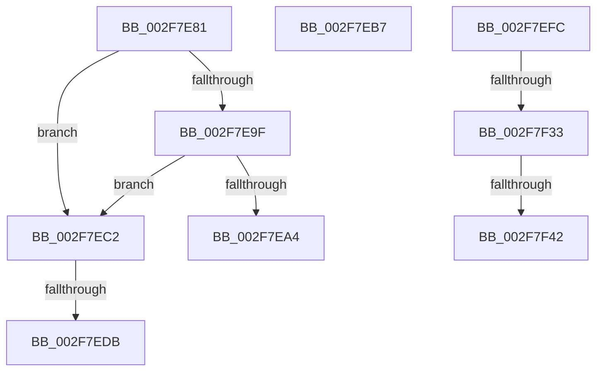

# sub_002F7E81

- RVA: `0x002F7E81`–`0x002F7F63` (길이 `226` bytes)
- VA: `0x00000001402F7E81`
- 실행 섹션: `.text`
- PDB 이름 있음: `아니요`; PDB Function 태그: `아니요`
- unwind 정보 RVA: `0x000724B0`
- 디코드: `47`개 명령, `226/226` bytes 표시
- 미해석 바이트: `0` (있으면 어셈블리에 `.byte`로 보존)

> 이 문서는 커널 이미지의 기계어와 PDB 기호를 분석해 생성했습니다. 4번과 5번은 함수 원형과 자료형을 바이너리 사용 방식에서 추정한 C 해석이며 원본 소스 복구 결과는 아닙니다.

## 1. Dependencies

- 직접 호출 지점: **0**; 고유 호출 대상: **0**
- 직접 호출자로 확인된 함수: **0**
- RIP 상대 이미지 참조: **4**

### Outgoing calls
- 직접 디코드된 call 명령이 없습니다.

### Direct callers
- 이 함수 시작 RVA로 연결되는 직접 call은 확인되지 않았습니다. 간접 호출은 완전히 역산할 수 없습니다.

### Static image references
- `0x002F7E8A` → RVA `0x00FC5020` (`ALMOSTRO`; read)
- `0x002F7ECB` → RVA `0x00F10E00` (`.data`; read)
- `0x002F7F05` → RVA `0x01201840` (`CFGRO`; read)
- `0x002F7F0D` → RVA `0x00FC5060` (`ALMOSTRO`; read)

## 2. Other-region calls and transfers

- 다른 실행 섹션으로 향하는 call: **0**
- call이 아닌 외부 분기/꼬리 이동: **7**
  - `0x002F7EB2` → [sub_002F7D3D + 0x9E](Unknown_function_002F7D3D.md) (`tail-transfer`)
  - `0x002F7EBD` → [sub_002F7D3D + 0x5E](Unknown_function_002F7D3D.md) (`tail-transfer`)
  - `0x002F7ED5` → [sub_002F7D3D + 0x2B](Unknown_function_002F7D3D.md) (`tail-transfer`)
  - `0x002F7EF7` → [sub_002F7D3D + 0x9E](Unknown_function_002F7D3D.md) (`tail-transfer`)
  - `0x002F7F2D` → [sub_002F7FCA + 0x7](Unknown_function_002F7FCA.md) (`tail-transfer`)
  - `0x002F7F3C` → [sub_002F7FCA + 0x7](Unknown_function_002F7FCA.md) (`tail-transfer`)
  - `0x002F7F5E` → [sub_002F7D3D + 0x9E](Unknown_function_002F7D3D.md) (`tail-transfer`)

## 3. Assembly (complete function range)

```asm
002F7E81  65 48 8B 0C 25 20 3A 00 00      mov rcx, qword ptr gs:[0x3a20]
002F7E8A  8B 05 90 D1 CC 00               mov eax, dword ptr [rip + 0xccd190]
002F7E90  48 83 C1 50                     add rcx, 0x50
002F7E94  48 8B D1                        mov rdx, rcx
002F7E97  48 2B D0                        sub rdx, rax
002F7E9A  48 3B D3                        cmp rdx, rbx
002F7E9D  77 23                           ja 0x1402f7ec2
002F7E9F  48 3B D9                        cmp rbx, rcx
002F7EA2  73 1E                           jae 0x1402f7ec2
002F7EA4  C7 06 01 00 00 00               mov dword ptr [rsi], 1
002F7EAA  B0 01                           mov al, 1
002F7EAC  48 89 0F                        mov qword ptr [rdi], rcx
002F7EAF  49 89 16                        mov qword ptr [r14], rdx
002F7EB2  E9 24 FF FF FF                  jmp 0x1402f7ddb
002F7EB7  C7 06 02 00 00 00               mov dword ptr [rsi], 2
002F7EBD  E9 D9 FE FF FF                  jmp 0x1402f7d9b
002F7EC2  65 48 8B 0C 25 20 00 00 00      mov rcx, qword ptr gs:[0x20]
002F7ECB  48 8B 05 2E 8F C1 00            mov rax, qword ptr [rip + 0xc18f2e]
002F7ED2  48 3B C8                        cmp rcx, rax
002F7ED5  0F 85 8D FE FF FF               jne 0x1402f7d68
002F7EDB  C7 06 07 00 00 00               mov dword ptr [rsi], 7
002F7EE1  48 B8 00 00 00 00 00 80 FF FF   movabs rax, 0xffff800000000000
002F7EEB  48 C7 07 FF FF FF FF            mov qword ptr [rdi], 0xffffffffffffffff
002F7EF2  49 89 06                        mov qword ptr [r14], rax
002F7EF5  B0 01                           mov al, 1
002F7EF7  E9 DF FE FF FF                  jmp 0x1402f7ddb
002F7EFC  65 48 8B 04 25 18 00 00 00      mov rax, qword ptr gs:[0x18]
002F7F05  44 0F B6 05 33 99 F0 00         movzx r8d, byte ptr [rip + 0xf09933]
002F7F0D  44 8B 0D 4C D1 CC 00            mov r9d, dword ptr [rip + 0xccd14c]
002F7F14  45 84 C0                        test r8b, r8b
002F7F17  48 8B 48 08                     mov rcx, qword ptr [rax + 8]
002F7F1B  41 8B C1                        mov eax, r9d
002F7F1E  48 8B 51 34                     mov rdx, qword ptr [rcx + 0x34]
002F7F22  B9 D0 01 00 00                  mov ecx, 0x1d0
002F7F27  0F 45 C1                        cmovne eax, ecx
002F7F2A  48 3B DA                        cmp rbx, rdx
002F7F2D  0F 87 9E 00 00 00               ja 0x1402f7fd1
002F7F33  48 8B CA                        mov rcx, rdx
002F7F36  48 2B C8                        sub rcx, rax
002F7F39  48 3B D9                        cmp rbx, rcx
002F7F3C  0F 82 8F 00 00 00               jb 0x1402f7fd1
002F7F42  C7 06 08 00 00 00               mov dword ptr [rsi], 8
002F7F48  48 B8 00 00 00 00 00 80 FF FF   movabs rax, 0xffff800000000000
002F7F52  48 C7 07 FF FF FF FF            mov qword ptr [rdi], 0xffffffffffffffff
002F7F59  49 89 06                        mov qword ptr [r14], rax
002F7F5C  B0 01                           mov al, 1
002F7F5E  E9 78 FE FF FF                  jmp 0x1402f7ddb
```

## 4. C-style interpretation (structured pseudocode)

```c
__int64 __fastcall sub_002F7E81(void)
{
    a1 = (*(unsigned __int64 *)(gs_base + (0 + 14880))) + (80);
    a2 = (a1) - ((unsigned int)(*(unsigned int *)(v_rip + 13422992)));
    if (a2 > v_rbx) goto loc_002F7EC2;
    if (v_rbx >= a1) goto loc_002F7EC2;
    *(unsigned int *)(v_rsi) = 1;
    *(unsigned __int64 *)(v_rdi) = a1;
    *(unsigned __int64 *)(v_r14) = a2;
loc_002F7EC2:
    *(unsigned int *)(v_rsi) = 7;
    *(unsigned __int64 *)(v_rdi) = -1;
    *(unsigned __int64 *)(v_r14) = *(unsigned __int64 *)(v_rip + 12685102);
}
```

## 5. (Beta) C Style

```c
void sub_002F7E81(void)
{
    a1 = (*(uint64_t *)(gs_base + (0 + 0x3A20))) + (80);
    a2 = (a1) - ((uint32_t)(*(uint32_t *)(v_rip + 0xCCD190)));
    if (a2 > local_rbx) goto loc_002F7EC2;
    if (local_rbx >= a1) goto loc_002F7EC2;
    *(uint32_t *)(local_rsi) = 1;
    *(uint64_t *)(local_rdi) = a1;
    *(uint64_t *)(local_r14) = a2;
loc_002F7EC2:
    *(uint32_t *)(local_rsi) = 7;
    *(uint64_t *)(local_rdi) = -1;
    *(uint64_t *)(local_r14) = *(uint64_t *)(v_rip + 0xC18F2E);
}
```

## 6. Execution-region graph

[열기: 2D/3D 그래프와 함수 탐색 컨트롤 패널](../../../control-panel.html?section=text&rva=0x002F7E81&view=graph)

- 2D 그래프는 위에서 아래로 흐르고, 3D 그래프는 빈 공간을 드래그해 회전합니다. Shift+드래그는 이동, 휠은 확대·축소, 함수 노드 선택은 대상 보고서 이동입니다.

### Static fallback


