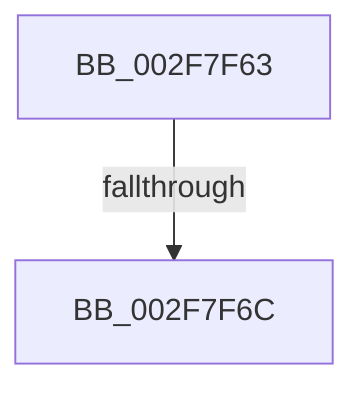

# sub_002F7F63

- RVA: `0x002F7F63`–`0x002F7F7F` (길이 `28` bytes)
- VA: `0x00000001402F7F63`
- 실행 섹션: `.text`
- PDB 이름 있음: `아니요`; PDB Function 태그: `아니요`
- unwind 정보 RVA: `0x000724C8`
- 디코드: `7`개 명령, `28/28` bytes 표시
- 미해석 바이트: `0` (있으면 어셈블리에 `.byte`로 보존)

> 이 문서는 커널 이미지의 기계어와 PDB 기호를 분석해 생성했습니다. 4번과 5번은 함수 원형과 자료형을 바이너리 사용 방식에서 추정한 C 해석이며 원본 소스 복구 결과는 아닙니다.

## 1. Dependencies

- 직접 호출 지점: **0**; 고유 호출 대상: **0**
- 직접 호출자로 확인된 함수: **0**
- RIP 상대 이미지 참조: **0**

### Outgoing calls
- 직접 디코드된 call 명령이 없습니다.

### Direct callers
- 이 함수 시작 RVA로 연결되는 직접 call은 확인되지 않았습니다. 간접 호출은 완전히 역산할 수 없습니다.

### Static image references
- 디코드된 RIP-relative 메모리 참조가 없습니다.

## 2. Other-region calls and transfers

- 다른 실행 섹션으로 향하는 call: **0**
- call이 아닌 외부 분기/꼬리 이동: **2**
  - `0x002F7F66` → [sub_002F7E25 + 0x1E](Unknown_function_002F7E25.md) (`tail-transfer`)
  - `0x002F7F7A` → [sub_002F7DE0](Unknown_function_002F7DE0.md) (`tail-transfer`)

## 3. Assembly (complete function range)

```asm
002F7F63  48 3B DA                        cmp rbx, rdx
002F7F66  0F 83 D7 FE FF FF               jae 0x1402f7e43
002F7F6C  C7 06 06 00 00 00               mov dword ptr [rsi], 6
002F7F72  B0 01                           mov al, 1
002F7F74  49 89 11                        mov qword ptr [r9], rdx
002F7F77  49 89 08                        mov qword ptr [r8], rcx
002F7F7A  E9 61 FE FF FF                  jmp 0x1402f7de0
```

## 4. C-style interpretation (structured pseudocode)

```c
__int64 __fastcall sub_002F7F63(__int64 a1, __int64 a2, __int64 a3, __int64 a4)
{
    *(unsigned int *)(v_rsi) = 6;
    *(unsigned __int64 *)(a4) = a2;
    *(unsigned __int64 *)(a3) = a1;
}
```

## 5. (Beta) C Style

```c
int64_t sub_002F7F63(int64_t Arg1, int64_t Arg2, void *Arg3, void *Arg4)
{
    uint8_t *arg3 = (uint8_t *)Arg3;
    uint8_t *arg4 = (uint8_t *)Arg4;

    *(uint32_t *)(local_rsi) = 6;
    *(uint64_t *)(arg4) = Arg2;
    *(uint64_t *)(arg3) = Arg1;
}
```

### 관측된 메모리 오프셋

구조체 형식이 확인되지 않은 접근은 인자 기준의 오프셋으로만 기록했습니다.

| 기준 인자 | 오프셋 표현 | 폭 (bit) | 접근 |
|---|---:|---:|---|
| `Arg3` | `+ 0x0` | `64` | `W` |
| `Arg4` | `+ 0x0` | `64` | `W` |

## 6. Execution-region graph

[열기: 2D/3D 그래프와 함수 탐색 컨트롤 패널](../../../control-panel.html?section=text&rva=0x002F7F63&view=graph)

- 2D 그래프는 위에서 아래로 흐르고, 3D 그래프는 빈 공간을 드래그해 회전합니다. Shift+드래그는 이동, 휠은 확대·축소, 함수 노드 선택은 대상 보고서 이동입니다.

### Static fallback


