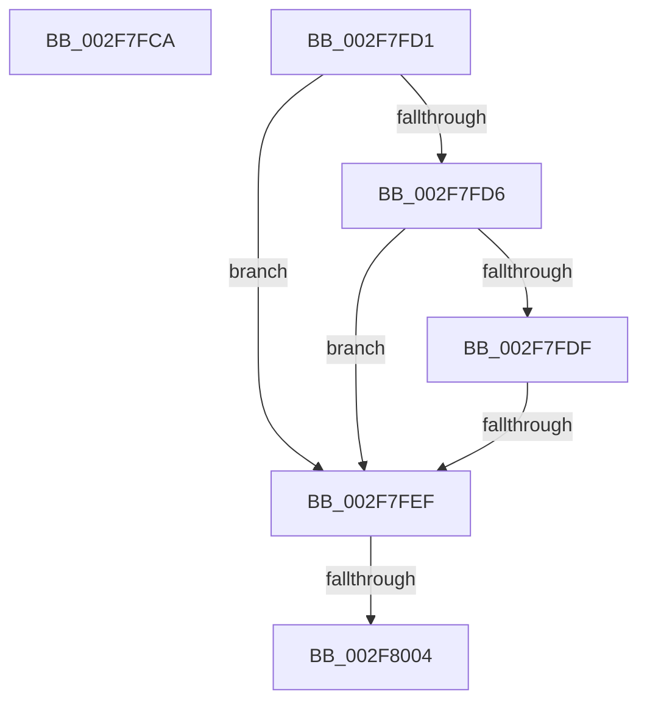

# sub_002F7FCA

- RVA: `0x002F7FCA`–`0x002F8025` (길이 `91` bytes)
- VA: `0x00000001402F7FCA`
- 실행 섹션: `.text`
- PDB 이름 있음: `아니요`; PDB Function 태그: `아니요`
- unwind 정보 RVA: `0x00072508`
- 디코드: `22`개 명령, `91/91` bytes 표시
- 미해석 바이트: `0` (있으면 어셈블리에 `.byte`로 보존)

> 이 문서는 커널 이미지의 기계어와 PDB 기호를 분석해 생성했습니다. 4번과 5번은 함수 원형과 자료형을 바이너리 사용 방식에서 추정한 C 해석이며 원본 소스 복구 결과는 아닙니다.

## 1. Dependencies

- 직접 호출 지점: **1**; 고유 호출 대상: **1**
- 직접 호출자로 확인된 함수: **0**
- RIP 상대 이미지 참조: **0**

### Outgoing calls
- `0x002F7FF7` → [KiRspInIstStack](../41/KiRspInIstStack_function_00418504.md) (function, `0x00418504`)

### Direct callers
- 이 함수 시작 RVA로 연결되는 직접 call은 확인되지 않았습니다. 간접 호출은 완전히 역산할 수 없습니다.

### Static image references
- 디코드된 RIP-relative 메모리 참조가 없습니다.

## 2. Other-region calls and transfers

- 다른 실행 섹션으로 향하는 call: **0**
- call이 아닌 외부 분기/꼬리 이동: **4**
  - `0x002F7FCC` → [sub_002F7D3D + 0x9E](Unknown_function_002F7D3D.md) (`tail-transfer`)
  - `0x002F7FE9` → [sub_002F7E81 + 0xC1](Unknown_function_002F7E81.md) (`tail-transfer`)
  - `0x002F7FFE` → [sub_002F7D3D + 0x44](Unknown_function_002F7D3D.md) (`tail-transfer`)
  - `0x002F8020` → [sub_002F7D3D + 0x9E](Unknown_function_002F7D3D.md) (`tail-transfer`)

## 3. Assembly (complete function range)

```asm
002F7FCA  32 C0                           xor al, al
002F7FCC  E9 0A FE FF FF                  jmp 0x1402f7ddb
002F7FD1  45 84 C0                        test r8b, r8b
002F7FD4  74 19                           je 0x1402f7fef
002F7FD6  4C 8B 42 08                     mov r8, qword ptr [rdx + 8]
002F7FDA  49 3B D8                        cmp rbx, r8
002F7FDD  77 10                           ja 0x1402f7fef
002F7FDF  41 8D 49 E0                     lea ecx, [r9 - 0x20]
002F7FE3  4C 2B C1                        sub r8, rcx
002F7FE6  49 3B D8                        cmp rbx, r8
002F7FE9  0F 83 53 FF FF FF               jae 0x1402f7f42
002F7FEF  48 8B D3                        mov rdx, rbx
002F7FF2  B9 02 00 00 00                  mov ecx, 2
002F7FF7  E8 08 05 12 00                  call 0x140418504
002F7FFC  85 C0                           test eax, eax
002F7FFE  0F 84 7D FD FF FF               je 0x1402f7d81
002F8004  C7 06 09 00 00 00               mov dword ptr [rsi], 9
002F800A  48 B8 00 00 00 00 00 80 FF FF   movabs rax, 0xffff800000000000
002F8014  48 C7 07 FF FF FF FF            mov qword ptr [rdi], 0xffffffffffffffff
002F801B  49 89 06                        mov qword ptr [r14], rax
002F801E  B0 01                           mov al, 1
002F8020  E9 B6 FD FF FF                  jmp 0x1402f7ddb
```

## 4. C-style interpretation (structured pseudocode)

```c
__int64 __fastcall sub_002F7FCA(__int64 a1, __int64 a2, unsigned __int8 a3, __int64 a4)
{
    __int64 result;

    result = 0;
}
```

## 5. (Beta) C Style

```c
int64_t sub_002F7FCA(int64_t Arg1, int64_t Arg2, uint8_t Arg3, int64_t Arg4)
{
    int64_t result;

    result = 0;
}
```

## 6. Execution-region graph

[열기: 2D/3D 그래프와 함수 탐색 컨트롤 패널](../../../control-panel.html?section=text&rva=0x002F7FCA&view=graph)

- 2D 그래프는 위에서 아래로 흐르고, 3D 그래프는 빈 공간을 드래그해 회전합니다. Shift+드래그는 이동, 휠은 확대·축소, 함수 노드 선택은 대상 보고서 이동입니다.

### Static fallback


