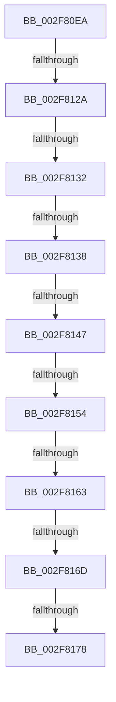

# sub_002F80EA

- RVA: `0x002F80EA`–`0x002F819B` (길이 `177` bytes)
- VA: `0x00000001402F80EA`
- 실행 섹션: `.text`
- PDB 이름 있음: `아니요`; PDB Function 태그: `아니요`
- unwind 정보 RVA: `0x00072540`
- 디코드: `43`개 명령, `177/177` bytes 표시
- 미해석 바이트: `0` (있으면 어셈블리에 `.byte`로 보존)

> 이 문서는 커널 이미지의 기계어와 PDB 기호를 분석해 생성했습니다. 4번과 5번은 함수 원형과 자료형을 바이너리 사용 방식에서 추정한 C 해석이며 원본 소스 복구 결과는 아닙니다.

## 1. Dependencies

- 직접 호출 지점: **2**; 고유 호출 대상: **2**
- 직접 호출자로 확인된 함수: **0**
- RIP 상대 이미지 참조: **1**

### Outgoing calls
- `0x002F8105` → [KeGetCurrentStackPointer](../6B/KeGetCurrentStackPointer_function_006B1070.md) (function, `0x006B1070`)
- `0x002F811D` → [KeAreInterruptsEnabled](KeAreInterruptsEnabled_function_002F8060.md) (function, `0x002F8060`)

### Direct callers
- 이 함수 시작 RVA로 연결되는 직접 call은 확인되지 않았습니다. 간접 호출은 완전히 역산할 수 없습니다.

### Static image references
- `0x002F8138` → RVA `0x00FC5020` (`ALMOSTRO`; read)

## 2. Other-region calls and transfers

- 다른 실행 섹션으로 향하는 call: **0**
- call이 아닌 외부 분기/꼬리 이동: **8**
  - `0x002F8124` → [sub_002F819C + 0x71](Unknown_function_002F819C.md) (`tail-transfer`)
  - `0x002F8130` → [sub_002F819C](Unknown_function_002F819C.md) (`tail-transfer`)
  - `0x002F8132` → [sub_002F819C + 0x73](Unknown_function_002F819C.md) (`tail-transfer`)
  - `0x002F8141` → [sub_002F8270 + 0xC](Unknown_function_002F8270.md) (`tail-transfer`)
  - `0x002F814E` → [sub_002F8270](Unknown_function_002F8270.md) (`tail-transfer`)
  - `0x002F815D` → [sub_002F819C + 0x56](Unknown_function_002F819C.md) (`tail-transfer`)
  - `0x002F8167` → [sub_002F819C + 0x56](Unknown_function_002F819C.md) (`tail-transfer`)
  - `0x002F8176` → [sub_002F819C + 0x4A](Unknown_function_002F819C.md) (`tail-transfer`)

## 3. Assembly (complete function range)

```asm
002F80EA  48 89 7C 24 70                  mov qword ptr [rsp + 0x70], rdi
002F80EF  65 48 8B 3C 25 88 01 00 00      mov rdi, qword ptr gs:[0x188]
002F80F8  4C 89 74 24 78                  mov qword ptr [rsp + 0x78], r14
002F80FD  4C 89 BC 24 88 00 00 00         mov qword ptr [rsp + 0x88], r15
002F8105  E8 66 8F 3B 00                  call 0x1406b1070
002F810A  4C 8B 7F 30                     mov r15, qword ptr [rdi + 0x30]
002F810E  4C 8B F0                        mov r14, rax
002F8111  48 8B 4F 28                     mov rcx, qword ptr [rdi + 0x28]
002F8115  48 8B 79 08                     mov rdi, qword ptr [rcx + 8]
002F8119  48 83 E7 FE                     and rdi, 0xfffffffffffffffe
002F811D  E8 3E FF FF FF                  call 0x1402f8060
002F8122  84 C0                           test al, al
002F8124  0F 84 E3 00 00 00               je 0x1402f820d
002F812A  44 0F 20 C0                     mov rax, cr8
002F812E  3C 02                           cmp al, 2
002F8130  74 6A                           je 0x1402f819c
002F8132  0F 87 D7 00 00 00               ja 0x1402f820f
002F8138  8B 0D E2 CE CC 00               mov ecx, dword ptr [rip + 0xcccee2]
002F813E  48 3B D9                        cmp rbx, rcx
002F8141  0F 84 35 01 00 00               je 0x1402f827c
002F8147  48 81 FB 00 60 00 00            cmp rbx, 0x6000
002F814E  0F 84 1C 01 00 00               je 0x1402f8270
002F8154  49 8B C6                        mov rax, r14
002F8157  48 2B C7                        sub rax, rdi
002F815A  48 3B C3                        cmp rax, rbx
002F815D  0F 82 8F 00 00 00               jb 0x1402f81f2
002F8163  40 F6 C5 01                     test bpl, 1
002F8167  0F 85 85 00 00 00               jne 0x1402f81f2
002F816D  49 8B C6                        mov rax, r14
002F8170  49 2B C7                        sub rax, r15
002F8173  48 3B C3                        cmp rax, rbx
002F8176  72 6E                           jb 0x1402f81e6
002F8178  B8 8B 04 00 C0                  mov eax, 0xc000048b
002F817D  4C 8B 74 24 78                  mov r14, qword ptr [rsp + 0x78]
002F8182  48 8B 7C 24 70                  mov rdi, qword ptr [rsp + 0x70]
002F8187  4C 8B BC 24 88 00 00 00         mov r15, qword ptr [rsp + 0x88]
002F818F  48 83 C4 40                     add rsp, 0x40
002F8193  41 5D                           pop r13
002F8195  41 5C                           pop r12
002F8197  5E                              pop rsi
002F8198  5D                              pop rbp
002F8199  5B                              pop rbx
002F819A  C3                              ret
```

## 4. C-style interpretation (structured pseudocode)

```c
__int64 __fastcall sub_002F80EA(__int64 a1, __int64 a2, __int64 a3, __int64 a4, __int64 a5, __int64 a6, __int64 a7, __int64 a8, __int64 a9, __int64 a10, __int64 a11, __int64 a12, __int64 a13, __int64 a14, __int64 a15, __int64 a16, __int64 a17)
{
    __int64 result;
    __int64 v_rdi;
    __int64 v_rsp;
    unsigned __int64 v_stack_p70;
    unsigned __int64 v_stack_p78;
    unsigned __int64 v_stack_p88;

    v_stack_p70 = v_rdi;
    v_stack_p78 = v_r14;
    v_stack_p88 = v_r15;
    result = KeGetCurrentStackPointer(a1, a2, a3, a4);
    v_rdi = (*(unsigned __int64 *)(*(unsigned __int64 *)(*(unsigned __int64 *)(gs_base + (0 + 392)) + 40) + 8)) & (-2);
    result = KeAreInterruptsEnabled(*(unsigned __int64 *)(*(unsigned __int64 *)(gs_base + (0 + 392)) + 40), a2, a3, a4);
    result = (result) - (v_rdi);
    result = (result) - (*(unsigned __int64 *)(*(unsigned __int64 *)(gs_base + (0 + 392)) + 48));
    v_rsp = (v_rsp) + (64);
    return (unsigned int)(0xC000048BULL);
}
```

## 5. (Beta) C Style

```c
int64_t sub_002F80EA(int64_t Arg1, int64_t Arg2, int64_t Arg3, int64_t Arg4, uint64_t Arg5, uint64_t Arg6, uint64_t Arg7, uint64_t Arg8, uint64_t Arg9, uint64_t Arg10, uint64_t Arg11, uint64_t Arg12, uint64_t Arg13, int64_t Arg14, int64_t Arg15, uint64_t Arg16, int64_t Arg17)
{
    int64_t result;
    int64_t local_rdi;
    int64_t local_rsp;
    uint64_t v_stack_p70;
    uint64_t v_stack_p78;
    uint64_t v_stack_p88;

    v_stack_p70 = local_rdi;
    v_stack_p78 = local_r14;
    v_stack_p88 = local_r15;
    result = KeGetCurrentStackPointer(Arg1, Arg2, Arg3, Arg4);
    local_rdi = (*(uint64_t *)(*(uint64_t *)(*(uint64_t *)(gs_base + (0 + 0x188)) + 0x28) + 0x8)) & (-2);
    result = KeAreInterruptsEnabled(*(uint64_t *)(*(uint64_t *)(gs_base + (0 + 0x188)) + 0x28), Arg2, Arg3, Arg4);
    result = (result) - (local_rdi);
    result = (result) - (*(uint64_t *)(*(uint64_t *)(gs_base + (0 + 0x188)) + 0x30));
    local_rsp = (local_rsp) + (64);
    return (uint32_t)(0xC000048BULL);
}
```

## 6. Execution-region graph

[열기: 2D/3D 그래프와 함수 탐색 컨트롤 패널](../../../control-panel.html?section=text&rva=0x002F80EA&view=graph)

- 2D 그래프는 위에서 아래로 흐르고, 3D 그래프는 빈 공간을 드래그해 회전합니다. Shift+드래그는 이동, 휠은 확대·축소, 함수 노드 선택은 대상 보고서 이동입니다.

### Static fallback


