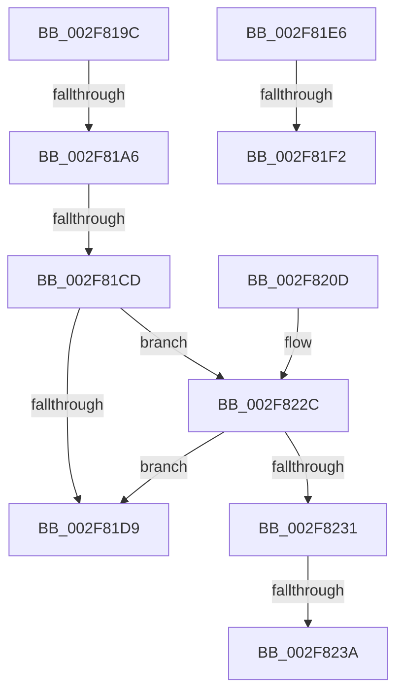

# sub_002F819C

- RVA: `0x002F819C`–`0x002F8242` (길이 `166` bytes)
- VA: `0x00000001402F819C`
- 실행 섹션: `.text`
- PDB 이름 있음: `아니요`; PDB Function 태그: `아니요`
- unwind 정보 RVA: `0x00072570`
- 디코드: `39`개 명령, `166/166` bytes 표시
- 미해석 바이트: `0` (있으면 어셈블리에 `.byte`로 보존)

> 이 문서는 커널 이미지의 기계어와 PDB 기호를 분석해 생성했습니다. 4번과 5번은 함수 원형과 자료형을 바이너리 사용 방식에서 추정한 C 해석이며 원본 소스 복구 결과는 아닙니다.

## 1. Dependencies

- 직접 호출 지점: **4**; 고유 호출 대상: **4**
- 직접 호출자로 확인된 함수: **0**
- RIP 상대 이미지 참조: **0**

### Outgoing calls
- `0x002F81A6` → [KeGetCurrentStackPointer](../6B/KeGetCurrentStackPointer_function_006B1070.md) (function, `0x006B1070`)
- `0x002F81C0` → [KeQueryCurrentStackInformationEx](KeQueryCurrentStackInformationEx_function_002F7CD0.md) (function, `0x002F7CD0`)
- `0x002F8203` → [KiExpandKernelStackAndCalloutOnStackSegment](KiExpandKernelStackAndCalloutOnStackSegment_function_002F8880.md) (function, `0x002F8880`)
- `0x002F8226` → [KeBugCheckEx](../4F/KeBugCheckEx_function_004FD660.md) (function, `0x004FD660`)

### Direct callers
- 이 함수 시작 RVA로 연결되는 직접 call은 확인되지 않았습니다. 간접 호출은 완전히 역산할 수 없습니다.

### Static image references
- 디코드된 RIP-relative 메모리 참조가 없습니다.

## 2. Other-region calls and transfers

- 다른 실행 섹션으로 향하는 call: **0**
- call이 아닌 외부 분기/꼬리 이동: **7**
  - `0x002F81A0` → [sub_002F8270 + 0x14](Unknown_function_002F8270.md) (`tail-transfer`)
  - `0x002F81C7` → [sub_002F82CA](Unknown_function_002F82CA.md) (`tail-transfer`)
  - `0x002F81E1` → [sub_002F80EA + 0x6A](Unknown_function_002F80EA.md) (`tail-transfer`)
  - `0x002F81EC` → [sub_002F82CA + 0x7](Unknown_function_002F82CA.md) (`tail-transfer`)
  - `0x002F8208` → [sub_002F80EA + 0x93](Unknown_function_002F80EA.md) (`tail-transfer`)
  - `0x002F8234` → [sub_002F80EA + 0x6A](Unknown_function_002F80EA.md) (`tail-transfer`)
  - `0x002F823D` → [sub_002F80EA + 0x6A](Unknown_function_002F80EA.md) (`tail-transfer`)

## 3. Assembly (complete function range)

```asm
002F819C  40 F6 C5 02                     test bpl, 2
002F81A0  0F 85 DE 00 00 00               jne 0x1402f8284
002F81A6  E8 C5 8E 3B 00                  call 0x1406b1070
002F81AB  48 8B C8                        mov rcx, rax
002F81AE  4C 8D 4C 24 38                  lea r9, [rsp + 0x38]
002F81B3  4C 8D 44 24 30                  lea r8, [rsp + 0x30]
002F81B8  48 8D 94 24 80 00 00 00         lea rdx, [rsp + 0x80]
002F81C0  E8 0B FB FF FF                  call 0x1402f7cd0
002F81C5  84 C0                           test al, al
002F81C7  0F 84 FD 00 00 00               je 0x1402f82ca
002F81CD  8B 84 24 80 00 00 00            mov eax, dword ptr [rsp + 0x80]
002F81D4  83 F8 01                        cmp eax, 1
002F81D7  75 53                           jne 0x1402f822c
002F81D9  4C 8B 7C 24 30                  mov r15, qword ptr [rsp + 0x30]
002F81DE  49 8B FF                        mov rdi, r15
002F81E1  E9 6E FF FF FF                  jmp 0x1402f8154
002F81E6  F7 C5 00 00 00 C0               test ebp, 0xc0000000
002F81EC  0F 84 DF 00 00 00               je 0x1402f82d1
002F81F2  44 8B CD                        mov r9d, ebp
002F81F5  48 89 74 24 20                  mov qword ptr [rsp + 0x20], rsi
002F81FA  4C 8B C3                        mov r8, rbx
002F81FD  49 8B D4                        mov rdx, r12
002F8200  49 8B CD                        mov rcx, r13
002F8203  E8 78 06 00 00                  call 0x1402f8880
002F8208  E9 70 FF FF FF                  jmp 0x1402f817d
002F820D  B0 0F                           mov al, 0xf
002F820F  45 33 C9                        xor r9d, r9d
002F8212  44 0F B6 C0                     movzx r8d, al
002F8216  48 C7 44 24 20 00 00 00 00      mov qword ptr [rsp + 0x20], 0
002F821F  41 8D 51 02                     lea edx, [r9 + 2]
002F8223  8D 4A 08                        lea ecx, [rdx + 8]
002F8226  E8 35 54 20 00                  call 0x1404fd660
002F822B  CC                              int3
002F822C  83 F8 0A                        cmp eax, 0xa
002F822F  74 A8                           je 0x1402f81d9
002F8231  83 F8 05                        cmp eax, 5
002F8234  0F 85 1A FF FF FF               jne 0x1402f8154
002F823A  83 CD 01                        or ebp, 1
002F823D  E9 12 FF FF FF                  jmp 0x1402f8154
```

## 4. C-style interpretation (structured pseudocode)

```c
__int64 __fastcall sub_002F819C(__int64 a1, __int64 a2, __int64 a3, __int64 a4, __int64 a5, __int64 a6, __int64 a7, __int64 a8, __int64 a9, __int64 a10, __int64 a11, __int64 a12, __int64 a13, __int64 a14, __int64 a15, unsigned int a16)
{
    __int64 result;
    __int64 v_rbp;
    unsigned __int64 v_stack_p20;

    result = KeGetCurrentStackPointer(a1, a2, a3, a4);
    result = KeQueryCurrentStackInformationEx(result, a16, a6, a7);
    if (((unsigned int)((unsigned int)(a16))) != 1) goto loc_002F822C;
loc_002F81D9:
loc_002F822C:
    if (((unsigned int)((unsigned int)(a16))) == 10) goto loc_002F81D9;
    v_rbp = (unsigned int)((v_rbp) | (1));
}
```

## 5. (Beta) C Style

```c
int64_t sub_002F819C(int64_t Arg1, int64_t Arg2, int64_t Arg3, int64_t Arg4, uint64_t Arg5, int64_t Arg6, int64_t Arg7, uint64_t Arg8, uint64_t Arg9, uint64_t Arg10, uint64_t Arg11, uint64_t Arg12, uint64_t Arg13, uint64_t Arg14, uint64_t Arg15, uint32_t Arg16)
{
    int64_t result;
    int64_t local_rbp;
    uint64_t v_stack_p20;

    result = KeGetCurrentStackPointer(Arg1, Arg2, Arg3, Arg4);
    result = KeQueryCurrentStackInformationEx(result, Arg16, Arg6, Arg7);
    if (((uint32_t)((uint32_t)(Arg16))) != 1) goto loc_002F822C;
loc_002F81D9:
loc_002F822C:
    if (((uint32_t)((uint32_t)(Arg16))) == 10) goto loc_002F81D9;
    local_rbp = (uint32_t)((local_rbp) | (1));
}
```

## 6. Execution-region graph

[열기: 2D/3D 그래프와 함수 탐색 컨트롤 패널](../../../control-panel.html?section=text&rva=0x002F819C&view=graph)

- 2D 그래프는 위에서 아래로 흐르고, 3D 그래프는 빈 공간을 드래그해 회전합니다. Shift+드래그는 이동, 휠은 확대·축소, 함수 노드 선택은 대상 보고서 이동입니다.

### Static fallback


