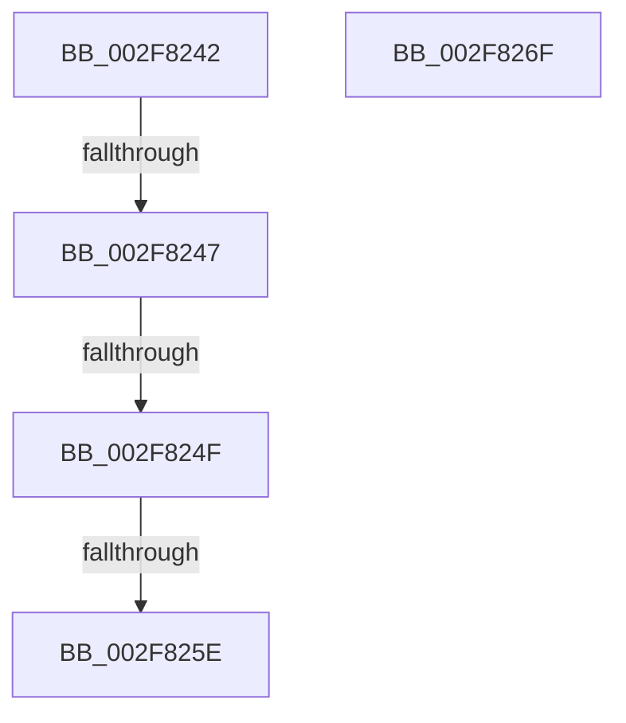

# sub_002F8242

- RVA: `0x002F8242`–`0x002F8270` (길이 `46` bytes)
- VA: `0x00000001402F8242`
- 실행 섹션: `.text`
- PDB 이름 있음: `아니요`; PDB Function 태그: `아니요`
- unwind 정보 RVA: `0x0007258C`
- 디코드: `17`개 명령, `46/46` bytes 표시
- 미해석 바이트: `0` (있으면 어셈블리에 `.byte`로 보존)

> 이 문서는 커널 이미지의 기계어와 PDB 기호를 분석해 생성했습니다. 4번과 5번은 함수 원형과 자료형을 바이너리 사용 방식에서 추정한 C 해석이며 원본 소스 복구 결과는 아닙니다.

## 1. Dependencies

- 직접 호출 지점: **0**; 고유 호출 대상: **0**
- 직접 호출자로 확인된 함수: **0**
- RIP 상대 이미지 참조: **1**

### Outgoing calls
- 직접 디코드된 call 명령이 없습니다.

### Direct callers
- 이 함수 시작 RVA로 연결되는 직접 call은 확인되지 않았습니다. 간접 호출은 완전히 역산할 수 없습니다.

### Static image references
- `0x002F824F` → RVA `0x00FC5020` (`ALMOSTRO`; read)

## 2. Other-region calls and transfers

- 다른 실행 섹션으로 향하는 call: **0**
- call이 아닌 외부 분기/꼬리 이동: **3**
  - `0x002F8245` → [sub_002F828E](Unknown_function_002F828E.md) (`tail-transfer`)
  - `0x002F824D` → [sub_002F828E](Unknown_function_002F828E.md) (`tail-transfer`)
  - `0x002F8258` → [sub_002F80EA](Unknown_function_002F80EA.md) (`tail-transfer`)

## 3. Assembly (complete function range)

```asm
002F8242  48 85 F6                        test rsi, rsi
002F8245  74 47                           je 0x1402f828e
002F8247  0F B6 46 07                     movzx eax, byte ptr [rsi + 7]
002F824B  A8 01                           test al, 1
002F824D  74 3F                           je 0x1402f828e
002F824F  8B 05 CB CD CC 00               mov eax, dword ptr [rip + 0xcccdcb]
002F8255  48 3B D8                        cmp rbx, rax
002F8258  0F 86 8C FE FF FF               jbe 0x1402f80ea
002F825E  B8 F1 00 00 C0                  mov eax, 0xc00000f1
002F8263  48 83 C4 40                     add rsp, 0x40
002F8267  41 5D                           pop r13
002F8269  41 5C                           pop r12
002F826B  5E                              pop rsi
002F826C  5D                              pop rbp
002F826D  5B                              pop rbx
002F826E  C3                              ret
002F826F  CC                              int3
```

## 4. C-style interpretation (structured pseudocode)

```c
__int64 __fastcall sub_002F8242(void)
{
    __int64 v_rsp;

    v_rsp = (v_rsp) + (64);
    return (unsigned int)(0xC00000F1ULL);
}
```

## 5. (Beta) C Style

```c
void sub_002F8242(void)
{
    int64_t local_rsp;

    local_rsp = (local_rsp) + (64);
    return (uint32_t)(0xC00000F1ULL);
}
```

## 6. Execution-region graph

[열기: 2D/3D 그래프와 함수 탐색 컨트롤 패널](../../../control-panel.html?section=text&rva=0x002F8242&view=graph)

- 2D 그래프는 위에서 아래로 흐르고, 3D 그래프는 빈 공간을 드래그해 회전합니다. Shift+드래그는 이동, 휠은 확대·축소, 함수 노드 선택은 대상 보고서 이동입니다.

### Static fallback


