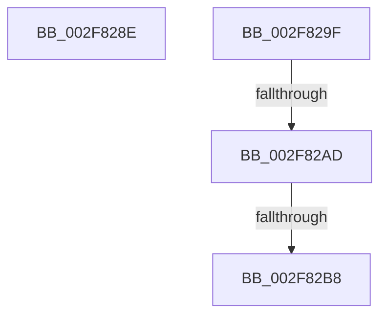

# sub_002F828E

- RVA: `0x002F828E`–`0x002F82CA` (길이 `60` bytes)
- VA: `0x00000001402F828E`
- 실행 섹션: `.text`
- PDB 이름 있음: `아니요`; PDB Function 태그: `아니요`
- unwind 정보 RVA: `0x000725BC`
- 디코드: `18`개 명령, `60/60` bytes 표시
- 미해석 바이트: `0` (있으면 어셈블리에 `.byte`로 보존)

> 이 문서는 커널 이미지의 기계어와 PDB 기호를 분석해 생성했습니다. 4번과 5번은 함수 원형과 자료형을 바이너리 사용 방식에서 추정한 C 해석이며 원본 소스 복구 결과는 아닙니다.

## 1. Dependencies

- 직접 호출 지점: **0**; 고유 호출 대상: **0**
- 직접 호출자로 확인된 함수: **0**
- RIP 상대 이미지 참조: **1**

### Outgoing calls
- 직접 디코드된 call 명령이 없습니다.

### Direct callers
- 이 함수 시작 RVA로 연결되는 직접 call은 확인되지 않았습니다. 간접 호출은 완전히 역산할 수 없습니다.

### Static image references
- `0x002F82B8` → RVA `0x00FC5020` (`ALMOSTRO`; read)

## 2. Other-region calls and transfers

- 다른 실행 섹션으로 향하는 call: **0**
- call이 아닌 외부 분기/꼬리 이동: **3**
  - `0x002F82A7` → [KiExpandKernelStackAndCalloutSwitchStack + 0x47](KiExpandKernelStackAndCalloutSwitchStack_function_002F8080.md) (`tail-transfer`)
  - `0x002F82B2` → [KiExpandKernelStackAndCalloutSwitchStack + 0x47](KiExpandKernelStackAndCalloutSwitchStack_function_002F8080.md) (`tail-transfer`)
  - `0x002F82C5` → [KiExpandKernelStackAndCalloutSwitchStack + 0x47](KiExpandKernelStackAndCalloutSwitchStack_function_002F8080.md) (`tail-transfer`)

## 3. Assembly (complete function range)

```asm
002F828E  B8 F3 00 00 C0                  mov eax, 0xc00000f3
002F8293  48 83 C4 40                     add rsp, 0x40
002F8297  41 5D                           pop r13
002F8299  41 5C                           pop r12
002F829B  5E                              pop rsi
002F829C  5D                              pop rbp
002F829D  5B                              pop rbx
002F829E  C3                              ret
002F829F  CC                              int3
002F82A0  48 81 FB 00 18 01 00            cmp rbx, 0x11800
002F82A7  0F 87 1A FE FF FF               ja 0x1402f80c7
002F82AD  48 03 DB                        add rbx, rbx
002F82B0  85 ED                           test ebp, ebp
002F82B2  0F 89 0F FE FF FF               jns 0x1402f80c7
002F82B8  8B 05 62 CD CC 00               mov eax, dword ptr [rip + 0xcccd62]
002F82BE  48 3B D8                        cmp rbx, rax
002F82C1  48 0F 47 D8                     cmova rbx, rax
002F82C5  E9 FD FD FF FF                  jmp 0x1402f80c7
```

## 4. C-style interpretation (structured pseudocode)

```c
__int64 __fastcall sub_002F828E(void)
{
    __int64 v_rsp;

    v_rsp = (v_rsp) + (64);
    return (unsigned int)(0xC00000F3ULL);
}
```

## 5. (Beta) C Style

```c
void sub_002F828E(void)
{
    int64_t local_rsp;

    local_rsp = (local_rsp) + (64);
    return (uint32_t)(0xC00000F3ULL);
}
```

## 6. Execution-region graph

[열기: 2D/3D 그래프와 함수 탐색 컨트롤 패널](../../../control-panel.html?section=text&rva=0x002F828E&view=graph)

- 2D 그래프는 위에서 아래로 흐르고, 3D 그래프는 빈 공간을 드래그해 회전합니다. Shift+드래그는 이동, 휠은 확대·축소, 함수 노드 선택은 대상 보고서 이동입니다.

### Static fallback


