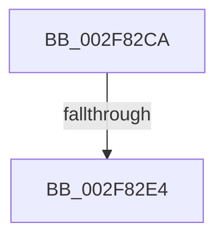

# sub_002F82CA

- RVA: `0x002F82CA`–`0x002F82E9` (길이 `31` bytes)
- VA: `0x00000001402F82CA`
- 실행 섹션: `.text`
- PDB 이름 있음: `아니요`; PDB Function 태그: `아니요`
- unwind 정보 RVA: `0x000725D0`
- 디코드: `8`개 명령, `31/31` bytes 표시
- 미해석 바이트: `0` (있으면 어셈블리에 `.byte`로 보존)

> 이 문서는 커널 이미지의 기계어와 PDB 기호를 분석해 생성했습니다. 4번과 5번은 함수 원형과 자료형을 바이너리 사용 방식에서 추정한 C 해석이며 원본 소스 복구 결과는 아닙니다.

## 1. Dependencies

- 직접 호출 지점: **1**; 고유 호출 대상: **1**
- 직접 호출자로 확인된 함수: **0**
- RIP 상대 이미지 참조: **0**

### Outgoing calls
- `0x002F82D7` → [MmGrowKernelStackEx](../2A/MmGrowKernelStackEx_function_002A04E0.md) (function, `0x002A04E0`)

### Direct callers
- 이 함수 시작 RVA로 연결되는 직접 call은 확인되지 않았습니다. 간접 호출은 완전히 역산할 수 없습니다.

### Static image references
- 디코드된 RIP-relative 메모리 참조가 없습니다.

## 2. Other-region calls and transfers

- 다른 실행 섹션으로 향하는 call: **0**
- call이 아닌 외부 분기/꼬리 이동: **2**
  - `0x002F82DE` → [sub_002F819C + 0x56](Unknown_function_002F819C.md) (`tail-transfer`)
  - `0x002F82E4` → [sub_002F80EA + 0x8E](Unknown_function_002F80EA.md) (`tail-transfer`)

## 3. Assembly (complete function range)

```asm
002F82CA  B9 04 00 00 00                  mov ecx, 4
002F82CF  CD 29                           int 0x29
002F82D1  48 8B D3                        mov rdx, rbx
002F82D4  49 8B CE                        mov rcx, r14
002F82D7  E8 04 82 FA FF                  call 0x1402a04e0
002F82DC  85 C0                           test eax, eax
002F82DE  0F 88 0E FF FF FF               js 0x1402f81f2
002F82E4  E9 8F FE FF FF                  jmp 0x1402f8178
```

## 4. C-style interpretation (structured pseudocode)

```c
__int64 __fastcall sub_002F82CA(void)
{
    __int64 result;

    result = MmGrowKernelStackEx(v_r14, v_rbx, a3, a4);
}
```

## 5. (Beta) C Style

```c
void sub_002F82CA(void)
{
    int64_t result;

    result = MmGrowKernelStackEx(local_r14, local_rbx, a3, a4);
}
```

## 6. Execution-region graph

[열기: 2D/3D 그래프와 함수 탐색 컨트롤 패널](../../../control-panel.html?section=text&rva=0x002F82CA&view=graph)

- 2D 그래프는 위에서 아래로 흐르고, 3D 그래프는 빈 공간을 드래그해 회전합니다. Shift+드래그는 이동, 휠은 확대·축소, 함수 노드 선택은 대상 보고서 이동입니다.

### Static fallback


