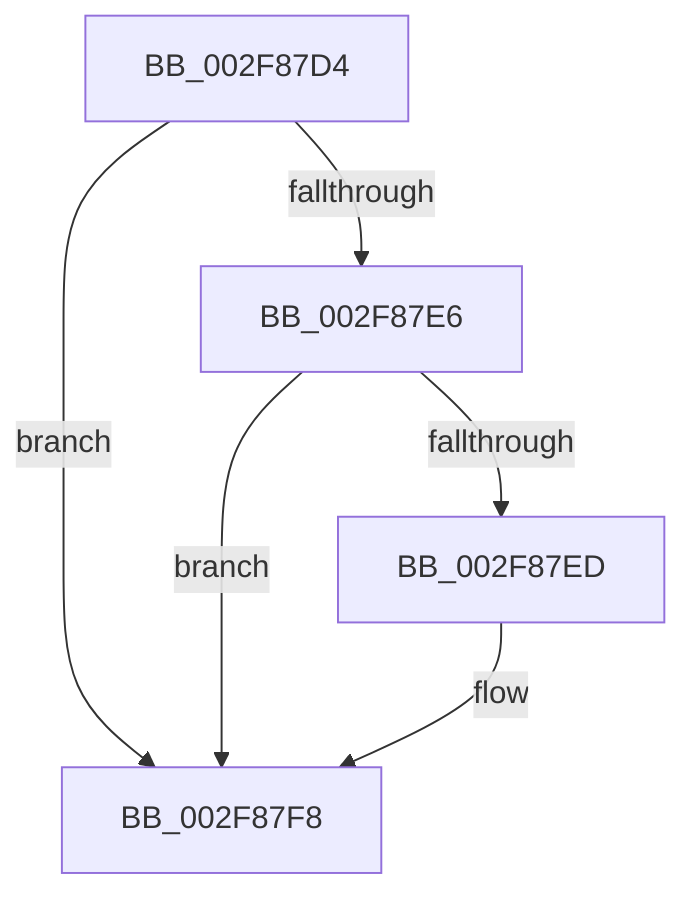

# sub_002F87D4

- RVA: `0x002F87D4`–`0x002F880D` (길이 `57` bytes)
- VA: `0x00000001402F87D4`
- 실행 섹션: `.text`
- PDB 이름 있음: `아니요`; PDB Function 태그: `아니요`
- unwind 정보 RVA: `0x000726A4`
- 디코드: `14`개 명령, `57/57` bytes 표시
- 미해석 바이트: `0` (있으면 어셈블리에 `.byte`로 보존)

> 이 문서는 커널 이미지의 기계어와 PDB 기호를 분석해 생성했습니다. 4번과 5번은 함수 원형과 자료형을 바이너리 사용 방식에서 추정한 C 해석이며 원본 소스 복구 결과는 아닙니다.

## 1. Dependencies

- 직접 호출 지점: **1**; 고유 호출 대상: **1**
- 직접 호출자로 확인된 함수: **0**
- RIP 상대 이미지 참조: **0**

### Outgoing calls
- `0x002F87EF` → [KeQueryPerformanceCounter](../37/KeQueryPerformanceCounter_function_0037E7E0.md) (function, `0x0037E7E0`)

### Direct callers
- 이 함수 시작 RVA로 연결되는 직접 call은 확인되지 않았습니다. 간접 호출은 완전히 역산할 수 없습니다.

### Static image references
- 디코드된 RIP-relative 메모리 참조가 없습니다.

## 2. Other-region calls and transfers

- 다른 실행 섹션으로 향하는 call: **0**
- call이 아닌 외부 분기/꼬리 이동: **1**
  - `0x002F880B` → [sub_002F880D + 0x3](Unknown_function_002F880D.md) (`tail-transfer`)

## 3. Assembly (complete function range)

```asm
002F87D4  4C 89 64 24 60                  mov qword ptr [rsp + 0x60], r12
002F87D9  4C 8B A4 24 A0 00 00 00         mov r12, qword ptr [rsp + 0xa0]
002F87E1  4D 85 E4                        test r12, r12
002F87E4  74 12                           je 0x1402f87f8
002F87E6  49 83 3C 24 00                  cmp qword ptr [r12], 0
002F87EB  75 0B                           jne 0x1402f87f8
002F87ED  33 C9                           xor ecx, ecx
002F87EF  E8 EC 5F 08 00                  call 0x14037e7e0
002F87F4  49 89 04 24                     mov qword ptr [r12], rax
002F87F8  4C 8B 64 24 60                  mov r12, qword ptr [rsp + 0x60]
002F87FD  45 33 C0                        xor r8d, r8d
002F8800  4C 89 84 24 88 00 00 00         mov qword ptr [rsp + 0x88], r8
002F8808  48 3B EB                        cmp rbp, rbx
002F880B  75 03                           jne 0x1402f8810
```

## 4. C-style interpretation (structured pseudocode)

```c
__int64 __fastcall sub_002F87D4(int a1, __int64 a2, int a3, __int64 a4, __int64 a5, __int64 a6, __int64 a7, __int64 a8, __int64 a9, __int64 a10, __int64 a11, __int64 a12, __int64 a13, __int64 a14, __int64 a15, __int64 a16, __int64 a17, __int64 a18, __int64 a19, __int64 a20)
{
    __int64 result;
    unsigned __int64 v_stack_p60;
    unsigned __int64 v_stack_p88;

    v_stack_p60 = v_r12;
    if (a20 == 0) goto loc_002F87F8;
    if ((*(unsigned __int64 *)(a20)) == 0) {
        a1 = 0;
        result = KeQueryPerformanceCounter(a1, a2, a3, a4);
        *(unsigned __int64 *)(a20) = result;
    }
    a3 = 0;
    v_stack_p88 = 0;
}
```

## 5. (Beta) C Style

```c
int64_t sub_002F87D4(int32_t Arg1, int64_t Arg2, int32_t Arg3, int64_t Arg4, uint64_t Arg5, uint64_t Arg6, uint64_t Arg7, uint64_t Arg8, uint64_t Arg9, uint64_t Arg10, uint64_t Arg11, int64_t Arg12, uint64_t Arg13, uint64_t Arg14, uint64_t Arg15, uint64_t Arg16, uint64_t Arg17, uint64_t Arg18, uint64_t Arg19, int64_t Arg20)
{
    int64_t result;
    uint64_t v_stack_p60;
    uint64_t v_stack_p88;

    v_stack_p60 = local_r12;
    if (Arg20 == 0) goto loc_002F87F8;
    if ((*(uint64_t *)(Arg20)) == 0) {
        Arg1 = 0;
        result = KeQueryPerformanceCounter(Arg1, Arg2, Arg3, Arg4);
        *(uint64_t *)(Arg20) = result;
    }
    Arg3 = 0;
    v_stack_p88 = 0;
}
```

## 6. Execution-region graph

[열기: 2D/3D 그래프와 함수 탐색 컨트롤 패널](../../../control-panel.html?section=text&rva=0x002F87D4&view=graph)

- 2D 그래프는 위에서 아래로 흐르고, 3D 그래프는 빈 공간을 드래그해 회전합니다. Shift+드래그는 이동, 휠은 확대·축소, 함수 노드 선택은 대상 보고서 이동입니다.

### Static fallback


