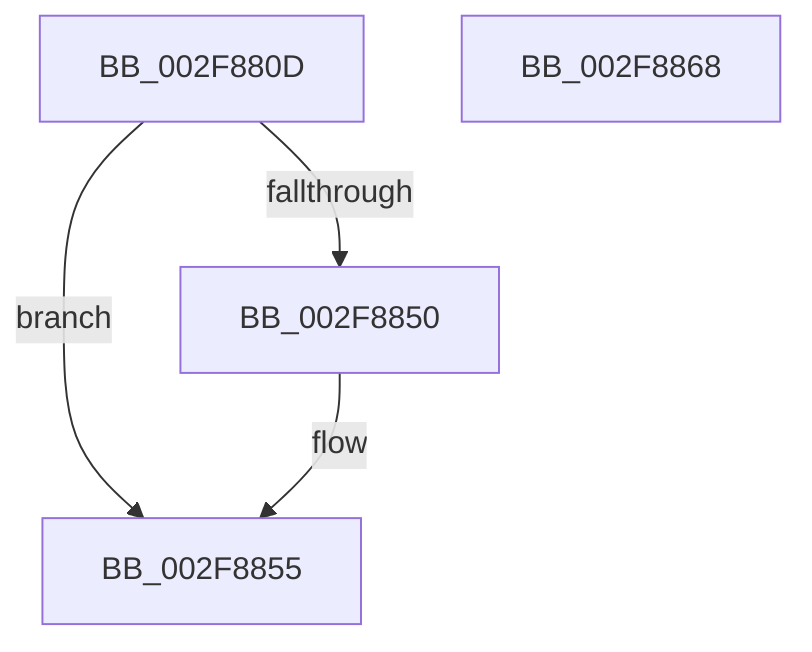

# sub_002F880D

- RVA: `0x002F880D`–`0x002F886F` (길이 `98` bytes)
- VA: `0x00000001402F880D`
- 실행 섹션: `.text`
- PDB 이름 있음: `아니요`; PDB Function 태그: `아니요`
- unwind 정보 RVA: `0x000726B8`
- 디코드: `20`개 명령, `98/98` bytes 표시
- 미해석 바이트: `0` (있으면 어셈블리에 `.byte`로 보존)

> 이 문서는 커널 이미지의 기계어와 PDB 기호를 분석해 생성했습니다. 4번과 5번은 함수 원형과 자료형을 바이너리 사용 방식에서 추정한 C 해석이며 원본 소스 복구 결과는 아닙니다.

## 1. Dependencies

- 직접 호출 지점: **2**; 고유 호출 대상: **2**
- 직접 호출자로 확인된 함수: **0**
- RIP 상대 이미지 참조: **0**

### Outgoing calls
- `0x002F883E` → [MmPrefetchForCacheManager](../../page/93/MmPrefetchForCacheManager_function_0093D714.md) (function, `0x0093D714`)
- `0x002F8850` → [MmWaitForCacheManagerPrefetch](../36/MmWaitForCacheManagerPrefetch_function_0036D644.md) (function, `0x0036D644`)

### Direct callers
- 이 함수 시작 RVA로 연결되는 직접 call은 확인되지 않았습니다. 간접 호출은 완전히 역산할 수 없습니다.

### Static image references
- 디코드된 RIP-relative 메모리 참조가 없습니다.

## 2. Other-region calls and transfers

- 다른 실행 섹션으로 향하는 call: **1**
  - `0x002F883E` → [MmPrefetchForCacheManager](../../page/93/MmPrefetchForCacheManager_function_0093D714.md) (`.text` → `PAGE`)
- call이 아닌 외부 분기/꼬리 이동: **2**
  - `0x002F8863` → [CcFetchDataForRead + 0x7E](CcFetchDataForRead_function_002F8720.md) (`tail-transfer`)
  - `0x002F886A` → [CcFetchDataForRead + 0x91](CcFetchDataForRead_function_002F8720.md) (`tail-transfer`)

## 3. Assembly (complete function range)

```asm
002F880D  4D 8B 06                        mov r8, qword ptr [r14]
002F8810  48 8D 84 24 88 00 00 00         lea rax, [rsp + 0x88]
002F8818  4C 8B CB                        mov r9, rbx
002F881B  48 89 44 24 38                  mov qword ptr [rsp + 0x38], rax
002F8820  48 8B D7                        mov rdx, rdi
002F8823  48 8B 84 24 98 00 00 00         mov rax, qword ptr [rsp + 0x98]
002F882B  49 8B CF                        mov rcx, r15
002F882E  48 89 44 24 30                  mov qword ptr [rsp + 0x30], rax
002F8833  8B 84 24 90 00 00 00            mov eax, dword ptr [rsp + 0x90]
002F883A  89 44 24 20                     mov dword ptr [rsp + 0x20], eax
002F883E  E8 D1 4E 64 00                  call 0x14093d714
002F8843  48 8B 8C 24 88 00 00 00         mov rcx, qword ptr [rsp + 0x88]
002F884B  48 85 C9                        test rcx, rcx
002F884E  74 05                           je 0x1402f8855
002F8850  E8 EF 4D 07 00                  call 0x14036d644
002F8855  48 8B 84 24 80 00 00 00         mov rax, qword ptr [rsp + 0x80]
002F885D  C7 00 01 00 00 00               mov dword ptr [rax], 1
002F8863  E9 36 FF FF FF                  jmp 0x1402f879e
002F8868  32 C0                           xor al, al
002F886A  E9 42 FF FF FF                  jmp 0x1402f87b1
```

## 4. C-style interpretation (structured pseudocode)

```c
__int64 __fastcall sub_002F880D(__int64 a1, __int64 a2, __int64 a3, __int64 a4, __int64 a5, __int64 a6, __int64 a7, __int64 a8, __int64 a9, __int64 a10, __int64 a11, __int64 a12, __int64 a13, __int64 a14, __int64 a15, __int64 a16, __int64 a17, unsigned int a18, __int64 a19)
{
    __int64 result;
    unsigned int v_stack_p20;
    unsigned __int64 v_stack_p30;
    unsigned __int64 v_stack_p38;

    v_stack_p38 = a17;
    v_stack_p30 = a19;
    v_stack_p20 = (unsigned int)((unsigned int)(a18));
    result = MmPrefetchForCacheManager(v_r15, v_rdi, *(unsigned __int64 *)(v_r14), v_rbx);
    if (a17 != 0) {
        result = MmWaitForCacheManagerPrefetch(a17, v_rdi, *(unsigned __int64 *)(v_r14), v_rbx);
    }
    *(unsigned int *)(a16) = 1;
}
```

## 5. (Beta) C Style

```c
int64_t sub_002F880D(int64_t Arg1, int64_t Arg2, int64_t Arg3, int64_t Arg4, uint64_t Arg5, uint64_t Arg6, uint64_t Arg7, uint64_t Arg8, uint64_t Arg9, uint64_t Arg10, uint64_t Arg11, uint64_t Arg12, uint64_t Arg13, uint64_t Arg14, uint64_t Arg15, void *Arg16, int64_t Arg17, uint32_t Arg18, int64_t Arg19)
{
    uint8_t *arg16 = (uint8_t *)Arg16;

    int64_t result;
    uint32_t v_stack_p20;
    uint64_t v_stack_p30;
    uint64_t v_stack_p38;

    v_stack_p38 = Arg17;
    v_stack_p30 = Arg19;
    v_stack_p20 = (uint32_t)((uint32_t)(Arg18));
    result = MmPrefetchForCacheManager(local_r15, local_rdi, *(uint64_t *)(local_r14), local_rbx);
    if (Arg17 != 0) {
        result = MmWaitForCacheManagerPrefetch(Arg17, local_rdi, *(uint64_t *)(local_r14), local_rbx);
    }
    *(uint32_t *)(arg16) = 1;
}
```

### 관측된 메모리 오프셋

구조체 형식이 확인되지 않은 접근은 인자 기준의 오프셋으로만 기록했습니다.

| 기준 인자 | 오프셋 표현 | 폭 (bit) | 접근 |
|---|---:|---:|---|
| `Arg16` | `+ 0x0` | `32` | `W` |

## 6. Execution-region graph

[열기: 2D/3D 그래프와 함수 탐색 컨트롤 패널](../../../control-panel.html?section=text&rva=0x002F880D&view=graph)

- 2D 그래프는 위에서 아래로 흐르고, 3D 그래프는 빈 공간을 드래그해 회전합니다. Shift+드래그는 이동, 휠은 확대·축소, 함수 노드 선택은 대상 보고서 이동입니다.

### Static fallback


