# sub_002F8911

- RVA: `0x002F8911`–`0x002F8BA0` (길이 `655` bytes)
- VA: `0x00000001402F8911`
- 실행 섹션: `.text`
- PDB 이름 있음: `아니요`; PDB Function 태그: `아니요`
- unwind 정보 RVA: `0x000726DC`
- 디코드: `157`개 명령, `655/655` bytes 표시
- 미해석 바이트: `0` (있으면 어셈블리에 `.byte`로 보존)

> 이 문서는 커널 이미지의 기계어와 PDB 기호를 분석해 생성했습니다. 4번과 5번은 함수 원형과 자료형을 바이너리 사용 방식에서 추정한 C 해석이며 원본 소스 복구 결과는 아닙니다.

## 1. Dependencies

- 직접 호출 지점: **5**; 고유 호출 대상: **5**
- 직접 호출자로 확인된 함수: **0**
- RIP 상대 이미지 참조: **3**

### Outgoing calls
- `0x002F8A33` → [MmCreateKernelStack](../33/MmCreateKernelStack_function_00337D20.md) (function, `0x00337D20`)
- `0x002F8AC0` → [KeGetCurrentStackPointer](../6B/KeGetCurrentStackPointer_function_006B1070.md) (function, `0x006B1070`)
- `0x002F8AD4` → [KeQueryCurrentStackInformationEx](KeQueryCurrentStackInformationEx_function_002F7CD0.md) (function, `0x002F7CD0`)
- `0x002F8AF5` → [KiSwitchKernelStackAndCallout](../6B/KiSwitchKernelStackAndCallout_function_006B2610.md) (function, `0x006B2610`)
- `0x002F8B96` → [MmDeleteKernelStack](../33/MmDeleteKernelStack_function_0033A960.md) (function, `0x0033A960`)

### Direct callers
- 이 함수 시작 RVA로 연결되는 직접 call은 확인되지 않았습니다. 간접 호출은 완전히 역산할 수 없습니다.

### Static image references
- `0x002F89AC` → RVA `0x00FC51D8` (`ALMOSTRO`; read)
- `0x002F89F5` → RVA `0x00FC8C40` (`ALMOSTRO`; read)
- `0x002F8A65` → RVA `0x00FC5020` (`ALMOSTRO`; read)

## 2. Other-region calls and transfers

- 다른 실행 섹션으로 향하는 call: **0**
- call이 아닌 외부 분기/꼬리 이동: **14**
  - `0x002F892E` → [sub_002F8BF2 + 0x9A](Unknown_function_002F8BF2.md) (`tail-transfer`)
  - `0x002F8938` → [sub_002F8BF2 + 0x154](Unknown_function_002F8BF2.md) (`tail-transfer`)
  - `0x002F8945` → [sub_002F8BF2 + 0x7B](Unknown_function_002F8BF2.md) (`tail-transfer`)
  - `0x002F8956` → [sub_002F8BF2 + 0x30](Unknown_function_002F8BF2.md) (`tail-transfer`)
  - `0x002F8973` → [sub_002F8BF2 + 0x5B](Unknown_function_002F8BF2.md) (`tail-transfer`)
  - `0x002F8984` → [sub_002F8BF2 + 0x84](Unknown_function_002F8BF2.md) (`tail-transfer`)
  - `0x002F8A29` → [sub_002F8BF2 + 0x145](Unknown_function_002F8BF2.md) (`tail-transfer`)
  - `0x002F8A5F` → [sub_002F8BF2 + 0xF4](Unknown_function_002F8BF2.md) (`tail-transfer`)
  - `0x002F8A9C` → [sub_002F8BF2 + 0xFF](Unknown_function_002F8BF2.md) (`tail-transfer`)
  - `0x002F8AEF` → [sub_002F8BF2 + 0xA4](Unknown_function_002F8BF2.md) (`tail-transfer`)
  - `0x002F8B06` → [sub_002F8BF2](Unknown_function_002F8BF2.md) (`tail-transfer`)
  - `0x002F8B11` → [sub_002F8BF2 + 0x14](Unknown_function_002F8BF2.md) (`tail-transfer`)
  - `0x002F8B31` → [sub_002F8BF2 + 0xC0](Unknown_function_002F8BF2.md) (`tail-transfer`)
  - `0x002F8B67` → [sub_002F8BF2 + 0x116](Unknown_function_002F8BF2.md) (`tail-transfer`)

## 3. Assembly (complete function range)

```asm
002F8911  48 89 B4 24 E0 00 00 00         mov qword ptr [rsp + 0xe0], rsi
002F8919  4C 89 BC 24 D8 00 00 00         mov qword ptr [rsp + 0xd8], r15
002F8921  40 F6 C7 F0                     test dil, 0xf0
002F8925  0F 84 9A 00 00 00               je 0x1402f89c5
002F892B  48 85 DB                        test rbx, rbx
002F892E  0F 84 58 03 00 00               je 0x1402f8c8c
002F8934  40 F6 C7 01                     test dil, 1
002F8938  0F 85 08 04 00 00               jne 0x1402f8d46
002F893E  41 0F B6 46 7D                  movzx eax, byte ptr [r14 + 0x7d]
002F8943  A8 02                           test al, 2
002F8945  0F 85 22 03 00 00               jne 0x1402f8c6d
002F894B  0C 02                           or al, 2
002F894D  41 88 46 7D                     mov byte ptr [r14 + 0x7d], al
002F8951  41 0F BA E4 1E                  bt r12d, 0x1e
002F8956  0F 83 C6 02 00 00               jae 0x1402f8c22
002F895C  0F 0D 4B 07                     prefetchw byte ptr [rbx + 7]
002F8960  0F B6 43 07                     movzx eax, byte ptr [rbx + 7]
002F8964  0F B6 C8                        movzx ecx, al
002F8967  80 C9 02                        or cl, 2
002F896A  F0 0F B0 4B 07                  lock cmpxchg byte ptr [rbx + 7], cl
002F896F  75 F3                           jne 0x1402f8964
002F8971  A8 02                           test al, 2
002F8973  0F 85 D4 02 00 00               jne 0x1402f8c4d
002F8979  48 8D 73 08                     lea rsi, [rbx + 8]
002F897D  0F B6 4B 06                     movzx ecx, byte ptr [rbx + 6]
002F8981  3A 4B 05                        cmp cl, byte ptr [rbx + 5]
002F8984  0F 83 EC 02 00 00               jae 0x1402f8c76
002F898A  4C 8B 7C CB 40                  mov r15, qword ptr [rbx + rcx*8 + 0x40]
002F898F  40 80 CF 08                     or dil, 8
002F8993  FE C1                           inc cl
002F8995  88 4B 06                        mov byte ptr [rbx + 6], cl
002F8998  40 F6 C7 01                     test dil, 1
002F899C  0F 85 A6 00 00 00               jne 0x1402f8a48
002F89A2  80 7B 04 00                     cmp byte ptr [rbx + 4], 0
002F89A6  0F 84 9C 00 00 00               je 0x1402f8a48
002F89AC  8B 05 26 C8 CC 00               mov eax, dword ptr [rip + 0xccc826]
002F89B2  41 BD 05 00 00 00               mov r13d, 5
002F89B8  48 89 45 6F                     mov qword ptr [rbp + 0x6f], rax
002F89BC  40 80 CF 01                     or dil, 1
002F89C0  E9 83 00 00 00                  jmp 0x1402f8a48
002F89C5  41 8B CD                        mov ecx, r13d
002F89C8  41 8B C4                        mov eax, r12d
002F89CB  83 C9 02                        or ecx, 2
002F89CE  41 F6 C4 02                     test r12b, 2
002F89D2  41 0F 45 CD                     cmovne ecx, r13d
002F89D6  83 E0 04                        and eax, 4
002F89D9  74 06                           je 0x1402f89e1
002F89DB  83 CA 04                        or edx, 4
002F89DE  89 55 77                        mov dword ptr [rbp + 0x77], edx
002F89E1  44 8B E9                        mov r13d, ecx
002F89E4  41 83 CD 10                     or r13d, 0x10
002F89E8  85 C0                           test eax, eax
002F89EA  41 8B 86 4C 02 00 00            mov eax, dword ptr [r14 + 0x24c]
002F89F1  44 0F 44 E9                     cmove r13d, ecx
002F89F5  48 8D 0D 44 02 CD 00            lea rcx, [rip + 0xcd0244]
002F89FC  48 8B 04 C1                     mov rax, qword ptr [rcx + rax*8]
002F8A00  48 8B 88 C0 00 00 00            mov rcx, qword ptr [rax + 0xc0]
002F8A07  0F B7 81 8A 00 00 00            movzx eax, word ptr [rcx + 0x8a]
002F8A0E  48 8D 4C 24 40                  lea rcx, [rsp + 0x40]
002F8A13  89 45 87                        mov dword ptr [rbp - 0x79], eax
002F8A16  44 89 6C 24 40                  mov dword ptr [rsp + 0x40], r13d
002F8A1B  C7 45 83 05 00 00 00            mov dword ptr [rbp - 0x7d], 5
002F8A22  4C 89 4D 8F                     mov qword ptr [rbp - 0x71], r9
002F8A26  45 85 E4                        test r12d, r12d
002F8A29  0F 88 08 03 00 00               js 0x1402f8d37
002F8A2F  4C 89 75 8F                     mov qword ptr [rbp - 0x71], r14
002F8A33  E8 E8 F2 03 00                  call 0x140337d20
002F8A38  4C 8B 7D 97                     mov r15, qword ptr [rbp - 0x69]
002F8A3C  49 8B C7                        mov rax, r15
002F8A3F  48 85 C0                        test rax, rax
002F8A42  0F 84 E3 FE FF FF               je 0x1402f892b
002F8A48  4D 89 7F B0                     mov qword ptr [r15 - 0x50], r15
002F8A4C  49 8D 77 B0                     lea rsi, [r15 - 0x50]
002F8A50  4C 8B C6                        mov r8, rsi
002F8A53  BA 08 00 00 00                  mov edx, 8
002F8A58  49 8B CF                        mov rcx, r15
002F8A5B  40 F6 C7 01                     test dil, 1
002F8A5F  0F 85 81 02 00 00               jne 0x1402f8ce6
002F8A65  8B 05 B5 C5 CC 00               mov eax, dword ptr [rip + 0xccc5b5]
002F8A6B  48 2B C8                        sub rcx, rax
002F8A6E  48 8D 41 01                     lea rax, [rcx + 1]
002F8A72  33 C9                           xor ecx, ecx
002F8A74  49 89 04 10                     mov qword ptr [r8 + rdx], rax
002F8A78  49 8B 46 38                     mov rax, qword ptr [r14 + 0x38]
002F8A7C  48 89 46 10                     mov qword ptr [rsi + 0x10], rax
002F8A80  49 8B 46 28                     mov rax, qword ptr [r14 + 0x28]
002F8A84  48 89 46 28                     mov qword ptr [rsi + 0x28], rax
002F8A88  48 89 4E 48                     mov qword ptr [rsi + 0x48], rcx
002F8A8C  48 89 4E 30                     mov qword ptr [rsi + 0x30], rcx
002F8A90  48 89 4E 40                     mov qword ptr [rsi + 0x40], rcx
002F8A94  48 89 4E 38                     mov qword ptr [rsi + 0x38], rcx
002F8A98  41 F6 C5 01                     test r13b, 1
002F8A9C  0F 85 4F 02 00 00               jne 0x1402f8cf1
002F8AA2  41 0F B6 46 7D                  movzx eax, byte ptr [r14 + 0x7d]
002F8AA7  A8 01                           test al, 1
002F8AA9  0F 85 AC 00 00 00               jne 0x1402f8b5b
002F8AAF  0C 01                           or al, 1
002F8AB1  41 88 46 7D                     mov byte ptr [r14 + 0x7d], al
002F8AB5  48 89 4D C7                     mov qword ptr [rbp - 0x39], rcx
002F8AB9  48 89 4D BF                     mov qword ptr [rbp - 0x41], rcx
002F8ABD  89 4D 7F                        mov dword ptr [rbp + 0x7f], ecx
002F8AC0  E8 AB 85 3B 00                  call 0x1406b1070
002F8AC5  48 8B C8                        mov rcx, rax
002F8AC8  4C 8D 4D BF                     lea r9, [rbp - 0x41]
002F8ACC  4C 8D 45 C7                     lea r8, [rbp - 0x39]
002F8AD0  48 8D 55 7F                     lea rdx, [rbp + 0x7f]
002F8AD4  E8 F7 F1 FF FF                  call 0x1402f7cd0
002F8AD9  83 7D 7F 0A                     cmp dword ptr [rbp + 0x7f], 0xa
002F8ADD  4C 8B C6                        mov r8, rsi
002F8AE0  4C 8B 6D 67                     mov r13, qword ptr [rbp + 0x67]
002F8AE4  4C 8B 4D 6F                     mov r9, qword ptr [rbp + 0x6f]
002F8AE8  49 8B CD                        mov rcx, r13
002F8AEB  48 8B 55 5F                     mov rdx, qword ptr [rbp + 0x5f]
002F8AEF  0F 84 A1 01 00 00               je 0x1402f8c96
002F8AF5  E8 16 9B 3B 00                  call 0x1406b2610
002F8AFA  8B F0                           mov esi, eax
002F8AFC  40 F6 C7 08                     test dil, 8
002F8B00  74 62                           je 0x1402f8b64
002F8B02  80 43 06 FF                     add byte ptr [rbx + 6], 0xff
002F8B06  0F 84 E6 00 00 00               je 0x1402f8bf2
002F8B0C  41 0F BA E4 1E                  bt r12d, 0x1e
002F8B11  0F 83 EF 00 00 00               jae 0x1402f8c06
002F8B17  F0 80 63 07 FD                  lock and byte ptr [rbx + 7], 0xfd
002F8B1C  40 F6 C7 02                     test dil, 2
002F8B20  75 05                           jne 0x1402f8b27
002F8B22  41 80 66 7D FE                  and byte ptr [r14 + 0x7d], 0xfe
002F8B27  44 0F 20 C0                     mov rax, cr8
002F8B2B  48 8B 4D CF                     mov rcx, qword ptr [rbp - 0x31]
002F8B2F  3A C1                           cmp al, cl
002F8B31  0F 85 7B 01 00 00               jne 0x1402f8cb2
002F8B37  8B C6                           mov eax, esi
002F8B39  4C 8B BC 24 D8 00 00 00         mov r15, qword ptr [rsp + 0xd8]
002F8B41  48 8B B4 24 E0 00 00 00         mov rsi, qword ptr [rsp + 0xe0]
002F8B49  48 81 C4 E8 00 00 00            add rsp, 0xe8
002F8B50  41 5E                           pop r14
002F8B52  41 5D                           pop r13
002F8B54  41 5C                           pop r12
002F8B56  5F                              pop rdi
002F8B57  5B                              pop rbx
002F8B58  5D                              pop rbp
002F8B59  C3                              ret
002F8B5A  CC                              int3
002F8B5B  40 80 CF 02                     or dil, 2
002F8B5F  E9 51 FF FF FF                  jmp 0x1402f8ab5
002F8B64  45 85 E4                        test r12d, r12d
002F8B67  0F 88 9B 01 00 00               js 0x1402f8d08
002F8B6D  8B 45 77                        mov eax, dword ptr [rbp + 0x77]
002F8B70  48 8D 4D D7                     lea rcx, [rbp - 0x29]
002F8B74  0F 57 C0                        xorps xmm0, xmm0
002F8B77  48 C7 45 DF 00 00 00 00         mov qword ptr [rbp - 0x21], 0
002F8B7F  F3 0F 7F 45 F7                  movdqu xmmword ptr [rbp - 9], xmm0
002F8B84  89 45 D7                        mov dword ptr [rbp - 0x29], eax
002F8B87  C7 45 DB 05 00 00 00            mov dword ptr [rbp - 0x25], 5
002F8B8E  4C 89 7D EF                     mov qword ptr [rbp - 0x11], r15
002F8B92  4C 89 75 E7                     mov qword ptr [rbp - 0x19], r14
002F8B96  E8 C5 1D 04 00                  call 0x14033a960
002F8B9B  E9 7C FF FF FF                  jmp 0x1402f8b1c
```

## 4. C-style interpretation (structured pseudocode)

```c
__int64 __fastcall sub_002F8911(__int64 a1, int a2, __int64 a3, __int64 a4, __int64 a5, __int64 a6, __int64 a7, __int64 a8, __int64 a9, __int64 a10, __int64 a11, __int64 a12, __int64 a13, __int64 a14, __int64 a15, __int64 a16, __int64 a17, __int64 a18, __int64 a19, __int64 a20, __int64 a21, __int64 a22, __int64 a23, __int64 a24, __int64 a25, __int64 a26, __int64 a27, __int64 a28)
{
    __int64 result;
    __int64 v_r13;
    __int64 v_rdi;
    __int64 v_rsp;
    unsigned int v_stack_p40;
    unsigned __int64 v_stack_pD8;
    unsigned __int64 v_stack_pE0;

    v_stack_pE0 = v_rsi;
    v_stack_pD8 = v_r15;
    if ((((unsigned __int8)(v_rdi)) & (240)) == 0) goto loc_002F89C5;
loc_002F892B:
    result = (unsigned __int8)((*(unsigned __int8 *)(v_r14 + 125)) | (2));
    *(unsigned __int8 *)(v_r14 + 125) = (unsigned __int8)(result);
loc_002F8964:
    a1 = (unsigned __int8)(((unsigned __int8)(*(unsigned __int8 *)(v_rbx + 7))) | (2));
    if (condition_is_not_equal) goto loc_002F8964;
    v_rdi = (unsigned __int8)((v_rdi) | (8));
    a1 = (unsigned __int8)((*(unsigned __int8 *)(v_rbx + 6)) + 1);
    *(unsigned __int8 *)(v_rbx + 6) = (unsigned __int8)(a1);
    if ((((unsigned __int8)(v_rdi)) & (1)) != 0) goto loc_002F8A48;
    if ((*(unsigned __int8 *)(v_rbx + 4)) == 0) goto loc_002F8A48;
    *(unsigned __int64 *)(v_rbp + 111) = (unsigned int)(*(unsigned int *)(v_rip + 13420582));
    v_rdi = (unsigned __int8)((v_rdi) | (1));
    goto loc_002F8A48;
loc_002F89C5:
    a1 = (unsigned int)((5) | (2));
    if ((((unsigned __int8)(v_r12)) & (2)) != 0) { a1 = 5; }
    result = (unsigned int)(((unsigned int)((unsigned int)(v_r12))) & (4));
    if (!(condition_is_equal)) {
        a2 = (unsigned int)((a2) | (4));
        *(unsigned int *)(v_rbp + 119) = a2;
    }
    v_r13 = (unsigned int)(((unsigned int)((unsigned int)(a1))) | (16));
    if ((unsigned int)(result) == 0) { v_r13 = (unsigned int)(a1); }
    *(unsigned int *)(v_rbp - 121) = (unsigned int)(*(unsigned __int16 *)(*(unsigned __int64 *)(*(unsigned __int64 *)(v_rip + 13435460 + (unsigned int)(*(unsigned int *)(v_r14 + 588)) * 8) + 192) + 138));
    v_stack_p40 = (unsigned int)(v_r13);
    *(unsigned int *)(v_rbp - 125) = 5;
    *(unsigned __int64 *)(v_rbp - 113) = a4;
    *(unsigned __int64 *)(v_rbp - 113) = v_r14;
    result = MmCreateKernelStack(a8, a2, a3, a4);
    if (*(unsigned __int64 *)(v_rbp - 105) == 0) goto loc_002F892B;
loc_002F8A48:
    *(unsigned __int64 *)(*(unsigned __int64 *)(v_rbp - 105) - 80) = *(unsigned __int64 *)(v_rbp - 105);
    a1 = (*(unsigned __int64 *)(v_rbp - 105)) - ((unsigned int)(*(unsigned int *)(v_rip + 13419957)));
    a1 = 0;
    *(unsigned __int64 *)(*(unsigned __int64 *)(v_rbp - 105) - 80 + 8 * 1) = a1 + 1;
    *(unsigned __int64 *)(*(unsigned __int64 *)(v_rbp - 105) - 80 + 16) = *(unsigned __int64 *)(v_r14 + 56);
    *(unsigned __int64 *)(*(unsigned __int64 *)(v_rbp - 105) - 80 + 40) = *(unsigned __int64 *)(v_r14 + 40);
    *(unsigned __int64 *)(*(unsigned __int64 *)(v_rbp - 105) - 80 + 72) = 0;
    *(unsigned __int64 *)(*(unsigned __int64 *)(v_rbp - 105) - 80 + 48) = 0;
    *(unsigned __int64 *)(*(unsigned __int64 *)(v_rbp - 105) - 80 + 64) = 0;
    *(unsigned __int64 *)(*(unsigned __int64 *)(v_rbp - 105) - 80 + 56) = 0;
    if ((((unsigned __int8)(*(unsigned __int8 *)(v_r14 + 125))) & (1)) != 0) goto loc_002F8B5B;
    result = (unsigned __int8)((*(unsigned __int8 *)(v_r14 + 125)) | (1));
    *(unsigned __int8 *)(v_r14 + 125) = (unsigned __int8)(result);
loc_002F8AB5:
    *(unsigned __int64 *)(v_rbp - 57) = 0;
    *(unsigned __int64 *)(v_rbp - 65) = 0;
    *(unsigned int *)(v_rbp + 127) = 0;
    result = KeGetCurrentStackPointer(a1, 8, *(unsigned __int64 *)(v_rbp - 105) - 80, a4);
    result = KeQueryCurrentStackInformationEx(result, v_rbp + 127, v_rbp - 57, v_rbp - 65);
    result = KiSwitchKernelStackAndCallout(*(unsigned __int64 *)(v_rbp + 103), *(unsigned __int64 *)(v_rbp + 95), *(unsigned __int64 *)(v_rbp - 105) - 80, *(unsigned __int64 *)(v_rbp + 111));
    if ((((unsigned __int8)(v_rdi)) & (8)) == 0) goto loc_002F8B64;
loc_002F8B1C:
    if ((((unsigned __int8)(v_rdi)) & (2)) == 0) {
    }
    v_rsp = (v_rsp) + (232);
    return (unsigned int)((unsigned int)((unsigned int)((unsigned int)(result))));
loc_002F8B5B:
    v_rdi = (unsigned __int8)((v_rdi) | (2));
    goto loc_002F8AB5;
loc_002F8B64:
    *(unsigned __int64 *)(v_rbp - 33) = 0;
    *(unsigned __int64 *)(v_rbp - 9) = v_xmm0;
    *(unsigned int *)(v_rbp - 41) = (unsigned int)((unsigned int)(*(unsigned int *)(v_rbp + 119)));
    *(unsigned int *)(v_rbp - 37) = 5;
    *(unsigned __int64 *)(v_rbp - 17) = a27;
    *(unsigned __int64 *)(v_rbp - 25) = v_r14;
    result = MmDeleteKernelStack(v_rbp - 41, *(unsigned __int64 *)(v_rbp + 95), *(unsigned __int64 *)(v_rbp - 105) - 80, *(unsigned __int64 *)(v_rbp + 111));
    goto loc_002F8B1C;
}
```

## 5. (Beta) C Style

```c
int64_t sub_002F8911(int64_t Arg1, int32_t Arg2, int64_t Arg3, int64_t Arg4, uint64_t Arg5, uint64_t Arg6, uint64_t Arg7, int64_t Arg8, uint64_t Arg9, uint64_t Arg10, uint64_t Arg11, uint64_t Arg12, uint64_t Arg13, uint64_t Arg14, uint64_t Arg15, uint64_t Arg16, uint64_t Arg17, uint64_t Arg18, uint64_t Arg19, uint64_t Arg20, uint64_t Arg21, uint64_t Arg22, uint64_t Arg23, uint64_t Arg24, uint64_t Arg25, uint64_t Arg26, int64_t Arg27, int64_t Arg28)
{
    int64_t result;
    int64_t local_r13;
    int64_t local_rdi;
    int64_t local_rsp;
    uint32_t v_stack_p40;
    uint64_t v_stack_pD8;
    uint64_t v_stack_pE0;

    v_stack_pE0 = local_rsi;
    v_stack_pD8 = local_r15;
    if ((((uint8_t)(local_rdi)) & (240)) == 0) goto loc_002F89C5;
loc_002F892B:
    result = (uint8_t)((*(uint8_t *)(local_r14 + 0x7D)) | (2));
    *(uint8_t *)(local_r14 + 0x7D) = (uint8_t)(result);
loc_002F8964:
    Arg1 = (uint8_t)(((uint8_t)(*(uint8_t *)(local_rbx + 0x7))) | (2));
    if (condition_is_not_equal) goto loc_002F8964;
    local_rdi = (uint8_t)((local_rdi) | (8));
    Arg1 = (uint8_t)((*(uint8_t *)(local_rbx + 0x6)) + 1);
    *(uint8_t *)(local_rbx + 0x6) = (uint8_t)(Arg1);
    if ((((uint8_t)(local_rdi)) & (1)) != 0) goto loc_002F8A48;
    if ((*(uint8_t *)(local_rbx + 0x4)) == 0) goto loc_002F8A48;
    *(uint64_t *)(local_rbp + 0x6F) = (uint32_t)(*(uint32_t *)(v_rip + 0xCCC826));
    local_rdi = (uint8_t)((local_rdi) | (1));
    goto loc_002F8A48;
loc_002F89C5:
    Arg1 = (uint32_t)((5) | (2));
    if ((((uint8_t)(local_r12)) & (2)) != 0) { Arg1 = 5; }
    result = (uint32_t)(((uint32_t)((uint32_t)(local_r12))) & (4));
    if (!(condition_is_equal)) {
        Arg2 = (uint32_t)((Arg2) | (4));
        *(uint32_t *)(local_rbp + 0x77) = Arg2;
    }
    local_r13 = (uint32_t)(((uint32_t)((uint32_t)(Arg1))) | (16));
    if ((uint32_t)(result) == 0) { local_r13 = (uint32_t)(Arg1); }
    *(uint32_t *)(local_rbp - 0x79) = (uint32_t)(*(uint16_t *)(*(uint64_t *)(*(uint64_t *)(v_rip + 0xCD0244 + (uint32_t)(*(uint32_t *)(local_r14 + 0x24C)) * 8) + 0xC0) + 0x8A));
    v_stack_p40 = (uint32_t)(local_r13);
    *(uint32_t *)(local_rbp - 0x7D) = 5;
    *(uint64_t *)(local_rbp - 0x71) = Arg4;
    *(uint64_t *)(local_rbp - 0x71) = local_r14;
    result = MmCreateKernelStack(Arg8, Arg2, Arg3, Arg4);
    if (*(uint64_t *)(local_rbp - 0x69) == 0) goto loc_002F892B;
loc_002F8A48:
    *(uint64_t *)(*(uint64_t *)(local_rbp - 0x69) - 0x50) = *(uint64_t *)(local_rbp - 0x69);
    Arg1 = (*(uint64_t *)(local_rbp - 0x69)) - ((uint32_t)(*(uint32_t *)(v_rip + 0xCCC5B5)));
    Arg1 = 0;
    *(uint64_t *)(*(uint64_t *)(local_rbp - 0x69) - 0x50 + 0x8 * 1) = Arg1 + 1;
    *(uint64_t *)(*(uint64_t *)(local_rbp - 0x69) - 0x50 + 0x10) = *(uint64_t *)(local_r14 + 0x38);
    *(uint64_t *)(*(uint64_t *)(local_rbp - 0x69) - 0x50 + 0x28) = *(uint64_t *)(local_r14 + 0x28);
    *(uint64_t *)(*(uint64_t *)(local_rbp - 0x69) - 0x50 + 0x48) = 0;
    *(uint64_t *)(*(uint64_t *)(local_rbp - 0x69) - 0x50 + 0x30) = 0;
    *(uint64_t *)(*(uint64_t *)(local_rbp - 0x69) - 0x50 + 0x40) = 0;
    *(uint64_t *)(*(uint64_t *)(local_rbp - 0x69) - 0x50 + 0x38) = 0;
    if ((((uint8_t)(*(uint8_t *)(local_r14 + 0x7D))) & (1)) != 0) goto loc_002F8B5B;
    result = (uint8_t)((*(uint8_t *)(local_r14 + 0x7D)) | (1));
    *(uint8_t *)(local_r14 + 0x7D) = (uint8_t)(result);
loc_002F8AB5:
    *(uint64_t *)(local_rbp - 0x39) = 0;
    *(uint64_t *)(local_rbp - 0x41) = 0;
    *(uint32_t *)(local_rbp + 0x7F) = 0;
    result = KeGetCurrentStackPointer(Arg1, 8, *(uint64_t *)(local_rbp - 0x69) - 80, Arg4);
    result = KeQueryCurrentStackInformationEx(result, local_rbp + 127, local_rbp - 57, local_rbp - 65);
    result = KiSwitchKernelStackAndCallout(*(uint64_t *)(local_rbp + 0x67), *(uint64_t *)(local_rbp + 0x5F), *(uint64_t *)(local_rbp - 0x69) - 80, *(uint64_t *)(local_rbp + 0x6F));
    if ((((uint8_t)(local_rdi)) & (8)) == 0) goto loc_002F8B64;
loc_002F8B1C:
    if ((((uint8_t)(local_rdi)) & (2)) == 0) {
    }
    local_rsp = (local_rsp) + (232);
    return (uint32_t)((uint32_t)((uint32_t)((uint32_t)(result))));
loc_002F8B5B:
    local_rdi = (uint8_t)((local_rdi) | (2));
    goto loc_002F8AB5;
loc_002F8B64:
    *(uint64_t *)(local_rbp - 0x21) = 0;
    *(uint64_t *)(local_rbp - 0x9) = v_xmm0;
    *(uint32_t *)(local_rbp - 0x29) = (uint32_t)((uint32_t)(*(uint32_t *)(local_rbp + 0x77)));
    *(uint32_t *)(local_rbp - 0x25) = 5;
    *(uint64_t *)(local_rbp - 0x11) = Arg27;
    *(uint64_t *)(local_rbp - 0x19) = local_r14;
    result = MmDeleteKernelStack(local_rbp - 41, *(uint64_t *)(local_rbp + 0x5F), *(uint64_t *)(local_rbp - 0x69) - 80, *(uint64_t *)(local_rbp + 0x6F));
    goto loc_002F8B1C;
}
```

## 6. Execution-region graph

[열기: 2D/3D 그래프와 함수 탐색 컨트롤 패널](../../../control-panel.html?section=text&rva=0x002F8911&view=graph)

- 2D 그래프는 위에서 아래로 흐르고, 3D 그래프는 빈 공간을 드래그해 회전합니다. Shift+드래그는 이동, 휠은 확대·축소, 함수 노드 선택은 대상 보고서 이동입니다.

### Static fallback

```mermaid
flowchart TD
  bb_002F8911[BB_002F8911]
  bb_002F892B[BB_002F892B]
  bb_002F8934[BB_002F8934]
  bb_002F893E[BB_002F893E]
  bb_002F894B[BB_002F894B]
  bb_002F895C[BB_002F895C]
  bb_002F8964[BB_002F8964]
  bb_002F8971[BB_002F8971]
  bb_002F8979[BB_002F8979]
  bb_002F898A[BB_002F898A]
  bb_002F89A2[BB_002F89A2]
  bb_002F89AC[BB_002F89AC]
  bb_002F89C5[BB_002F89C5]
  bb_002F89DB[BB_002F89DB]
  bb_002F89E1[BB_002F89E1]
  bb_002F8A2F[BB_002F8A2F]
  bb_002F8A48[BB_002F8A48]
  bb_002F8A65[BB_002F8A65]
  bb_002F8AA2[BB_002F8AA2]
  bb_002F8AAF[BB_002F8AAF]
  bb_002F8AB5[BB_002F8AB5]
  bb_002F8AF5[BB_002F8AF5]
  bb_002F8B02[BB_002F8B02]
  bb_002F8B0C[BB_002F8B0C]
  bb_002F8B17[BB_002F8B17]
  bb_002F8B1C[BB_002F8B1C]
  bb_002F8B22[BB_002F8B22]
  bb_002F8B27[BB_002F8B27]
  bb_002F8B37[BB_002F8B37]
  bb_002F8B5A[BB_002F8B5A]
  bb_002F8B5B[BB_002F8B5B]
  bb_002F8B64[BB_002F8B64]
  bb_002F8B6D[BB_002F8B6D]
  bb_002F8911 -->|branch| bb_002F89C5
  bb_002F8911 -->|fallthrough| bb_002F892B
  bb_002F892B -->|fallthrough| bb_002F8934
  bb_002F8934 -->|fallthrough| bb_002F893E
  bb_002F893E -->|fallthrough| bb_002F894B
  bb_002F894B -->|fallthrough| bb_002F895C
  bb_002F895C -->|flow| bb_002F8964
  bb_002F8964 -->|branch| bb_002F8964
  bb_002F8964 -->|fallthrough| bb_002F8971
  bb_002F8971 -->|fallthrough| bb_002F8979
  bb_002F8979 -->|fallthrough| bb_002F898A
  bb_002F898A -->|branch| bb_002F8A48
  bb_002F898A -->|fallthrough| bb_002F89A2
  bb_002F89A2 -->|branch| bb_002F8A48
  bb_002F89A2 -->|fallthrough| bb_002F89AC
  bb_002F89AC -->|branch| bb_002F8A48
  bb_002F89C5 -->|branch| bb_002F89E1
  bb_002F89C5 -->|fallthrough| bb_002F89DB
  bb_002F89DB -->|flow| bb_002F89E1
  bb_002F89E1 -->|fallthrough| bb_002F8A2F
  bb_002F8A2F -->|branch| bb_002F892B
  bb_002F8A2F -->|fallthrough| bb_002F8A48
  bb_002F8A48 -->|fallthrough| bb_002F8A65
  bb_002F8A65 -->|fallthrough| bb_002F8AA2
  bb_002F8AA2 -->|branch| bb_002F8B5B
  bb_002F8AA2 -->|fallthrough| bb_002F8AAF
  bb_002F8AAF -->|flow| bb_002F8AB5
  bb_002F8AB5 -->|fallthrough| bb_002F8AF5
  bb_002F8AF5 -->|branch| bb_002F8B64
  bb_002F8AF5 -->|fallthrough| bb_002F8B02
  bb_002F8B02 -->|fallthrough| bb_002F8B0C
  bb_002F8B0C -->|fallthrough| bb_002F8B17
  bb_002F8B17 -->|flow| bb_002F8B1C
  bb_002F8B1C -->|branch| bb_002F8B27
  bb_002F8B1C -->|fallthrough| bb_002F8B22
  bb_002F8B22 -->|flow| bb_002F8B27
  bb_002F8B27 -->|fallthrough| bb_002F8B37
  bb_002F8B5A -->|flow| bb_002F8B5B
  bb_002F8B5B -->|branch| bb_002F8AB5
  bb_002F8B64 -->|fallthrough| bb_002F8B6D
  bb_002F8B6D -->|branch| bb_002F8B1C
```


