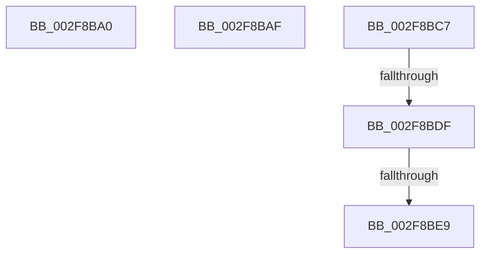

# sub_002F8BA0

- RVA: `0x002F8BA0`–`0x002F8BF2` (길이 `82` bytes)
- VA: `0x00000001402F8BA0`
- 실행 섹션: `.text`
- PDB 이름 있음: `아니요`; PDB Function 태그: `아니요`
- unwind 정보 RVA: `0x000726F8`
- 디코드: `20`개 명령, `82/82` bytes 표시
- 미해석 바이트: `0` (있으면 어셈블리에 `.byte`로 보존)

> 이 문서는 커널 이미지의 기계어와 PDB 기호를 분석해 생성했습니다. 4번과 5번은 함수 원형과 자료형을 바이너리 사용 방식에서 추정한 C 해석이며 원본 소스 복구 결과는 아닙니다.

## 1. Dependencies

- 직접 호출 지점: **0**; 고유 호출 대상: **0**
- 직접 호출자로 확인된 함수: **0**
- RIP 상대 이미지 참조: **0**

### Outgoing calls
- 직접 디코드된 call 명령이 없습니다.

### Direct callers
- 이 함수 시작 RVA로 연결되는 직접 call은 확인되지 않았습니다. 간접 호출은 완전히 역산할 수 없습니다.

### Static image references
- 디코드된 RIP-relative 메모리 참조가 없습니다.

## 2. Other-region calls and transfers

- 다른 실행 섹션으로 향하는 call: **0**
- call이 아닌 외부 분기/꼬리 이동: **5**
  - `0x002F8BAA` → [KiExpandKernelStackAndCalloutOnStackSegment + 0x77](KiExpandKernelStackAndCalloutOnStackSegment_function_002F8880.md) (`tail-transfer`)
  - `0x002F8BC2` → [KiExpandKernelStackAndCalloutOnStackSegment + 0x6D](KiExpandKernelStackAndCalloutOnStackSegment_function_002F8880.md) (`tail-transfer`)
  - `0x002F8BD9` → [sub_002F8911](Unknown_function_002F8911.md) (`tail-transfer`)
  - `0x002F8BE3` → [sub_002F8911](Unknown_function_002F8911.md) (`tail-transfer`)
  - `0x002F8BED` → [sub_002F8911](Unknown_function_002F8911.md) (`tail-transfer`)

## 3. Assembly (complete function range)

```asm
002F8BA0  48 85 DB                        test rbx, rbx
002F8BA3  40 0F B6 FF                     movzx edi, dil
002F8BA7  0F 45 F9                        cmovne edi, ecx
002F8BAA  E9 48 FD FF FF                  jmp 0x1402f88f7
002F8BAF  48 85 DB                        test rbx, rbx
002F8BB2  40 0F B6 FF                     movzx edi, dil
002F8BB6  48 8D 45 B7                     lea rax, [rbp - 0x49]
002F8BBA  0F 45 F9                        cmovne edi, ecx
002F8BBD  48 89 44 24 38                  mov qword ptr [rsp + 0x38], rax
002F8BC2  E9 26 FD FF FF                  jmp 0x1402f88ed
002F8BC7  BA 01 00 00 00                  mov edx, 1
002F8BCC  40 80 CF 01                     or dil, 1
002F8BD0  89 55 77                        mov dword ptr [rbp + 0x77], edx
002F8BD3  44 8B EA                        mov r13d, edx
002F8BD6  48 85 DB                        test rbx, rbx
002F8BD9  0F 84 32 FD FF FF               je 0x1402f8911
002F8BDF  44 38 4B 04                     cmp byte ptr [rbx + 4], r9b
002F8BE3  0F 84 28 FD FF FF               je 0x1402f8911
002F8BE9  44 8D 6A 04                     lea r13d, [rdx + 4]
002F8BED  E9 1F FD FF FF                  jmp 0x1402f8911
```

## 4. C-style interpretation (structured pseudocode)

```c
__int64 __fastcall sub_002F8BA0(int a1, __int64 a2, __int64 a3, unsigned __int8 a4)
{
    __int64 v_rdi;
    unsigned __int64 v_stack_p38;

    v_rdi = (unsigned __int8)(v_rdi);
    if (v_rbx != 0) { v_rdi = a1; }
}
```

## 5. (Beta) C Style

```c
int64_t sub_002F8BA0(int32_t Arg1, int64_t Arg2, int64_t Arg3, uint8_t Arg4)
{
    int64_t local_rdi;
    uint64_t v_stack_p38;

    local_rdi = (uint8_t)(local_rdi);
    if (local_rbx != 0) { local_rdi = Arg1; }
}
```

## 6. Execution-region graph

[열기: 2D/3D 그래프와 함수 탐색 컨트롤 패널](../../../control-panel.html?section=text&rva=0x002F8BA0&view=graph)

- 2D 그래프는 위에서 아래로 흐르고, 3D 그래프는 빈 공간을 드래그해 회전합니다. Shift+드래그는 이동, 휠은 확대·축소, 함수 노드 선택은 대상 보고서 이동입니다.

### Static fallback


