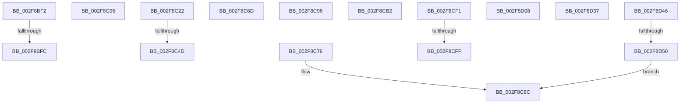

# sub_002F8BF2

- RVA: `0x002F8BF2`–`0x002F8D55` (길이 `355` bytes)
- VA: `0x00000001402F8BF2`
- 실행 섹션: `.text`
- PDB 이름 있음: `아니요`; PDB Function 태그: `아니요`
- unwind 정보 RVA: `0x00072708`
- 디코드: `77`개 명령, `355/355` bytes 표시
- 미해석 바이트: `0` (있으면 어셈블리에 `.byte`로 보존)

> 이 문서는 커널 이미지의 기계어와 PDB 기호를 분석해 생성했습니다. 4번과 5번은 함수 원형과 자료형을 바이너리 사용 방식에서 추정한 C 해석이며 원본 소스 복구 결과는 아닙니다.

## 1. Dependencies

- 직접 호출 지점: **7**; 고유 호출 대상: **6**
- 직접 호출자로 확인된 함수: **0**
- RIP 상대 이미지 참조: **1**

### Outgoing calls
- `0x002F8C18` → [KeReleaseMutantEx](../39/KeReleaseMutantEx_function_00396850.md) (function, `0x00396850`)
- `0x002F8C3D` → [KeWaitForSingleObject](../20/KeWaitForSingleObject_function_0020E6B0.md) (function, `0x0020E6B0`)
- `0x002F8C87` → [KeReleaseMutantEx](../39/KeReleaseMutantEx_function_00396850.md) (function, `0x00396850`)
- `0x002F8C9F` → [KiSwitchKernelStackAndCallout](../6B/KiSwitchKernelStackAndCallout_function_006B2610.md) (function, `0x006B2610`)
- `0x002F8CE0` → [KeBugCheckEx](../4F/KeBugCheckEx_function_004FD660.md) (function, `0x004FD660`)
- `0x002F8D1C` → [ExpInterlockedPushEntrySList](../6B/ExpInterlockedPushEntrySList_function_006BA5B0.md) (function, `0x006BA5B0`)
- `0x002F8D2D` → [KeInsertQueueDpc](../20/KeInsertQueueDpc_function_00207C50.md) (function, `0x00207C50`)

### Direct callers
- 이 함수 시작 RVA로 연결되는 직접 call은 확인되지 않았습니다. 간접 호출은 완전히 역산할 수 없습니다.

### Static image references
- `0x002F8CE6` → RVA `0x00FC5088` (`ALMOSTRO`; read)

## 2. Other-region calls and transfers

- 다른 실행 섹션으로 향하는 call: **0**
- call이 아닌 외부 분기/꼬리 이동: **14**
  - `0x002F8BF6` → [sub_002F8911 + 0x1FB](Unknown_function_002F8911.md) (`tail-transfer`)
  - `0x002F8C01` → [sub_002F8911 + 0x1FB](Unknown_function_002F8911.md) (`tail-transfer`)
  - `0x002F8C1D` → [sub_002F8911 + 0x20B](Unknown_function_002F8911.md) (`tail-transfer`)
  - `0x002F8C47` → [sub_002F8911 + 0x6C](Unknown_function_002F8911.md) (`tail-transfer`)
  - `0x002F8C68` → [sub_002F8911 + 0x228](Unknown_function_002F8911.md) (`tail-transfer`)
  - `0x002F8C71` → [sub_002F8911 + 0x40](Unknown_function_002F8911.md) (`tail-transfer`)
  - `0x002F8C91` → [sub_002F8911 + 0x228](Unknown_function_002F8911.md) (`tail-transfer`)
  - `0x002F8CAD` → [sub_002F8911 + 0x1E9](Unknown_function_002F8911.md) (`tail-transfer`)
  - `0x002F8CEC` → [sub_002F8911 + 0x15A](Unknown_function_002F8911.md) (`tail-transfer`)
  - `0x002F8CF9` → [sub_002F8911 + 0x191](Unknown_function_002F8911.md) (`tail-transfer`)
  - `0x002F8D03` → [sub_002F8911 + 0x191](Unknown_function_002F8911.md) (`tail-transfer`)
  - `0x002F8D32` → [sub_002F8911 + 0x20B](Unknown_function_002F8911.md) (`tail-transfer`)
  - `0x002F8D41` → [sub_002F8911 + 0x122](Unknown_function_002F8911.md) (`tail-transfer`)
  - `0x002F8D4A` → [sub_002F8911 + 0x2D](Unknown_function_002F8911.md) (`tail-transfer`)

## 3. Assembly (complete function range)

```asm
002F8BF2  40 F6 C7 04                     test dil, 4
002F8BF6  0F 85 10 FF FF FF               jne 0x1402f8b0c
002F8BFC  41 80 66 7D FD                  and byte ptr [r14 + 0x7d], 0xfd
002F8C01  E9 06 FF FF FF                  jmp 0x1402f8b0c
002F8C06  BA 01 00 00 00                  mov edx, 1
002F8C0B  48 8D 4B 08                     lea rcx, [rbx + 8]
002F8C0F  4C 8D 4C 24 30                  lea r9, [rsp + 0x30]
002F8C14  44 8D 42 03                     lea r8d, [rdx + 3]
002F8C18  E8 33 DC 09 00                  call 0x140396850
002F8C1D  E9 FA FE FF FF                  jmp 0x1402f8b1c
002F8C22  48 8B 44 24 38                  mov rax, qword ptr [rsp + 0x38]
002F8C27  48 8D 73 08                     lea rsi, [rbx + 8]
002F8C2B  45 33 C9                        xor r9d, r9d
002F8C2E  48 89 44 24 20                  mov qword ptr [rsp + 0x20], rax
002F8C33  45 33 C0                        xor r8d, r8d
002F8C36  48 8B CE                        mov rcx, rsi
002F8C39  41 8D 51 19                     lea edx, [r9 + 0x19]
002F8C3D  E8 6E 5A F1 FF                  call 0x14020e6b0
002F8C42  3D 02 01 00 00                  cmp eax, 0x102
002F8C47  0F 85 30 FD FF FF               jne 0x1402f897d
002F8C4D  41 0F B6 46 7D                  movzx eax, byte ptr [r14 + 0x7d]
002F8C52  40 D0 EF                        shr dil, 1
002F8C55  40 32 F8                        xor dil, al
002F8C58  40 80 E7 02                     and dil, 2
002F8C5C  40 32 F8                        xor dil, al
002F8C5F  B8 08 07 00 C0                  mov eax, 0xc0000708
002F8C64  41 88 7E 7D                     mov byte ptr [r14 + 0x7d], dil
002F8C68  E9 CC FE FF FF                  jmp 0x1402f8b39
002F8C6D  40 80 CF 04                     or dil, 4
002F8C71  E9 DB FC FF FF                  jmp 0x1402f8951
002F8C76  BA 01 00 00 00                  mov edx, 1
002F8C7B  4C 8D 4C 24 30                  lea r9, [rsp + 0x30]
002F8C80  48 8B CE                        mov rcx, rsi
002F8C83  44 8D 42 03                     lea r8d, [rdx + 3]
002F8C87  E8 C4 DB 09 00                  call 0x140396850
002F8C8C  B8 17 00 00 C0                  mov eax, 0xc0000017
002F8C91  E9 A3 FE FF FF                  jmp 0x1402f8b39
002F8C96  65 C6 04 25 E6 88 00 00 01      mov byte ptr gs:[0x88e6], 1
002F8C9F  E8 6C 99 3B 00                  call 0x1406b2610
002F8CA4  65 C6 04 25 E6 88 00 00 00      mov byte ptr gs:[0x88e6], 0
002F8CAD  E9 48 FE FF FF                  jmp 0x1402f8afa
002F8CB2  44 0F 20 C0                     mov rax, cr8
002F8CB6  4C 8B 45 5F                     mov r8, qword ptr [rbp + 0x5f]
002F8CBA  4D 8B CD                        mov r9, r13
002F8CBD  0F B6 D0                        movzx edx, al
002F8CC0  48 C1 E2 08                     shl rdx, 8
002F8CC4  0F B6 C1                        movzx eax, cl
002F8CC7  B9 C8 00 00 00                  mov ecx, 0xc8
002F8CCC  48 0B D0                        or rdx, rax
002F8CCF  48 C7 44 24 20 00 00 00 00      mov qword ptr [rsp + 0x20], 0
002F8CD8  48 C1 E2 08                     shl rdx, 8
002F8CDC  48 83 CA 02                     or rdx, 2
002F8CE0  E8 7B 49 20 00                  call 0x1404fd660
002F8CE5  CC                              int3
002F8CE6  8B 05 9C C3 CC 00               mov eax, dword ptr [rip + 0xccc39c]
002F8CEC  E9 7A FD FF FF                  jmp 0x1402f8a6b
002F8CF1  48 83 CE 01                     or rsi, 1
002F8CF5  41 F6 C5 04                     test r13b, 4
002F8CF9  0F 84 A3 FD FF FF               je 0x1402f8aa2
002F8CFF  48 83 CE 02                     or rsi, 2
002F8D03  E9 9A FD FF FF                  jmp 0x1402f8aa2
002F8D08  65 48 8B 1C 25 20 00 00 00      mov rbx, qword ptr gs:[0x20]
002F8D11  49 8D 57 F0                     lea rdx, [r15 - 0x10]
002F8D15  48 8D 8B D0 A1 00 00            lea rcx, [rbx + 0xa1d0]
002F8D1C  E8 8F 18 3C 00                  call 0x1406ba5b0
002F8D21  48 8D 8B 50 A1 00 00            lea rcx, [rbx + 0xa150]
002F8D28  45 33 C0                        xor r8d, r8d
002F8D2B  33 D2                           xor edx, edx
002F8D2D  E8 1E EF F0 FF                  call 0x140207c50
002F8D32  E9 E5 FD FF FF                  jmp 0x1402f8b1c
002F8D37  41 8B C5                        mov eax, r13d
002F8D3A  83 C8 40                        or eax, 0x40
002F8D3D  89 44 24 40                     mov dword ptr [rsp + 0x40], eax
002F8D41  E9 ED FC FF FF                  jmp 0x1402f8a33
002F8D46  80 7B 04 00                     cmp byte ptr [rbx + 4], 0
002F8D4A  0F 85 EE FB FF FF               jne 0x1402f893e
002F8D50  E9 37 FF FF FF                  jmp 0x1402f8c8c
```

## 4. C-style interpretation (structured pseudocode)

```c
__int64 __fastcall sub_002F8BF2(void)
{
    unsigned __int64 v_stack_p20;
    unsigned __int64 v_stack_p30;
    unsigned __int64 v_stack_p38;
    unsigned int v_stack_p40;
}
```

## 5. (Beta) C Style

```c
void sub_002F8BF2(void)
{
    uint64_t v_stack_p20;
    uint64_t v_stack_p30;
    uint64_t v_stack_p38;
    uint32_t v_stack_p40;
}
```

## 6. Execution-region graph

[열기: 2D/3D 그래프와 함수 탐색 컨트롤 패널](../../../control-panel.html?section=text&rva=0x002F8BF2&view=graph)

- 2D 그래프는 위에서 아래로 흐르고, 3D 그래프는 빈 공간을 드래그해 회전합니다. Shift+드래그는 이동, 휠은 확대·축소, 함수 노드 선택은 대상 보고서 이동입니다.

### Static fallback


