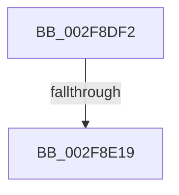

# sub_002F8DF2

- RVA: `0x002F8DF2`–`0x002F8E26` (길이 `52` bytes)
- VA: `0x00000001402F8DF2`
- 실행 섹션: `.text`
- PDB 이름 있음: `아니요`; PDB Function 태그: `아니요`
- unwind 정보 RVA: `0x00072738`
- 디코드: `9`개 명령, `52/52` bytes 표시
- 미해석 바이트: `0` (있으면 어셈블리에 `.byte`로 보존)

> 이 문서는 커널 이미지의 기계어와 PDB 기호를 분석해 생성했습니다. 4번과 5번은 함수 원형과 자료형을 바이너리 사용 방식에서 추정한 C 해석이며 원본 소스 복구 결과는 아닙니다.

## 1. Dependencies

- 직접 호출 지점: **1**; 고유 호출 대상: **1**
- 직접 호출자로 확인된 함수: **0**
- RIP 상대 이미지 참조: **0**

### Outgoing calls
- `0x002F8E08` → [ExpInterlockedPopEntrySList](../6B/ExpInterlockedPopEntrySList_function_006BA570.md) (function, `0x006BA570`)

### Direct callers
- 이 함수 시작 RVA로 연결되는 직접 call은 확인되지 않았습니다. 간접 호출은 완전히 역산할 수 없습니다.

### Static image references
- 디코드된 RIP-relative 메모리 참조가 없습니다.

## 2. Other-region calls and transfers

- 다른 실행 섹션으로 향하는 call: **0**
- call이 아닌 외부 분기/꼬리 이동: **1**
  - `0x002F8E13` → [sub_002F926B](Unknown_function_002F926B.md) (`tail-transfer`)

## 3. Assembly (complete function range)

```asm
002F8DF2  48 89 B4 24 60 01 00 00         mov qword ptr [rsp + 0x160], rsi
002F8DFA  48 8B 88 A8 8B 00 00            mov rcx, qword ptr [rax + 0x8ba8]
002F8E01  48 81 C1 80 01 00 00            add rcx, 0x180
002F8E08  E8 63 17 3C 00                  call 0x1406ba570
002F8E0D  48 8B F0                        mov rsi, rax
002F8E10  48 85 C0                        test rax, rax
002F8E13  0F 84 52 04 00 00               je 0x1402f926b
002F8E19  41 F7 87 30 03 00 00 00 00 00 40  test dword ptr [r15 + 0x330], 0x40000000
002F8E24  8B D3                           mov edx, ebx
```

## 4. C-style interpretation (structured pseudocode)

```c
__int64 __fastcall sub_002F8DF2(void)
{
    __int64 result;
    unsigned __int64 v_stack_p160;

    v_stack_p160 = v_rsi;
    a1 = (*(unsigned __int64 *)(result + 35752)) + (384);
    result = ExpInterlockedPopEntrySList(a1, a2, a3, a4);
    return result;
}
```

## 5. (Beta) C Style

```c
void sub_002F8DF2(void)
{
    int64_t result;
    uint64_t v_stack_p160;

    v_stack_p160 = local_rsi;
    a1 = (*(uint64_t *)(result + 0x8BA8)) + (384);
    result = ExpInterlockedPopEntrySList(a1, a2, a3, a4);
    return result;
}
```

## 6. Execution-region graph

[열기: 2D/3D 그래프와 함수 탐색 컨트롤 패널](../../../control-panel.html?section=text&rva=0x002F8DF2&view=graph)

- 2D 그래프는 위에서 아래로 흐르고, 3D 그래프는 빈 공간을 드래그해 회전합니다. Shift+드래그는 이동, 휠은 확대·축소, 함수 노드 선택은 대상 보고서 이동입니다.

### Static fallback


