# sub_002F8E26

- RVA: `0x002F8E26`–`0x002F908B` (길이 `613` bytes)
- VA: `0x00000001402F8E26`
- 실행 섹션: `.text`
- PDB 이름 있음: `아니요`; PDB Function 태그: `아니요`
- unwind 정보 RVA: `0x0007274C`
- 디코드: `132`개 명령, `613/613` bytes 표시
- 미해석 바이트: `0` (있으면 어셈블리에 `.byte`로 보존)

> 이 문서는 커널 이미지의 기계어와 PDB 기호를 분석해 생성했습니다. 4번과 5번은 함수 원형과 자료형을 바이너리 사용 방식에서 추정한 C 해석이며 원본 소스 복구 결과는 아닙니다.

## 1. Dependencies

- 직접 호출 지점: **6**; 고유 호출 대상: **6**
- 직접 호출자로 확인된 함수: **0**
- RIP 상대 이미지 참조: **3**

### Outgoing calls
- `0x002F8E89` → [KeAreInterruptsEnabled](KeAreInterruptsEnabled_function_002F8060.md) (function, `0x002F8060`)
- `0x002F8EA2` → [Feature_ETWStackExpandedStackwalks__private_IsEnabledDeviceUsageNoInline](../44/Feature_ETWStackExpandedStackwalks__private_IsEnabledDeviceUsageNoInline_function_00444094.md) (function, `0x00444094`)
- `0x002F8F0F` → [KeExpandKernelStackAndCalloutInternal](KeExpandKernelStackAndCalloutInternal_function_002F8450.md) (function, `0x002F8450`)
- `0x002F8F54` → [RtlWalkFrameChain](RtlWalkFrameChain_function_002F85E0.md) (function, `0x002F85E0`)
- `0x002F901E` → [EtwpLogKernelEvent](../25/EtwpLogKernelEvent_function_0025CC00.md) (function, `0x0025CC00`)
- `0x002F906E` → [ExpInterlockedPushEntrySList](../6B/ExpInterlockedPushEntrySList_function_006BA5B0.md) (function, `0x006BA5B0`)

### Direct callers
- 이 함수 시작 RVA로 연결되는 직접 call은 확인되지 않았습니다. 간접 호출은 완전히 역산할 수 없습니다.

### Static image references
- `0x002F8EC4` → RVA `0x00453680` (`EtwpExpandedStackWalk`; read)
- `0x002F9045` → RVA `0x00FC6A80` (`ALMOSTRO`; read)
- `0x002F9052` → RVA `0x00FC8C40` (`ALMOSTRO`; read)

## 2. Other-region calls and transfers

- 다른 실행 섹션으로 향하는 call: **0**
- call이 아닌 외부 분기/꼬리 이동: **9**
  - `0x002F8E3D` → [sub_002F9323](Unknown_function_002F9323.md) (`tail-transfer`)
  - `0x002F8F1C` → [sub_002F92E7](Unknown_function_002F92E7.md) (`tail-transfer`)
  - `0x002F8F2F` → [sub_002F92E7](Unknown_function_002F92E7.md) (`tail-transfer`)
  - `0x002F8F37` → [sub_002F92A3 + 0x1D](Unknown_function_002F92A3.md) (`tail-transfer`)
  - `0x002F8F61` → [sub_002F92E7 + 0x1A](Unknown_function_002F92E7.md) (`tail-transfer`)
  - `0x002F8F8C` → [sub_002F90AE + 0x18](Unknown_function_002F90AE.md) (`tail-transfer`)
  - `0x002F8FE7` → [sub_002F90AE + 0x16C](Unknown_function_002F90AE.md) (`tail-transfer`)
  - `0x002F9037` → [sub_002F90AE](Unknown_function_002F90AE.md) (`tail-transfer`)
  - `0x002F903F` → [sub_002F90AE + 0x1AA](Unknown_function_002F90AE.md) (`tail-transfer`)

## 3. Assembly (complete function range)

```asm
002F8E26  4C 89 A4 24 18 01 00 00         mov qword ptr [rsp + 0x118], r12
002F8E2E  44 8B E3                        mov r12d, ebx
002F8E31  4C 89 AC 24 10 01 00 00         mov qword ptr [rsp + 0x110], r13
002F8E39  4C 8D 6E 20                     lea r13, [rsi + 0x20]
002F8E3D  0F 85 E0 04 00 00               jne 0x1402f9323
002F8E43  48 89 BC 24 20 01 00 00         mov qword ptr [rsp + 0x120], rdi
002F8E4B  41 0F BA E6 0B                  bt r14d, 0xb
002F8E50  0F 83 14 01 00 00               jae 0x1402f8f6a
002F8E56  41 8B FE                        mov edi, r14d
002F8E59  C1 EF 14                        shr edi, 0x14
002F8E5C  83 E7 0F                        and edi, 0xf
002F8E5F  44 8B E7                        mov r12d, edi
002F8E62  41 C1 E4 08                     shl r12d, 8
002F8E66  41 0F BA E6 19                  bt r14d, 0x19
002F8E6B  73 04                           jae 0x1402f8e71
002F8E6D  41 83 CC 02                     or r12d, 2
002F8E71  F0 41 FF 87 00 04 00 00         lock inc dword ptr [r15 + 0x400]
002F8E79  48 8B 46 18                     mov rax, qword ptr [rsi + 0x18]
002F8E7D  44 8D AF 00 01 00 00            lea r13d, [rdi + 0x100]
002F8E84  48 89 44 24 40                  mov qword ptr [rsp + 0x40], rax
002F8E89  E8 D2 F1 FF FF                  call 0x1402f8060
002F8E8E  84 C0                           test al, al
002F8E90  0F 84 B1 00 00 00               je 0x1402f8f47
002F8E96  44 0F 20 C0                     mov rax, cr8
002F8E9A  3C 02                           cmp al, 2
002F8E9C  0F 87 A5 00 00 00               ja 0x1402f8f47
002F8EA2  E8 ED B1 14 00                  call 0x140444094
002F8EA7  85 C0                           test eax, eax
002F8EA9  0F 84 98 00 00 00               je 0x1402f8f47
002F8EAF  44 89 6D B0                     mov dword ptr [rbp - 0x50], r13d
002F8EB3  48 8D 46 20                     lea rax, [rsi + 0x20]
002F8EB7  4C 8B 6C 24 40                  mov r13, qword ptr [rsp + 0x40]
002F8EBC  48 8D 55 98                     lea rdx, [rbp - 0x68]
002F8EC0  48 89 45 98                     mov qword ptr [rbp - 0x68], rax
002F8EC4  48 8D 0D B5 A7 15 00            lea rcx, [rip + 0x15a7b5]
002F8ECB  48 8B 44 24 40                  mov rax, qword ptr [rsp + 0x40]
002F8ED0  41 B9 08 00 00 40               mov r9d, 0x40000008
002F8ED6  48 89 45 A0                     mov qword ptr [rbp - 0x60], rax
002F8EDA  41 B8 00 60 00 00               mov r8d, 0x6000
002F8EE0  48 89 5D B8                     mov qword ptr [rbp - 0x48], rbx
002F8EE4  44 89 65 B4                     mov dword ptr [rbp - 0x4c], r12d
002F8EE8  65 4C 8B 24 25 88 01 00 00      mov r12, qword ptr gs:[0x188]
002F8EF1  4C 89 65 A8                     mov qword ptr [rbp - 0x58], r12
002F8EF5  4C 89 6C 24 20                  mov qword ptr [rsp + 0x20], r13
002F8EFA  41 0F B6 44 24 7D               movzx eax, byte ptr [r12 + 0x7d]
002F8F00  83 E0 01                        and eax, 1
002F8F03  49 89 B4 24 B0 06 00 00         mov qword ptr [r12 + 0x6b0], rsi
002F8F0B  89 44 24 30                     mov dword ptr [rsp + 0x30], eax
002F8F0F  E8 3C F5 FF FF                  call 0x1402f8450
002F8F14  41 0F B6 4D 07                  movzx ecx, byte ptr [r13 + 7]
002F8F19  F6 C1 02                        test cl, 2
002F8F1C  0F 85 C5 03 00 00               jne 0x1402f92e7
002F8F22  41 0F B6 4C 24 7D               movzx ecx, byte ptr [r12 + 0x7d]
002F8F28  83 E1 01                        and ecx, 1
002F8F2B  39 4C 24 30                     cmp dword ptr [rsp + 0x30], ecx
002F8F2F  0F 85 B2 03 00 00               jne 0x1402f92e7
002F8F35  85 C0                           test eax, eax
002F8F37  0F 88 83 03 00 00               js 0x1402f92c0
002F8F3D  44 8B 65 B8                     mov r12d, dword ptr [rbp - 0x48]
002F8F41  4C 8D 6E 20                     lea r13, [rsi + 0x20]
002F8F45  EB 15                           jmp 0x1402f8f5c
002F8F47  41 8B D5                        mov edx, r13d
002F8F4A  45 8B C4                        mov r8d, r12d
002F8F4D  4C 8D 6E 20                     lea r13, [rsi + 0x20]
002F8F51  49 8B CD                        mov rcx, r13
002F8F54  E8 87 F6 FF FF                  call 0x1402f85e0
002F8F59  44 8B E0                        mov r12d, eax
002F8F5C  8B D3                           mov edx, ebx
002F8F5E  44 3B E7                        cmp r12d, edi
002F8F61  0F 86 9A 03 00 00               jbe 0x1402f9301
002F8F67  44 2B E7                        sub r12d, edi
002F8F6A  B9 18 00 00 00                  mov ecx, 0x18
002F8F6F  B8 00 04 00 00                  mov eax, 0x400
002F8F74  4C 8B CE                        mov r9, rsi
002F8F77  4D 8B C7                        mov r8, r15
002F8F7A  48 8D 3C 0E                     lea rdi, [rsi + rcx]
002F8F7E  48 89 7C 24 78                  mov qword ptr [rsp + 0x78], rdi
002F8F83  4D 8D 0C 07                     lea r9, [r15 + rax]
002F8F87  41 0F BA E6 0C                  bt r14d, 0xc
002F8F8C  0F 82 34 01 00 00               jb 0x1402f90c6
002F8F92  42 8D 3C 22                     lea edi, [rdx + r12]
002F8F96  85 FF                           test edi, edi
002F8F98  0F 84 85 00 00 00               je 0x1402f9023
002F8F9E  48 8B 4C 24 68                  mov rcx, qword ptr [rsp + 0x68]
002F8FA3  41 81 E6 02 E6 FF FF            and r14d, 0xffffe602
002F8FAA  41 83 CE 02                     or r14d, 2
002F8FAE  48 C7 45 F0 10 00 00 00         mov qword ptr [rbp - 0x10], 0x10
002F8FB6  41 F7 87 30 03 00 00 00 00 00 01  test dword ptr [r15 + 0x330], 0x1000000
002F8FC1  8B 81 08 05 00 00               mov eax, dword ptr [rcx + 0x508]
002F8FC7  89 45 88                        mov dword ptr [rbp - 0x78], eax
002F8FCA  8B 81 10 05 00 00               mov eax, dword ptr [rcx + 0x510]
002F8FD0  89 45 8C                        mov dword ptr [rbp - 0x74], eax
002F8FD3  48 8B 44 24 70                  mov rax, qword ptr [rsp + 0x70]
002F8FD8  48 8B 00                        mov rax, qword ptr [rax]
002F8FDB  48 89 45 80                     mov qword ptr [rbp - 0x80], rax
002F8FDF  48 8D 45 80                     lea rax, [rbp - 0x80]
002F8FE3  48 89 45 E8                     mov qword ptr [rbp - 0x18], rax
002F8FE7  0F 85 2D 02 00 00               jne 0x1402f921a
002F8FED  45 8B 07                        mov r8d, dword ptr [r15]
002F8FF0  8D 04 FD 00 00 00 00            lea eax, [rdi*8]
002F8FF7  49 8B 97 50 05 00 00            mov rdx, qword ptr [r15 + 0x550]
002F8FFE  48 8D 4D E8                     lea rcx, [rbp - 0x18]
002F9002  44 89 74 24 28                  mov dword ptr [rsp + 0x28], r14d
002F9007  41 B9 02 00 00 00               mov r9d, 2
002F900D  89 45 00                        mov dword ptr [rbp], eax
002F9010  4C 89 6D F8                     mov qword ptr [rbp - 8], r13
002F9014  89 5D 04                        mov dword ptr [rbp + 4], ebx
002F9017  66 C7 44 24 20 20 18            mov word ptr [rsp + 0x20], 0x1820
002F901E  E8 DD 3B F6 FF                  call 0x14025cc00
002F9023  4C 8B 44 24 78                  mov r8, qword ptr [rsp + 0x78]
002F9028  4D 8B 00                        mov r8, qword ptr [r8]
002F902B  4D 85 C0                        test r8, r8
002F902E  74 09                           je 0x1402f9039
002F9030  41 0F B6 40 07                  movzx eax, byte ptr [r8 + 7]
002F9035  A8 02                           test al, 2
002F9037  75 75                           jne 0x1402f90ae
002F9039  8B 4E 10                        mov ecx, dword ptr [rsi + 0x10]
002F903C  83 F9 FF                        cmp ecx, -1
002F903F  0F 84 13 02 00 00               je 0x1402f9258
002F9045  8B 05 35 DA CC 00               mov eax, dword ptr [rip + 0xccda35]
002F904B  3B C8                           cmp ecx, eax
002F904D  73 0E                           jae 0x1402f905d
002F904F  0F AE E8                        lfence
002F9052  48 8D 05 E7 FB CC 00            lea rax, [rip + 0xccfbe7]
002F9059  48 8B 1C C8                     mov rbx, qword ptr [rax + rcx*8]
002F905D  48 8B 8B A8 8B 00 00            mov rcx, qword ptr [rbx + 0x8ba8]
002F9064  48 81 C1 80 01 00 00            add rcx, 0x180
002F906B  48 8B D6                        mov rdx, rsi
002F906E  E8 3D 15 3C 00                  call 0x1406ba5b0
002F9073  48 8B BC 24 20 01 00 00         mov rdi, qword ptr [rsp + 0x120]
002F907B  4C 8B A4 24 18 01 00 00         mov r12, qword ptr [rsp + 0x118]
002F9083  4C 8B AC 24 10 01 00 00         mov r13, qword ptr [rsp + 0x110]
```

## 4. C-style interpretation (structured pseudocode)

```c
__int64 __fastcall sub_002F8E26(__int64 a1, __int64 a2, __int64 a3, __int64 a4, __int64 a5, unsigned int a6, __int64 a7, __int64 a8, __int64 a9, __int64 a10, __int64 a11, __int64 a12, __int64 a13, __int64 a14, __int64 a15, __int64 a16, __int64 a17, __int64 a18, __int64 a19, __int64 a20, __int64 a21, __int64 a22, __int64 a23, __int64 a24, __int64 a25, __int64 a26, __int64 a27, __int64 a28, __int64 a29, __int64 a30, __int64 a31, __int64 a32, __int64 a33, __int64 a34, __int64 a35, __int64 a36)
{
    __int64 result;
    __int64 v_r12;
    __int64 v_r14;
    __int64 v_rbx;
    __int64 v_rdi;
    unsigned __int64 v_stack_p110;
    unsigned __int64 v_stack_p118;
    unsigned __int64 v_stack_p120;
    unsigned __int64 v_stack_p20;
    unsigned int v_stack_p28;
    unsigned int v_stack_p30;
    unsigned __int64 v_stack_p40;
    unsigned __int64 v_stack_p78;

    v_stack_p118 = v_r12;
    v_stack_p110 = v_r13;
    v_stack_p120 = v_rdi;
    if (condition_is_above_or_equal) goto loc_002F8F6A;
    v_rdi = (unsigned int)(((unsigned int)((unsigned int)(v_r14))) >> (20));
    v_rdi = (unsigned int)((v_rdi) & (15));
    v_r12 = (unsigned int)(((unsigned int)((unsigned int)(v_rdi))) << (8));
    if (!(condition_is_above_or_equal)) {
        v_r12 = (unsigned int)((v_r12) | (2));
    }
    v_stack_p40 = *(unsigned __int64 *)(v_rsi + 24);
    result = KeAreInterruptsEnabled(a1, a2, a3, a4);
    if ((unsigned __int8)(result) == 0) goto loc_002F8F47;
    if (((unsigned __int8)(v_cr8)) > 2) goto loc_002F8F47;
    result = Feature_ETWStackExpandedStackwalks__private_IsEnabledDeviceUsageNoInline(a1, a2, a3, a4);
    if ((unsigned int)(result) == 0) goto loc_002F8F47;
    *(unsigned int *)(v_rbp - 80) = (unsigned int)(v_rdi + 256);
    *(unsigned __int64 *)(v_rbp - 104) = v_rsi + 32;
    *(unsigned __int64 *)(v_rbp - 96) = a8;
    *(unsigned __int64 *)(v_rbp - 72) = v_rbx;
    *(unsigned int *)(v_rbp - 76) = (unsigned int)(v_r12);
    *(unsigned __int64 *)(v_rbp - 88) = *(unsigned __int64 *)(gs_base + (0 + 392));
    v_stack_p20 = a8;
    result = (unsigned int)((*(unsigned __int8 *)(*(unsigned __int64 *)(gs_base + (0 + 392)) + 125)) & (1));
    *(unsigned __int64 *)(*(unsigned __int64 *)(gs_base + (0 + 392)) + 1712) = v_rsi;
    v_stack_p30 = (unsigned int)(result);
    result = KeExpandKernelStackAndCalloutInternal(v_rip + 1419189, v_rbp - 104, (unsigned int)(0x6000ULL), (unsigned int)(0x40000008ULL));
    a1 = (unsigned int)((*(unsigned __int8 *)(*(unsigned __int64 *)(gs_base + (0 + 392)) + 125)) & (1));
    goto loc_002F8F5C;
loc_002F8F47:
    result = RtlWalkFrameChain(v_rsi + 32, (unsigned int)((unsigned int)(v_rsi + 32)), (unsigned int)((unsigned int)((unsigned int)(*(unsigned int *)(v_rbp - 72)))), (unsigned int)(0x40000008ULL));
loc_002F8F5C:
    v_r12 = (unsigned int)(((unsigned int)((unsigned int)(result))) - ((unsigned int)(v_rdi)));
loc_002F8F6A:
    v_stack_p78 = v_rsi + 24 * 1;
    if ((unsigned int)((unsigned int)((unsigned int)(v_rbx)) + v_r12 * 1) == 0) goto loc_002F9023;
    v_r14 = (unsigned int)((v_r14) & (0xFFFFE602ULL));
    v_r14 = (unsigned int)((v_r14) | (2));
    *(unsigned __int64 *)(v_rbp - 16) = 16;
    *(unsigned int *)(v_rbp - 120) = (unsigned int)((unsigned int)(*(unsigned int *)(a13 + 1288)));
    *(unsigned int *)(v_rbp - 116) = (unsigned int)((unsigned int)(*(unsigned int *)(a13 + 1296)));
    *(unsigned __int64 *)(v_rbp - 128) = *(unsigned __int64 *)(a14);
    *(unsigned __int64 *)(v_rbp - 24) = v_rbp - 128;
    v_stack_p28 = (unsigned int)(v_r14);
    *(unsigned int *)(v_rbp) = (unsigned int)((unsigned int)((unsigned int)(v_rbx)) + v_r12 * 1 * 8);
    *(unsigned __int64 *)(v_rbp - 8) = v_rsi + 32;
    *(unsigned int *)(v_rbp + 4) = (unsigned int)(v_rbx);
    v_stack_p20 = 0x1820ULL;
    result = EtwpLogKernelEvent(v_rbp - 24, *(unsigned __int64 *)(v_r15 + 1360), (unsigned int)(*(unsigned int *)(v_r15)), 2);
loc_002F9023:
    if (*(unsigned __int64 *)(a15) == 0) goto loc_002F9039;
loc_002F9039:
    result = (unsigned int)(*(unsigned int *)(v_rip + 13425205));
    if (((unsigned int)((unsigned int)(*(unsigned int *)(v_rsi + 16)))) < ((unsigned int)((unsigned int)(*(unsigned int *)(v_rip + 13425205))))) {
        result = v_rip + 13433831;
        v_rbx = *(unsigned __int64 *)(result + (unsigned int)(*(unsigned int *)(v_rsi + 16)) * 8);
    }
    a1 = (*(unsigned __int64 *)(v_rbx + 35752)) + (384);
    result = ExpInterlockedPushEntrySList(a1, v_rsi, *(unsigned __int64 *)(a15), 2);
    return result;
}
```

## 5. (Beta) C Style

```c
int64_t sub_002F8E26(int64_t Arg1, int64_t Arg2, int64_t Arg3, int64_t Arg4, uint64_t Arg5, uint32_t Arg6, uint64_t Arg7, void *Arg8, uint64_t Arg9, uint64_t Arg10, uint64_t Arg11, uint64_t Arg12, void *Arg13, void *Arg14, void *Arg15, uint64_t Arg16, uint64_t Arg17, uint64_t Arg18, uint64_t Arg19, uint64_t Arg20, uint64_t Arg21, uint64_t Arg22, uint64_t Arg23, uint64_t Arg24, uint64_t Arg25, uint64_t Arg26, uint64_t Arg27, uint64_t Arg28, uint64_t Arg29, uint64_t Arg30, uint64_t Arg31, uint64_t Arg32, uint64_t Arg33, int64_t Arg34, int64_t Arg35, int64_t Arg36)
{
    uint8_t *arg8 = (uint8_t *)Arg8;
    uint8_t *arg13 = (uint8_t *)Arg13;
    uint8_t *arg14 = (uint8_t *)Arg14;
    uint8_t *arg15 = (uint8_t *)Arg15;

    int64_t result;
    int64_t local_r12;
    int64_t local_r14;
    int64_t local_rbx;
    int64_t local_rdi;
    uint64_t v_stack_p110;
    uint64_t v_stack_p118;
    uint64_t v_stack_p120;
    uint64_t v_stack_p20;
    uint32_t v_stack_p28;
    uint32_t v_stack_p30;
    uint64_t v_stack_p40;
    uint64_t v_stack_p78;

    v_stack_p118 = local_r12;
    v_stack_p110 = local_r13;
    v_stack_p120 = local_rdi;
    if (condition_is_above_or_equal) goto loc_002F8F6A;
    local_rdi = (uint32_t)(((uint32_t)((uint32_t)(local_r14))) >> (20));
    local_rdi = (uint32_t)((local_rdi) & (15));
    local_r12 = (uint32_t)(((uint32_t)((uint32_t)(local_rdi))) << (8));
    if (!(condition_is_above_or_equal)) {
        local_r12 = (uint32_t)((local_r12) | (2));
    }
    v_stack_p40 = *(uint64_t *)(local_rsi + 0x18);
    result = KeAreInterruptsEnabled(Arg1, Arg2, Arg3, Arg4);
    if ((uint8_t)(result) == 0) goto loc_002F8F47;
    if (((uint8_t)(v_cr8)) > 2) goto loc_002F8F47;
    result = Feature_ETWStackExpandedStackwalks__private_IsEnabledDeviceUsageNoInline(Arg1, Arg2, Arg3, Arg4);
    if ((uint32_t)(result) == 0) goto loc_002F8F47;
    *(uint32_t *)(local_rbp - 0x50) = (uint32_t)(local_rdi + 256);
    *(uint64_t *)(local_rbp - 0x68) = local_rsi + 32;
    *(void **)(local_rbp - 0x60) = Arg8;
    *(uint64_t *)(local_rbp - 0x48) = local_rbx;
    *(uint32_t *)(local_rbp - 0x4C) = (uint32_t)(local_r12);
    *(uint64_t *)(local_rbp - 0x58) = *(uint64_t *)(gs_base + (0 + 0x188));
    v_stack_p20 = Arg8;
    result = (uint32_t)((*(uint8_t *)(*(uint64_t *)(gs_base + (0 + 0x188)) + 0x7D)) & (1));
    *(uint64_t *)(*(uint64_t *)(gs_base + (0 + 0x188)) + 0x6B0) = local_rsi;
    v_stack_p30 = (uint32_t)(result);
    result = KeExpandKernelStackAndCalloutInternal(v_rip + 1419189, local_rbp - 104, (uint32_t)(0x6000ULL), (uint32_t)(0x40000008ULL));
    Arg1 = (uint32_t)((*(uint8_t *)(*(uint64_t *)(gs_base + (0 + 0x188)) + 0x7D)) & (1));
    goto loc_002F8F5C;
loc_002F8F47:
    result = RtlWalkFrameChain(local_rsi + 32, (uint32_t)((uint32_t)(local_rsi + 32)), (uint32_t)((uint32_t)((uint32_t)(*(uint32_t *)(local_rbp - 0x48)))), (uint32_t)(0x40000008ULL));
loc_002F8F5C:
    local_r12 = (uint32_t)(((uint32_t)((uint32_t)(result))) - ((uint32_t)(local_rdi)));
loc_002F8F6A:
    v_stack_p78 = local_rsi + 24 * 1;
    if ((uint32_t)((uint32_t)((uint32_t)(local_rbx)) + local_r12 * 1) == 0) goto loc_002F9023;
    local_r14 = (uint32_t)((local_r14) & (0xFFFFE602ULL));
    local_r14 = (uint32_t)((local_r14) | (2));
    *(uint64_t *)(local_rbp - 0x10) = 16;
    *(uint32_t *)(local_rbp - 0x78) = (uint32_t)((uint32_t)(*(uint32_t *)(arg13 + 0x508)));
    *(uint32_t *)(local_rbp - 0x74) = (uint32_t)((uint32_t)(*(uint32_t *)(arg13 + 0x510)));
    *(uint64_t *)(local_rbp - 0x80) = *(uint64_t *)(arg14);
    *(uint64_t *)(local_rbp - 0x18) = local_rbp - 128;
    v_stack_p28 = (uint32_t)(local_r14);
    *(uint32_t *)(local_rbp) = (uint32_t)((uint32_t)((uint32_t)(local_rbx)) + local_r12 * 1 * 8);
    *(uint64_t *)(local_rbp - 0x8) = local_rsi + 32;
    *(uint32_t *)(local_rbp + 0x4) = (uint32_t)(local_rbx);
    v_stack_p20 = 0x1820ULL;
    result = EtwpLogKernelEvent(local_rbp - 24, *(uint64_t *)(local_r15 + 0x550), (uint32_t)(*(uint32_t *)(local_r15)), 2);
loc_002F9023:
    if (*(uint64_t *)(arg15) == 0) goto loc_002F9039;
loc_002F9039:
    result = (uint32_t)(*(uint32_t *)(v_rip + 0xCCDA35));
    if (((uint32_t)((uint32_t)(*(uint32_t *)(local_rsi + 0x10)))) < ((uint32_t)((uint32_t)(*(uint32_t *)(v_rip + 0xCCDA35))))) {
        result = v_rip + 13433831;
        local_rbx = *(uint64_t *)(result + (uint32_t)(*(uint32_t *)(local_rsi + 0x10)) * 8);
    }
    Arg1 = (*(uint64_t *)(local_rbx + 0x8BA8)) + (384);
    result = ExpInterlockedPushEntrySList(Arg1, local_rsi, *(uint64_t *)(arg15), 2);
    return result;
}
```

### 관측된 메모리 오프셋

구조체 형식이 확인되지 않은 접근은 인자 기준의 오프셋으로만 기록했습니다.

| 기준 인자 | 오프셋 표현 | 폭 (bit) | 접근 |
|---|---:|---:|---|
| `Arg8` | `+ 0x7` | `8` | `R` |
| `Arg13` | `+ 0x508` | `32` | `R` |
| `Arg13` | `+ 0x510` | `32` | `R` |
| `Arg14` | `+ 0x0` | `64` | `R` |
| `Arg15` | `+ 0x0` | `64` | `R` |

## 6. Execution-region graph

[열기: 2D/3D 그래프와 함수 탐색 컨트롤 패널](../../../control-panel.html?section=text&rva=0x002F8E26&view=graph)

- 2D 그래프는 위에서 아래로 흐르고, 3D 그래프는 빈 공간을 드래그해 회전합니다. Shift+드래그는 이동, 휠은 확대·축소, 함수 노드 선택은 대상 보고서 이동입니다.

### Static fallback

```mermaid
flowchart TD
  bb_002F8E26[BB_002F8E26]
  bb_002F8E43[BB_002F8E43]
  bb_002F8E56[BB_002F8E56]
  bb_002F8E6D[BB_002F8E6D]
  bb_002F8E71[BB_002F8E71]
  bb_002F8E96[BB_002F8E96]
  bb_002F8EA2[BB_002F8EA2]
  bb_002F8EAF[BB_002F8EAF]
  bb_002F8F22[BB_002F8F22]
  bb_002F8F35[BB_002F8F35]
  bb_002F8F3D[BB_002F8F3D]
  bb_002F8F47[BB_002F8F47]
  bb_002F8F5C[BB_002F8F5C]
  bb_002F8F67[BB_002F8F67]
  bb_002F8F6A[BB_002F8F6A]
  bb_002F8F92[BB_002F8F92]
  bb_002F8F9E[BB_002F8F9E]
  bb_002F8FED[BB_002F8FED]
  bb_002F9023[BB_002F9023]
  bb_002F9030[BB_002F9030]
  bb_002F9039[BB_002F9039]
  bb_002F9045[BB_002F9045]
  bb_002F904F[BB_002F904F]
  bb_002F905D[BB_002F905D]
  bb_002F8E26 -->|fallthrough| bb_002F8E43
  bb_002F8E43 -->|branch| bb_002F8F6A
  bb_002F8E43 -->|fallthrough| bb_002F8E56
  bb_002F8E56 -->|branch| bb_002F8E71
  bb_002F8E56 -->|fallthrough| bb_002F8E6D
  bb_002F8E6D -->|flow| bb_002F8E71
  bb_002F8E71 -->|branch| bb_002F8F47
  bb_002F8E71 -->|fallthrough| bb_002F8E96
  bb_002F8E96 -->|branch| bb_002F8F47
  bb_002F8E96 -->|fallthrough| bb_002F8EA2
  bb_002F8EA2 -->|branch| bb_002F8F47
  bb_002F8EA2 -->|fallthrough| bb_002F8EAF
  bb_002F8EAF -->|fallthrough| bb_002F8F22
  bb_002F8F22 -->|fallthrough| bb_002F8F35
  bb_002F8F35 -->|fallthrough| bb_002F8F3D
  bb_002F8F3D -->|branch| bb_002F8F5C
  bb_002F8F47 -->|flow| bb_002F8F5C
  bb_002F8F5C -->|fallthrough| bb_002F8F67
  bb_002F8F67 -->|flow| bb_002F8F6A
  bb_002F8F6A -->|fallthrough| bb_002F8F92
  bb_002F8F92 -->|branch| bb_002F9023
  bb_002F8F92 -->|fallthrough| bb_002F8F9E
  bb_002F8F9E -->|fallthrough| bb_002F8FED
  bb_002F8FED -->|flow| bb_002F9023
  bb_002F9023 -->|branch| bb_002F9039
  bb_002F9023 -->|fallthrough| bb_002F9030
  bb_002F9030 -->|fallthrough| bb_002F9039
  bb_002F9039 -->|fallthrough| bb_002F9045
  bb_002F9045 -->|branch| bb_002F905D
  bb_002F9045 -->|fallthrough| bb_002F904F
  bb_002F904F -->|flow| bb_002F905D
```


