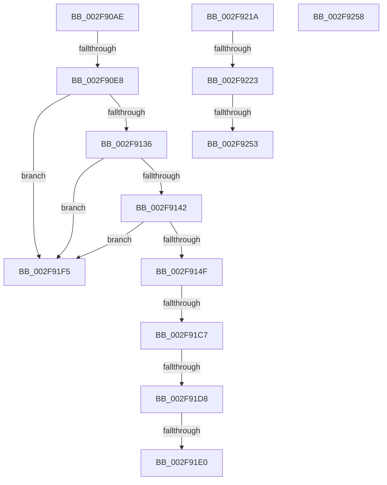

# sub_002F90AE

- RVA: `0x002F90AE`–`0x002F926B` (길이 `445` bytes)
- VA: `0x00000001402F90AE`
- 실행 섹션: `.text`
- PDB 이름 있음: `아니요`; PDB Function 태그: `아니요`
- unwind 정보 RVA: `0x0007278C`
- 디코드: `102`개 명령, `445/445` bytes 표시
- 미해석 바이트: `0` (있으면 어셈블리에 `.byte`로 보존)

> 이 문서는 커널 이미지의 기계어와 PDB 기호를 분석해 생성했습니다. 4번과 5번은 함수 원형과 자료형을 바이너리 사용 방식에서 추정한 C 해석이며 원본 소스 복구 결과는 아닙니다.

## 1. Dependencies

- 직접 호출 지점: **6**; 고유 호출 대상: **6**
- 직접 호출자로 확인된 함수: **0**
- RIP 상대 이미지 참조: **3**

### Outgoing calls
- `0x002F90C0` → [KeBugCheckEx](../4F/KeBugCheckEx_function_004FD660.md) (function, `0x004FD660`)
- `0x002F9129` → [KeAreInterruptsEnabled](KeAreInterruptsEnabled_function_002F8060.md) (function, `0x002F8060`)
- `0x002F9142` → [Feature_ETWStackExpandedStackwalks__private_IsEnabledDeviceUsageNoInline](../44/Feature_ETWStackExpandedStackwalks__private_IsEnabledDeviceUsageNoInline_function_00444094.md) (function, `0x00444094`)
- `0x002F91B0` → [KeExpandKernelStackAndCalloutInternal](KeExpandKernelStackAndCalloutInternal_function_002F8450.md) (function, `0x002F8450`)
- `0x002F9203` → [RtlWalkFrameChain](RtlWalkFrameChain_function_002F85E0.md) (function, `0x002F85E0`)
- `0x002F9246` → [EtwpTraceStackKey](../3F/EtwpTraceStackKey_function_003FC290.md) (function, `0x003FC290`)

### Direct callers
- 이 함수 시작 RVA로 연결되는 직접 call은 확인되지 않았습니다. 간접 호출은 완전히 역산할 수 없습니다.

### Static image references
- `0x002F9167` → RVA `0x00453680` (`EtwpExpandedStackWalk`; read)
- `0x002F9258` → RVA `0x00E28F9C` (`.data`; read/write)
- `0x002F925F` → RVA `0x00E28F80` (`.data`; read)

## 2. Other-region calls and transfers

- 다른 실행 섹션으로 향하는 call: **0**
- call이 아닌 외부 분기/꼬리 이동: **10**
  - `0x002F90E2` → [sub_002F92A3](Unknown_function_002F92A3.md) (`tail-transfer`)
  - `0x002F91C1` → [sub_002F92E7 + 0x22](Unknown_function_002F92E7.md) (`tail-transfer`)
  - `0x002F91D2` → [sub_002F92E7 + 0x22](Unknown_function_002F92E7.md) (`tail-transfer`)
  - `0x002F91DA` → [sub_002F92A3 + 0x1D](Unknown_function_002F92A3.md) (`tail-transfer`)
  - `0x002F91F0` → [sub_002F8E26 + 0x16C](Unknown_function_002F8E26.md) (`tail-transfer`)
  - `0x002F9215` → [sub_002F8E26 + 0x16C](Unknown_function_002F8E26.md) (`tail-transfer`)
  - `0x002F921D` → [sub_002F8E26 + 0x1C7](Unknown_function_002F8E26.md) (`tail-transfer`)
  - `0x002F924D` → [sub_002F8E26 + 0x1FD](Unknown_function_002F8E26.md) (`tail-transfer`)
  - `0x002F9253` → [sub_002F8E26 + 0x1C7](Unknown_function_002F8E26.md) (`tail-transfer`)
  - `0x002F9266` → [sub_002F8E26 + 0x245](Unknown_function_002F8E26.md) (`tail-transfer`)

## 3. Assembly (complete function range)

```asm
002F90AE  4C 8B CE                        mov r9, rsi
002F90B1  48 89 5C 24 20                  mov qword ptr [rsp + 0x20], rbx
002F90B6  BA 0A 00 00 00                  mov edx, 0xa
002F90BB  B9 1D 01 00 00                  mov ecx, 0x11d
002F90C0  E8 9B 45 20 00                  call 0x1404fd660
002F90C5  CC                              int3
002F90C6  65 48 8B 04 25 88 01 00 00      mov rax, qword ptr gs:[0x188]
002F90CF  BA 00 01 00 00                  mov edx, 0x100
002F90D4  48 8B 88 B8 00 00 00            mov rcx, qword ptr [rax + 0xb8]
002F90DB  48 39 99 40 06 00 00            cmp qword ptr [rcx + 0x640], rbx
002F90E2  0F 85 BB 01 00 00               jne 0x1402f92a3
002F90E8  41 8B C6                        mov eax, r14d
002F90EB  C1 E8 10                        shr eax, 0x10
002F90EE  83 E0 0F                        and eax, 0xf
002F90F1  89 44 24 40                     mov dword ptr [rsp + 0x40], eax
002F90F5  F0 41 FF 01                     lock inc dword ptr [r9]
002F90F9  48 8B 3F                        mov rdi, qword ptr [rdi]
002F90FC  8B C8                           mov ecx, eax
002F90FE  41 2B C4                        sub eax, r12d
002F9101  C1 E1 08                        shl ecx, 8
002F9104  03 C2                           add eax, edx
002F9106  48 89 7C 24 48                  mov qword ptr [rsp + 0x48], rdi
002F910B  89 44 24 30                     mov dword ptr [rsp + 0x30], eax
002F910F  83 C9 01                        or ecx, 1
002F9112  41 8B C4                        mov eax, r12d
002F9115  89 4C 24 34                     mov dword ptr [rsp + 0x34], ecx
002F9119  48 8D 04 C5 00 00 00 00         lea rax, [rax*8]
002F9121  49 03 C5                        add rax, r13
002F9124  48 89 44 24 50                  mov qword ptr [rsp + 0x50], rax
002F9129  E8 32 EF FF FF                  call 0x1402f8060
002F912E  84 C0                           test al, al
002F9130  0F 84 BF 00 00 00               je 0x1402f91f5
002F9136  44 0F 20 C0                     mov rax, cr8
002F913A  3C 02                           cmp al, 2
002F913C  0F 87 B3 00 00 00               ja 0x1402f91f5
002F9142  E8 4D AF 14 00                  call 0x140444094
002F9147  85 C0                           test eax, eax
002F9149  0F 84 A6 00 00 00               je 0x1402f91f5
002F914F  8B 54 24 30                     mov edx, dword ptr [rsp + 0x30]
002F9153  41 B9 08 00 00 40               mov r9d, 0x40000008
002F9159  48 8B 4C 24 50                  mov rcx, qword ptr [rsp + 0x50]
002F915E  44 8B 44 24 34                  mov r8d, dword ptr [rsp + 0x34]
002F9163  48 89 4D C0                     mov qword ptr [rbp - 0x40], rcx
002F9167  48 8D 0D 12 A5 15 00            lea rcx, [rip + 0x15a512]
002F916E  89 55 D8                        mov dword ptr [rbp - 0x28], edx
002F9171  48 8D 55 C0                     lea rdx, [rbp - 0x40]
002F9175  44 89 45 DC                     mov dword ptr [rbp - 0x24], r8d
002F9179  41 B8 00 60 00 00               mov r8d, 0x6000
002F917F  48 89 5D E0                     mov qword ptr [rbp - 0x20], rbx
002F9183  48 89 7D C8                     mov qword ptr [rbp - 0x38], rdi
002F9187  65 48 8B 3C 25 88 01 00 00      mov rdi, qword ptr gs:[0x188]
002F9190  48 89 7D D0                     mov qword ptr [rbp - 0x30], rdi
002F9194  0F B6 47 7D                     movzx eax, byte ptr [rdi + 0x7d]
002F9198  83 E0 01                        and eax, 1
002F919B  48 89 B7 B0 06 00 00            mov qword ptr [rdi + 0x6b0], rsi
002F91A2  89 44 24 30                     mov dword ptr [rsp + 0x30], eax
002F91A6  48 8B 44 24 48                  mov rax, qword ptr [rsp + 0x48]
002F91AB  48 89 44 24 20                  mov qword ptr [rsp + 0x20], rax
002F91B0  E8 9B F2 FF FF                  call 0x1402f8450
002F91B5  48 8B 54 24 48                  mov rdx, qword ptr [rsp + 0x48]
002F91BA  0F B6 4A 07                     movzx ecx, byte ptr [rdx + 7]
002F91BE  F6 C1 02                        test cl, 2
002F91C1  0F 85 42 01 00 00               jne 0x1402f9309
002F91C7  0F B6 4F 7D                     movzx ecx, byte ptr [rdi + 0x7d]
002F91CB  83 E1 01                        and ecx, 1
002F91CE  39 4C 24 30                     cmp dword ptr [rsp + 0x30], ecx
002F91D2  0F 85 31 01 00 00               jne 0x1402f9309
002F91D8  85 C0                           test eax, eax
002F91DA  0F 88 E0 00 00 00               js 0x1402f92c0
002F91E0  8B 45 E0                        mov eax, dword ptr [rbp - 0x20]
002F91E3  8B D0                           mov edx, eax
002F91E5  2B 54 24 40                     sub edx, dword ptr [rsp + 0x40]
002F91E9  3B 44 24 40                     cmp eax, dword ptr [rsp + 0x40]
002F91ED  0F 46 D3                        cmovbe edx, ebx
002F91F0  E9 9D FD FF FF                  jmp 0x1402f8f92
002F91F5  44 8B 44 24 34                  mov r8d, dword ptr [rsp + 0x34]
002F91FA  8B 54 24 30                     mov edx, dword ptr [rsp + 0x30]
002F91FE  48 8B 4C 24 50                  mov rcx, qword ptr [rsp + 0x50]
002F9203  E8 D8 F3 FF FF                  call 0x1402f85e0
002F9208  8B D0                           mov edx, eax
002F920A  2B 54 24 40                     sub edx, dword ptr [rsp + 0x40]
002F920E  3B 44 24 40                     cmp eax, dword ptr [rsp + 0x40]
002F9212  0F 46 D3                        cmovbe edx, ebx
002F9215  E9 78 FD FF FF                  jmp 0x1402f8f92
002F921A  83 FF 04                        cmp edi, 4
002F921D  0F 82 CA FD FF FF               jb 0x1402f8fed
002F9223  44 8B C3                        mov r8d, ebx
002F9226  89 7C 24 28                     mov dword ptr [rsp + 0x28], edi
002F922A  45 85 E4                        test r12d, r12d
002F922D  4C 89 6C 24 20                  mov qword ptr [rsp + 0x20], r13
002F9232  4C 8D 4D E8                     lea r9, [rbp - 0x18]
002F9236  41 8B D6                        mov edx, r14d
002F9239  41 0F 94 C0                     sete r8b
002F923D  49 8B CF                        mov rcx, r15
002F9240  66 41 81 C0 25 18               add r8w, 0x1825
002F9246  E8 45 30 10 00                  call 0x1403fc290
002F924B  84 C0                           test al, al
002F924D  0F 85 D0 FD FF FF               jne 0x1402f9023
002F9253  E9 95 FD FF FF                  jmp 0x1402f8fed
002F9258  F0 FF 0D 3D FD B2 00            lock dec dword ptr [rip + 0xb2fd3d]
002F925F  48 8D 0D 1A FD B2 00            lea rcx, [rip + 0xb2fd1a]
002F9266  E9 00 FE FF FF                  jmp 0x1402f906b
```

## 4. C-style interpretation (structured pseudocode)

```c
__int64 __fastcall sub_002F90AE(__int64 a1, __int64 a2, __int64 a3, __int64 a4, __int64 a5, unsigned int a6, __int64 a7, unsigned int a8, __int64 a9, __int64 a10)
{
    __int64 result;
    unsigned __int64 v_stack_p20;
    unsigned int v_stack_p28;
    unsigned int v_stack_p30;
    unsigned int v_stack_p34;
    unsigned int v_stack_p40;
    unsigned __int64 v_stack_p48;
    unsigned __int64 v_stack_p50;

    v_stack_p20 = v_rbx;
    result = KeBugCheckEx(285, 10, a3, v_rsi);
    result = (unsigned int)(((unsigned int)((unsigned int)(v_r14))) >> (16));
    result = (unsigned int)((result) & (15));
    v_stack_p40 = (unsigned int)(result);
    result = (unsigned int)((result) - ((unsigned int)(v_r12)));
    a1 = (unsigned int)(((unsigned int)((unsigned int)(result))) << (8));
    result = (unsigned int)((result) + (256));
    v_stack_p48 = *(unsigned __int64 *)(v_rdi);
    v_stack_p30 = (unsigned int)(result);
    a1 = (unsigned int)((a1) | (1));
    v_stack_p34 = (unsigned int)(a1);
    result = ((unsigned int)((unsigned int)(v_r12)) * 8) + (v_r13);
    v_stack_p50 = result;
    result = KeAreInterruptsEnabled(a1, 256, a3, v_rsi);
    if ((unsigned __int8)(result) == 0) goto loc_002F91F5;
    if (((unsigned __int8)(v_cr8)) > 2) goto loc_002F91F5;
    result = Feature_ETWStackExpandedStackwalks__private_IsEnabledDeviceUsageNoInline(a1, 256, a3, v_rsi);
    if ((unsigned int)(result) == 0) goto loc_002F91F5;
    *(unsigned __int64 *)(v_rbp - 64) = a10;
    *(unsigned int *)(v_rbp - 40) = (unsigned int)((unsigned int)(a6));
    *(unsigned int *)(v_rbp - 36) = (unsigned int)((unsigned int)(v_stack_p34));
    *(unsigned __int64 *)(v_rbp - 32) = v_rbx;
    *(unsigned __int64 *)(v_rbp - 56) = *(unsigned __int64 *)(v_rdi);
    *(unsigned __int64 *)(v_rbp - 48) = *(unsigned __int64 *)(gs_base + (0 + 392));
    result = (unsigned int)((*(unsigned __int8 *)(*(unsigned __int64 *)(gs_base + (0 + 392)) + 125)) & (1));
    *(unsigned __int64 *)(*(unsigned __int64 *)(gs_base + (0 + 392)) + 1712) = v_rsi;
    v_stack_p30 = (unsigned int)(result);
    v_stack_p20 = a9;
    result = KeExpandKernelStackAndCalloutInternal(v_rip + 1418514, v_rbp - 64, (unsigned int)(0x6000ULL), (unsigned int)(0x40000008ULL));
    a1 = (unsigned int)((*(unsigned __int8 *)(*(unsigned __int64 *)(gs_base + (0 + 392)) + 125)) & (1));
    a2 = (unsigned int)(((unsigned int)((unsigned int)((unsigned int)(*(unsigned int *)(v_rbp - 32))))) - (a8));
    if (((unsigned int)((unsigned int)(*(unsigned int *)(v_rbp - 32)))) <= a8) { a2 = (unsigned int)(v_rbx); }
loc_002F91F5:
    result = RtlWalkFrameChain(a10, (unsigned int)(a6), (unsigned int)(v_stack_p34), (unsigned int)(0x40000008ULL));
    a2 = (unsigned int)(((unsigned int)((unsigned int)(result))) - (a8));
    if (((unsigned int)(result)) <= a8) { a2 = (unsigned int)(v_rbx); }
}
```

## 5. (Beta) C Style

```c
int64_t sub_002F90AE(int64_t Arg1, int64_t Arg2, int64_t Arg3, int64_t Arg4, uint64_t Arg5, uint32_t Arg6, uint64_t Arg7, uint32_t Arg8, void *Arg9, int64_t Arg10)
{
    uint8_t *arg9 = (uint8_t *)Arg9;

    int64_t result;
    uint64_t v_stack_p20;
    uint32_t v_stack_p28;
    uint32_t v_stack_p30;
    uint32_t v_stack_p34;
    uint32_t v_stack_p40;
    uint64_t v_stack_p48;
    uint64_t v_stack_p50;

    v_stack_p20 = local_rbx;
    result = KeBugCheckEx(285, 10, Arg3, local_rsi);
    result = (uint32_t)(((uint32_t)((uint32_t)(local_r14))) >> (16));
    result = (uint32_t)((result) & (15));
    v_stack_p40 = (uint32_t)(result);
    result = (uint32_t)((result) - ((uint32_t)(local_r12)));
    Arg1 = (uint32_t)(((uint32_t)((uint32_t)(result))) << (8));
    result = (uint32_t)((result) + (256));
    v_stack_p48 = *(uint64_t *)(local_rdi);
    v_stack_p30 = (uint32_t)(result);
    Arg1 = (uint32_t)((Arg1) | (1));
    v_stack_p34 = (uint32_t)(Arg1);
    result = ((uint32_t)((uint32_t)(local_r12)) * 8) + (local_r13);
    v_stack_p50 = result;
    result = KeAreInterruptsEnabled(Arg1, 256, Arg3, local_rsi);
    if ((uint8_t)(result) == 0) goto loc_002F91F5;
    if (((uint8_t)(v_cr8)) > 2) goto loc_002F91F5;
    result = Feature_ETWStackExpandedStackwalks__private_IsEnabledDeviceUsageNoInline(Arg1, 256, Arg3, local_rsi);
    if ((uint32_t)(result) == 0) goto loc_002F91F5;
    *(uint64_t *)(local_rbp - 0x40) = Arg10;
    *(uint32_t *)(local_rbp - 0x28) = (uint32_t)((uint32_t)(Arg6));
    *(uint32_t *)(local_rbp - 0x24) = (uint32_t)((uint32_t)(v_stack_p34));
    *(uint64_t *)(local_rbp - 0x20) = local_rbx;
    *(uint64_t *)(local_rbp - 0x38) = *(uint64_t *)(local_rdi);
    *(uint64_t *)(local_rbp - 0x30) = *(uint64_t *)(gs_base + (0 + 0x188));
    result = (uint32_t)((*(uint8_t *)(*(uint64_t *)(gs_base + (0 + 0x188)) + 0x7D)) & (1));
    *(uint64_t *)(*(uint64_t *)(gs_base + (0 + 0x188)) + 0x6B0) = local_rsi;
    v_stack_p30 = (uint32_t)(result);
    v_stack_p20 = Arg9;
    result = KeExpandKernelStackAndCalloutInternal(v_rip + 1418514, local_rbp - 64, (uint32_t)(0x6000ULL), (uint32_t)(0x40000008ULL));
    Arg1 = (uint32_t)((*(uint8_t *)(*(uint64_t *)(gs_base + (0 + 0x188)) + 0x7D)) & (1));
    Arg2 = (uint32_t)(((uint32_t)((uint32_t)((uint32_t)(*(uint32_t *)(local_rbp - 0x20))))) - (Arg8));
    if (((uint32_t)((uint32_t)(*(uint32_t *)(local_rbp - 0x20)))) <= Arg8) { Arg2 = (uint32_t)(local_rbx); }
loc_002F91F5:
    result = RtlWalkFrameChain(Arg10, (uint32_t)(Arg6), (uint32_t)(v_stack_p34), (uint32_t)(0x40000008ULL));
    Arg2 = (uint32_t)(((uint32_t)((uint32_t)(result))) - (Arg8));
    if (((uint32_t)(result)) <= Arg8) { Arg2 = (uint32_t)(local_rbx); }
}
```

### 관측된 메모리 오프셋

구조체 형식이 확인되지 않은 접근은 인자 기준의 오프셋으로만 기록했습니다.

| 기준 인자 | 오프셋 표현 | 폭 (bit) | 접근 |
|---|---:|---:|---|
| `Arg9` | `+ 0x7` | `8` | `R` |

## 6. Execution-region graph

[열기: 2D/3D 그래프와 함수 탐색 컨트롤 패널](../../../control-panel.html?section=text&rva=0x002F90AE&view=graph)

- 2D 그래프는 위에서 아래로 흐르고, 3D 그래프는 빈 공간을 드래그해 회전합니다. Shift+드래그는 이동, 휠은 확대·축소, 함수 노드 선택은 대상 보고서 이동입니다.

### Static fallback


