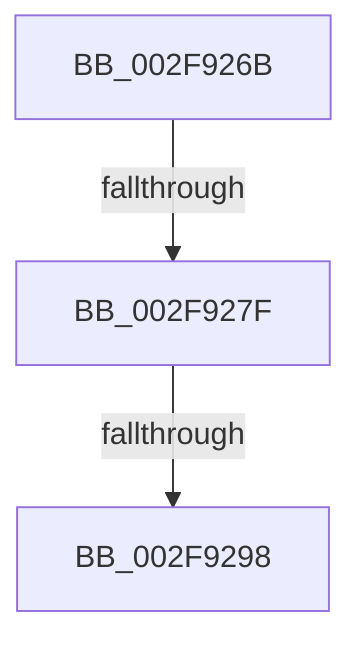

# sub_002F926B

- RVA: `0x002F926B`–`0x002F92A3` (길이 `56` bytes)
- VA: `0x00000001402F926B`
- 실행 섹션: `.text`
- PDB 이름 있음: `아니요`; PDB Function 태그: `아니요`
- unwind 정보 RVA: `0x000727AC`
- 디코드: `11`개 명령, `56/56` bytes 표시
- 미해석 바이트: `0` (있으면 어셈블리에 `.byte`로 보존)

> 이 문서는 커널 이미지의 기계어와 PDB 기호를 분석해 생성했습니다. 4번과 5번은 함수 원형과 자료형을 바이너리 사용 방식에서 추정한 C 해석이며 원본 소스 복구 결과는 아닙니다.

## 1. Dependencies

- 직접 호출 지점: **1**; 고유 호출 대상: **1**
- 직접 호출자로 확인된 함수: **0**
- RIP 상대 이미지 참조: **5**

### Outgoing calls
- `0x002F9272` → [ExpInterlockedPopEntrySList](../6B/ExpInterlockedPopEntrySList_function_006BA570.md) (function, `0x006BA570`)

### Direct callers
- 이 함수 시작 RVA로 연결되는 직접 call은 확인되지 않았습니다. 간접 호출은 완전히 역산할 수 없습니다.

### Static image references
- `0x002F926B` → RVA `0x00E28F80` (`.data`; read)
- `0x002F927F` → RVA `0x00E28F9C` (`.data`; read/write)
- `0x002F9286` → RVA `0x00E28F9C` (`.data`; read)
- `0x002F928C` → RVA `0x00E28FA0` (`.data`; read)
- `0x002F9298` → RVA `0x00E28FA0` (`.data`; read/write)

## 2. Other-region calls and transfers

- 다른 실행 섹션으로 향하는 call: **0**
- call이 아닌 외부 분기/꼬리 이동: **3**
  - `0x002F927D` → [sub_002F92CD](Unknown_function_002F92CD.md) (`tail-transfer`)
  - `0x002F9292` → [sub_002F8DF2 + 0x27](Unknown_function_002F8DF2.md) (`tail-transfer`)
  - `0x002F929E` → [sub_002F8DF2 + 0x27](Unknown_function_002F8DF2.md) (`tail-transfer`)

## 3. Assembly (complete function range)

```asm
002F926B  48 8D 0D 0E FD B2 00            lea rcx, [rip + 0xb2fd0e]
002F9272  E8 F9 12 3C 00                  call 0x1406ba570
002F9277  48 8B F0                        mov rsi, rax
002F927A  48 85 C0                        test rax, rax
002F927D  74 4E                           je 0x1402f92cd
002F927F  F0 FF 05 16 FD B2 00            lock inc dword ptr [rip + 0xb2fd16]
002F9286  8B 05 10 FD B2 00               mov eax, dword ptr [rip + 0xb2fd10]
002F928C  3B 05 0E FD B2 00               cmp eax, dword ptr [rip + 0xb2fd0e]
002F9292  0F 8E 81 FB FF FF               jle 0x1402f8e19
002F9298  87 05 02 FD B2 00               xchg dword ptr [rip + 0xb2fd02], eax
002F929E  E9 76 FB FF FF                  jmp 0x1402f8e19
```

## 4. C-style interpretation (structured pseudocode)

```c
__int64 __fastcall sub_002F926B(void)
{
    __int64 result;

    result = ExpInterlockedPopEntrySList(v_rip + 11730190, a2, a3, a4);
}
```

## 5. (Beta) C Style

```c
void sub_002F926B(void)
{
    int64_t result;

    result = ExpInterlockedPopEntrySList(v_rip + 11730190, a2, a3, a4);
}
```

## 6. Execution-region graph

[열기: 2D/3D 그래프와 함수 탐색 컨트롤 패널](../../../control-panel.html?section=text&rva=0x002F926B&view=graph)

- 2D 그래프는 위에서 아래로 흐르고, 3D 그래프는 빈 공간을 드래그해 회전합니다. Shift+드래그는 이동, 휠은 확대·축소, 함수 노드 선택은 대상 보고서 이동입니다.

### Static fallback


