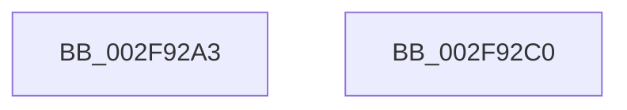

# sub_002F92A3

- RVA: `0x002F92A3`–`0x002F92CD` (길이 `42` bytes)
- VA: `0x00000001402F92A3`
- 실행 섹션: `.text`
- PDB 이름 있음: `아니요`; PDB Function 태그: `아니요`
- unwind 정보 RVA: `0x000727C0`
- 디코드: `9`개 명령, `42/42` bytes 표시
- 미해석 바이트: `0` (있으면 어셈블리에 `.byte`로 보존)

> 이 문서는 커널 이미지의 기계어와 PDB 기호를 분석해 생성했습니다. 4번과 5번은 함수 원형과 자료형을 바이너리 사용 방식에서 추정한 C 해석이며 원본 소스 복구 결과는 아닙니다.

## 1. Dependencies

- 직접 호출 지점: **1**; 고유 호출 대상: **1**
- 직접 호출자로 확인된 함수: **0**
- RIP 상대 이미지 참조: **0**

### Outgoing calls
- `0x002F92B4` → [PsPicoWalkUserStack](../../page/AB/PsPicoWalkUserStack_function_00ABF288.md) (function, `0x00ABF288`)

### Direct callers
- 이 함수 시작 RVA로 연결되는 직접 call은 확인되지 않았습니다. 간접 호출은 완전히 역산할 수 없습니다.

### Static image references
- 디코드된 RIP-relative 메모리 참조가 없습니다.

## 2. Other-region calls and transfers

- 다른 실행 섹션으로 향하는 call: **1**
  - `0x002F92B4` → [PsPicoWalkUserStack](../../page/AB/PsPicoWalkUserStack_function_00ABF288.md) (`.text` → `PAGE`)
- call이 아닌 외부 분기/꼬리 이동: **2**
  - `0x002F92BB` → [sub_002F8E26 + 0x16C](Unknown_function_002F8E26.md) (`tail-transfer`)
  - `0x002F92C8` → [sub_002F8E26 + 0x24D](Unknown_function_002F8E26.md) (`tail-transfer`)

## 3. Assembly (complete function range)

```asm
002F92A3  41 8B C4                        mov eax, r12d
002F92A6  41 2B D4                        sub edx, r12d
002F92A9  48 8D 0C C5 00 00 00 00         lea rcx, [rax*8]
002F92B1  49 03 CD                        add rcx, r13
002F92B4  E8 CF 5F 7C 00                  call 0x140abf288
002F92B9  8B D0                           mov edx, eax
002F92BB  E9 D2 FC FF FF                  jmp 0x1402f8f92
002F92C0  F0 41 FF 87 04 04 00 00         lock inc dword ptr [r15 + 0x404]
002F92C8  E9 A6 FD FF FF                  jmp 0x1402f9073
```

## 4. C-style interpretation (structured pseudocode)

```c
__int64 __fastcall sub_002F92A3(__int64 a1, int a2)
{
    __int64 result;

    a2 = (unsigned int)((a2) - ((unsigned int)(v_r12)));
    a1 = ((unsigned int)((unsigned int)(v_r12)) * 8) + (v_r13);
    result = PsPicoWalkUserStack(a1, a2, a3, a4);
}
```

## 5. (Beta) C Style

```c
int64_t sub_002F92A3(int64_t Arg1, int32_t Arg2)
{
    int64_t result;

    Arg2 = (uint32_t)((Arg2) - ((uint32_t)(local_r12)));
    Arg1 = ((uint32_t)((uint32_t)(local_r12)) * 8) + (local_r13);
    result = PsPicoWalkUserStack(Arg1, Arg2, a3, a4);
}
```

## 6. Execution-region graph

[열기: 2D/3D 그래프와 함수 탐색 컨트롤 패널](../../../control-panel.html?section=text&rva=0x002F92A3&view=graph)

- 2D 그래프는 위에서 아래로 흐르고, 3D 그래프는 빈 공간을 드래그해 회전합니다. Shift+드래그는 이동, 휠은 확대·축소, 함수 노드 선택은 대상 보고서 이동입니다.

### Static fallback


