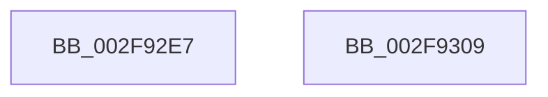

# sub_002F92E7

- RVA: `0x002F92E7`–`0x002F9323` (길이 `60` bytes)
- VA: `0x00000001402F92E7`
- 실행 섹션: `.text`
- PDB 이름 있음: `아니요`; PDB Function 태그: `아니요`
- unwind 정보 RVA: `0x000727F4`
- 디코드: `16`개 명령, `60/60` bytes 표시
- 미해석 바이트: `0` (있으면 어셈블리에 `.byte`로 보존)

> 이 문서는 커널 이미지의 기계어와 PDB 기호를 분석해 생성했습니다. 4번과 5번은 함수 원형과 자료형을 바이너리 사용 방식에서 추정한 C 해석이며 원본 소스 복구 결과는 아닙니다.

## 1. Dependencies

- 직접 호출 지점: **2**; 고유 호출 대상: **1**
- 직접 호출자로 확인된 함수: **0**
- RIP 상대 이미지 참조: **0**

### Outgoing calls
- `0x002F92FB` → [KeBugCheckEx](../4F/KeBugCheckEx_function_004FD660.md) (function, `0x004FD660`)
- `0x002F931D` → [KeBugCheckEx](../4F/KeBugCheckEx_function_004FD660.md) (function, `0x004FD660`)

### Direct callers
- 이 함수 시작 RVA로 연결되는 직접 call은 확인되지 않았습니다. 간접 호출은 완전히 역산할 수 없습니다.

### Static image references
- 디코드된 RIP-relative 메모리 참조가 없습니다.

## 2. Other-region calls and transfers

- 다른 실행 섹션으로 향하는 call: **0**
- call이 아닌 외부 분기/꼬리 이동: **1**
  - `0x002F9304` → [sub_002F8E26 + 0x144](Unknown_function_002F8E26.md) (`tail-transfer`)

## 3. Assembly (complete function range)

```asm
002F92E7  45 33 C9                        xor r9d, r9d
002F92EA  48 89 5C 24 20                  mov qword ptr [rsp + 0x20], rbx
002F92EF  4D 8B C5                        mov r8, r13
002F92F2  B9 1D 01 00 00                  mov ecx, 0x11d
002F92F7  41 8D 51 0A                     lea edx, [r9 + 0xa]
002F92FB  E8 60 43 20 00                  call 0x1404fd660
002F9300  CC                              int3
002F9301  44 8B E3                        mov r12d, ebx
002F9304  E9 61 FC FF FF                  jmp 0x1402f8f6a
002F9309  45 33 C9                        xor r9d, r9d
002F930C  48 89 5C 24 20                  mov qword ptr [rsp + 0x20], rbx
002F9311  4C 8B C2                        mov r8, rdx
002F9314  B9 1D 01 00 00                  mov ecx, 0x11d
002F9319  41 8D 51 0A                     lea edx, [r9 + 0xa]
002F931D  E8 3E 43 20 00                  call 0x1404fd660
002F9322  CC                              int3
```

## 4. C-style interpretation (structured pseudocode)

```c
__int64 __fastcall sub_002F92E7(__int64 a1, __int64 a2, __int64 a3, int a4)
{
    __int64 result;
    unsigned __int64 v_stack_p20;

    a4 = 0;
    v_stack_p20 = v_rbx;
    result = KeBugCheckEx(285, a4 + 10, v_r13, a4);
}
```

## 5. (Beta) C Style

```c
int64_t sub_002F92E7(int64_t Arg1, int64_t Arg2, int64_t Arg3, int32_t Arg4)
{
    int64_t result;
    uint64_t v_stack_p20;

    Arg4 = 0;
    v_stack_p20 = local_rbx;
    result = KeBugCheckEx(285, Arg4 + 10, local_r13, Arg4);
}
```

## 6. Execution-region graph

[열기: 2D/3D 그래프와 함수 탐색 컨트롤 패널](../../../control-panel.html?section=text&rva=0x002F92E7&view=graph)

- 2D 그래프는 위에서 아래로 흐르고, 3D 그래프는 빈 공간을 드래그해 회전합니다. Shift+드래그는 이동, 휠은 확대·축소, 함수 노드 선택은 대상 보고서 이동입니다.

### Static fallback


