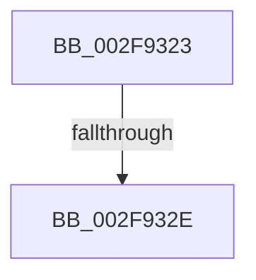

# sub_002F9323

- RVA: `0x002F9323`–`0x002F9349` (길이 `38` bytes)
- VA: `0x00000001402F9323`
- 실행 섹션: `.text`
- PDB 이름 있음: `아니요`; PDB Function 태그: `아니요`
- unwind 정보 RVA: `0x00072814`
- 디코드: `7`개 명령, `38/38` bytes 표시
- 미해석 바이트: `0` (있으면 어셈블리에 `.byte`로 보존)

> 이 문서는 커널 이미지의 기계어와 PDB 기호를 분석해 생성했습니다. 4번과 5번은 함수 원형과 자료형을 바이너리 사용 방식에서 추정한 C 해석이며 원본 소스 복구 결과는 아닙니다.

## 1. Dependencies

- 직접 호출 지점: **0**; 고유 호출 대상: **0**
- 직접 호출자로 확인된 함수: **0**
- RIP 상대 이미지 참조: **1**

### Outgoing calls
- 직접 디코드된 call 명령이 없습니다.

### Direct callers
- 이 함수 시작 RVA로 연결되는 직접 call은 확인되지 않았습니다. 간접 호출은 완전히 역산할 수 없습니다.

### Static image references
- `0x002F932E` → RVA `0x00FC6B28` (`ALMOSTRO`; read)

## 2. Other-region calls and transfers

- 다른 실행 섹션으로 향하는 call: **0**
- call이 아닌 외부 분기/꼬리 이동: **2**
  - `0x002F9328` → [sub_002F8E26 + 0x1D](Unknown_function_002F8E26.md) (`tail-transfer`)
  - `0x002F9344` → [sub_002F8E26 + 0x1D](Unknown_function_002F8E26.md) (`tail-transfer`)

## 3. Assembly (complete function range)

```asm
002F9323  41 0F BA E6 0B                  bt r14d, 0xb
002F9328  0F 83 15 FB FF FF               jae 0x1402f8e43
002F932E  48 8B 05 F3 D7 CC 00            mov rax, qword ptr [rip + 0xccd7f3]
002F9335  41 BC 01 00 00 00               mov r12d, 1
002F933B  49 89 45 00                     mov qword ptr [r13], rax
002F933F  41 0F BA F6 0B                  btr r14d, 0xb
002F9344  E9 FA FA FF FF                  jmp 0x1402f8e43
```

## 4. C-style interpretation (structured pseudocode)

```c
__int64 __fastcall sub_002F9323(void)
{
    *(unsigned __int64 *)(v_r13) = *(unsigned __int64 *)(v_rip + 13424627);
}
```

## 5. (Beta) C Style

```c
void sub_002F9323(void)
{
    *(uint64_t *)(local_r13) = *(uint64_t *)(v_rip + 0xCCD7F3);
}
```

## 6. Execution-region graph

[열기: 2D/3D 그래프와 함수 탐색 컨트롤 패널](../../../control-panel.html?section=text&rva=0x002F9323&view=graph)

- 2D 그래프는 위에서 아래로 흐르고, 3D 그래프는 빈 공간을 드래그해 회전합니다. Shift+드래그는 이동, 휠은 확대·축소, 함수 노드 선택은 대상 보고서 이동입니다.

### Static fallback


