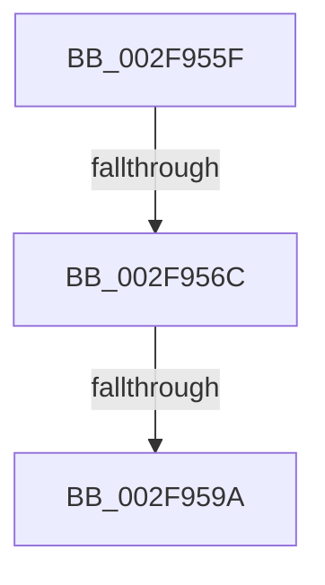

# sub_002F955F

- RVA: `0x002F955F`–`0x002F95A5` (길이 `70` bytes)
- VA: `0x00000001402F955F`
- 실행 섹션: `.text`
- PDB 이름 있음: `아니요`; PDB Function 태그: `아니요`
- unwind 정보 RVA: `0x00072850`
- 디코드: `19`개 명령, `70/70` bytes 표시
- 미해석 바이트: `0` (있으면 어셈블리에 `.byte`로 보존)

> 이 문서는 커널 이미지의 기계어와 PDB 기호를 분석해 생성했습니다. 4번과 5번은 함수 원형과 자료형을 바이너리 사용 방식에서 추정한 C 해석이며 원본 소스 복구 결과는 아닙니다.

## 1. Dependencies

- 직접 호출 지점: **1**; 고유 호출 대상: **1**
- 직접 호출자로 확인된 함수: **0**
- RIP 상대 이미지 참조: **2**

### Outgoing calls
- `0x002F9591` → [ExpQueueWorkItem](../35/ExpQueueWorkItem_function_00358400.md) (function, `0x00358400`)

### Direct callers
- 이 함수 시작 RVA로 연결되는 직접 call은 확인되지 않았습니다. 간접 호출은 완전히 역산할 수 없습니다.

### Static image references
- `0x002F956C` → RVA `0x000110F8` (`.rdata`; read)
- `0x002F9577` → RVA `0x00FC6EA0` (`ALMOSTRO`; read)

## 2. Other-region calls and transfers

- 다른 실행 섹션으로 향하는 call: **0**
- call이 아닌 외부 분기/꼬리 이동: **2**
  - `0x002F956A` → [sub_002F95A6](Unknown_function_002F95A6.md) (`tail-transfer`)
  - `0x002F9598` → [sub_002F95A6 + 0x6](Unknown_function_002F95A6.md) (`tail-transfer`)

## 3. Assembly (complete function range)

```asm
002F955F  48 89 7C 24 40                  mov qword ptr [rsp + 0x40], rdi
002F9564  48 63 FA                        movsxd rdi, edx
002F9567  83 FA 07                        cmp edx, 7
002F956A  73 3A                           jae 0x1402f95a6
002F956C  4C 8D 05 85 7B D1 FF            lea r8, [rip - 0x2e847b]
002F9573  45 8B 04 B8                     mov r8d, dword ptr [r8 + rdi*4]
002F9577  48 8B 0D 22 D9 CC 00            mov rcx, qword ptr [rip + 0xccd922]
002F957E  33 C0                           xor eax, eax
002F9580  41 B9 FF FF FF FF               mov r9d, 0xffffffff
002F9586  89 44 24 20                     mov dword ptr [rsp + 0x20], eax
002F958A  48 8B D3                        mov rdx, rbx
002F958D  48 8B 49 10                     mov rcx, qword ptr [rcx + 0x10]
002F9591  E8 6A EE 05 00                  call 0x140358400
002F9596  84 C0                           test al, al
002F9598  74 12                           je 0x1402f95ac
002F959A  48 8B 7C 24 40                  mov rdi, qword ptr [rsp + 0x40]
002F959F  48 83 C4 30                     add rsp, 0x30
002F95A3  5B                              pop rbx
002F95A4  C3                              ret
```

## 4. C-style interpretation (structured pseudocode)

```c
__int64 __fastcall sub_002F955F(__int64 a1, int a2, __int64 a3, __int64 a4, __int64 a5, __int64 a6, __int64 a7, __int64 a8)
{
    __int64 result;
    __int64 v_rsp;
    unsigned int v_stack_p20;
    unsigned __int64 v_stack_p40;

    v_stack_p40 = v_rdi;
    result = 0;
    v_stack_p20 = 0;
    result = ExpQueueWorkItem(*(unsigned __int64 *)(*(unsigned __int64 *)(v_rip + 13424930) + 16), v_rbx, (unsigned int)(*(unsigned int *)(v_rip - 3048571 + (int)(a2) * 4)), (unsigned int)(0xFFFFFFFFULL));
    v_rsp = (v_rsp) + (48);
    return result;
}
```

## 5. (Beta) C Style

```c
int64_t sub_002F955F(int64_t Arg1, int32_t Arg2, int64_t Arg3, int64_t Arg4, uint64_t Arg5, uint64_t Arg6, uint64_t Arg7, int64_t Arg8)
{
    int64_t result;
    int64_t local_rsp;
    uint32_t v_stack_p20;
    uint64_t v_stack_p40;

    v_stack_p40 = local_rdi;
    result = 0;
    v_stack_p20 = 0;
    result = ExpQueueWorkItem(*(uint64_t *)(*(uint64_t *)(v_rip + 0xCCD922) + 0x10), local_rbx, (uint32_t)(*(uint32_t *)(v_rip - 0x2E847B + (int32_t)(Arg2) * 4)), (uint32_t)(0xFFFFFFFFULL));
    local_rsp = (local_rsp) + (48);
    return result;
}
```

## 6. Execution-region graph

[열기: 2D/3D 그래프와 함수 탐색 컨트롤 패널](../../../control-panel.html?section=text&rva=0x002F955F&view=graph)

- 2D 그래프는 위에서 아래로 흐르고, 3D 그래프는 빈 공간을 드래그해 회전합니다. Shift+드래그는 이동, 휠은 확대·축소, 함수 노드 선택은 대상 보고서 이동입니다.

### Static fallback


