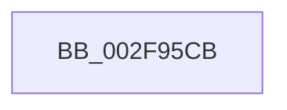

# sub_002F95CB

- RVA: `0x002F95CB`–`0x002F9619` (길이 `78` bytes)
- VA: `0x00000001402F95CB`
- 실행 섹션: `.text`
- PDB 이름 있음: `아니요`; PDB Function 태그: `아니요`
- unwind 정보 RVA: `0x0007288C`
- 디코드: `23`개 명령, `78/78` bytes 표시
- 미해석 바이트: `0` (있으면 어셈블리에 `.byte`로 보존)

> 이 문서는 커널 이미지의 기계어와 PDB 기호를 분석해 생성했습니다. 4번과 5번은 함수 원형과 자료형을 바이너리 사용 방식에서 추정한 C 해석이며 원본 소스 복구 결과는 아닙니다.

## 1. Dependencies

- 직접 호출 지점: **3**; 고유 호출 대상: **1**
- 직접 호출자로 확인된 함수: **0**
- RIP 상대 이미지 참조: **0**

### Outgoing calls
- `0x002F95E0` → [KeBugCheckEx](../4F/KeBugCheckEx_function_004FD660.md) (function, `0x004FD660`)
- `0x002F95F8` → [KeBugCheckEx](../4F/KeBugCheckEx_function_004FD660.md) (function, `0x004FD660`)
- `0x002F9613` → [KeBugCheckEx](../4F/KeBugCheckEx_function_004FD660.md) (function, `0x004FD660`)

### Direct callers
- 이 함수 시작 RVA로 연결되는 직접 call은 확인되지 않았습니다. 간접 호출은 완전히 역산할 수 없습니다.

### Static image references
- 디코드된 RIP-relative 메모리 참조가 없습니다.

## 2. Other-region calls and transfers

- 다른 실행 섹션으로 향하는 call: **0**
- 별도 외부 분기/꼬리 이동을 확인하지 못했습니다.

## 3. Assembly (complete function range)

```asm
002F95CB  33 C0                           xor eax, eax
002F95CD  4C 63 CA                        movsxd r9, edx
002F95D0  4C 8B C3                        mov r8, rbx
002F95D3  48 89 44 24 20                  mov qword ptr [rsp + 0x20], rax
002F95D8  B9 E4 00 00 00                  mov ecx, 0xe4
002F95DD  8D 50 01                        lea edx, [rax + 1]
002F95E0  E8 7B 40 20 00                  call 0x1404fd660
002F95E5  CC                              int3
002F95E6  33 C0                           xor eax, eax
002F95E8  4C 8B C3                        mov r8, rbx
002F95EB  B9 E4 00 00 00                  mov ecx, 0xe4
002F95F0  48 89 44 24 20                  mov qword ptr [rsp + 0x20], rax
002F95F5  8D 50 07                        lea edx, [rax + 7]
002F95F8  E8 63 40 20 00                  call 0x1404fd660
002F95FD  CC                              int3
002F95FE  33 C0                           xor eax, eax
002F9600  4C 63 CA                        movsxd r9, edx
002F9603  4C 8B C3                        mov r8, rbx
002F9606  48 89 44 24 20                  mov qword ptr [rsp + 0x20], rax
002F960B  B9 E4 00 00 00                  mov ecx, 0xe4
002F9610  8D 50 06                        lea edx, [rax + 6]
002F9613  E8 48 40 20 00                  call 0x1404fd660
002F9618  CC                              int3
```

## 4. C-style interpretation (structured pseudocode)

```c
__int64 __fastcall sub_002F95CB(__int64 a1, int a2)
{
    __int64 result;
    unsigned __int64 v_stack_p20;

    result = 0;
    v_stack_p20 = 0;
    result = KeBugCheckEx(228, result + 1, v_rbx, (int)(a2));
    result = 0;
    v_stack_p20 = 0;
    result = KeBugCheckEx(228, result + 7, v_rbx, (int)(a2));
    result = 0;
    v_stack_p20 = 0;
    result = KeBugCheckEx(228, result + 6, v_rbx, (int)((unsigned int)(result + 7)));
    return result;
}
```

## 5. (Beta) C Style

```c
int64_t sub_002F95CB(int64_t Arg1, int32_t Arg2)
{
    int64_t result;
    uint64_t v_stack_p20;

    result = 0;
    v_stack_p20 = 0;
    result = KeBugCheckEx(228, result + 1, local_rbx, (int32_t)(Arg2));
    result = 0;
    v_stack_p20 = 0;
    result = KeBugCheckEx(228, result + 7, local_rbx, (int32_t)(Arg2));
    result = 0;
    v_stack_p20 = 0;
    result = KeBugCheckEx(228, result + 6, local_rbx, (int32_t)((uint32_t)(result + 7)));
    return result;
}
```

## 6. Execution-region graph

[열기: 2D/3D 그래프와 함수 탐색 컨트롤 패널](../../../control-panel.html?section=text&rva=0x002F95CB&view=graph)

- 2D 그래프는 위에서 아래로 흐르고, 3D 그래프는 빈 공간을 드래그해 회전합니다. Shift+드래그는 이동, 휠은 확대·축소, 함수 노드 선택은 대상 보고서 이동입니다.

### Static fallback


