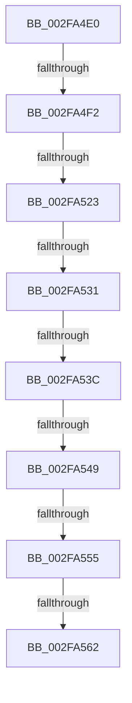

# sub_002FA4E0

- RVA: `0x002FA4E0`–`0x002FA56A` (길이 `138` bytes)
- VA: `0x00000001402FA4E0`
- 실행 섹션: `.text`
- PDB 이름 있음: `아니요`; PDB Function 태그: `아니요`
- unwind 정보 RVA: `0x00072964`
- 디코드: `30`개 명령, `138/138` bytes 표시
- 미해석 바이트: `0` (있으면 어셈블리에 `.byte`로 보존)

> 이 문서는 커널 이미지의 기계어와 PDB 기호를 분석해 생성했습니다. 4번과 5번은 함수 원형과 자료형을 바이너리 사용 방식에서 추정한 C 해석이며 원본 소스 복구 결과는 아닙니다.

## 1. Dependencies

- 직접 호출 지점: **2**; 고유 호출 대상: **2**
- 직접 호출자로 확인된 함수: **0**
- RIP 상대 이미지 참조: **0**

### Outgoing calls
- `0x002FA53C` → [KeAreInterruptsEnabled](KeAreInterruptsEnabled_function_002F8060.md) (function, `0x002F8060`)
- `0x002FA555` → [MmCanThreadFault](MmCanThreadFault_function_002F86B0.md) (function, `0x002F86B0`)

### Direct callers
- 이 함수 시작 RVA로 연결되는 직접 call은 확인되지 않았습니다. 간접 호출은 완전히 역산할 수 없습니다.

### Static image references
- 디코드된 RIP-relative 메모리 참조가 없습니다.

## 2. Other-region calls and transfers

- 다른 실행 섹션으로 향하는 call: **0**
- call이 아닌 외부 분기/꼬리 이동: **8**
  - `0x002FA4EC` → [sub_002FA5C7](Unknown_function_002FA5C7.md) (`tail-transfer`)
  - `0x002FA51D` → [sub_002FA641 + 0x67](Unknown_function_002FA641.md) (`tail-transfer`)
  - `0x002FA52B` → [sub_002FA641 + 0x21](Unknown_function_002FA641.md) (`tail-transfer`)
  - `0x002FA53A` → [sub_002FA57E](Unknown_function_002FA57E.md) (`tail-transfer`)
  - `0x002FA543` → [sub_002FA641](Unknown_function_002FA641.md) (`tail-transfer`)
  - `0x002FA54F` → [sub_002FA641](Unknown_function_002FA641.md) (`tail-transfer`)
  - `0x002FA55C` → [sub_002FA641 + 0x28](Unknown_function_002FA641.md) (`tail-transfer`)
  - `0x002FA568` → [sub_002FA57E + 0x4](Unknown_function_002FA57E.md) (`tail-transfer`)

## 3. Assembly (complete function range)

```asm
002FA4E0  4C 89 64 24 70                  mov qword ptr [rsp + 0x70], r12
002FA4E5  45 32 E4                        xor r12b, r12b
002FA4E8  0F BA E3 0D                     bt ebx, 0xd
002FA4EC  0F 82 D5 00 00 00               jb 0x1402fa5c7
002FA4F2  4C 89 74 24 78                  mov qword ptr [rsp + 0x78], r14
002FA4F7  8B CB                           mov ecx, ebx
002FA4F9  65 4C 8B 34 25 88 01 00 00      mov r14, qword ptr gs:[0x188]
002FA502  81 E1 00 00 00 04               and ecx, 0x4000000
002FA508  4C 89 BC 24 80 00 00 00         mov qword ptr [rsp + 0x80], r15
002FA510  44 8B FB                        mov r15d, ebx
002FA513  41 81 E7 00 80 00 00            and r15d, 0x8000
002FA51A  4C 3B F7                        cmp r14, rdi
002FA51D  0F 85 85 01 00 00               jne 0x1402fa6a8
002FA523  41 F7 46 74 00 04 00 00         test dword ptr [r14 + 0x74], 0x400
002FA52B  0F 85 31 01 00 00               jne 0x1402fa662
002FA531  41 8B 86 A0 05 00 00            mov eax, dword ptr [r14 + 0x5a0]
002FA538  A8 01                           test al, 1
002FA53A  75 42                           jne 0x1402fa57e
002FA53C  E8 1F DB FF FF                  call 0x1402f8060
002FA541  84 C0                           test al, al
002FA543  0F 84 F8 00 00 00               je 0x1402fa641
002FA549  44 0F 20 C0                     mov rax, cr8
002FA54D  3C 02                           cmp al, 2
002FA54F  0F 83 EC 00 00 00               jae 0x1402fa641
002FA555  E8 56 E1 FF FF                  call 0x1402f86b0
002FA55A  85 C0                           test eax, eax
002FA55C  0F 85 07 01 00 00               jne 0x1402fa669
002FA562  B1 01                           mov cl, 1
002FA564  44 0F B6 E1                     movzx r12d, cl
002FA568  EB 18                           jmp 0x1402fa582
```

## 4. C-style interpretation (structured pseudocode)

```c
__int64 __fastcall sub_002FA4E0(void)
{
    __int64 result;
    __int64 v_r12;
    __int64 v_r15;
    unsigned __int64 v_stack_p70;
    unsigned __int64 v_stack_p78;
    unsigned __int64 v_stack_p80;

    v_stack_p70 = v_r12;
    v_r12 = 0;
    v_stack_p78 = v_r14;
    a1 = (unsigned int)(((unsigned int)((unsigned int)(v_rbx))) & (0x4000000ULL));
    v_stack_p80 = v_r15;
    v_r15 = (unsigned int)(((unsigned int)((unsigned int)(v_rbx))) & (0x8000ULL));
    result = KeAreInterruptsEnabled(a1, a2, a3, a4);
    result = MmCanThreadFault(a1, a2, a3, a4);
}
```

## 5. (Beta) C Style

```c
void sub_002FA4E0(void)
{
    int64_t result;
    int64_t local_r12;
    int64_t local_r15;
    uint64_t v_stack_p70;
    uint64_t v_stack_p78;
    uint64_t v_stack_p80;

    v_stack_p70 = local_r12;
    local_r12 = 0;
    v_stack_p78 = local_r14;
    a1 = (uint32_t)(((uint32_t)((uint32_t)(local_rbx))) & (0x4000000ULL));
    v_stack_p80 = local_r15;
    local_r15 = (uint32_t)(((uint32_t)((uint32_t)(local_rbx))) & (0x8000ULL));
    result = KeAreInterruptsEnabled(a1, a2, a3, a4);
    result = MmCanThreadFault(a1, a2, a3, a4);
}
```

## 6. Execution-region graph

[열기: 2D/3D 그래프와 함수 탐색 컨트롤 패널](../../../control-panel.html?section=text&rva=0x002FA4E0&view=graph)

- 2D 그래프는 위에서 아래로 흐르고, 3D 그래프는 빈 공간을 드래그해 회전합니다. Shift+드래그는 이동, 휠은 확대·축소, 함수 노드 선택은 대상 보고서 이동입니다.

### Static fallback


