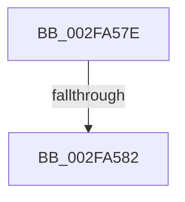

# sub_002FA57E

- RVA: `0x002FA57E`–`0x002FA5A2` (길이 `36` bytes)
- VA: `0x00000001402FA57E`
- 실행 섹션: `.text`
- PDB 이름 있음: `아니요`; PDB Function 태그: `아니요`
- unwind 정보 RVA: `0x00072990`
- 디코드: `9`개 명령, `36/36` bytes 표시
- 미해석 바이트: `0` (있으면 어셈블리에 `.byte`로 보존)

> 이 문서는 커널 이미지의 기계어와 PDB 기호를 분석해 생성했습니다. 4번과 5번은 함수 원형과 자료형을 바이너리 사용 방식에서 추정한 C 해석이며 원본 소스 복구 결과는 아닙니다.

## 1. Dependencies

- 직접 호출 지점: **0**; 고유 호출 대상: **0**
- 직접 호출자로 확인된 함수: **0**
- RIP 상대 이미지 참조: **0**

### Outgoing calls
- 직접 디코드된 call 명령이 없습니다.

### Direct callers
- 이 함수 시작 RVA로 연결되는 직접 call은 확인되지 않았습니다. 간접 호출은 완전히 역산할 수 없습니다.

### Static image references
- 디코드된 RIP-relative 메모리 참조가 없습니다.

## 2. Other-region calls and transfers

- 다른 실행 섹션으로 향하는 call: **0**
- call이 아닌 외부 분기/꼬리 이동: **2**
  - `0x002FA580` → [sub_002FA4E0 + 0x5C](Unknown_function_002FA4E0.md) (`tail-transfer`)
  - `0x002FA59C` → [sub_002FA5F0 + 0x4B](Unknown_function_002FA5F0.md) (`tail-transfer`)

## 3. Assembly (complete function range)

```asm
002FA57E  85 C9                           test ecx, ecx
002FA580  75 BA                           jne 0x1402fa53c
002FA582  4C 8B BC 24 80 00 00 00         mov r15, qword ptr [rsp + 0x80]
002FA58A  0F BA E3 18                     bt ebx, 0x18
002FA58E  41 0F B6 C4                     movzx eax, r12b
002FA592  BA 01 00 00 00                  mov edx, 1
002FA597  0F 42 C2                        cmovb eax, edx
002FA59A  84 C9                           test cl, cl
002FA59C  0F 84 99 00 00 00               je 0x1402fa63b
```

## 4. C-style interpretation (structured pseudocode)

```c
__int64 __fastcall sub_002FA57E(int a1, __int64 a2, __int64 a3, __int64 a4, __int64 a5, __int64 a6, __int64 a7, __int64 a8, __int64 a9, __int64 a10, __int64 a11, __int64 a12, __int64 a13, __int64 a14, __int64 a15, __int64 a16)
{
    __int64 result;

    result = (unsigned __int8)(v_r12);
    if (condition_is_below) { result = 1; }
}
```

## 5. (Beta) C Style

```c
int64_t sub_002FA57E(int32_t Arg1, int64_t Arg2, int64_t Arg3, int64_t Arg4, uint64_t Arg5, uint64_t Arg6, uint64_t Arg7, uint64_t Arg8, uint64_t Arg9, uint64_t Arg10, uint64_t Arg11, uint64_t Arg12, uint64_t Arg13, uint64_t Arg14, uint64_t Arg15, int64_t Arg16)
{
    int64_t result;

    result = (uint8_t)(local_r12);
    if (condition_is_below) { result = 1; }
}
```

## 6. Execution-region graph

[열기: 2D/3D 그래프와 함수 탐색 컨트롤 패널](../../../control-panel.html?section=text&rva=0x002FA57E&view=graph)

- 2D 그래프는 위에서 아래로 흐르고, 3D 그래프는 빈 공간을 드래그해 회전합니다. Shift+드래그는 이동, 휠은 확대·축소, 함수 노드 선택은 대상 보고서 이동입니다.

### Static fallback


