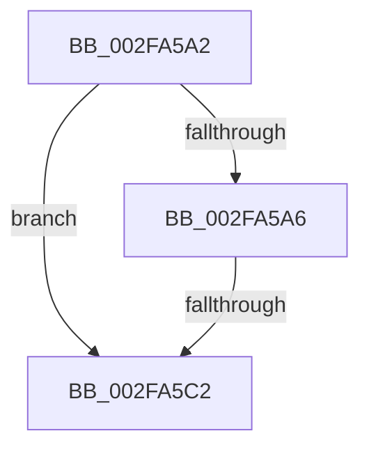

# sub_002FA5A2

- RVA: `0x002FA5A2`–`0x002FA5C7` (길이 `37` bytes)
- VA: `0x00000001402FA5A2`
- 실행 섹션: `.text`
- PDB 이름 있음: `아니요`; PDB Function 태그: `아니요`
- unwind 정보 RVA: `0x000729AC`
- 디코드: `9`개 명령, `37/37` bytes 표시
- 미해석 바이트: `0` (있으면 어셈블리에 `.byte`로 보존)

> 이 문서는 커널 이미지의 기계어와 PDB 기호를 분석해 생성했습니다. 4번과 5번은 함수 원형과 자료형을 바이너리 사용 방식에서 추정한 C 해석이며 원본 소스 복구 결과는 아닙니다.

## 1. Dependencies

- 직접 호출 지점: **0**; 고유 호출 대상: **0**
- 직접 호출자로 확인된 함수: **0**
- RIP 상대 이미지 참조: **0**

### Outgoing calls
- 직접 디코드된 call 명령이 없습니다.

### Direct callers
- 이 함수 시작 RVA로 연결되는 직접 call은 확인되지 않았습니다. 간접 호출은 완전히 역산할 수 없습니다.

### Static image references
- 디코드된 RIP-relative 메모리 참조가 없습니다.

## 2. Other-region calls and transfers

- 다른 실행 섹션으로 향하는 call: **0**
- call이 아닌 외부 분기/꼬리 이동: **1**
  - `0x002FA5C0` → [sub_002FA5F0](Unknown_function_002FA5F0.md) (`tail-transfer`)

## 3. Assembly (complete function range)

```asm
002FA5A2  84 C0                           test al, al
002FA5A4  74 1C                           je 0x1402fa5c2
002FA5A6  44 0F B7 B6 32 03 00 00         movzx r14d, word ptr [rsi + 0x332]
002FA5AE  0F BA F3 0C                     btr ebx, 0xc
002FA5B2  41 83 E6 07                     and r14d, 7
002FA5B6  41 83 C6 18                     add r14d, 0x18
002FA5BA  F0 44 0F AB 77 78               lock bts dword ptr [rdi + 0x78], r14d
002FA5C0  73 2E                           jae 0x1402fa5f0
002FA5C2  4C 8B 74 24 78                  mov r14, qword ptr [rsp + 0x78]
```

## 4. C-style interpretation (structured pseudocode)

```c
void __fastcall sub_002FA5A2(__int64 a1, __int64 a2, __int64 a3, __int64 a4, __int64 a5, __int64 a6, __int64 a7, __int64 a8, __int64 a9, __int64 a10, __int64 a11, __int64 a12, __int64 a13, __int64 a14, __int64 a15)
{
    __int64 v_r14;

    if ((unsigned __int8)(result) == 0) goto loc_002FA5C2;
    v_r14 = (unsigned int)((*(unsigned __int16 *)(v_rsi + 818)) & (7));
    v_r14 = (unsigned int)((v_r14) + (24));
loc_002FA5C2:
    return;
}
```

## 5. (Beta) C Style

```c
void sub_002FA5A2(int64_t Arg1, int64_t Arg2, int64_t Arg3, int64_t Arg4, uint64_t Arg5, uint64_t Arg6, uint64_t Arg7, uint64_t Arg8, uint64_t Arg9, uint64_t Arg10, uint64_t Arg11, uint64_t Arg12, uint64_t Arg13, uint64_t Arg14, int64_t Arg15)
{
    int64_t local_r14;

    if ((uint8_t)(result) == 0) goto loc_002FA5C2;
    local_r14 = (uint32_t)((*(uint16_t *)(local_rsi + 0x332)) & (7));
    local_r14 = (uint32_t)((local_r14) + (24));
loc_002FA5C2:
    return;
}
```

## 6. Execution-region graph

[열기: 2D/3D 그래프와 함수 탐색 컨트롤 패널](../../../control-panel.html?section=text&rva=0x002FA5A2&view=graph)

- 2D 그래프는 위에서 아래로 흐르고, 3D 그래프는 빈 공간을 드래그해 회전합니다. Shift+드래그는 이동, 휠은 확대·축소, 함수 노드 선택은 대상 보고서 이동입니다.

### Static fallback


