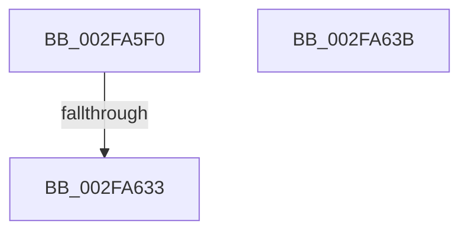

# sub_002FA5F0

- RVA: `0x002FA5F0`–`0x002FA641` (길이 `81` bytes)
- VA: `0x00000001402FA5F0`
- 실행 섹션: `.text`
- PDB 이름 있음: `아니요`; PDB Function 태그: `아니요`
- unwind 정보 RVA: `0x000729EC`
- 디코드: `18`개 명령, `81/81` bytes 표시
- 미해석 바이트: `0` (있으면 어셈블리에 `.byte`로 보존)

> 이 문서는 커널 이미지의 기계어와 PDB 기호를 분석해 생성했습니다. 4번과 5번은 함수 원형과 자료형을 바이너리 사용 방식에서 추정한 C 해석이며 원본 소스 복구 결과는 아닙니다.

## 1. Dependencies

- 직접 호출 지점: **1**; 고유 호출 대상: **1**
- 직접 호출자로 확인된 함수: **0**
- RIP 상대 이미지 참조: **2**

### Outgoing calls
- `0x002FA62A` → [EtwpQueueApc](../20/EtwpQueueApc_function_00203B7C.md) (function, `0x00203B7C`)

### Direct callers
- 이 함수 시작 RVA로 연결되는 직접 call은 확인되지 않았습니다. 간접 호출은 완전히 역산할 수 없습니다.

### Static image references
- `0x002FA5FD` → RVA `0x00227870` (`EtwpStackWalkApc`; read)
- `0x002FA612` → RVA `0x004B8470` (`EtwpCancelStackWalkApc`; read)

## 2. Other-region calls and transfers

- 다른 실행 섹션으로 향하는 call: **0**
- call이 아닌 외부 분기/꼬리 이동: **3**
  - `0x002FA631` → [sub_002FA5A2 + 0x20](Unknown_function_002FA5A2.md) (`tail-transfer`)
  - `0x002FA639` → [sub_002FA5A2 + 0x20](Unknown_function_002FA5A2.md) (`tail-transfer`)
  - `0x002FA63F` → [sub_002FA5A2 + 0x20](Unknown_function_002FA5A2.md) (`tail-transfer`)

## 3. Assembly (complete function range)

```asm
002FA5F0  8B 45 00                        mov eax, dword ptr [rbp]
002FA5F3  48 8D 8E 40 03 00 00            lea rcx, [rsi + 0x340]
002FA5FA  8B 55 04                        mov edx, dword ptr [rbp + 4]
002FA5FD  4C 8D 0D 6C D2 F2 FF            lea r9, [rip - 0xd2d94]
002FA604  48 89 44 24 38                  mov qword ptr [rsp + 0x38], rax
002FA609  45 0F B6 C5                     movzx r8d, r13b
002FA60D  48 89 54 24 30                  mov qword ptr [rsp + 0x30], rdx
002FA612  48 8D 05 57 DE 1B 00            lea rax, [rip + 0x1bde57]
002FA619  48 C7 44 24 28 00 00 00 00      mov qword ptr [rsp + 0x28], 0
002FA622  48 8B D7                        mov rdx, rdi
002FA625  48 89 44 24 20                  mov qword ptr [rsp + 0x20], rax
002FA62A  E8 4D 95 F0 FF                  call 0x140203b7c
002FA62F  85 C0                           test eax, eax
002FA631  79 8F                           jns 0x1402fa5c2
002FA633  F0 44 0F B3 77 78               lock btr dword ptr [rdi + 0x78], r14d
002FA639  EB 87                           jmp 0x1402fa5c2
002FA63B  0F BA F3 0C                     btr ebx, 0xc
002FA63F  EB 81                           jmp 0x1402fa5c2
```

## 4. C-style interpretation (structured pseudocode)

```c
__int64 __fastcall sub_002FA5F0(void)
{
    __int64 result;
    unsigned __int64 v_stack_p20;
    unsigned __int64 v_stack_p28;
    unsigned __int64 v_stack_p30;
    unsigned __int64 v_stack_p38;

    v_stack_p38 = (unsigned int)(*(unsigned int *)(v_rbp));
    v_stack_p30 = (unsigned int)(*(unsigned int *)(v_rbp + 4));
    v_stack_p28 = 0;
    v_stack_p20 = v_rip + 1826391;
    result = EtwpQueueApc(v_rsi + 832, v_rdi, (unsigned __int8)(v_r13), v_rip - 863636);
}
```

## 5. (Beta) C Style

```c
void sub_002FA5F0(void)
{
    int64_t result;
    uint64_t v_stack_p20;
    uint64_t v_stack_p28;
    uint64_t v_stack_p30;
    uint64_t v_stack_p38;

    v_stack_p38 = (uint32_t)(*(uint32_t *)(local_rbp));
    v_stack_p30 = (uint32_t)(*(uint32_t *)(local_rbp + 0x4));
    v_stack_p28 = 0;
    v_stack_p20 = v_rip + 1826391;
    result = EtwpQueueApc(local_rsi + 832, local_rdi, (uint8_t)(local_r13), v_rip - 863636);
}
```

## 6. Execution-region graph

[열기: 2D/3D 그래프와 함수 탐색 컨트롤 패널](../../../control-panel.html?section=text&rva=0x002FA5F0&view=graph)

- 2D 그래프는 위에서 아래로 흐르고, 3D 그래프는 빈 공간을 드래그해 회전합니다. Shift+드래그는 이동, 휠은 확대·축소, 함수 노드 선택은 대상 보고서 이동입니다.

### Static fallback


