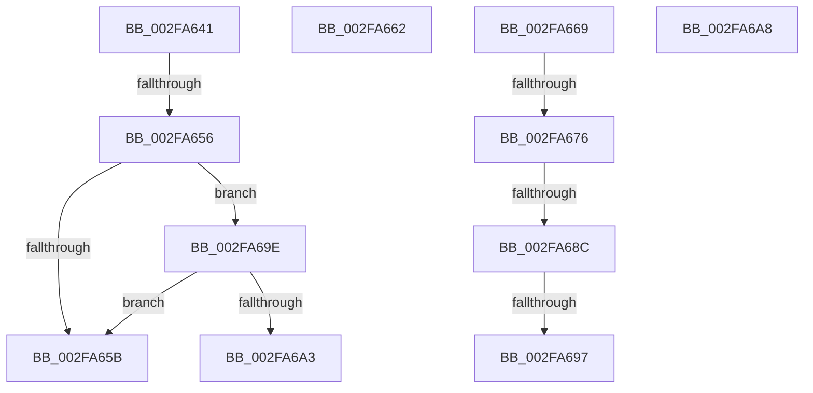

# sub_002FA641

- RVA: `0x002FA641`–`0x002FA6AF` (길이 `110` bytes)
- VA: `0x00000001402FA641`
- 실행 섹션: `.text`
- PDB 이름 있음: `아니요`; PDB Function 태그: `아니요`
- unwind 정보 RVA: `0x00072A04`
- 디코드: `24`개 명령, `110/110` bytes 표시
- 미해석 바이트: `0` (있으면 어셈블리에 `.byte`로 보존)

> 이 문서는 커널 이미지의 기계어와 PDB 기호를 분석해 생성했습니다. 4번과 5번은 함수 원형과 자료형을 바이너리 사용 방식에서 추정한 C 해석이며 원본 소스 복구 결과는 아닙니다.

## 1. Dependencies

- 직접 호출 지점: **0**; 고유 호출 대상: **0**
- 직접 호출자로 확인된 함수: **0**
- RIP 상대 이미지 참조: **0**

### Outgoing calls
- 직접 디코드된 call 명령이 없습니다.

### Direct callers
- 이 함수 시작 RVA로 연결되는 직접 call은 확인되지 않았습니다. 간접 호출은 완전히 역산할 수 없습니다.

### Static image references
- 디코드된 RIP-relative 메모리 참조가 없습니다.

## 2. Other-region calls and transfers

- 다른 실행 섹션으로 향하는 call: **0**
- call이 아닌 외부 분기/꼬리 이동: **9**
  - `0x002FA650` → [sub_002FA4E0 + 0x82](Unknown_function_002FA4E0.md) (`tail-transfer`)
  - `0x002FA65D` → [sub_002FA57E + 0x4](Unknown_function_002FA57E.md) (`tail-transfer`)
  - `0x002FA664` → [sub_002FA57E + 0x4](Unknown_function_002FA57E.md) (`tail-transfer`)
  - `0x002FA670` → [sub_002FA4E0 + 0x82](Unknown_function_002FA4E0.md) (`tail-transfer`)
  - `0x002FA686` → [sub_002FA4E0 + 0x82](Unknown_function_002FA4E0.md) (`tail-transfer`)
  - `0x002FA691` → [sub_002FA4E0 + 0x82](Unknown_function_002FA4E0.md) (`tail-transfer`)
  - `0x002FA699` → [sub_002FA57E + 0x4](Unknown_function_002FA57E.md) (`tail-transfer`)
  - `0x002FA6A3` → [sub_002FA4E0 + 0x82](Unknown_function_002FA4E0.md) (`tail-transfer`)
  - `0x002FA6AA` → [sub_002FA57E + 0x4](Unknown_function_002FA57E.md) (`tail-transfer`)

## 3. Assembly (complete function range)

```asm
002FA641  65 48 8B 04 25 20 00 00 00      mov rax, qword ptr gs:[0x20]
002FA64A  0F B6 48 20                     movzx ecx, byte ptr [rax + 0x20]
002FA64E  84 C9                           test cl, cl
002FA650  0F 84 0C FF FF FF               je 0x1402fa562
002FA656  80 F9 01                        cmp cl, 1
002FA659  74 43                           je 0x1402fa69e
002FA65B  32 C9                           xor cl, cl
002FA65D  E9 20 FF FF FF                  jmp 0x1402fa582
002FA662  32 C9                           xor cl, cl
002FA664  E9 19 FF FF FF                  jmp 0x1402fa582
002FA669  45 38 A6 AE 05 00 00            cmp byte ptr [r14 + 0x5ae], r12b
002FA670  0F 85 EC FE FF FF               jne 0x1402fa562
002FA676  65 48 8B 04 25 88 01 00 00      mov rax, qword ptr gs:[0x188]
002FA67F  80 B8 4A 02 00 00 01            cmp byte ptr [rax + 0x24a], 1
002FA686  0F 84 D6 FE FF FF               je 0x1402fa562
002FA68C  41 F6 46 7D 04                  test byte ptr [r14 + 0x7d], 4
002FA691  0F 85 CB FE FF FF               jne 0x1402fa562
002FA697  B1 01                           mov cl, 1
002FA699  E9 E4 FE FF FF                  jmp 0x1402fa582
002FA69E  45 85 FF                        test r15d, r15d
002FA6A1  74 B8                           je 0x1402fa65b
002FA6A3  E9 BA FE FF FF                  jmp 0x1402fa562
002FA6A8  32 C9                           xor cl, cl
002FA6AA  E9 D3 FE FF FF                  jmp 0x1402fa582
```

## 4. C-style interpretation (structured pseudocode)

```c
__int64 __fastcall sub_002FA641(void)
{
    if (((unsigned __int8)(*(unsigned __int8 *)(*(unsigned __int64 *)(gs_base + (0 + 32)) + 32))) == 1) goto loc_002FA69E;
loc_002FA65B:
    a1 = 0;
loc_002FA69E:
    if ((unsigned int)(v_r15) == 0) goto loc_002FA65B;
}
```

## 5. (Beta) C Style

```c
void sub_002FA641(void)
{
    if (((uint8_t)(*(uint8_t *)(*(uint64_t *)(gs_base + (0 + 0x20)) + 0x20))) == 1) goto loc_002FA69E;
loc_002FA65B:
    a1 = 0;
loc_002FA69E:
    if ((uint32_t)(local_r15) == 0) goto loc_002FA65B;
}
```

## 6. Execution-region graph

[열기: 2D/3D 그래프와 함수 탐색 컨트롤 패널](../../../control-panel.html?section=text&rva=0x002FA641&view=graph)

- 2D 그래프는 위에서 아래로 흐르고, 3D 그래프는 빈 공간을 드래그해 회전합니다. Shift+드래그는 이동, 휠은 확대·축소, 함수 노드 선택은 대상 보고서 이동입니다.

### Static fallback


