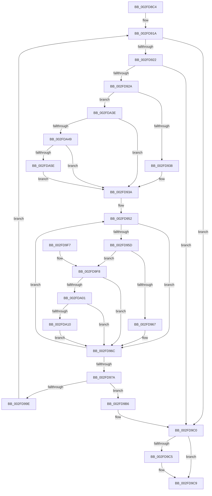

# UpcaseUnicodeToUTF8NHelper

- RVA: `0x002FD8C4`–`0x002FDA68` (길이 `420` bytes)
- VA: `0x00000001402FD8C4`
- 실행 섹션: `.text`
- PDB 이름 있음: `예`; PDB Function 태그: `아니요`
- unwind 정보 RVA: `0x00072C60`
- 디코드: `111`개 명령, `420/420` bytes 표시
- 미해석 바이트: `0` (있으면 어셈블리에 `.byte`로 보존)

> 이 문서는 커널 이미지의 기계어와 PDB 기호를 분석해 생성했습니다. 4번과 5번은 함수 원형과 자료형을 바이너리 사용 방식에서 추정한 C 해석이며 원본 소스 복구 결과는 아닙니다.

## 1. Dependencies

- 직접 호출 지점: **3**; 고유 호출 대상: **3**
- 직접 호출자로 확인된 함수: **3**
- RIP 상대 이미지 참조: **1**

### Outgoing calls
- `0x002FD902` → [PsGetCurrentServerSiloGlobals](PsGetCurrentServerSiloGlobals_function_002FE1F0.md) (function, `0x002FE1F0`)
- `0x002FD995` → [RtlUnicodeToUTF8N](../../page/90/RtlUnicodeToUTF8N_function_0090DBF0.md) (function, `0x0090DBF0`)
- `0x002FD9D7` → [_security_check_cookie](../6A/_security_check_cookie_function_006AC640.md) (function, `0x006AC640`)

### Direct callers
- [RtlUpcaseUnicodeToOemN](../../page/90/RtlUpcaseUnicodeToOemN_function_0090CC70.md) at `0x0090CD23`
- [RtlUpcaseUnicodeToMultiByteN](../../page/90/RtlUpcaseUnicodeToMultiByteN_function_0090D760.md) at `0x0090D80F`
- [RtlUpcaseUnicodeStringToCountedOemString](../../page/90/RtlUpcaseUnicodeStringToCountedOemString_function_0090E4D0.md) at `0x0090E63A`

### Static image references
- `0x002FD8DB` → RVA `0x00E0A740` (`.data`; read)

## 2. Other-region calls and transfers

- 다른 실행 섹션으로 향하는 call: **1**
  - `0x002FD995` → [RtlUnicodeToUTF8N](../../page/90/RtlUnicodeToUTF8N_function_0090DBF0.md) (`.text` → `PAGE`)
- 별도 외부 분기/꼬리 이동을 확인하지 못했습니다.

## 3. Assembly (complete function range)

```asm
002FD8C4  48 89 5C 24 20                  mov qword ptr [rsp + 0x20], rbx
002FD8C9  55                              push rbp
002FD8CA  56                              push rsi
002FD8CB  57                              push rdi
002FD8CC  41 54                           push r12
002FD8CE  41 55                           push r13
002FD8D0  41 56                           push r14
002FD8D2  41 57                           push r15
002FD8D4  48 81 EC E0 00 00 00            sub rsp, 0xe0
002FD8DB  48 8B 05 5E CE B0 00            mov rax, qword ptr [rip + 0xb0ce5e]
002FD8E2  48 33 C4                        xor rax, rsp
002FD8E5  48 89 84 24 D0 00 00 00         mov qword ptr [rsp + 0xd0], rax
002FD8ED  45 33 FF                        xor r15d, r15d
002FD8F0  4C 89 44 24 40                  mov qword ptr [rsp + 0x40], r8
002FD8F5  33 F6                           xor esi, esi
002FD8F7  4D 8B F1                        mov r14, r9
002FD8FA  4D 8B E0                        mov r12, r8
002FD8FD  8B EA                           mov ebp, edx
002FD8FF  4C 8B E9                        mov r13, rcx
002FD902  E8 E9 08 00 00                  call 0x1402fe1f0
002FD907  8B BC 24 40 01 00 00            mov edi, dword ptr [rsp + 0x140]
002FD90E  48 8B 88 B0 04 00 00            mov rcx, qword ptr [rax + 0x4b0]
002FD915  48 89 4C 24 38                  mov qword ptr [rsp + 0x38], rcx
002FD91A  85 FF                           test edi, edi
002FD91C  0F 84 9E 00 00 00               je 0x1402fd9c0
002FD922  85 ED                           test ebp, ebp
002FD924  0F 84 96 00 00 00               je 0x1402fd9c0
002FD92A  44 21 7C 24 30                  and dword ptr [rsp + 0x30], r15d
002FD92F  83 FF 40                        cmp edi, 0x40
002FD932  0F 83 06 01 00 00               jae 0x1402fda3e
002FD938  8B DF                           mov ebx, edi
002FD93A  4C 8B 64 24 38                  mov r12, qword ptr [rsp + 0x38]
002FD93F  48 8D 44 24 50                  lea rax, [rsp + 0x50]
002FD944  4D 8B D6                        mov r10, r14
002FD947  44 8B DB                        mov r11d, ebx
002FD94A  4C 2B D0                        sub r10, rax
002FD94D  4C 8D 4C 24 50                  lea r9, [rsp + 0x50]
002FD952  47 0F B7 04 0A                  movzx r8d, word ptr [r10 + r9]
002FD957  41 83 F8 61                     cmp r8d, 0x61
002FD95B  72 0F                           jb 0x1402fd96c
002FD95D  41 83 F8 7A                     cmp r8d, 0x7a
002FD961  0F 87 91 00 00 00               ja 0x1402fd9f8
002FD967  66 41 83 E8 20                  sub r8w, 0x20
002FD96C  66 45 89 01                     mov word ptr [r9], r8w
002FD970  49 83 C1 02                     add r9, 2
002FD974  49 83 EB 01                     sub r11, 1
002FD978  75 D8                           jne 0x1402fd952
002FD97A  4C 8B 64 24 40                  mov r12, qword ptr [rsp + 0x40]
002FD97F  8D 04 1B                        lea eax, [rbx + rbx]
002FD982  4C 8D 4C 24 50                  lea r9, [rsp + 0x50]
002FD987  89 44 24 20                     mov dword ptr [rsp + 0x20], eax
002FD98B  4C 8D 44 24 30                  lea r8, [rsp + 0x30]
002FD990  8B D5                           mov edx, ebp
002FD992  49 8B CD                        mov rcx, r13
002FD995  E8 56 02 61 00                  call 0x14090dbf0
002FD99A  85 C0                           test eax, eax
002FD99C  78 18                           js 0x1402fd9b6
002FD99E  8B 4C 24 30                     mov ecx, dword ptr [rsp + 0x30]
002FD9A2  8B C3                           mov eax, ebx
002FD9A4  4C 03 E9                        add r13, rcx
002FD9A7  2B E9                           sub ebp, ecx
002FD9A9  03 F1                           add esi, ecx
002FD9AB  2B FB                           sub edi, ebx
002FD9AD  4D 8D 34 46                     lea r14, [r14 + rax*2]
002FD9B1  E9 64 FF FF FF                  jmp 0x1402fd91a
002FD9B6  03 74 24 30                     add esi, dword ptr [rsp + 0x30]
002FD9BA  41 BF 05 00 00 80               mov r15d, 0x80000005
002FD9C0  4D 85 E4                        test r12, r12
002FD9C3  74 04                           je 0x1402fd9c9
002FD9C5  41 89 34 24                     mov dword ptr [r12], esi
002FD9C9  41 8B C7                        mov eax, r15d
002FD9CC  48 8B 8C 24 D0 00 00 00         mov rcx, qword ptr [rsp + 0xd0]
002FD9D4  48 33 CC                        xor rcx, rsp
002FD9D7  E8 64 EC 3A 00                  call 0x1406ac640
002FD9DC  48 8B 9C 24 38 01 00 00         mov rbx, qword ptr [rsp + 0x138]
002FD9E4  48 81 C4 E0 00 00 00            add rsp, 0xe0
002FD9EB  41 5F                           pop r15
002FD9ED  41 5E                           pop r14
002FD9EF  41 5D                           pop r13
002FD9F1  41 5C                           pop r12
002FD9F3  5F                              pop rdi
002FD9F4  5E                              pop rsi
002FD9F5  5D                              pop rbp
002FD9F6  C3                              ret
002FD9F7  CC                              int3
002FD9F8  4D 85 E4                        test r12, r12
002FD9FB  0F 84 6B FF FF FF               je 0x1402fd96c
002FDA01  B8 C0 00 00 00                  mov eax, 0xc0
002FDA06  66 44 3B C0                     cmp r8w, ax
002FDA0A  0F 82 5C FF FF FF               jb 0x1402fd96c
002FDA10  49 8B C0                        mov rax, r8
002FDA13  41 8B D0                        mov edx, r8d
002FDA16  48 C1 E8 08                     shr rax, 8
002FDA1A  83 E2 0F                        and edx, 0xf
002FDA1D  41 0F B7 0C 44                  movzx ecx, word ptr [r12 + rax*2]
002FDA22  41 8B C0                        mov eax, r8d
002FDA25  C1 E8 04                        shr eax, 4
002FDA28  83 E0 0F                        and eax, 0xf
002FDA2B  03 C8                           add ecx, eax
002FDA2D  41 0F B7 0C 4C                  movzx ecx, word ptr [r12 + rcx*2]
002FDA32  03 CA                           add ecx, edx
002FDA34  66 45 03 04 4C                  add r8w, word ptr [r12 + rcx*2]
002FDA39  E9 2E FF FF FF                  jmp 0x1402fd96c
002FDA3E  BB 40 00 00 00                  mov ebx, 0x40
002FDA43  0F 84 F1 FE FF FF               je 0x1402fd93a
002FDA49  41 0F B7 46 7E                  movzx eax, word ptr [r14 + 0x7e]
002FDA4E  2D 00 D8 00 00                  sub eax, 0xd800
002FDA53  3D FF 03 00 00                  cmp eax, 0x3ff
002FDA58  0F 87 DC FE FF FF               ja 0x1402fd93a
002FDA5E  BB 3F 00 00 00                  mov ebx, 0x3f
002FDA63  E9 D2 FE FF FF                  jmp 0x1402fd93a
```

## 4. C-style interpretation (structured pseudocode)

```c
__int64 __fastcall UpcaseUnicodeToUTF8NHelper(__int64 a1, int a2, __int64 a3, __int64 a4, unsigned int a5)
{
    __int64 result;
    __int64 v_r10;
    __int64 v_r11;
    __int64 v_r13;
    __int64 v_r15;
    __int64 v_rbp;
    __int64 v_rdi;
    __int64 v_rsi;
    __int64 v_rsp;
    unsigned __int64 v_stack_m48;
    unsigned __int64 v_stack_mC8;
    unsigned __int64 v_stack_mD8;
    unsigned __int64 v_stack_mE0;
    unsigned int v_stack_mE8;
    unsigned int v_stack_mF8;
    unsigned __int64 v_stack_p20;

    v_stack_p20 = v_rbx;
    v_rsp = (v_rsp) - (224);
    result = (*(unsigned __int64 *)(v_rip + 11587166)) ^ (v_rsp);
    v_stack_m48 = result;
    v_r15 = 0;
    v_stack_mD8 = a3;
    v_rsi = 0;
    result = PsGetCurrentServerSiloGlobals(a1, a2, a3, a4);
    v_stack_mE0 = *(unsigned __int64 *)(result + 1200);
loc_002FD91A:
    if ((unsigned int)((unsigned int)(a5)) == 0) goto loc_002FD9C0;
    if ((unsigned int)((unsigned int)(a2)) == 0) goto loc_002FD9C0;
    if (((unsigned int)((unsigned int)(a5))) >= 64) goto loc_002FDA3E;
loc_002FD93A:
    v_r10 = (a4) - (v_stack_mC8);
loc_002FD952:
    if (((unsigned int)(*(unsigned __int16 *)(v_r10 + v_stack_mC8 * 1))) < 97) goto loc_002FD96C;
    if (((unsigned int)(*(unsigned __int16 *)(v_r10 + v_stack_mC8 * 1))) > 122) goto loc_002FD9F8;
    a3 = (unsigned __int16)((*(unsigned __int16 *)(v_r10 + v_stack_mC8 * 1)) - (32));
loc_002FD96C:
    *(unsigned __int16 *)(v_stack_mC8) = (unsigned __int16)(a3);
    a4 = (v_stack_mC8) + (2);
    v_r11 = ((unsigned int)((unsigned int)((unsigned int)((unsigned int)((unsigned int)(a5)))))) - (1);
    if (condition_is_not_equal) goto loc_002FD952;
    v_stack_mF8 = (unsigned int)((unsigned int)((unsigned int)((unsigned int)(a5))) + (unsigned int)((unsigned int)((unsigned int)(a5))) * 1);
    result = RtlUnicodeToUTF8N(a1, (unsigned int)((unsigned int)((unsigned int)(a2))), v_stack_mE8, v_stack_mC8);
    if (sign_flag) goto loc_002FD9B6;
    v_r13 = (a1) + ((unsigned int)(v_stack_mE8));
    v_rbp = (unsigned int)(((unsigned int)(a2)) - ((unsigned int)((unsigned int)(v_stack_mE8))));
    v_rsi = (unsigned int)((v_rsi) + ((unsigned int)((unsigned int)(v_stack_mE8))));
    v_rdi = (unsigned int)(((unsigned int)(a5)) - ((unsigned int)((unsigned int)((unsigned int)((unsigned int)(a5))))));
    goto loc_002FD91A;
loc_002FD9B6:
    v_rsi = (unsigned int)((v_rsi) + (v_stack_mE8));
loc_002FD9C0:
    if (v_stack_mD8 != 0) {
        *(unsigned int *)(v_stack_mD8) = (unsigned int)(v_rsi);
    }
    a1 = (v_stack_m48) ^ (v_rsp);
    result = _security_check_cookie(a1, (unsigned int)((unsigned int)((unsigned int)(a2))), v_stack_mE8, v_stack_mC8);
    v_rsp = (v_rsp) + (224);
    return result;
loc_002FD9F8:
    if (v_stack_mD8 == 0) goto loc_002FD96C;
    if (((unsigned __int16)(v_stack_mE8)) < 192) goto loc_002FD96C;
    result = (v_stack_mE8) >> (8);
    a2 = (unsigned int)(((unsigned int)((unsigned int)(v_stack_mE8))) & (15));
    result = (unsigned int)(((unsigned int)((unsigned int)(v_stack_mE8))) >> (4));
    result = (unsigned int)((result) & (15));
    a1 = (unsigned int)((*(unsigned __int16 *)(v_stack_mD8 + result * 2)) + ((unsigned int)(result)));
    a1 = (unsigned int)((*(unsigned __int16 *)(v_stack_mD8 + a1 * 2)) + (a2));
    a3 = (unsigned __int16)((v_stack_mE8) + (*(unsigned __int16 *)(v_stack_mD8 + a1 * 2)));
    goto loc_002FD96C;
loc_002FDA3E:
    if (condition_is_equal) goto loc_002FD93A;
    result = (unsigned int)((*(unsigned __int16 *)(a4 + (unsigned int)((unsigned int)((unsigned int)((unsigned int)((unsigned int)(a5))))) * 2 + 126)) - (0xD800ULL));
    if (((unsigned int)(result)) > 0x3FFULL) goto loc_002FD93A;
    goto loc_002FD93A;
}
```

## 5. (Beta) C Style

```c
int64_t UpcaseUnicodeToUTF8NHelper(int64_t Arg1, int32_t Arg2, int64_t Arg3, void *Arg4, uint32_t Arg5)
{
    uint8_t *arg4 = (uint8_t *)Arg4;

    int64_t result;
    int64_t local_r10;
    int64_t local_r11;
    int64_t local_r13;
    int64_t local_r15;
    int64_t local_rbp;
    int64_t local_rdi;
    int64_t local_rsi;
    int64_t local_rsp;
    uint64_t v_stack_m48;
    uint64_t v_stack_mC8;
    uint64_t v_stack_mD8;
    uint64_t v_stack_mE0;
    uint32_t v_stack_mE8;
    uint32_t v_stack_mF8;
    uint64_t v_stack_p20;

    v_stack_p20 = local_rbx;
    local_rsp = (local_rsp) - (224);
    result = (*(uint64_t *)(v_rip + 0xB0CE5E)) ^ (local_rsp);
    v_stack_m48 = result;
    local_r15 = 0;
    v_stack_mD8 = Arg3;
    local_rsi = 0;
    result = PsGetCurrentServerSiloGlobals(Arg1, Arg2, Arg3, Arg4);
    v_stack_mE0 = *(uint64_t *)(result + 0x4B0);
loc_002FD91A:
    if ((uint32_t)((uint32_t)(Arg5)) == 0) goto loc_002FD9C0;
    if ((uint32_t)((uint32_t)(Arg2)) == 0) goto loc_002FD9C0;
    if (((uint32_t)((uint32_t)(Arg5))) >= 64) goto loc_002FDA3E;
loc_002FD93A:
    local_r10 = (Arg4) - (v_stack_mC8);
loc_002FD952:
    if (((uint32_t)(*(uint16_t *)(local_r10 + v_stack_mC8 * 1))) < 97) goto loc_002FD96C;
    if (((uint32_t)(*(uint16_t *)(local_r10 + v_stack_mC8 * 1))) > 122) goto loc_002FD9F8;
    Arg3 = (uint16_t)((*(uint16_t *)(local_r10 + v_stack_mC8 * 1)) - (32));
loc_002FD96C:
    *(uint16_t *)(v_stack_mC8) = (uint16_t)(Arg3);
    Arg4 = (v_stack_mC8) + (2);
    local_r11 = ((uint32_t)((uint32_t)((uint32_t)((uint32_t)((uint32_t)(Arg5)))))) - (1);
    if (condition_is_not_equal) goto loc_002FD952;
    v_stack_mF8 = (uint32_t)((uint32_t)((uint32_t)((uint32_t)(Arg5))) + (uint32_t)((uint32_t)((uint32_t)(Arg5))) * 1);
    result = RtlUnicodeToUTF8N(Arg1, (uint32_t)((uint32_t)((uint32_t)(Arg2))), v_stack_mE8, v_stack_mC8);
    if (sign_flag) goto loc_002FD9B6;
    local_r13 = (Arg1) + ((uint32_t)(v_stack_mE8));
    local_rbp = (uint32_t)(((uint32_t)(Arg2)) - ((uint32_t)((uint32_t)(v_stack_mE8))));
    local_rsi = (uint32_t)((local_rsi) + ((uint32_t)((uint32_t)(v_stack_mE8))));
    local_rdi = (uint32_t)(((uint32_t)(Arg5)) - ((uint32_t)((uint32_t)((uint32_t)((uint32_t)(Arg5))))));
    goto loc_002FD91A;
loc_002FD9B6:
    local_rsi = (uint32_t)((local_rsi) + (v_stack_mE8));
loc_002FD9C0:
    if (v_stack_mD8 != 0) {
        *(uint32_t *)(v_stack_mD8) = (uint32_t)(local_rsi);
    }
    Arg1 = (v_stack_m48) ^ (local_rsp);
    result = _security_check_cookie(Arg1, (uint32_t)((uint32_t)((uint32_t)(Arg2))), v_stack_mE8, v_stack_mC8);
    local_rsp = (local_rsp) + (224);
    return result;
loc_002FD9F8:
    if (v_stack_mD8 == 0) goto loc_002FD96C;
    if (((uint16_t)(v_stack_mE8)) < 192) goto loc_002FD96C;
    result = (v_stack_mE8) >> (8);
    Arg2 = (uint32_t)(((uint32_t)((uint32_t)(v_stack_mE8))) & (15));
    result = (uint32_t)(((uint32_t)((uint32_t)(v_stack_mE8))) >> (4));
    result = (uint32_t)((result) & (15));
    Arg1 = (uint32_t)((*(uint16_t *)(v_stack_mD8 + result * 2)) + ((uint32_t)(result)));
    Arg1 = (uint32_t)((*(uint16_t *)(v_stack_mD8 + Arg1 * 2)) + (Arg2));
    Arg3 = (uint16_t)((v_stack_mE8) + (*(uint16_t *)(v_stack_mD8 + Arg1 * 2)));
    goto loc_002FD96C;
loc_002FDA3E:
    if (condition_is_equal) goto loc_002FD93A;
    result = (uint32_t)((*(uint16_t *)(arg4 + (uint32_t)((uint32_t)((uint32_t)((uint32_t)((uint32_t)(Arg5))))) * 2 + 0x7E)) - (0xD800ULL));
    if (((uint32_t)(result)) > 0x3FFULL) goto loc_002FD93A;
    goto loc_002FD93A;
}
```

### 관측된 메모리 오프셋

구조체 형식이 확인되지 않은 접근은 인자 기준의 오프셋으로만 기록했습니다.

| 기준 인자 | 오프셋 표현 | 폭 (bit) | 접근 |
|---|---:|---:|---|
| `Arg4` | `+ 0x0 + r9*1` | `16` | `R` |
| `Arg4` | `+ 0x0 + rax*2` | `64` | `R` |
| `Arg4` | `+ 0x7E` | `16` | `R` |

## 6. Execution-region graph

[열기: 2D/3D 그래프와 함수 탐색 컨트롤 패널](../../../control-panel.html?section=text&rva=0x002FD8C4&view=graph)

- 2D 그래프는 위에서 아래로 흐르고, 3D 그래프는 빈 공간을 드래그해 회전합니다. Shift+드래그는 이동, 휠은 확대·축소, 함수 노드 선택은 대상 보고서 이동입니다.

### Static fallback


