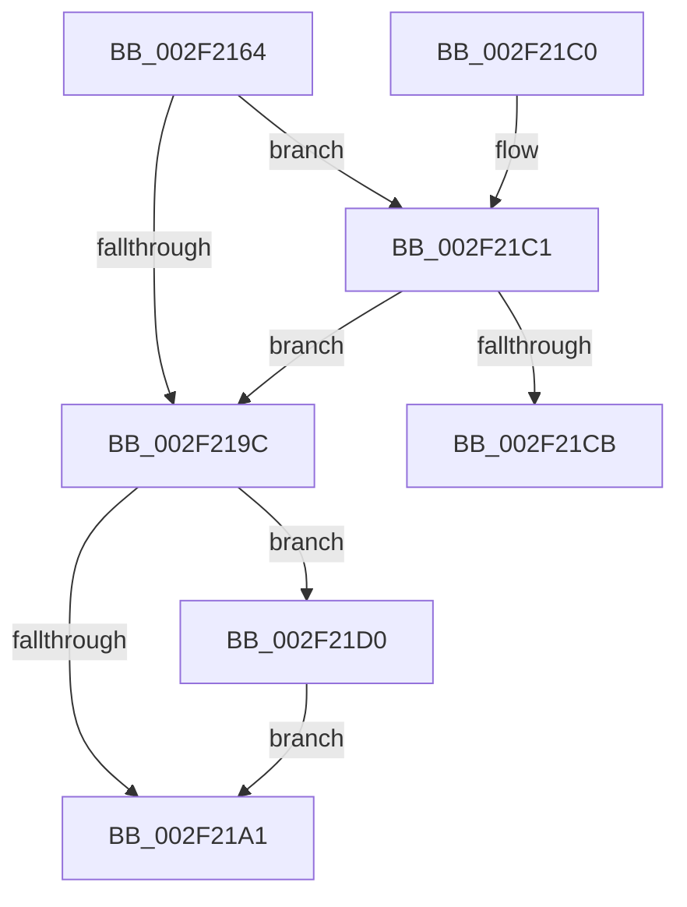

# VslGetNestedPageProtectionFlags

- RVA: `0x002F2164`–`0x002F21DC` (길이 `120` bytes)
- VA: `0x00000001402F2164`
- 실행 섹션: `.text`
- PDB 이름 있음: `예`; PDB Function 태그: `예`
- unwind 정보 RVA: `0x00071F04`
- 디코드: `29`개 명령, `120/120` bytes 표시
- 미해석 바이트: `0` (있으면 어셈블리에 `.byte`로 보존)

> 이 문서는 커널 이미지의 기계어와 PDB 기호를 분석해 생성했습니다. 4번과 5번은 함수 원형과 자료형을 바이너리 사용 방식에서 추정한 C 해석이며 원본 소스 복구 결과는 아닙니다.

## 1. Dependencies

- 직접 호출 지점: **2**; 고유 호출 대상: **2**
- 직접 호출자로 확인된 함수: **15**
- RIP 상대 이미지 참조: **4**

### Outgoing calls
- `0x002F218D` → [memset](../6C/memset_function_006C6C40.md) (function, `0x006C6C40`)
- `0x002F21B2` → [_security_check_cookie](../6A/_security_check_cookie_function_006AC640.md) (function, `0x006AC640`)

### Direct callers
- [RtlGuardCheckExceptionHandler](RtlGuardCheckExceptionHandler_function_002F2038.md) at `0x002F204B`
- [RtlpControlFlowGuardEnforced](RtlpControlFlowGuardEnforced_function_002F2144.md) at `0x002F214A`
- [sub_00312A48](../31/Unknown_function_00312A48.md) at `0x00312A99`
- [sub_00312A48](../31/Unknown_function_00312A48.md) at `0x00312ACD`
- [KiIsSecureFlushRequired](../40/KiIsSecureFlushRequired_function_00401CCC.md) at `0x00401D20`
- [HvlGetEnlightenmentInfo](../58/HvlGetEnlightenmentInfo_function_00588020.md) at `0x005884A5`
- [HvlpDetermineEnlightenments](../58/HvlpDetermineEnlightenments_function_0058CC9C.md) at `0x0058D099`
- [VslpGetNestedPageProtectionFlags](../../page/71/VslpGetNestedPageProtectionFlags_function_00719D70.md) at `0x00719D76`
- [PsLocateSystemDlls](../../page/77/PsLocateSystemDlls_function_0077ED90.md) at `0x0077EDBD`
- [PiIsDriverBlocked](../../page/99/PiIsDriverBlocked_function_0099C254.md) at `0x0099C302`
- [ExpQuerySystemInformation](../../page/A5/ExpQuerySystemInformation_function_00A57858.md) at `0x00A5A3EA`
- [MiInitializeStrongCode](../../init/BE/MiInitializeStrongCode_function_00BEEAEC.md) at `0x00BEEAF7`
- [InitBootProcessor](../../init/C1/InitBootProcessor_function_00C1B1C8.md) at `0x00C1B2DB`
- [KiAreCodePatchesAllowed](../../init/C3/KiAreCodePatchesAllowed_function_00C36DF0.md) at `0x00C36DF6`
- [KiIsKernelCfgActive](../../init/C3/KiIsKernelCfgActive_function_00C36E54.md) at `0x00C36E5A`
- [PspIumInitialize](../../init/C4/PspIumInitialize_function_00C467A8.md) at `0x00C46828`

### Static image references
- `0x002F216D` → RVA `0x00E0A740` (`.data`; read)
- `0x002F2192` → RVA `0x01201860` (`CFGRO`; read)
- `0x002F21A1` → RVA `0x0120184C` (`CFGRO`; read)
- `0x002F21D0` → RVA `0x01201868` (`CFGRO`; read)

## 2. Other-region calls and transfers

- 다른 실행 섹션으로 향하는 call: **0**
- call이 아닌 외부 분기/꼬리 이동: **1**
  - `0x002F21CB` → [sub_006DEF8A](../6D/Unknown_function_006DEF8A.md) (`tail-transfer`)

## 3. Assembly (complete function range)

```asm
002F2164  40 53                           push rbx
002F2166  48 81 EC A0 00 00 00            sub rsp, 0xa0
002F216D  48 8B 05 CC 85 B1 00            mov rax, qword ptr [rip + 0xb185cc]
002F2174  48 33 C4                        xor rax, rsp
002F2177  48 89 84 24 90 00 00 00         mov qword ptr [rsp + 0x90], rax
002F217F  33 D2                           xor edx, edx
002F2181  48 8B D9                        mov rbx, rcx
002F2184  48 8D 4C 24 20                  lea rcx, [rsp + 0x20]
002F2189  44 8D 42 68                     lea r8d, [rdx + 0x68]
002F218D  E8 AE 4A 3D 00                  call 0x1406c6c40
002F2192  48 83 3D C6 F6 F0 00 00         cmp qword ptr [rip + 0xf0f6c6], 0
002F219A  75 25                           jne 0x1402f21c1
002F219C  48 85 DB                        test rbx, rbx
002F219F  75 2F                           jne 0x1402f21d0
002F21A1  8B 05 A5 F6 F0 00               mov eax, dword ptr [rip + 0xf0f6a5]
002F21A7  48 8B 8C 24 90 00 00 00         mov rcx, qword ptr [rsp + 0x90]
002F21AF  48 33 CC                        xor rcx, rsp
002F21B2  E8 89 A4 3B 00                  call 0x1406ac640
002F21B7  48 81 C4 A0 00 00 00            add rsp, 0xa0
002F21BE  5B                              pop rbx
002F21BF  C3                              ret
002F21C0  CC                              int3
002F21C1  8B 05 85 F6 F0 00               mov eax, dword ptr [rip + 0xf0f685]
002F21C7  85 C0                           test eax, eax
002F21C9  75 D1                           jne 0x1402f219c
002F21CB  E9 BA CD 3E 00                  jmp 0x1406def8a
002F21D0  48 8B 05 91 F6 F0 00            mov rax, qword ptr [rip + 0xf0f691]
002F21D7  48 89 03                        mov qword ptr [rbx], rax
002F21DA  EB C5                           jmp 0x1402f21a1
```

## 4. C-style interpretation (structured pseudocode)

```c
__int64 __fastcall VslGetNestedPageProtectionFlags(__int64 a1, int a2)
{
    __int64 result;
    __int64 v_rsp;
    unsigned __int64 v_stack_m18;
    unsigned __int64 v_stack_m88;

    v_rsp = (v_rsp) - (160);
    result = (*(unsigned __int64 *)(v_rip + 11634124)) ^ (v_rsp);
    v_stack_m18 = result;
    a2 = 0;
    result = memset(v_stack_m88, a2, a2 + 104, a4);
    if ((*(unsigned __int64 *)(v_rip + 15791814)) != 0) goto loc_002F21C1;
loc_002F219C:
    if (a1 != 0) goto loc_002F21D0;
loc_002F21A1:
    a1 = (v_stack_m18) ^ (v_rsp);
    result = _security_check_cookie(a1, a2, a2 + 104, a4);
    v_rsp = (v_rsp) + (160);
    return result;
loc_002F21C1:
    if ((unsigned int)((unsigned int)(*(unsigned int *)(v_rip + 15791749))) != 0) goto loc_002F219C;
loc_002F21D0:
    *(unsigned __int64 *)(a1) = *(unsigned __int64 *)(v_rip + 15791761);
    goto loc_002F21A1;
}
```

## 5. (Beta) C Style

```c
int64_t VslGetNestedPageProtectionFlags(int64_t Arg1, int32_t Arg2)
{
    int64_t result;
    int64_t local_rsp;
    uint64_t v_stack_m18;
    uint64_t v_stack_m88;

    local_rsp = (local_rsp) - (160);
    result = (*(uint64_t *)(v_rip + 0xB185CC)) ^ (local_rsp);
    v_stack_m18 = result;
    Arg2 = 0;
    result = memset(v_stack_m88, Arg2, Arg2 + 104, a4);
    if ((*(uint64_t *)(v_rip + 0xF0F6C6)) != 0) goto loc_002F21C1;
loc_002F219C:
    if (Arg1 != 0) goto loc_002F21D0;
loc_002F21A1:
    Arg1 = (v_stack_m18) ^ (local_rsp);
    result = _security_check_cookie(Arg1, Arg2, Arg2 + 104, a4);
    local_rsp = (local_rsp) + (160);
    return result;
loc_002F21C1:
    if ((uint32_t)((uint32_t)(*(uint32_t *)(v_rip + 0xF0F685))) != 0) goto loc_002F219C;
loc_002F21D0:
    *(uint64_t *)(Arg1) = *(uint64_t *)(v_rip + 0xF0F691);
    goto loc_002F21A1;
}
```

## 6. Execution-region graph

[열기: 2D/3D 그래프와 함수 탐색 컨트롤 패널](../../../control-panel.html?section=text&rva=0x002F2164&view=graph)

- 2D 그래프는 위에서 아래로 흐르고, 3D 그래프는 빈 공간을 드래그해 회전합니다. Shift+드래그는 이동, 휠은 확대·축소, 함수 노드 선택은 대상 보고서 이동입니다.

### Static fallback


