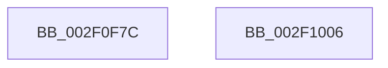

# tlgWriteAgg

- RVA: `0x002F0F7C`–`0x002F1007` (길이 `139` bytes)
- VA: `0x00000001402F0F7C`
- 실행 섹션: `.text`
- PDB 이름 있음: `예`; PDB Function 태그: `아니요`
- unwind 정보 RVA: `0x0006BDBC`
- 디코드: `34`개 명령, `139/139` bytes 표시
- 미해석 바이트: `0` (있으면 어셈블리에 `.byte`로 보존)

> 이 문서는 커널 이미지의 기계어와 PDB 기호를 분석해 생성했습니다. 4번과 5번은 함수 원형과 자료형을 바이너리 사용 방식에서 추정한 C 해석이며 원본 소스 복구 결과는 아닙니다.

## 1. Dependencies

- 직접 호출 지점: **1**; 고유 호출 대상: **1**
- 직접 호출자로 확인된 함수: **29**
- RIP 상대 이미지 참조: **2**

### Outgoing calls
- `0x002F0FFC` → [TlgAggregateAbsorbEvent](TlgAggregateAbsorbEvent_function_002F1010.md) (function, `0x002F1010`)

### Direct callers
- [MiLogPeriodicTelemetry](../2D/MiLogPeriodicTelemetry_function_002DB750.md) at `0x002DB8A6`
- [MiLogPeriodicTelemetry](../2D/MiLogPeriodicTelemetry_function_002DB750.md) at `0x002DB938`
- [MiLogPeriodicTelemetry](../2D/MiLogPeriodicTelemetry_function_002DB750.md) at `0x002DBAE9`
- [MiLogPeriodicTelemetry](../2D/MiLogPeriodicTelemetry_function_002DB750.md) at `0x002DBC48`
- [FsRtlpRequestExclusiveOplock](../3F/FsRtlpRequestExclusiveOplock_function_003F3800.md) at `0x003F3B1F`
- [CmpThreadInfoLogStack](../4C/CmpThreadInfoLogStack_function_004CA590.md) at `0x004CA699`
- [FsRtlpRequestShareableOplock](../4E/FsRtlpRequestShareableOplock_function_004E6EC8.md) at `0x004E722E`
- [FsRtlpOplockAckTimeoutWorker](../58/FsRtlpOplockAckTimeoutWorker_function_00582950.md) at `0x00582AB4`
- [MiLogSlabEntriesDemote](../68/MiLogSlabEntriesDemote_function_0068EE4C.md) at `0x0068F067`
- [MiLogSlabEntriesDemote](../68/MiLogSlabEntriesDemote_function_0068EE4C.md) at `0x0068F11D`
- [FsRtlpOplockPerfSendData](../../page/6F/FsRtlpOplockPerfSendData_function_006FDB80.md) at `0x006FDC76`
- [NtCreateIoRing](../../page/72/NtCreateIoRing_function_00720530.md) at `0x00720CAD`
- [CmpDoParseKey](../../page/85/CmpDoParseKey_function_0085F750.md) at `0x0086041E`
- [NtQueryKey](../../page/86/NtQueryKey_function_008676E0.md) at `0x00867E8F`
- [CmLoadAppKey](../../page/87/CmLoadAppKey_function_00876FFC.md) at `0x00877454`
- [CmLoadAppKey](../../page/87/CmLoadAppKey_function_00876FFC.md) at `0x00877670`
- [CmLoadAppKey](../../page/87/CmLoadAppKey_function_00876FFC.md) at `0x00877926`
- [CmLoadKey](../../page/87/CmLoadKey_function_008787CC.md) at `0x00878C65`
- [CmLoadKey](../../page/87/CmLoadKey_function_008787CC.md) at `0x00878E5F`
- [CmpLogHiveFileInaccessible](../../page/87/CmpLogHiveFileInaccessible_function_0087AEAC.md) at `0x0087AFF1`
- [EtwpWriteAppStateChangeSummary](../../page/8A/EtwpWriteAppStateChangeSummary_function_008A4990.md) at `0x008A4F30`
- [sub_008B28C6](../../page/8B/Unknown_function_008B28C6.md) at `0x008B297E`
- [NtEnumerateValueKey](../../page/8B/NtEnumerateValueKey_function_008B3B50.md) at `0x008B43C0`
- [PnpTraceSetDevNodeProblem](../../page/8F/PnpTraceSetDevNodeProblem_function_008FE08C.md) at `0x008FE1D4`
- [PnpTraceInterruptConnection](../../page/90/PnpTraceInterruptConnection_function_00900A60.md) at `0x00900AFE`
- [HvAnalyzeLogFiles](../../page/9B/HvAnalyzeLogFiles_function_009B9A9C.md) at `0x009B9D03`
- [FsRtlCheckOplockForFsFilterCallback](../../page/9F/FsRtlCheckOplockForFsFilterCallback_function_009F67A0.md) at `0x009F6975`
- [PnpTraceClearDevNodeProblem](../../page/A2/PnpTraceClearDevNodeProblem_function_00A27E58.md) at `0x00A27F55`
- [MiLogPinDriverAddress](../../page/A4/MiLogPinDriverAddress_function_00A442B4.md) at `0x00A444CD`
- [MiLogNonRetpolineImageLoadEvent](../../page/A9/MiLogNonRetpolineImageLoadEvent_function_00A9975C.md) at `0x00A99846`
- [EtwpStartLogger](../../page/A9/EtwpStartLogger_function_00A99D80.md) at `0x00A9A5D2`
- [PnpTraceDmaGuardDevicePolicy](../../page/AD/PnpTraceDmaGuardDevicePolicy_function_00AD1A38.md) at `0x00AD1B12`
- [sub_00B179DA](../../page/B1/Unknown_function_00B179DA.md) at `0x00B17B7A`
- [sub_00B2E53E](../../page/B2/Unknown_function_00B2E53E.md) at `0x00B2E5B7`
- [sub_00B3261C](../../page/B3/Unknown_function_00B3261C.md) at `0x00B326AD`
- [sub_00B3AD1E](../../page/B3/Unknown_function_00B3AD1E.md) at `0x00B3ADDF`

### Static image references
- `0x002F0FC1` → RVA `0x00043590` (`.rdata`; read)
- `0x002F0FE0` → RVA `0x0005BCFD` (`.rdata`; read)

## 2. Other-region calls and transfers

- 다른 실행 섹션으로 향하는 call: **0**
- 별도 외부 분기/꼬리 이동을 확인하지 못했습니다.

## 3. Assembly (complete function range)

```asm
002F0F7C  4C 89 44 24 18                  mov qword ptr [rsp + 0x18], r8
002F0F81  48 83 EC 38                     sub rsp, 0x38
002F0F85  0F B6 02                        movzx eax, byte ptr [rdx]
002F0F88  4C 8B D1                        mov r10, rcx
002F0F8B  C1 E0 18                        shl eax, 0x18
002F0F8E  45 8B C1                        mov r8d, r9d
002F0F91  4C 8B 4C 24 60                  mov r9, qword ptr [rsp + 0x60]
002F0F96  89 44 24 20                     mov dword ptr [rsp + 0x20], eax
002F0F9A  0F B7 42 01                     movzx eax, word ptr [rdx + 1]
002F0F9E  89 44 24 24                     mov dword ptr [rsp + 0x24], eax
002F0FA2  48 8B 42 03                     mov rax, qword ptr [rdx + 3]
002F0FA6  48 83 C2 0B                     add rdx, 0xb
002F0FAA  48 89 44 24 28                  mov qword ptr [rsp + 0x28], rax
002F0FAF  48 8B 41 08                     mov rax, qword ptr [rcx + 8]
002F0FB3  49 89 01                        mov qword ptr [r9], rax
002F0FB6  48 8B 41 08                     mov rax, qword ptr [rcx + 8]
002F0FBA  0F B7 08                        movzx ecx, word ptr [rax]
002F0FBD  41 89 49 08                     mov dword ptr [r9 + 8], ecx
002F0FC1  48 8D 0D C8 25 D5 FF            lea rcx, [rip - 0x2ada38]
002F0FC8  49 89 51 10                     mov qword ptr [r9 + 0x10], rdx
002F0FCC  41 C7 41 0C 02 00 00 00         mov dword ptr [r9 + 0xc], 2
002F0FD4  0F B7 02                        movzx eax, word ptr [rdx]
002F0FD7  48 8D 54 24 20                  lea rdx, [rsp + 0x20]
002F0FDC  41 89 41 18                     mov dword ptr [r9 + 0x18], eax
002F0FE0  48 8D 05 16 AD D6 FF            lea rax, [rip - 0x2952ea]
002F0FE7  2B C1                           sub eax, ecx
002F0FE9  41 C7 41 1C 01 00 00 00         mov dword ptr [r9 + 0x1c], 1
002F0FF1  89 44 24 50                     mov dword ptr [rsp + 0x50], eax
002F0FF5  49 8B CA                        mov rcx, r10
002F0FF8  8B 44 24 50                     mov eax, dword ptr [rsp + 0x50]
002F0FFC  E8 0F 00 00 00                  call 0x1402f1010
002F1001  48 83 C4 38                     add rsp, 0x38
002F1005  C3                              ret
002F1006  CC                              int3
```

## 4. C-style interpretation (structured pseudocode)

```c
__int64 __fastcall tlgWriteAgg(__int64 a1, __int64 a2, __int64 a3, int a4, __int64 a5)
{
    __int64 result;
    __int64 v_rsp;
    unsigned __int64 v_stack_m10;
    unsigned int v_stack_m14;
    unsigned int v_stack_m18;
    unsigned __int64 v_stack_p18;

    v_stack_p18 = a3;
    v_rsp = (v_rsp) - (56);
    result = (unsigned int)((*(unsigned __int8 *)(a2)) << (24));
    v_stack_m18 = (unsigned int)(result);
    v_stack_m14 = (unsigned int)(*(unsigned __int16 *)(a2 + 1));
    a2 = (a2) + (11);
    v_stack_m10 = *(unsigned __int64 *)(a2 + 3);
    *(unsigned __int64 *)(a5) = *(unsigned __int64 *)(a1 + 8);
    *(unsigned int *)(a5 + 8) = (unsigned int)(*(unsigned __int16 *)(*(unsigned __int64 *)(a1 + 8)));
    *(unsigned __int64 *)(a5 + 16) = a2;
    *(unsigned int *)(a5 + 12) = 2;
    *(unsigned int *)(a5 + 24) = (unsigned int)(*(unsigned __int16 *)(a2));
    result = (unsigned int)((v_rip - 2708202) - ((unsigned int)(v_rip - 2808376)));
    *(unsigned int *)(a5 + 28) = 1;
    v_stack_p18 = (unsigned int)(result);
    result = TlgAggregateAbsorbEvent(a1, v_stack_m18, (unsigned int)(a4), a5);
    v_rsp = (v_rsp) + (56);
    return result;
}
```

## 5. (Beta) C Style

```c
int64_t tlgWriteAgg(void *Arg1, void *Arg2, int64_t Arg3, int32_t Arg4, void *Arg5)
{
    uint8_t *arg1 = (uint8_t *)Arg1;
    uint8_t *arg2 = (uint8_t *)Arg2;
    uint8_t *arg5 = (uint8_t *)Arg5;

    int64_t result;
    int64_t local_rsp;
    uint64_t v_stack_m10;
    uint32_t v_stack_m14;
    uint32_t v_stack_m18;
    uint64_t v_stack_p18;

    v_stack_p18 = Arg3;
    local_rsp = (local_rsp) - (56);
    result = (uint32_t)((*(uint8_t *)(arg2)) << (24));
    v_stack_m18 = (uint32_t)(result);
    v_stack_m14 = (uint32_t)(*(uint16_t *)(arg2 + 0x1));
    Arg2 = (Arg2) + (11);
    v_stack_m10 = *(uint64_t *)(arg2 + 0x3);
    *(uint64_t *)(arg5) = *(uint64_t *)(arg1 + 0x8);
    *(uint32_t *)(arg5 + 0x8) = (uint32_t)(*(uint16_t *)(*(uint64_t *)(arg1 + 0x8)));
    *(void **)(arg5 + 0x10) = Arg2;
    *(uint32_t *)(arg5 + 0xC) = 2;
    *(uint32_t *)(arg5 + 0x18) = (uint32_t)(*(uint16_t *)(arg2));
    result = (uint32_t)((v_rip - 2708202) - ((uint32_t)(v_rip - 2808376)));
    *(uint32_t *)(arg5 + 0x1C) = 1;
    v_stack_p18 = (uint32_t)(result);
    result = TlgAggregateAbsorbEvent(Arg1, v_stack_m18, (uint32_t)(Arg4), Arg5);
    local_rsp = (local_rsp) + (56);
    return result;
}
```

### 관측된 메모리 오프셋

구조체 형식이 확인되지 않은 접근은 인자 기준의 오프셋으로만 기록했습니다.

| 기준 인자 | 오프셋 표현 | 폭 (bit) | 접근 |
|---|---:|---:|---|
| `Arg1` | `+ 0x8` | `64` | `R` |
| `Arg2` | `+ 0x0` | `8` | `R` |
| `Arg2` | `+ 0x0` | `16` | `R` |
| `Arg2` | `+ 0x1` | `16` | `R` |
| `Arg2` | `+ 0x3` | `64` | `R` |
| `Arg5` | `+ 0x0` | `64` | `W` |
| `Arg5` | `+ 0x8` | `32` | `W` |
| `Arg5` | `+ 0xC` | `32` | `W` |
| `Arg5` | `+ 0x10` | `64` | `W` |
| `Arg5` | `+ 0x18` | `32` | `W` |
| `Arg5` | `+ 0x1C` | `32` | `W` |

## 6. Execution-region graph

[열기: 2D/3D 그래프와 함수 탐색 컨트롤 패널](../../../control-panel.html?section=text&rva=0x002F0F7C&view=graph)

- 2D 그래프는 위에서 아래로 흐르고, 3D 그래프는 빈 공간을 드래그해 회전합니다. Shift+드래그는 이동, 휠은 확대·축소, 함수 노드 선택은 대상 보고서 이동입니다.

### Static fallback


