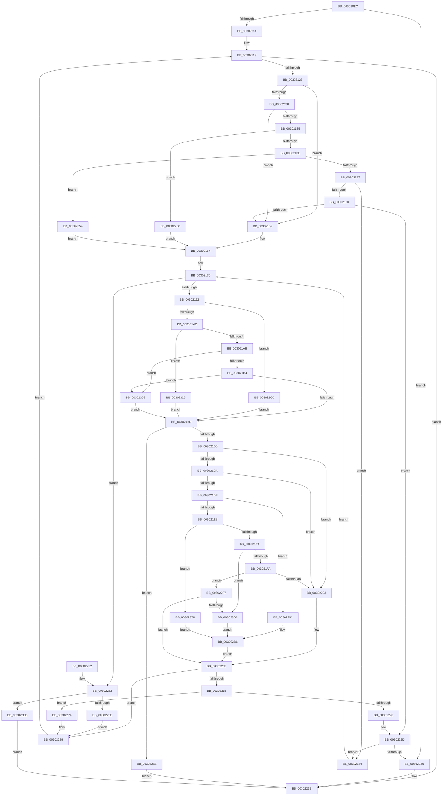

# AuthzBasepAddSecurityAttributeValues

- RVA: `0x003020EC`–`0x003023B1` (길이 `709` bytes)
- VA: `0x00000001403020EC`
- 실행 섹션: `.text`
- PDB 이름 있음: `예`; PDB Function 태그: `아니요`
- unwind 정보 RVA: `0x00073340`
- 디코드: `192`개 명령, `709/709` bytes 표시
- 미해석 바이트: `0` (있으면 어셈블리에 `.byte`로 보존)

> 이 문서는 커널 이미지의 기계어와 PDB 기호를 분석해 생성했습니다. 4번과 5번은 함수 원형과 자료형을 바이너리 사용 방식에서 추정한 C 해석이며 원본 소스 복구 결과는 아닙니다.

## 1. Dependencies

- 직접 호출 지점: **5**; 고유 호출 대상: **4**
- 직접 호출자로 확인된 함수: **1**
- RIP 상대 이미지 참조: **0**

### Outgoing calls
- `0x00302167` → [AuthzBasepFindSecurityAttributeValue](AuthzBasepFindSecurityAttributeValue_function_00302B2C.md) (function, `0x00302B2C`)
- `0x003021BF` → [AuthzBasepAllocateSecurityAttributeValue](AuthzBasepAllocateSecurityAttributeValue_function_00302AE0.md) (function, `0x00302AE0`)
- `0x0030226A` → [AuthzBasepRemoveSecurityAttributeValueFromLists](AuthzBasepRemoveSecurityAttributeValueFromLists_function_00302E00.md) (function, `0x00302E00`)
- `0x003022B6` → [memcpy](../6C/memcpy_function_006C6840.md) (function, `0x006C6840`)
- `0x0030234A` → [AuthzBasepFindSecurityAttributeValue](AuthzBasepFindSecurityAttributeValue_function_00302B2C.md) (function, `0x00302B2C`)

### Direct callers
- [AuthzBasepAddSecurityAttribute](../3A/AuthzBasepAddSecurityAttribute_function_003A8BE4.md) at `0x003A8C9F`

### Static image references
- 디코드된 RIP-relative 메모리 참조가 없습니다.

## 2. Other-region calls and transfers

- 다른 실행 섹션으로 향하는 call: **0**
- 별도 외부 분기/꼬리 이동을 확인하지 못했습니다.

## 3. Assembly (complete function range)

```asm
003020EC  48 89 5C 24 18                  mov qword ptr [rsp + 0x18], rbx
003020F1  55                              push rbp
003020F2  56                              push rsi
003020F3  57                              push rdi
003020F4  41 54                           push r12
003020F6  41 55                           push r13
003020F8  41 56                           push r14
003020FA  41 57                           push r15
003020FC  48 83 EC 20                     sub rsp, 0x20
00302100  0F B7 42 10                     movzx eax, word ptr [rdx + 0x10]
00302104  4C 8B FA                        mov r15, rdx
00302107  48 8B E9                        mov rbp, rcx
0030210A  66 39 41 30                     cmp word ptr [rcx + 0x30], ax
0030210E  0F 85 22 01 00 00               jne 0x140302236
00302114  33 FF                           xor edi, edi
00302116  44 8B E7                        mov r12d, edi
00302119  45 3B 67 18                     cmp r12d, dword ptr [r15 + 0x18]
0030211D  0F 83 18 01 00 00               jae 0x14030223b
00302123  44 0F B7 45 30                  movzx r8d, word ptr [rbp + 0x30]
00302128  41 8B C8                        mov ecx, r8d
0030212B  83 E9 01                        sub ecx, 1
0030212E  74 29                           je 0x140302159
00302130  83 E9 01                        sub ecx, 1
00302133  74 24                           je 0x140302159
00302135  83 E9 01                        sub ecx, 1
00302138  0F 84 92 01 00 00               je 0x1403022d0
0030213E  83 E9 01                        sub ecx, 1
00302141  0F 84 0D 02 00 00               je 0x140302354
00302147  83 E9 01                        sub ecx, 1
0030214A  0F 84 E6 01 00 00               je 0x140302336
00302150  83 E9 01                        sub ecx, 1
00302153  0F 85 D4 00 00 00               jne 0x14030222d
00302159  49 8B 57 20                     mov rdx, qword ptr [r15 + 0x20]
0030215D  45 8B F4                        mov r14d, r12d
00302160  4A 8B 14 F2                     mov rdx, qword ptr [rdx + r14*8]
00302164  48 8B CD                        mov rcx, rbp
00302167  E8 C0 09 00 00                  call 0x140302b2c
0030216C  49 8D 77 20                     lea rsi, [r15 + 0x20]
00302170  45 8B CC                        mov r9d, r12d
00302173  48 8B D0                        mov rdx, rax
00302176  45 8B D4                        mov r10d, r12d
00302179  45 8B C4                        mov r8d, r12d
0030217C  4C 89 74 24 60                  mov qword ptr [rsp + 0x60], r14
00302181  4C 89 74 24 68                  mov qword ptr [rsp + 0x68], r14
00302186  45 8B EC                        mov r13d, r12d
00302189  48 85 C0                        test rax, rax
0030218C  0F 85 C1 00 00 00               jne 0x140302253
00302192  41 0F B7 4F 10                  movzx ecx, word ptr [r15 + 0x10]
00302197  8B D7                           mov edx, edi
00302199  83 E9 03                        sub ecx, 3
0030219C  0F 84 1E 01 00 00               je 0x1403022c0
003021A2  83 E9 01                        sub ecx, 1
003021A5  0F 84 7A 01 00 00               je 0x140302325
003021AB  83 E9 01                        sub ecx, 1
003021AE  0F 84 B4 01 00 00               je 0x140302368
003021B4  83 F9 0B                        cmp ecx, 0xb
003021B7  0F 84 AB 01 00 00               je 0x140302368
003021BD  8B CA                           mov ecx, edx
003021BF  E8 1C 09 00 00                  call 0x140302ae0
003021C4  48 8B D8                        mov rbx, rax
003021C7  48 85 C0                        test rax, rax
003021CA  0F 84 13 01 00 00               je 0x1403022e3
003021D0  41 0F B7 4F 10                  movzx ecx, word ptr [r15 + 0x10]
003021D5  83 E9 01                        sub ecx, 1
003021D8  74 29                           je 0x140302203
003021DA  83 E9 01                        sub ecx, 1
003021DD  74 24                           je 0x140302203
003021DF  83 E9 01                        sub ecx, 1
003021E2  0F 84 A9 00 00 00               je 0x140302291
003021E8  83 E9 01                        sub ecx, 1
003021EB  0F 84 87 01 00 00               je 0x140302378
003021F1  83 E9 01                        sub ecx, 1
003021F4  0F 84 06 01 00 00               je 0x140302300
003021FA  83 E9 01                        sub ecx, 1
003021FD  0F 85 F4 00 00 00               jne 0x1403022f7
00302203  48 8B 06                        mov rax, qword ptr [rsi]
00302206  4A 8B 0C F0                     mov rcx, qword ptr [rax + r14*8]
0030220A  48 89 4B 28                     mov qword ptr [rbx + 0x28], rcx
0030220E  8B 43 20                        mov eax, dword ptr [rbx + 0x20]
00302211  A8 02                           test al, 2
00302213  75 74                           jne 0x140302289
00302215  48 8D 4D 60                     lea rcx, [rbp + 0x60]
00302219  48 8B 51 08                     mov rdx, qword ptr [rcx + 8]
0030221D  48 8D 43 10                     lea rax, [rbx + 0x10]
00302221  48 39 0A                        cmp qword ptr [rdx], rcx
00302224  74 4E                           je 0x140302274
00302226  B9 03 00 00 00                  mov ecx, 3
0030222B  CD 29                           int 0x29
0030222D  83 F9 0A                        cmp ecx, 0xa
00302230  0F 84 00 01 00 00               je 0x140302336
00302236  BF 0D 00 00 C0                  mov edi, 0xc000000d
0030223B  48 8B 5C 24 70                  mov rbx, qword ptr [rsp + 0x70]
00302240  8B C7                           mov eax, edi
00302242  48 83 C4 20                     add rsp, 0x20
00302246  41 5F                           pop r15
00302248  41 5E                           pop r14
0030224A  41 5D                           pop r13
0030224C  41 5C                           pop r12
0030224E  5F                              pop rdi
0030224F  5E                              pop rsi
00302250  5D                              pop rbp
00302251  C3                              ret
00302252  CC                              int3
00302253  8B 42 20                        mov eax, dword ptr [rdx + 0x20]
00302256  A8 04                           test al, 4
00302258  0F 84 8F 00 00 00               je 0x1403022ed
0030225E  83 E0 FB                        and eax, 0xfffffffb
00302261  45 33 C0                        xor r8d, r8d
00302264  48 8B CD                        mov rcx, rbp
00302267  89 42 20                        mov dword ptr [rdx + 0x20], eax
0030226A  E8 91 0B 00 00                  call 0x140302e00
0030226F  FF 4D 40                        dec dword ptr [rbp + 0x40]
00302272  EB 15                           jmp 0x140302289
00302274  48 89 08                        mov qword ptr [rax], rcx
00302277  48 89 50 08                     mov qword ptr [rax + 8], rdx
0030227B  48 89 02                        mov qword ptr [rdx], rax
0030227E  48 89 41 08                     mov qword ptr [rcx + 8], rax
00302282  83 4B 20 02                     or dword ptr [rbx + 0x20], 2
00302286  FF 45 58                        inc dword ptr [rbp + 0x58]
00302289  41 FF C4                        inc r12d
0030228C  E9 88 FE FF FF                  jmp 0x140302119
00302291  48 8B 06                        mov rax, qword ptr [rsi]
00302294  48 8D 4B 40                     lea rcx, [rbx + 0x40]
00302298  4D 03 ED                        add r13, r13
0030229B  46 0F B7 04 E8                  movzx r8d, word ptr [rax + r13*8]
003022A0  66 44 89 43 28                  mov word ptr [rbx + 0x28], r8w
003022A5  66 44 89 43 2A                  mov word ptr [rbx + 0x2a], r8w
003022AA  48 89 4B 30                     mov qword ptr [rbx + 0x30], rcx
003022AE  48 8B 16                        mov rdx, qword ptr [rsi]
003022B1  4A 8B 54 EA 08                  mov rdx, qword ptr [rdx + r13*8 + 8]
003022B6  E8 85 45 3C 00                  call 0x1406c6840
003022BB  E9 4E FF FF FF                  jmp 0x14030220e
003022C0  48 8B 06                        mov rax, qword ptr [rsi]
003022C3  4D 03 C0                        add r8, r8
003022C6  42 0F B7 14 C0                  movzx edx, word ptr [rax + r8*8]
003022CB  E9 ED FE FF FF                  jmp 0x1403021bd
003022D0  41 8B D4                        mov edx, r12d
003022D3  48 C1 E2 04                     shl rdx, 4
003022D7  49 03 57 20                     add rdx, qword ptr [r15 + 0x20]
003022DB  45 8B F4                        mov r14d, r12d
003022DE  E9 81 FE FF FF                  jmp 0x140302164
003022E3  BF 9A 00 00 C0                  mov edi, 0xc000009a
003022E8  E9 4E FF FF FF                  jmp 0x14030223b
003022ED  BF 35 00 00 C0                  mov edi, 0xc0000035
003022F2  E9 44 FF FF FF                  jmp 0x14030223b
003022F7  83 F9 0A                        cmp ecx, 0xa
003022FA  0F 85 0E FF FF FF               jne 0x14030220e
00302300  48 8B 06                        mov rax, qword ptr [rsi]
00302303  48 8D 4B 40                     lea rcx, [rbx + 0x40]
00302307  4C 8B 4C 24 60                  mov r9, qword ptr [rsp + 0x60]
0030230C  4D 03 C9                        add r9, r9
0030230F  46 8B 44 C8 08                  mov r8d, dword ptr [rax + r9*8 + 8]
00302314  44 89 43 30                     mov dword ptr [rbx + 0x30], r8d
00302318  48 89 4B 28                     mov qword ptr [rbx + 0x28], rcx
0030231C  48 8B 16                        mov rdx, qword ptr [rsi]
0030231F  4A 8B 14 CA                     mov rdx, qword ptr [rdx + r9*8]
00302323  EB 91                           jmp 0x1403022b6
00302325  48 8B 06                        mov rax, qword ptr [rsi]
00302328  4B 8D 0C 52                     lea rcx, [r10 + r10*2]
0030232C  0F B7 54 C8 08                  movzx edx, word ptr [rax + rcx*8 + 8]
00302331  E9 87 FE FF FF                  jmp 0x1403021bd
00302336  41 8B D4                        mov edx, r12d
00302339  49 8D 77 20                     lea rsi, [r15 + 0x20]
0030233D  48 C1 E2 04                     shl rdx, 4
00302341  48 8B CD                        mov rcx, rbp
00302344  48 03 16                        add rdx, qword ptr [rsi]
00302347  45 8B F4                        mov r14d, r12d
0030234A  E8 DD 07 00 00                  call 0x140302b2c
0030234F  E9 1C FE FF FF                  jmp 0x140302170
00302354  49 8B 47 20                     mov rax, qword ptr [r15 + 0x20]
00302358  45 8B F4                        mov r14d, r12d
0030235B  4B 8D 0C 76                     lea rcx, [r14 + r14*2]
0030235F  48 8D 14 C8                     lea rdx, [rax + rcx*8]
00302363  E9 FC FD FF FF                  jmp 0x140302164
00302368  48 8B 06                        mov rax, qword ptr [rsi]
0030236B  4D 03 C9                        add r9, r9
0030236E  42 8B 54 C8 08                  mov edx, dword ptr [rax + r9*8 + 8]
00302373  E9 45 FE FF FF                  jmp 0x1403021bd
00302378  48 8B 44 24 68                  mov rax, qword ptr [rsp + 0x68]
0030237D  4C 8D 0C 40                     lea r9, [rax + rax*2]
00302381  48 8B 06                        mov rax, qword ptr [rsi]
00302384  4A 8B 0C C8                     mov rcx, qword ptr [rax + r9*8]
00302388  48 89 4B 28                     mov qword ptr [rbx + 0x28], rcx
0030238C  48 8D 4B 40                     lea rcx, [rbx + 0x40]
00302390  48 8B 06                        mov rax, qword ptr [rsi]
00302393  42 0F B7 54 C8 08               movzx edx, word ptr [rax + r9*8 + 8]
00302399  66 89 53 30                     mov word ptr [rbx + 0x30], dx
0030239D  44 8B C2                        mov r8d, edx
003023A0  48 89 4B 38                     mov qword ptr [rbx + 0x38], rcx
003023A4  48 8B 16                        mov rdx, qword ptr [rsi]
003023A7  4A 8B 54 CA 10                  mov rdx, qword ptr [rdx + r9*8 + 0x10]
003023AC  E9 05 FF FF FF                  jmp 0x1403022b6
```

## 4. C-style interpretation (structured pseudocode)

```c
__int64 __fastcall AuthzBasepAddSecurityAttributeValues(__int64 a1, __int64 a2)
{
    __int64 result;
    __int64 v_r12;
    __int64 v_r13;
    __int64 v_rdi;
    __int64 v_rsp;
    unsigned __int64 v_stack_p10;
    unsigned __int64 v_stack_p18;
    unsigned __int64 v_stack_p60;
    unsigned __int64 v_stack_p68;
    unsigned __int64 v_stack_p8;

    v_stack_p18 = v_rbx;
    v_rsp = (v_rsp) - (32);
    if ((*(unsigned __int16 *)(a1 + 48)) != ((unsigned __int16)(*(unsigned __int16 *)(a2 + 16)))) goto loc_00302236;
    v_rdi = 0;
loc_00302119:
    if (0 >= (*(unsigned int *)(a2 + 24))) goto loc_0030223B;
    a1 = (unsigned int)(((unsigned int)((unsigned int)(*(unsigned __int16 *)(a1 + 48)))) - (1));
    if (condition_is_equal) goto loc_00302159;
    a1 = (unsigned int)((a1) - (1));
    if (condition_is_equal) goto loc_00302159;
    a1 = (unsigned int)((a1) - (1));
    if (condition_is_equal) goto loc_003022D0;
    a1 = (unsigned int)((a1) - (1));
    if (condition_is_equal) goto loc_00302354;
    a1 = (unsigned int)((a1) - (1));
    if (condition_is_equal) goto loc_00302336;
    a1 = (unsigned int)((a1) - (1));
    if (condition_is_not_equal) goto loc_0030222D;
loc_00302159:
loc_00302164:
    result = AuthzBasepFindSecurityAttributeValue(a1, *(unsigned __int64 *)(*(unsigned __int64 *)(a2 + 32) + 0 * 8), *(unsigned __int16 *)(a1 + 48), a4);
loc_00302170:
    v_stack_p8 = 0;
    v_stack_p10 = 0;
    if (result != 0) goto loc_00302253;
    a1 = (unsigned int)((*(unsigned __int16 *)(a2 + 16)) - (3));
    if (condition_is_equal) goto loc_003022C0;
    a1 = (unsigned int)((a1) - (1));
    if (condition_is_equal) goto loc_00302325;
    a1 = (unsigned int)((a1) - (1));
    if (condition_is_equal) goto loc_00302368;
    if (((unsigned int)(a1)) == 11) goto loc_00302368;
loc_003021BD:
    result = AuthzBasepAllocateSecurityAttributeValue(0, 0, 0, 0);
    if (result == 0) goto loc_003022E3;
    a1 = (unsigned int)((*(unsigned __int16 *)(a2 + 16)) - (1));
    if (condition_is_equal) goto loc_00302203;
    a1 = (unsigned int)((a1) - (1));
    if (condition_is_equal) goto loc_00302203;
    a1 = (unsigned int)((a1) - (1));
    if (condition_is_equal) goto loc_00302291;
    a1 = (unsigned int)((a1) - (1));
    if (condition_is_equal) goto loc_00302378;
    a1 = (unsigned int)((a1) - (1));
    if (condition_is_equal) goto loc_00302300;
    a1 = (unsigned int)((a1) - (1));
    if (condition_is_not_equal) goto loc_003022F7;
loc_00302203:
    *(unsigned __int64 *)(result + 40) = *(unsigned __int64 *)(*(unsigned __int64 *)(a2 + 32) + 0 * 8);
loc_0030220E:
    if ((((unsigned __int8)((unsigned int)(*(unsigned int *)(result + 32)))) & (2)) != 0) goto loc_00302289;
    if ((*(unsigned __int64 *)(*(unsigned __int64 *)(a1 + 96 + 8))) == (a1 + 96)) goto loc_00302274;
loc_0030222D:
    if (3 == 10) goto loc_00302336;
loc_00302236:
loc_0030223B:
    v_rsp = (v_rsp) + (32);
    return (unsigned int)((unsigned int)((unsigned int)(0xC000000DULL)));
loc_00302253:
    if ((((unsigned __int8)((unsigned int)(*(unsigned int *)(*(unsigned __int64 *)(a1 + 96 + 8) + 32)))) & (4)) == 0) goto loc_003022ED;
    result = (unsigned int)(((unsigned int)(*(unsigned int *)(*(unsigned __int64 *)(a1 + 96 + 8) + 32))) & (0xFFFFFFFBULL));
    a3 = 0;
    *(unsigned int *)(*(unsigned __int64 *)(a1 + 96 + 8) + 32) = (unsigned int)(result);
    result = AuthzBasepRemoveSecurityAttributeValueFromLists(a1, *(unsigned __int64 *)(a1 + 96 + 8), a3, 0);
    goto loc_00302289;
loc_00302274:
    *(unsigned __int64 *)(result) = a1;
    *(unsigned __int64 *)(result + 8) = *(unsigned __int64 *)(a1 + 96 + 8);
    *(unsigned __int64 *)(*(unsigned __int64 *)(a1 + 96 + 8)) = result;
    *(unsigned __int64 *)(a1 + 8) = result;
loc_00302289:
    v_r12 = (unsigned int)((0) + 1);
    goto loc_00302119;
loc_00302291:
    v_r13 = (0) + (0);
    *(unsigned __int16 *)(v_stack_p18 + 40) = (unsigned __int16)(*(unsigned __int16 *)(*(unsigned __int64 *)(a2 + 32) + v_r13 * 8));
    *(unsigned __int16 *)(v_stack_p18 + 42) = (unsigned __int16)(*(unsigned __int16 *)(*(unsigned __int64 *)(a2 + 32) + v_r13 * 8));
    *(unsigned __int64 *)(v_stack_p18 + 48) = v_stack_p18 + 64;
loc_003022B6:
    result = memcpy(v_stack_p18 + 64, *(unsigned __int64 *)(*(unsigned __int64 *)(a2 + 32) + v_r13 * 8 + 8), *(unsigned __int16 *)(*(unsigned __int64 *)(a2 + 32) + v_r13 * 8), 0);
    goto loc_0030220E;
loc_003022C0:
    a3 = (*(unsigned __int16 *)(*(unsigned __int64 *)(a2 + 32) + v_r13 * 8)) + (*(unsigned __int16 *)(*(unsigned __int64 *)(a2 + 32) + v_r13 * 8));
    goto loc_003021BD;
loc_003022D0:
    a2 = ((unsigned int)((unsigned int)(v_r12))) << (4);
    a2 = (a2) + (*(unsigned __int64 *)(a2 + 32));
    goto loc_00302164;
loc_003022E3:
    goto loc_0030223B;
loc_003022ED:
    goto loc_0030223B;
loc_003022F7:
    if (((unsigned int)(v_stack_p18 + 64)) != 10) goto loc_0030220E;
loc_00302300:
    a4 = (v_stack_p60) + (v_stack_p60);
    *(unsigned int *)(v_stack_p18 + 48) = (unsigned int)((unsigned int)(*(unsigned int *)(*(unsigned __int64 *)(a2 + 32) + a4 * 8 + 8)));
    *(unsigned __int64 *)(v_stack_p18 + 40) = v_stack_p18 + 64;
    goto loc_003022B6;
loc_00302325:
    goto loc_003021BD;
loc_00302336:
    a2 = ((unsigned int)((unsigned int)(v_r12))) << (4);
    a2 = (a2) + (*(unsigned __int64 *)(a2 + 32));
    result = AuthzBasepFindSecurityAttributeValue(a1, a2, (unsigned int)(*(unsigned int *)(*(unsigned __int64 *)(a2 + 32) + a4 * 8 + 8)), a4);
    goto loc_00302170;
loc_00302354:
    goto loc_00302164;
loc_00302368:
    a4 = (a4) + (a4);
    goto loc_003021BD;
loc_00302378:
    *(unsigned __int64 *)(v_stack_p18 + 40) = *(unsigned __int64 *)(*(unsigned __int64 *)(a2 + 32) + v_stack_p68 + v_stack_p68 * 2 * 8);
    *(unsigned __int16 *)(v_stack_p18 + 48) = (unsigned __int16)(*(unsigned __int16 *)(*(unsigned __int64 *)(a2 + 32) + v_stack_p68 + v_stack_p68 * 2 * 8 + 8));
    *(unsigned __int64 *)(v_stack_p18 + 56) = v_stack_p18 + 64;
    goto loc_003022B6;
}
```

## 5. (Beta) C Style

```c
int64_t AuthzBasepAddSecurityAttributeValues(void *Arg1, void *Arg2)
{
    uint8_t *arg1 = (uint8_t *)Arg1;
    uint8_t *arg2 = (uint8_t *)Arg2;

    int64_t result;
    int64_t local_r12;
    int64_t local_r13;
    int64_t local_rdi;
    int64_t local_rsp;
    uint64_t v_stack_p10;
    uint64_t v_stack_p18;
    uint64_t v_stack_p60;
    uint64_t v_stack_p68;
    uint64_t v_stack_p8;

    v_stack_p18 = local_rbx;
    local_rsp = (local_rsp) - (32);
    if ((*(uint16_t *)(arg1 + 0x30)) != ((uint16_t)(*(uint16_t *)(arg2 + 0x10)))) goto loc_00302236;
    local_rdi = 0;
loc_00302119:
    if (0 >= (*(uint32_t *)(arg2 + 0x18))) goto loc_0030223B;
    Arg1 = (uint32_t)(((uint32_t)((uint32_t)(*(uint16_t *)(arg1 + 0x30)))) - (1));
    if (condition_is_equal) goto loc_00302159;
    Arg1 = (uint32_t)((Arg1) - (1));
    if (condition_is_equal) goto loc_00302159;
    Arg1 = (uint32_t)((Arg1) - (1));
    if (condition_is_equal) goto loc_003022D0;
    Arg1 = (uint32_t)((Arg1) - (1));
    if (condition_is_equal) goto loc_00302354;
    Arg1 = (uint32_t)((Arg1) - (1));
    if (condition_is_equal) goto loc_00302336;
    Arg1 = (uint32_t)((Arg1) - (1));
    if (condition_is_not_equal) goto loc_0030222D;
loc_00302159:
loc_00302164:
    result = AuthzBasepFindSecurityAttributeValue(Arg1, *(uint64_t *)(*(uint64_t *)(arg2 + 0x20) + 0x0 * 8), *(uint16_t *)(arg1 + 0x30), a4);
loc_00302170:
    v_stack_p8 = 0;
    v_stack_p10 = 0;
    if (result != 0) goto loc_00302253;
    Arg1 = (uint32_t)((*(uint16_t *)(arg2 + 0x10)) - (3));
    if (condition_is_equal) goto loc_003022C0;
    Arg1 = (uint32_t)((Arg1) - (1));
    if (condition_is_equal) goto loc_00302325;
    Arg1 = (uint32_t)((Arg1) - (1));
    if (condition_is_equal) goto loc_00302368;
    if (((uint32_t)(Arg1)) == 11) goto loc_00302368;
loc_003021BD:
    result = AuthzBasepAllocateSecurityAttributeValue(0, 0, 0, 0);
    if (result == 0) goto loc_003022E3;
    Arg1 = (uint32_t)((*(uint16_t *)(arg2 + 0x10)) - (1));
    if (condition_is_equal) goto loc_00302203;
    Arg1 = (uint32_t)((Arg1) - (1));
    if (condition_is_equal) goto loc_00302203;
    Arg1 = (uint32_t)((Arg1) - (1));
    if (condition_is_equal) goto loc_00302291;
    Arg1 = (uint32_t)((Arg1) - (1));
    if (condition_is_equal) goto loc_00302378;
    Arg1 = (uint32_t)((Arg1) - (1));
    if (condition_is_equal) goto loc_00302300;
    Arg1 = (uint32_t)((Arg1) - (1));
    if (condition_is_not_equal) goto loc_003022F7;
loc_00302203:
    *(uint64_t *)(result + 0x28) = *(uint64_t *)(*(uint64_t *)(arg2 + 0x20) + 0x0 * 8);
loc_0030220E:
    if ((((uint8_t)((uint32_t)(*(uint32_t *)(result + 0x20)))) & (2)) != 0) goto loc_00302289;
    if ((*(uint64_t *)(*(uint64_t *)(arg1 + 0x60 + 0x8))) == (Arg1 + 96)) goto loc_00302274;
loc_0030222D:
    if (3 == 10) goto loc_00302336;
loc_00302236:
loc_0030223B:
    local_rsp = (local_rsp) + (32);
    return (uint32_t)((uint32_t)((uint32_t)(0xC000000DULL)));
loc_00302253:
    if ((((uint8_t)((uint32_t)(*(uint32_t *)(*(uint64_t *)(arg1 + 0x60 + 0x8) + 0x20)))) & (4)) == 0) goto loc_003022ED;
    result = (uint32_t)(((uint32_t)(*(uint32_t *)(*(uint64_t *)(arg1 + 0x60 + 0x8) + 0x20))) & (0xFFFFFFFBULL));
    a3 = 0;
    *(uint32_t *)(*(uint64_t *)(arg1 + 0x60 + 0x8) + 0x20) = (uint32_t)(result);
    result = AuthzBasepRemoveSecurityAttributeValueFromLists(Arg1, *(uint64_t *)(arg1 + 0x60 + 0x8), a3, 0);
    goto loc_00302289;
loc_00302274:
    *(void **)(result) = Arg1;
    *(uint64_t *)(result + 0x8) = *(uint64_t *)(arg1 + 0x60 + 0x8);
    *(uint64_t *)(*(uint64_t *)(arg1 + 0x60 + 0x8)) = result;
    *(uint64_t *)(arg1 + 0x8) = result;
loc_00302289:
    local_r12 = (uint32_t)((0) + 1);
    goto loc_00302119;
loc_00302291:
    local_r13 = (0) + (0);
    *(uint16_t *)(v_stack_p18 + 0x28) = (uint16_t)(*(uint16_t *)(*(uint64_t *)(arg2 + 0x20) + local_r13 * 8));
    *(uint16_t *)(v_stack_p18 + 0x2A) = (uint16_t)(*(uint16_t *)(*(uint64_t *)(arg2 + 0x20) + local_r13 * 8));
    *(uint64_t *)(v_stack_p18 + 0x30) = v_stack_p18 + 64;
loc_003022B6:
    result = memcpy(v_stack_p18 + 64, *(uint64_t *)(*(uint64_t *)(arg2 + 0x20) + local_r13 * 8 + 0x8), *(uint16_t *)(*(uint64_t *)(arg2 + 0x20) + local_r13 * 8), 0);
    goto loc_0030220E;
loc_003022C0:
    a3 = (*(uint16_t *)(*(uint64_t *)(arg2 + 0x20) + local_r13 * 8)) + (*(uint16_t *)(*(uint64_t *)(arg2 + 0x20) + local_r13 * 8));
    goto loc_003021BD;
loc_003022D0:
    Arg2 = ((uint32_t)((uint32_t)(local_r12))) << (4);
    Arg2 = (Arg2) + (*(uint64_t *)(arg2 + 0x20));
    goto loc_00302164;
loc_003022E3:
    goto loc_0030223B;
loc_003022ED:
    goto loc_0030223B;
loc_003022F7:
    if (((uint32_t)(v_stack_p18 + 64)) != 10) goto loc_0030220E;
loc_00302300:
    a4 = (v_stack_p60) + (v_stack_p60);
    *(uint32_t *)(v_stack_p18 + 0x30) = (uint32_t)((uint32_t)(*(uint32_t *)(*(uint64_t *)(arg2 + 0x20) + a4 * 8 + 0x8)));
    *(uint64_t *)(v_stack_p18 + 0x28) = v_stack_p18 + 64;
    goto loc_003022B6;
loc_00302325:
    goto loc_003021BD;
loc_00302336:
    Arg2 = ((uint32_t)((uint32_t)(local_r12))) << (4);
    Arg2 = (Arg2) + (*(uint64_t *)(arg2 + 0x20));
    result = AuthzBasepFindSecurityAttributeValue(Arg1, Arg2, (uint32_t)(*(uint32_t *)(*(uint64_t *)(arg2 + 0x20) + a4 * 8 + 0x8)), a4);
    goto loc_00302170;
loc_00302354:
    goto loc_00302164;
loc_00302368:
    a4 = (a4) + (a4);
    goto loc_003021BD;
loc_00302378:
    *(uint64_t *)(v_stack_p18 + 0x28) = *(uint64_t *)(*(uint64_t *)(arg2 + 0x20) + v_stack_p68 + v_stack_p68 * 2 * 8);
    *(uint16_t *)(v_stack_p18 + 0x30) = (uint16_t)(*(uint16_t *)(*(uint64_t *)(arg2 + 0x20) + v_stack_p68 + v_stack_p68 * 2 * 8 + 0x8));
    *(uint64_t *)(v_stack_p18 + 0x38) = v_stack_p18 + 64;
    goto loc_003022B6;
}
```

### 관측된 메모리 오프셋

구조체 형식이 확인되지 않은 접근은 인자 기준의 오프셋으로만 기록했습니다.

| 기준 인자 | 오프셋 표현 | 폭 (bit) | 접근 |
|---|---:|---:|---|
| `Arg1` | `+ 0x8` | `64` | `R` |
| `Arg1` | `+ 0x8` | `64` | `W` |
| `Arg1` | `+ 0x30` | `16` | `R` |
| `Arg1` | `+ 0x40` | `32` | `R/W` |
| `Arg1` | `+ 0x58` | `32` | `R/W` |
| `Arg1` | `+ 0x60` | `64` | `R` |
| `Arg2` | `+ 0x0` | `64` | `R` |
| `Arg2` | `+ 0x10` | `16` | `R` |
| `Arg2` | `+ 0x18` | `32` | `R` |
| `Arg2` | `+ 0x20` | `64` | `R` |

## 6. Execution-region graph

[열기: 2D/3D 그래프와 함수 탐색 컨트롤 패널](../../../control-panel.html?section=text&rva=0x003020EC&view=graph)

- 2D 그래프는 위에서 아래로 흐르고, 3D 그래프는 빈 공간을 드래그해 회전합니다. Shift+드래그는 이동, 휠은 확대·축소, 함수 노드 선택은 대상 보고서 이동입니다.

### Static fallback


