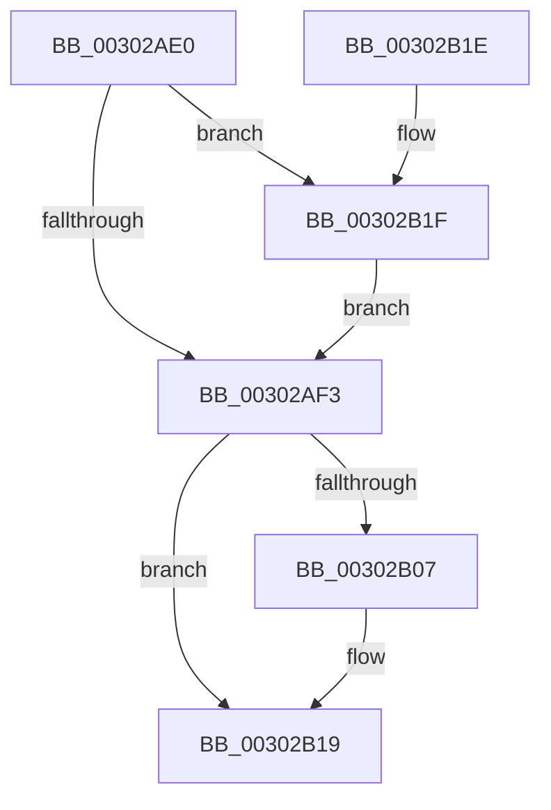

# AuthzBasepAllocateSecurityAttributeValue

- RVA: `0x00302AE0`–`0x00302B26` (길이 `70` bytes)
- VA: `0x0000000140302AE0`
- 실행 섹션: `.text`
- PDB 이름 있음: `예`; PDB Function 태그: `아니요`
- unwind 정보 RVA: `0x0005CEE8`
- 디코드: `21`개 명령, `70/70` bytes 표시
- 미해석 바이트: `0` (있으면 어셈블리에 `.byte`로 보존)

> 이 문서는 커널 이미지의 기계어와 PDB 기호를 분석해 생성했습니다. 4번과 5번은 함수 원형과 자료형을 바이너리 사용 방식에서 추정한 C 해석이며 원본 소스 복구 결과는 아닙니다.

## 1. Dependencies

- 직접 호출 지점: **1**; 고유 호출 대상: **1**
- 직접 호출자로 확인된 함수: **2**
- RIP 상대 이미지 참조: **0**

### Outgoing calls
- `0x00302AFD` → [ExAllocatePool2](../../poolcode/B8/ExAllocatePool2_function_00B820F0.md) (function, `0x00B820F0`)

### Direct callers
- [AuthzBasepAddSecurityAttributeValues](AuthzBasepAddSecurityAttributeValues_function_003020EC.md) at `0x003021BF`
- [AuthzBasepDuplicateSecurityAttributes](AuthzBasepDuplicateSecurityAttributes_function_003023C0.md) at `0x00302911`
- [AuthzBasepDuplicateSecurityAttributes](AuthzBasepDuplicateSecurityAttributes_function_003023C0.md) at `0x003029EA`

### Static image references
- 디코드된 RIP-relative 메모리 참조가 없습니다.

## 2. Other-region calls and transfers

- 다른 실행 섹션으로 향하는 call: **1**
  - `0x00302AFD` → [ExAllocatePool2](../../poolcode/B8/ExAllocatePool2_function_00B820F0.md) (`.text` → `POOLCODE`)
- 별도 외부 분기/꼬리 이동을 확인하지 못했습니다.

## 3. Assembly (complete function range)

```asm
00302AE0  48 83 EC 28                     sub rsp, 0x28
00302AE4  8B D1                           mov edx, ecx
00302AE6  B9 00 01 00 00                  mov ecx, 0x100
00302AEB  44 0F 20 C0                     mov rax, cr8
00302AEF  3C 02                           cmp al, 2
00302AF1  73 2C                           jae 0x140302b1f
00302AF3  48 83 C2 40                     add rdx, 0x40
00302AF7  41 B8 53 65 41 74               mov r8d, 0x74416553
00302AFD  E8 EE F5 87 00                  call 0x140b820f0
00302B02  48 85 C0                        test rax, rax
00302B05  74 12                           je 0x140302b19
00302B07  0F 57 C0                        xorps xmm0, xmm0
00302B0A  0F 11 00                        movups xmmword ptr [rax], xmm0
00302B0D  0F 11 40 10                     movups xmmword ptr [rax + 0x10], xmm0
00302B11  0F 11 40 20                     movups xmmword ptr [rax + 0x20], xmm0
00302B15  0F 11 40 30                     movups xmmword ptr [rax + 0x30], xmm0
00302B19  48 83 C4 28                     add rsp, 0x28
00302B1D  C3                              ret
00302B1E  CC                              int3
00302B1F  B9 40 00 00 00                  mov ecx, 0x40
00302B24  EB CD                           jmp 0x140302af3
```

## 4. C-style interpretation (structured pseudocode)

```c
__int64 __fastcall AuthzBasepAllocateSecurityAttributeValue(int a1)
{
    __int64 result;
    __int64 v_rsp;

    v_rsp = (v_rsp) - (40);
    if (((unsigned __int8)(v_cr8)) >= 2) goto loc_00302B1F;
loc_00302AF3:
    a2 = ((unsigned int)(a1)) + (64);
    result = ExAllocatePool2(256, a2, (unsigned int)(0x74416553ULL), a4);
    if (result != 0) {
        *(unsigned __int64 *)(result) = v_xmm0;
        *(unsigned __int64 *)(result + 16) = v_xmm0;
        *(unsigned __int64 *)(result + 32) = v_xmm0;
        *(unsigned __int64 *)(result + 48) = v_xmm0;
    }
    v_rsp = (v_rsp) + (40);
    return result;
loc_00302B1F:
    goto loc_00302AF3;
}
```

## 5. (Beta) C Style

```c
int64_t AuthzBasepAllocateSecurityAttributeValue(int32_t Arg1)
{
    int64_t result;
    int64_t local_rsp;

    local_rsp = (local_rsp) - (40);
    if (((uint8_t)(v_cr8)) >= 2) goto loc_00302B1F;
loc_00302AF3:
    a2 = ((uint32_t)(Arg1)) + (64);
    result = ExAllocatePool2(256, a2, (uint32_t)(0x74416553ULL), a4);
    if (result != 0) {
        *(uint64_t *)(result) = v_xmm0;
        *(uint64_t *)(result + 0x10) = v_xmm0;
        *(uint64_t *)(result + 0x20) = v_xmm0;
        *(uint64_t *)(result + 0x30) = v_xmm0;
    }
    local_rsp = (local_rsp) + (40);
    return result;
loc_00302B1F:
    goto loc_00302AF3;
}
```

## 6. Execution-region graph

[열기: 2D/3D 그래프와 함수 탐색 컨트롤 패널](../../../control-panel.html?section=text&rva=0x00302AE0&view=graph)

- 2D 그래프는 위에서 아래로 흐르고, 3D 그래프는 빈 공간을 드래그해 회전합니다. Shift+드래그는 이동, 휠은 확대·축소, 함수 노드 선택은 대상 보고서 이동입니다.

### Static fallback


