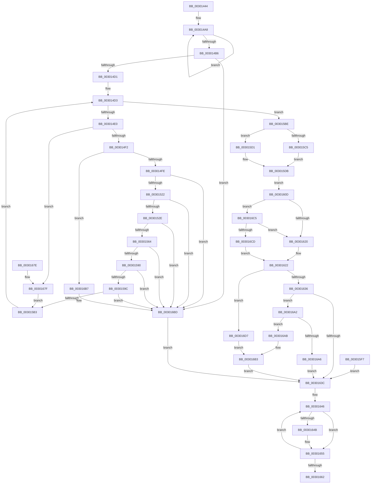

# AuthzBasepCompareFQBNOperands

- RVA: `0x00301444`–`0x003016DC` (길이 `664` bytes)
- VA: `0x0000000140301444`
- 실행 섹션: `.text`
- PDB 이름 있음: `예`; PDB Function 태그: `아니요`
- unwind 정보 RVA: `0x0007311C`
- 디코드: `166`개 명령, `664/664` bytes 표시
- 미해석 바이트: `0` (있으면 어셈블리에 `.byte`로 보존)

> 이 문서는 커널 이미지의 기계어와 PDB 기호를 분석해 생성했습니다. 4번과 5번은 함수 원형과 자료형을 바이너리 사용 방식에서 추정한 C 해석이며 원본 소스 복구 결과는 아닙니다.

## 1. Dependencies

- 직접 호출 지점: **7**; 고유 호출 대상: **6**
- 직접 호출자로 확인된 함수: **2**
- RIP 상대 이미지 참조: **0**

### Outgoing calls
- `0x003014C1` → [AuthzBasepGetOperandStringCaseForEvaluation](AuthzBasepGetOperandStringCaseForEvaluation_function_003017D4.md) (function, `0x003017D4`)
- `0x00301512` → [AuthzBasepGetConstantOperand](AuthzBasepGetConstantOperand_function_003016E4.md) (function, `0x003016E4`)
- `0x00301554` → [AuthzBasepUnicodeStringFromOperandValue](../2F/AuthzBasepUnicodeStringFromOperandValue_function_002FE4E8.md) (function, `0x002FE4E8`)
- `0x00301580` → [AuthzBasepGetConstantOperand](AuthzBasepGetConstantOperand_function_003016E4.md) (function, `0x003016E4`)
- `0x003015EA` → [RtlIsNameInExpression](../2F/RtlIsNameInExpression_function_002FDA70.md) (function, `0x002FDA70`)
- `0x00301650` → [ExFreePoolWithTag](../../poolcode/B8/ExFreePoolWithTag_function_00B82870.md) (function, `0x00B82870`)
- `0x003016AE` → [AuthzBasepCompareUnsigned](AuthzBasepCompareUnsigned_function_00302FEC.md) (function, `0x00302FEC`)

### Direct callers
- [AuthzBasepValueInSet](../2F/AuthzBasepValueInSet_function_002FE9B0.md) at `0x002FEB68`
- [AuthzBasepEvaluateExpression](AuthzBasepEvaluateExpression_function_00300578.md) at `0x00300657`

### Static image references
- 디코드된 RIP-relative 메모리 참조가 없습니다.

## 2. Other-region calls and transfers

- 다른 실행 섹션으로 향하는 call: **1**
  - `0x00301650` → [ExFreePoolWithTag](../../poolcode/B8/ExFreePoolWithTag_function_00B82870.md) (`.text` → `POOLCODE`)
- 별도 외부 분기/꼬리 이동을 확인하지 못했습니다.

## 3. Assembly (complete function range)

```asm
00301444  4C 8B DC                        mov r11, rsp
00301447  49 89 73 10                     mov qword ptr [r11 + 0x10], rsi
0030144B  4D 89 43 18                     mov qword ptr [r11 + 0x18], r8
0030144F  88 4C 24 08                     mov byte ptr [rsp + 8], cl
00301453  57                              push rdi
00301454  41 54                           push r12
00301456  41 55                           push r13
00301458  41 56                           push r14
0030145A  41 57                           push r15
0030145C  48 81 EC 90 00 00 00            sub rsp, 0x90
00301463  49 8B F8                        mov rdi, r8
00301466  4C 8B F2                        mov r14, rdx
00301469  83 64 24 28 00                  and dword ptr [rsp + 0x28], 0
0030146E  33 C0                           xor eax, eax
00301470  0F 57 C0                        xorps xmm0, xmm0
00301473  0F 11 44 24 40                  movups xmmword ptr [rsp + 0x40], xmm0
00301478  0F 11 44 24 50                  movups xmmword ptr [rsp + 0x50], xmm0
0030147D  89 44 24 60                     mov dword ptr [rsp + 0x60], eax
00301481  66 89 44 24 64                  mov word ptr [rsp + 0x64], ax
00301486  48 21 44 24 30                  and qword ptr [rsp + 0x30], rax
0030148B  49 21 43 80                     and qword ptr [r11 - 0x80], rax
0030148F  66 89 44 24 24                  mov word ptr [rsp + 0x24], ax
00301494  41 88 43 20                     mov byte ptr [r11 + 0x20], al
00301498  41 21 00                        and dword ptr [r8], eax
0030149B  49 8D 43 B8                     lea rax, [r11 - 0x48]
0030149F  41 BD 02 00 00 00               mov r13d, 2
003014A5  41 8B CD                        mov ecx, r13d
003014A8  48 83 20 00                     and qword ptr [rax], 0
003014AC  48 8D 40 10                     lea rax, [rax + 0x10]
003014B0  48 83 E9 01                     sub rcx, 1
003014B4  75 F2                           jne 0x1403014a8
003014B6  48 8D 94 24 D8 00 00 00         lea rdx, [rsp + 0xd8]
003014BE  49 8B CE                        mov rcx, r14
003014C1  E8 0E 03 00 00                  call 0x1403017d4
003014C6  44 8B F8                        mov r15d, eax
003014C9  85 C0                           test eax, eax
003014CB  0F 88 EC 01 00 00               js 0x1403016bd
003014D1  33 C0                           xor eax, eax
003014D3  89 44 24 2C                     mov dword ptr [rsp + 0x2c], eax
003014D7  41 3B C5                        cmp eax, r13d
003014DA  0F 83 DE 00 00 00               jae 0x1403015be
003014E0  8B F0                           mov esi, eax
003014E2  4C 8D 24 80                     lea r12, [rax + rax*4]
003014E6  43 83 7C E6 0C 01               cmp dword ptr [r14 + r12*8 + 0xc], 1
003014EC  0F 85 8D 01 00 00               jne 0x14030167f
003014F2  43 80 7C E6 04 00               cmp byte ptr [r14 + r12*8 + 4], 0
003014F8  0F 84 B9 01 00 00               je 0x1403016b7
003014FE  4C 8D 4C 24 28                  lea r9, [rsp + 0x28]
00301503  4C 8D 44 24 40                  lea r8, [rsp + 0x40]
00301508  43 8B 54 E6 18                  mov edx, dword ptr [r14 + r12*8 + 0x18]
0030150D  4B 8B 4C E6 20                  mov rcx, qword ptr [r14 + r12*8 + 0x20]
00301512  E8 CD 01 00 00                  call 0x1403016e4
00301517  44 8B F8                        mov r15d, eax
0030151A  85 C0                           test eax, eax
0030151C  0F 88 9B 01 00 00               js 0x1403016bd
00301522  66 83 7C 24 40 03               cmp word ptr [rsp + 0x40], 3
00301528  0F 85 8F 01 00 00               jne 0x1403016bd
0030152E  80 BC 24 D8 00 00 00 00         cmp byte ptr [rsp + 0xd8], 0
00301536  0F 94 C2                        sete dl
00301539  4C 8D 4C 24 24                  lea r9, [rsp + 0x24]
0030153E  4C 03 CE                        add r9, rsi
00301541  8B C6                           mov eax, esi
00301543  48 C1 E0 04                     shl rax, 4
00301547  4C 8D 44 24 68                  lea r8, [rsp + 0x68]
0030154C  4C 03 C0                        add r8, rax
0030154F  48 8D 4C 24 40                  lea rcx, [rsp + 0x40]
00301554  E8 8F CF FF FF                  call 0x1402fe4e8
00301559  44 8B F8                        mov r15d, eax
0030155C  85 C0                           test eax, eax
0030155E  0F 88 59 01 00 00               js 0x1403016bd
00301564  43 8B 54 E6 18                  mov edx, dword ptr [r14 + r12*8 + 0x18]
00301569  2B 54 24 28                     sub edx, dword ptr [rsp + 0x28]
0030156D  8B 4C 24 28                     mov ecx, dword ptr [rsp + 0x28]
00301571  4B 03 4C E6 20                  add rcx, qword ptr [r14 + r12*8 + 0x20]
00301576  4C 8D 4C 24 28                  lea r9, [rsp + 0x28]
0030157B  4C 8D 44 24 40                  lea r8, [rsp + 0x40]
00301580  E8 5F 01 00 00                  call 0x1403016e4
00301585  44 8B F8                        mov r15d, eax
00301588  85 C0                           test eax, eax
0030158A  0F 88 2D 01 00 00               js 0x1403016bd
00301590  66 44 39 6C 24 40               cmp word ptr [rsp + 0x40], r13w
00301596  0F 85 21 01 00 00               jne 0x1403016bd
0030159C  48 8B 4C 24 60                  mov rcx, qword ptr [rsp + 0x60]
003015A1  48 8B 01                        mov rax, qword ptr [rcx]
003015A4  48 89 44 F4 30                  mov qword ptr [rsp + rsi*8 + 0x30], rax
003015A9  44 38 69 08                     cmp byte ptr [rcx + 8], r13b
003015AD  0F 84 0A 01 00 00               je 0x1403016bd
003015B3  8B 44 24 2C                     mov eax, dword ptr [rsp + 0x2c]
003015B7  FF C0                           inc eax
003015B9  E9 15 FF FF FF                  jmp 0x1403014d3
003015BE  41 83 7E 34 01                  cmp dword ptr [r14 + 0x34], 1
003015C3  75 0C                           jne 0x1403015d1
003015C5  48 8D 54 24 68                  lea rdx, [rsp + 0x68]
003015CA  48 8D 4C 24 78                  lea rcx, [rsp + 0x78]
003015CF  EB 0A                           jmp 0x1403015db
003015D1  48 8D 54 24 78                  lea rdx, [rsp + 0x78]
003015D6  48 8D 4C 24 68                  lea rcx, [rsp + 0x68]
003015DB  80 BC 24 D8 00 00 00 00         cmp byte ptr [rsp + 0xd8], 0
003015E3  41 0F 94 C0                     sete r8b
003015E7  45 33 C9                        xor r9d, r9d
003015EA  E8 81 C4 FF FF                  call 0x1402fda70
003015EF  88 44 24 20                     mov byte ptr [rsp + 0x20], al
003015F3  8A C8                           mov cl, al
003015F5  EB 16                           jmp 0x14030160d
003015F7  44 8B F8                        mov r15d, eax
003015FA  48 8B 84 24 D0 00 00 00         mov rax, qword ptr [rsp + 0xd0]
00301602  83 08 FF                        or dword ptr [rax], 0xffffffff
00301605  41 BD 02 00 00 00               mov r13d, 2
0030160B  EB 2F                           jmp 0x14030163c
0030160D  48 8B 54 24 30                  mov rdx, qword ptr [rsp + 0x30]
00301612  4C 8B 44 24 38                  mov r8, qword ptr [rsp + 0x38]
00301617  49 3B D0                        cmp rdx, r8
0030161A  0F 84 A5 00 00 00               je 0x1403016c5
00301620  33 C0                           xor eax, eax
00301622  89 07                           mov dword ptr [rdi], eax
00301624  40 8A B4 24 C0 00 00 00         mov sil, byte ptr [rsp + 0xc0]
0030162C  40 80 FE 81                     cmp sil, 0x81
00301630  0F 84 A1 00 00 00               je 0x1403016d7
00301636  40 80 FE 80                     cmp sil, 0x80
0030163A  75 66                           jne 0x1403016a2
0030163C  48 8D 7C 24 24                  lea rdi, [rsp + 0x24]
00301641  48 8D 74 24 70                  lea rsi, [rsp + 0x70]
00301646  80 3F 00                        cmp byte ptr [rdi], 0
00301649  74 0A                           je 0x140301655
0030164B  33 D2                           xor edx, edx
0030164D  48 8B 0E                        mov rcx, qword ptr [rsi]
00301650  E8 1B 12 88 00                  call 0x140b82870
00301655  48 FF C7                        inc rdi
00301658  48 83 C6 10                     add rsi, 0x10
0030165C  49 83 ED 01                     sub r13, 1
00301660  75 E4                           jne 0x140301646
00301662  41 8B C7                        mov eax, r15d
00301665  48 8B B4 24 C8 00 00 00         mov rsi, qword ptr [rsp + 0xc8]
0030166D  48 81 C4 90 00 00 00            add rsp, 0x90
00301674  41 5F                           pop r15
00301676  41 5E                           pop r14
00301678  41 5D                           pop r13
0030167A  41 5C                           pop r12
0030167C  5F                              pop rdi
0030167D  C3                              ret
0030167E  CC                              int3
0030167F  4B 8B 44 E6 10                  mov rax, qword ptr [r14 + r12*8 + 0x10]
00301684  48 8B 48 30                     mov rcx, qword ptr [rax + 0x30]
00301688  48 8B 01                        mov rax, qword ptr [rcx]
0030168B  48 89 44 F4 30                  mov qword ptr [rsp + rsi*8 + 0x30], rax
00301690  48 03 F6                        add rsi, rsi
00301693  0F 10 41 08                     movups xmm0, xmmword ptr [rcx + 8]
00301697  F3 0F 7F 44 F4 68               movdqu xmmword ptr [rsp + rsi*8 + 0x68], xmm0
0030169D  E9 11 FF FF FF                  jmp 0x1403015b3
003016A2  84 C9                           test cl, cl
003016A4  75 05                           jne 0x1403016ab
003016A6  83 27 00                        and dword ptr [rdi], 0
003016A9  EB 91                           jmp 0x14030163c
003016AB  40 8A CE                        mov cl, sil
003016AE  E8 39 19 00 00                  call 0x140302fec
003016B3  89 07                           mov dword ptr [rdi], eax
003016B5  EB 85                           jmp 0x14030163c
003016B7  41 BF A2 01 00 C0               mov r15d, 0xc00001a2
003016BD  83 0F FF                        or dword ptr [rdi], 0xffffffff
003016C0  E9 77 FF FF FF                  jmp 0x14030163c
003016C5  84 C9                           test cl, cl
003016C7  0F 84 53 FF FF FF               je 0x140301620
003016CD  B8 01 00 00 00                  mov eax, 1
003016D2  E9 4B FF FF FF                  jmp 0x140301622
003016D7  83 F0 01                        xor eax, 1
003016DA  EB D7                           jmp 0x1403016b3
```

## 4. C-style interpretation (structured pseudocode)

```c
__int64 __fastcall AuthzBasepCompareFQBNOperands(unsigned __int8 a1, __int64 a2, __int64 a3)
{
    __int64 result;
    __int64 v_r13;
    __int64 v_rdi;
    __int64 v_rsi;
    __int64 v_rsp;
    unsigned __int64 v_stack_m40;
    unsigned __int64 v_stack_m48;
    unsigned __int64 v_stack_m50;
    unsigned __int16 v_stack_m54;
    unsigned int v_stack_m58;
    unsigned __int64 v_stack_m68;
    unsigned __int64 v_stack_m78;
    unsigned __int64 v_stack_m80;
    unsigned __int64 v_stack_m88;
    unsigned int v_stack_m8C;
    unsigned int v_stack_m90;
    unsigned __int16 v_stack_m94;
    unsigned __int8 v_stack_m98;
    unsigned __int64 v_stack_p10;
    unsigned __int64 v_stack_p18;
    unsigned __int64 v_stack_p20;
    unsigned __int8 v_stack_p8;

    *(unsigned __int64 *)(v_rsp + 16) = v_rsi;
    *(unsigned __int64 *)(v_rsp + 24) = a3;
    v_stack_p8 = a1;
    v_rsp = (v_rsp) - (144);
    result = 0;
    v_stack_m78 = v_xmm0;
    v_stack_m68 = v_xmm0;
    v_stack_m58 = 0;
    v_stack_m54 = 0;
    v_stack_m94 = 0;
    *(unsigned __int8 *)(v_rsp + 32) = 0;
loc_003014A8:
    a1 = (2) - (1);
    if (condition_is_not_equal) goto loc_003014A8;
    result = AuthzBasepGetOperandStringCaseForEvaluation(a2, v_stack_p20, a3, a4);
    if (sign_flag) goto loc_003016BD;
    result = 0;
loc_003014D3:
    v_stack_m8C = 0;
    if (0 >= 2) goto loc_003015BE;
    if ((*(unsigned int *)(a2 + result + result * 4 * 8 + 12)) != 1) goto loc_0030167F;
    if ((*(unsigned __int8 *)(a2 + result + result * 4 * 8 + 4)) == 0) goto loc_003016B7;
    result = AuthzBasepGetConstantOperand(*(unsigned __int64 *)(a2 + result + result * 4 * 8 + 32), (unsigned int)(*(unsigned int *)(a2 + result + result * 4 * 8 + 24)), v_stack_m78, v_stack_m90);
    if (sign_flag) goto loc_003016BD;
    if (v_stack_m78 != 3) goto loc_003016BD;
    a2 = (v_stack_p20 == 0) ? 1 : 0;
    a4 = (v_stack_m94) + (0);
    result = (0) << (4);
    a3 = (v_stack_m50) + (result);
    result = AuthzBasepUnicodeStringFromOperandValue(v_stack_m78, a2, a3, a4);
    if (sign_flag) goto loc_003016BD;
    a2 = (unsigned int)(((unsigned int)(*(unsigned int *)(a2 + result + result * 4 * 8 + 24))) - (v_stack_m90));
    a1 = ((unsigned int)(v_stack_m90)) + (*(unsigned __int64 *)(a2 + result + result * 4 * 8 + 32));
    result = AuthzBasepGetConstantOperand(a1, a2, v_stack_m78, v_stack_m90);
    if (sign_flag) goto loc_003016BD;
    if (v_stack_m78 != 2) goto loc_003016BD;
    *(unsigned __int64 *)(v_rsp + 0 * 8 + 48) = *(unsigned __int64 *)(v_stack_m58);
    if ((*(unsigned __int8 *)(v_stack_m58 + 8)) == 2) goto loc_003016BD;
loc_003015B3:
    result = (unsigned int)(((unsigned int)(v_stack_m8C)) + 1);
    goto loc_003014D3;
loc_003015BE:
    if ((*(unsigned int *)(a2 + 52)) != 1) goto loc_003015D1;
    goto loc_003015DB;
loc_003015D1:
loc_003015DB:
    a3 = (v_stack_p20 == 0) ? 1 : 0;
    a4 = 0;
    result = RtlIsNameInExpression(v_stack_m50, v_stack_m40, a3, a4);
    v_stack_m98 = (unsigned __int8)(result);
    goto loc_0030160D;
loc_0030160D:
    if (v_stack_m88 == v_stack_m80) goto loc_003016C5;
loc_00301620:
    result = 0;
loc_00301622:
    *(unsigned int *)(a3) = 0;
    if (((unsigned __int8)(v_stack_p8)) == 129) goto loc_003016D7;
    if (((unsigned __int8)(v_stack_p8)) != 128) goto loc_003016A2;
loc_0030163C:
loc_00301646:
    if ((*(unsigned __int8 *)(v_stack_m94)) != 0) {
        a2 = 0;
        a1 = *(unsigned __int64 *)(v_stack_m48);
        result = ExFreePoolWithTag(a1, a2, v_stack_m80, a4);
    }
    v_rdi = (v_stack_m94) + 1;
    v_rsi = (v_stack_m48) + (16);
    v_r13 = (2) - (1);
    if (condition_is_not_equal) goto loc_00301646;
    v_rsp = (v_rsp) + (144);
    return (unsigned int)((unsigned int)((unsigned int)((unsigned int)(result))));
loc_0030167F:
    *(unsigned __int64 *)(v_rsp + v_stack_p10 * 8 + 48) = *(unsigned __int64 *)(*(unsigned __int64 *)(*(unsigned __int64 *)(a2 + result + result * 4 * 8 + 16) + 48));
    v_rsi = (v_stack_p10) + (v_stack_p10);
    *(unsigned __int64 *)(v_rsp + v_rsi * 8 + 104) = v_xmm0;
    goto loc_003015B3;
loc_003016A2:
    if ((unsigned __int8)(*(unsigned __int64 *)(*(unsigned __int64 *)(a2 + result + result * 4 * 8 + 16) + 48)) != 0) goto loc_003016AB;
    goto loc_0030163C;
loc_003016AB:
    result = AuthzBasepCompareUnsigned((unsigned __int8)(v_rsi), a2, v_stack_m80, a4);
loc_003016B3:
    *(unsigned int *)(v_rdi) = (unsigned int)(result);
    goto loc_0030163C;
loc_003016B7:
loc_003016BD:
    goto loc_0030163C;
loc_003016C5:
    if ((unsigned __int8)((unsigned __int8)(v_rsi)) == 0) goto loc_00301620;
    goto loc_00301622;
loc_003016D7:
    result = (unsigned int)((1) ^ (1));
    goto loc_003016B3;
}
```

## 5. (Beta) C Style

```c
int64_t AuthzBasepCompareFQBNOperands(uint8_t Arg1, void *Arg2, void *Arg3)
{
    uint8_t *arg2 = (uint8_t *)Arg2;
    uint8_t *arg3 = (uint8_t *)Arg3;

    int64_t result;
    int64_t local_r13;
    int64_t local_rdi;
    int64_t local_rsi;
    int64_t local_rsp;
    uint64_t v_stack_m40;
    uint64_t v_stack_m48;
    uint64_t v_stack_m50;
    uint16_t v_stack_m54;
    uint32_t v_stack_m58;
    uint64_t v_stack_m68;
    uint64_t v_stack_m78;
    uint64_t v_stack_m80;
    uint64_t v_stack_m88;
    uint32_t v_stack_m8C;
    uint32_t v_stack_m90;
    uint16_t v_stack_m94;
    uint8_t v_stack_m98;
    uint64_t v_stack_p10;
    uint64_t v_stack_p18;
    uint64_t v_stack_p20;
    uint8_t v_stack_p8;

    *(uint64_t *)(local_rsp + 0x10) = local_rsi;
    *(void **)(local_rsp + 0x18) = Arg3;
    v_stack_p8 = Arg1;
    local_rsp = (local_rsp) - (144);
    result = 0;
    v_stack_m78 = v_xmm0;
    v_stack_m68 = v_xmm0;
    v_stack_m58 = 0;
    v_stack_m54 = 0;
    v_stack_m94 = 0;
    *(uint8_t *)(local_rsp + 0x20) = 0;
loc_003014A8:
    Arg1 = (2) - (1);
    if (condition_is_not_equal) goto loc_003014A8;
    result = AuthzBasepGetOperandStringCaseForEvaluation(Arg2, v_stack_p20, Arg3, a4);
    if (sign_flag) goto loc_003016BD;
    result = 0;
loc_003014D3:
    v_stack_m8C = 0;
    if (0 >= 2) goto loc_003015BE;
    if ((*(uint32_t *)(arg2 + result + result * 4 * 8 + 0xC)) != 1) goto loc_0030167F;
    if ((*(uint8_t *)(arg2 + result + result * 4 * 8 + 0x4)) == 0) goto loc_003016B7;
    result = AuthzBasepGetConstantOperand(*(uint64_t *)(arg2 + result + result * 4 * 8 + 0x20), (uint32_t)(*(uint32_t *)(arg2 + result + result * 4 * 8 + 0x18)), v_stack_m78, v_stack_m90);
    if (sign_flag) goto loc_003016BD;
    if (v_stack_m78 != 3) goto loc_003016BD;
    Arg2 = (v_stack_p20 == 0) ? 1 : 0;
    a4 = (v_stack_m94) + (0);
    result = (0) << (4);
    Arg3 = (v_stack_m50) + (result);
    result = AuthzBasepUnicodeStringFromOperandValue(v_stack_m78, Arg2, Arg3, a4);
    if (sign_flag) goto loc_003016BD;
    Arg2 = (uint32_t)(((uint32_t)(*(uint32_t *)(arg2 + result + result * 4 * 8 + 0x18))) - (v_stack_m90));
    Arg1 = ((uint32_t)(v_stack_m90)) + (*(uint64_t *)(arg2 + result + result * 4 * 8 + 0x20));
    result = AuthzBasepGetConstantOperand(Arg1, Arg2, v_stack_m78, v_stack_m90);
    if (sign_flag) goto loc_003016BD;
    if (v_stack_m78 != 2) goto loc_003016BD;
    *(uint64_t *)(local_rsp + 0x0 * 8 + 0x30) = *(uint64_t *)(v_stack_m58);
    if ((*(uint8_t *)(v_stack_m58 + 0x8)) == 2) goto loc_003016BD;
loc_003015B3:
    result = (uint32_t)(((uint32_t)(v_stack_m8C)) + 1);
    goto loc_003014D3;
loc_003015BE:
    if ((*(uint32_t *)(arg2 + 0x34)) != 1) goto loc_003015D1;
    goto loc_003015DB;
loc_003015D1:
loc_003015DB:
    Arg3 = (v_stack_p20 == 0) ? 1 : 0;
    a4 = 0;
    result = RtlIsNameInExpression(v_stack_m50, v_stack_m40, Arg3, a4);
    v_stack_m98 = (uint8_t)(result);
    goto loc_0030160D;
loc_0030160D:
    if (v_stack_m88 == v_stack_m80) goto loc_003016C5;
loc_00301620:
    result = 0;
loc_00301622:
    *(uint32_t *)(arg3) = 0;
    if (((uint8_t)(v_stack_p8)) == 129) goto loc_003016D7;
    if (((uint8_t)(v_stack_p8)) != 128) goto loc_003016A2;
loc_0030163C:
loc_00301646:
    if ((*(uint8_t *)(v_stack_m94)) != 0) {
        Arg2 = 0;
        Arg1 = *(uint64_t *)(v_stack_m48);
        result = ExFreePoolWithTag(Arg1, Arg2, v_stack_m80, a4);
    }
    local_rdi = (v_stack_m94) + 1;
    local_rsi = (v_stack_m48) + (16);
    local_r13 = (2) - (1);
    if (condition_is_not_equal) goto loc_00301646;
    local_rsp = (local_rsp) + (144);
    return (uint32_t)((uint32_t)((uint32_t)((uint32_t)(result))));
loc_0030167F:
    *(uint64_t *)(local_rsp + v_stack_p10 * 8 + 0x30) = *(uint64_t *)(*(uint64_t *)(*(uint64_t *)(arg2 + result + result * 4 * 8 + 0x10) + 0x30));
    local_rsi = (v_stack_p10) + (v_stack_p10);
    *(uint64_t *)(local_rsp + local_rsi * 8 + 0x68) = v_xmm0;
    goto loc_003015B3;
loc_003016A2:
    if ((uint8_t)(*(uint64_t *)(*(uint64_t *)(arg2 + result + result * 4 * 8 + 0x10) + 0x30)) != 0) goto loc_003016AB;
    goto loc_0030163C;
loc_003016AB:
    result = AuthzBasepCompareUnsigned((uint8_t)(local_rsi), Arg2, v_stack_m80, a4);
loc_003016B3:
    *(uint32_t *)(local_rdi) = (uint32_t)(result);
    goto loc_0030163C;
loc_003016B7:
loc_003016BD:
    goto loc_0030163C;
loc_003016C5:
    if ((uint8_t)((uint8_t)(local_rsi)) == 0) goto loc_00301620;
    goto loc_00301622;
loc_003016D7:
    result = (uint32_t)((1) ^ (1));
    goto loc_003016B3;
}
```

### 관측된 메모리 오프셋

구조체 형식이 확인되지 않은 접근은 인자 기준의 오프셋으로만 기록했습니다.

| 기준 인자 | 오프셋 표현 | 폭 (bit) | 접근 |
|---|---:|---:|---|
| `Arg2` | `+ 0x4 + r12*8` | `8` | `R` |
| `Arg2` | `+ 0xC + r12*8` | `32` | `R` |
| `Arg2` | `+ 0x10 + r12*8` | `64` | `R` |
| `Arg2` | `+ 0x18 + r12*8` | `32` | `R` |
| `Arg2` | `+ 0x20 + r12*8` | `64` | `R` |
| `Arg2` | `+ 0x34` | `32` | `R` |
| `Arg3` | `+ 0x0` | `32` | `R/W` |
| `Arg3` | `+ 0x0` | `32` | `W` |

## 6. Execution-region graph

[열기: 2D/3D 그래프와 함수 탐색 컨트롤 패널](../../../control-panel.html?section=text&rva=0x00301444&view=graph)

- 2D 그래프는 위에서 아래로 흐르고, 3D 그래프는 빈 공간을 드래그해 회전합니다. Shift+드래그는 이동, 휠은 확대·축소, 함수 노드 선택은 대상 보고서 이동입니다.

### Static fallback


