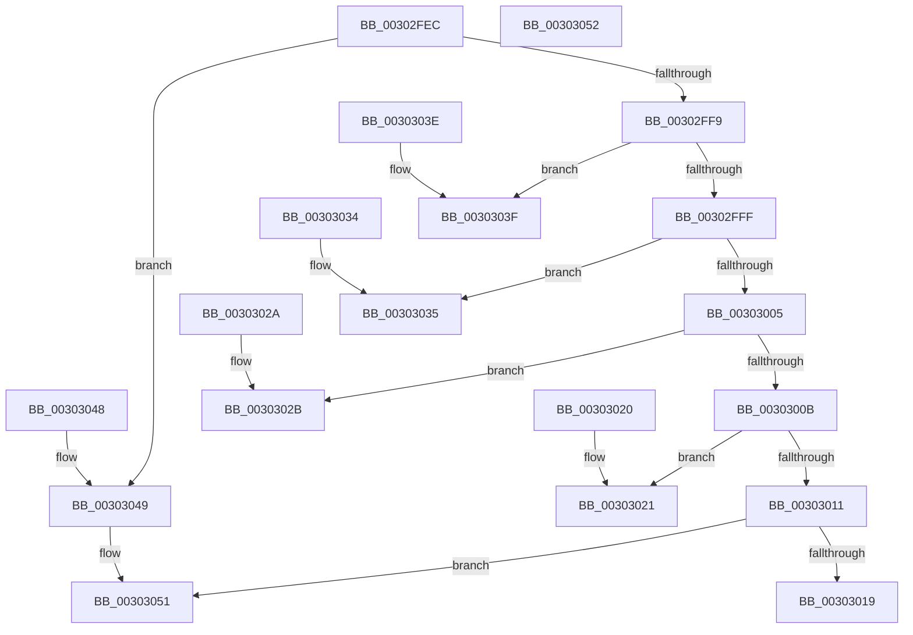

# AuthzBasepCompareUnsigned

- RVA: `0x00302FEC`–`0x00303053` (길이 `103` bytes)
- VA: `0x0000000140302FEC`
- 실행 섹션: `.text`
- PDB 이름 있음: `예`; PDB Function 태그: `아니요`
- unwind 정보 RVA: `0x000DB714`
- 디코드: `43`개 명령, `103/103` bytes 표시
- 미해석 바이트: `0` (있으면 어셈블리에 `.byte`로 보존)

> 이 문서는 커널 이미지의 기계어와 PDB 기호를 분석해 생성했습니다. 4번과 5번은 함수 원형과 자료형을 바이너리 사용 방식에서 추정한 C 해석이며 원본 소스 복구 결과는 아닙니다.

## 1. Dependencies

- 직접 호출 지점: **0**; 고유 호출 대상: **0**
- 직접 호출자로 확인된 함수: **2**
- RIP 상대 이미지 참조: **0**

### Outgoing calls
- 직접 디코드된 call 명령이 없습니다.

### Direct callers
- [AuthzBasepCompareFQBNOperands](AuthzBasepCompareFQBNOperands_function_00301444.md) at `0x003016AE`
- [AuthzBasepCompareIntegerOperands](../69/AuthzBasepCompareIntegerOperands_function_0069D718.md) at `0x0069D7AB`

### Static image references
- 디코드된 RIP-relative 메모리 참조가 없습니다.

## 2. Other-region calls and transfers

- 다른 실행 섹션으로 향하는 call: **0**
- 별도 외부 분기/꼬리 이동을 확인하지 못했습니다.

## 3. Assembly (complete function range)

```asm
00302FEC  44 0F B6 C9                     movzx r9d, cl
00302FF0  41 81 E9 80 00 00 00            sub r9d, 0x80
00302FF7  74 50                           je 0x140303049
00302FF9  41 83 E9 01                     sub r9d, 1
00302FFD  74 40                           je 0x14030303f
00302FFF  41 83 E9 01                     sub r9d, 1
00303003  74 30                           je 0x140303035
00303005  41 83 E9 01                     sub r9d, 1
00303009  74 20                           je 0x14030302b
0030300B  41 83 E9 01                     sub r9d, 1
0030300F  74 10                           je 0x140303021
00303011  33 C0                           xor eax, eax
00303013  41 83 F9 01                     cmp r9d, 1
00303017  75 38                           jne 0x140303051
00303019  49 3B D0                        cmp rdx, r8
0030301C  0F 93 C0                        setae al
0030301F  C3                              ret
00303020  CC                              int3
00303021  33 C0                           xor eax, eax
00303023  49 3B D0                        cmp rdx, r8
00303026  0F 97 C0                        seta al
00303029  C3                              ret
0030302A  CC                              int3
0030302B  33 C0                           xor eax, eax
0030302D  49 3B D0                        cmp rdx, r8
00303030  0F 96 C0                        setbe al
00303033  C3                              ret
00303034  CC                              int3
00303035  33 C0                           xor eax, eax
00303037  49 3B D0                        cmp rdx, r8
0030303A  0F 92 C0                        setb al
0030303D  C3                              ret
0030303E  CC                              int3
0030303F  33 C0                           xor eax, eax
00303041  49 3B D0                        cmp rdx, r8
00303044  0F 95 C0                        setne al
00303047  C3                              ret
00303048  CC                              int3
00303049  33 C0                           xor eax, eax
0030304B  49 3B D0                        cmp rdx, r8
0030304E  0F 94 C0                        sete al
00303051  C3                              ret
00303052  CC                              int3
```

## 4. C-style interpretation (structured pseudocode)

```c
__int64 __fastcall AuthzBasepCompareUnsigned(unsigned __int8 a1, __int64 a2, __int64 a3)
{
    __int64 result;

    a4 = (unsigned int)((a1) - (128));
    if (condition_is_equal) goto loc_00303049;
    a4 = (unsigned int)((a4) - (1));
    if (condition_is_equal) goto loc_0030303F;
    a4 = (unsigned int)((a4) - (1));
    if (condition_is_equal) goto loc_00303035;
    a4 = (unsigned int)((a4) - (1));
    if (condition_is_equal) goto loc_0030302B;
    a4 = (unsigned int)((a4) - (1));
    if (condition_is_equal) goto loc_00303021;
    result = 0;
    if (((unsigned int)(a4)) != 1) goto loc_00303051;
    result = (a2 >= a3) ? 1 : 0;
    return result;
loc_00303021:
    result = 0;
    result = (a2 > a3) ? 1 : 0;
    return result;
loc_0030302B:
    result = 0;
    result = (a2 <= a3) ? 1 : 0;
    return result;
loc_00303035:
    result = 0;
    result = (a2 < a3) ? 1 : 0;
    return result;
loc_0030303F:
    result = 0;
    result = (a2 != a3) ? 1 : 0;
    return result;
loc_00303049:
    result = 0;
    result = (a2 == a3) ? 1 : 0;
loc_00303051:
    return result;
}
```

## 5. (Beta) C Style

```c
int64_t AuthzBasepCompareUnsigned(uint8_t Arg1, int64_t Arg2, int64_t Arg3)
{
    int64_t result;

    a4 = (uint32_t)((Arg1) - (128));
    if (condition_is_equal) goto loc_00303049;
    a4 = (uint32_t)((a4) - (1));
    if (condition_is_equal) goto loc_0030303F;
    a4 = (uint32_t)((a4) - (1));
    if (condition_is_equal) goto loc_00303035;
    a4 = (uint32_t)((a4) - (1));
    if (condition_is_equal) goto loc_0030302B;
    a4 = (uint32_t)((a4) - (1));
    if (condition_is_equal) goto loc_00303021;
    result = 0;
    if (((uint32_t)(a4)) != 1) goto loc_00303051;
    result = (Arg2 >= Arg3) ? 1 : 0;
    return result;
loc_00303021:
    result = 0;
    result = (Arg2 > Arg3) ? 1 : 0;
    return result;
loc_0030302B:
    result = 0;
    result = (Arg2 <= Arg3) ? 1 : 0;
    return result;
loc_00303035:
    result = 0;
    result = (Arg2 < Arg3) ? 1 : 0;
    return result;
loc_0030303F:
    result = 0;
    result = (Arg2 != Arg3) ? 1 : 0;
    return result;
loc_00303049:
    result = 0;
    result = (Arg2 == Arg3) ? 1 : 0;
loc_00303051:
    return result;
}
```

## 6. Execution-region graph

[열기: 2D/3D 그래프와 함수 탐색 컨트롤 패널](../../../control-panel.html?section=text&rva=0x00302FEC&view=graph)

- 2D 그래프는 위에서 아래로 흐르고, 3D 그래프는 빈 공간을 드래그해 회전합니다. Shift+드래그는 이동, 휠은 확대·축소, 함수 노드 선택은 대상 보고서 이동입니다.

### Static fallback


