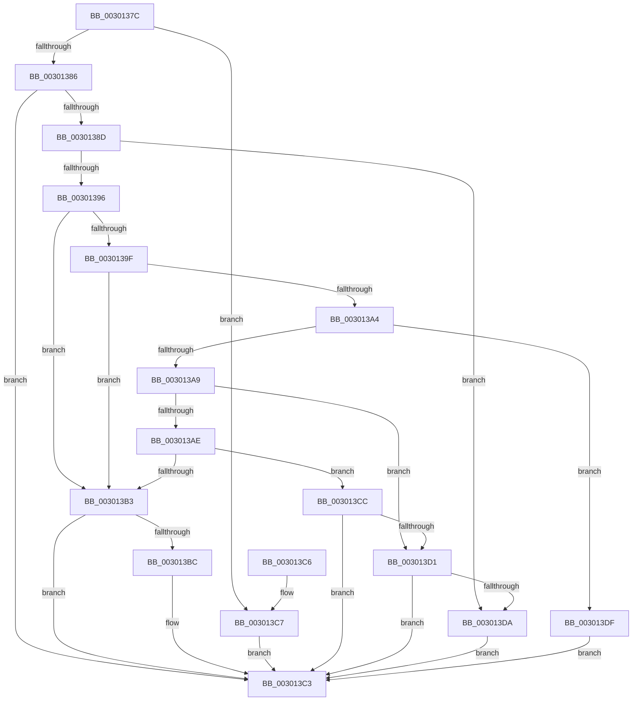

# AuthzBasepEvaluateAttribute

- RVA: `0x0030137C`–`0x003013EB` (길이 `111` bytes)
- VA: `0x000000014030137C`
- 실행 섹션: `.text`
- PDB 이름 있음: `예`; PDB Function 태그: `아니요`
- unwind 정보 RVA: `0x000DB714`
- 디코드: `42`개 명령, `111/111` bytes 표시
- 미해석 바이트: `0` (있으면 어셈블리에 `.byte`로 보존)

> 이 문서는 커널 이미지의 기계어와 PDB 기호를 분석해 생성했습니다. 4번과 5번은 함수 원형과 자료형을 바이너리 사용 방식에서 추정한 C 해석이며 원본 소스 복구 결과는 아닙니다.

## 1. Dependencies

- 직접 호출 지점: **0**; 고유 호출 대상: **0**
- 직접 호출자로 확인된 함수: **1**
- RIP 상대 이미지 참조: **0**

### Outgoing calls
- 직접 디코드된 call 명령이 없습니다.

### Direct callers
- [AuthzBasepEvaluateAceCondition](../2F/AuthzBasepEvaluateAceCondition_function_002FEBD0.md) at `0x002FF0DC`
- [AuthzBasepEvaluateAceCondition](../2F/AuthzBasepEvaluateAceCondition_function_002FEBD0.md) at `0x002FF666`
- [AuthzBasepEvaluateAceCondition](../2F/AuthzBasepEvaluateAceCondition_function_002FEBD0.md) at `0x002FF69C`
- [AuthzBasepEvaluateAceCondition](../2F/AuthzBasepEvaluateAceCondition_function_002FEBD0.md) at `0x002FF7B1`
- [AuthzBasepEvaluateAceCondition](../2F/AuthzBasepEvaluateAceCondition_function_002FEBD0.md) at `0x002FF7BD`
- [AuthzBasepEvaluateAceCondition](../2F/AuthzBasepEvaluateAceCondition_function_002FEBD0.md) at `0x002FF89F`
- [AuthzBasepEvaluateAceCondition](../2F/AuthzBasepEvaluateAceCondition_function_002FEBD0.md) at `0x002FFBA9`

### Static image references
- 디코드된 RIP-relative 메모리 참조가 없습니다.

## 2. Other-region calls and transfers

- 다른 실행 섹션으로 향하는 call: **0**
- 별도 외부 분기/꼬리 이동을 확인하지 못했습니다.

## 3. Assembly (complete function range)

```asm
0030137C  33 D2                           xor edx, edx
0030137E  4C 8B C1                        mov r8, rcx
00301381  48 85 C9                        test rcx, rcx
00301384  74 41                           je 0x1403013c7
00301386  8B 41 28                        mov eax, dword ptr [rcx + 0x28]
00301389  85 C0                           test eax, eax
0030138B  74 36                           je 0x1403013c3
0030138D  44 8D 4A 01                     lea r9d, [rdx + 1]
00301391  41 3B C1                        cmp eax, r9d
00301394  77 44                           ja 0x1403013da
00301396  0F B7 49 20                     movzx ecx, word ptr [rcx + 0x20]
0030139A  41 2B C9                        sub ecx, r9d
0030139D  74 14                           je 0x1403013b3
0030139F  41 2B C9                        sub ecx, r9d
003013A2  74 0F                           je 0x1403013b3
003013A4  41 2B C9                        sub ecx, r9d
003013A7  74 36                           je 0x1403013df
003013A9  83 E9 02                        sub ecx, 2
003013AC  74 23                           je 0x1403013d1
003013AE  41 2B C9                        sub ecx, r9d
003013B1  75 19                           jne 0x1403013cc
003013B3  49 8B 40 30                     mov rax, qword ptr [r8 + 0x30]
003013B7  48 85 C0                        test rax, rax
003013BA  74 07                           je 0x1403013c3
003013BC  48 39 10                        cmp qword ptr [rax], rdx
003013BF  41 0F 45 D1                     cmovne edx, r9d
003013C3  8B C2                           mov eax, edx
003013C5  C3                              ret
003013C6  CC                              int3
003013C7  83 CA FF                        or edx, 0xffffffff
003013CA  EB F7                           jmp 0x1403013c3
003013CC  83 F9 0A                        cmp ecx, 0xa
003013CF  75 F2                           jne 0x1403013c3
003013D1  49 8B 40 30                     mov rax, qword ptr [r8 + 0x30]
003013D5  39 50 08                        cmp dword ptr [rax + 8], edx
003013D8  74 E9                           je 0x1403013c3
003013DA  41 8B D1                        mov edx, r9d
003013DD  EB E4                           jmp 0x1403013c3
003013DF  49 8B 40 30                     mov rax, qword ptr [r8 + 0x30]
003013E3  66 39 10                        cmp word ptr [rax], dx
003013E6  0F 95 C2                        setne dl
003013E9  EB D8                           jmp 0x1403013c3
```

## 4. C-style interpretation (structured pseudocode)

```c
__int64 __fastcall AuthzBasepEvaluateAttribute(__int64 a1, int a2)
{
    a2 = 0;
    if (a1 == 0) goto loc_003013C7;
    if ((unsigned int)((unsigned int)(*(unsigned int *)(a1 + 40))) == 0) goto loc_003013C3;
    if (((unsigned int)((unsigned int)(*(unsigned int *)(a1 + 40)))) > ((unsigned int)(a2 + 1))) goto loc_003013DA;
    a1 = (unsigned int)((*(unsigned __int16 *)(a1 + 32)) - ((unsigned int)(a2 + 1)));
    if (condition_is_equal) goto loc_003013B3;
    a1 = (unsigned int)((a1) - ((unsigned int)(a2 + 1)));
    if (condition_is_equal) goto loc_003013B3;
    a1 = (unsigned int)((a1) - ((unsigned int)(a2 + 1)));
    if (condition_is_equal) goto loc_003013DF;
    a1 = (unsigned int)((a1) - (2));
    if (condition_is_equal) goto loc_003013D1;
    a1 = (unsigned int)((a1) - ((unsigned int)(a2 + 1)));
    if (condition_is_not_equal) goto loc_003013CC;
loc_003013B3:
    if (*(unsigned __int64 *)(a1 + 48) != 0) {
        if ((*(unsigned __int64 *)(*(unsigned __int64 *)(a1 + 48))) != 0) { a2 = (unsigned int)(a2 + 1); }
    }
    return (unsigned int)(a2);
loc_003013C7:
    a2 = (unsigned int)((a2) | (0xFFFFFFFFULL));
    goto loc_003013C3;
loc_003013CC:
    if (((unsigned int)(a1)) != 10) goto loc_003013C3;
loc_003013D1:
    if ((*(unsigned int *)(*(unsigned __int64 *)(a1 + 48) + 8)) == a2) goto loc_003013C3;
loc_003013DA:
    goto loc_003013C3;
loc_003013DF:
    a2 = ((*(unsigned __int16 *)(*(unsigned __int64 *)(a1 + 48))) != ((unsigned __int16)((unsigned int)((unsigned int)(a2 + 1))))) ? 1 : 0;
    goto loc_003013C3;
}
```

## 5. (Beta) C Style

```c
int64_t AuthzBasepEvaluateAttribute(void *Arg1, int32_t Arg2)
{
    uint8_t *arg1 = (uint8_t *)Arg1;

    Arg2 = 0;
    if (Arg1 == NULL) goto loc_003013C7;
    if ((uint32_t)((uint32_t)(*(uint32_t *)(arg1 + 0x28))) == 0) goto loc_003013C3;
    if (((uint32_t)((uint32_t)(*(uint32_t *)(arg1 + 0x28)))) > ((uint32_t)(Arg2 + 1))) goto loc_003013DA;
    Arg1 = (uint32_t)((*(uint16_t *)(arg1 + 0x20)) - ((uint32_t)(Arg2 + 1)));
    if (condition_is_equal) goto loc_003013B3;
    Arg1 = (uint32_t)((Arg1) - ((uint32_t)(Arg2 + 1)));
    if (condition_is_equal) goto loc_003013B3;
    Arg1 = (uint32_t)((Arg1) - ((uint32_t)(Arg2 + 1)));
    if (condition_is_equal) goto loc_003013DF;
    Arg1 = (uint32_t)((Arg1) - (2));
    if (condition_is_equal) goto loc_003013D1;
    Arg1 = (uint32_t)((Arg1) - ((uint32_t)(Arg2 + 1)));
    if (condition_is_not_equal) goto loc_003013CC;
loc_003013B3:
    if (*(uint64_t *)(arg1 + 0x30) != 0) {
        if ((*(uint64_t *)(*(uint64_t *)(arg1 + 0x30))) != 0) { Arg2 = (uint32_t)(Arg2 + 1); }
    }
    return (uint32_t)(Arg2);
loc_003013C7:
    Arg2 = (uint32_t)((Arg2) | (0xFFFFFFFFULL));
    goto loc_003013C3;
loc_003013CC:
    if (((uint32_t)(Arg1)) != 10) goto loc_003013C3;
loc_003013D1:
    if ((*(uint32_t *)(*(uint64_t *)(arg1 + 0x30) + 0x8)) == Arg2) goto loc_003013C3;
loc_003013DA:
    goto loc_003013C3;
loc_003013DF:
    Arg2 = ((*(uint16_t *)(*(uint64_t *)(arg1 + 0x30))) != ((uint16_t)((uint32_t)((uint32_t)(Arg2 + 1))))) ? 1 : 0;
    goto loc_003013C3;
}
```

### 관측된 메모리 오프셋

구조체 형식이 확인되지 않은 접근은 인자 기준의 오프셋으로만 기록했습니다.

| 기준 인자 | 오프셋 표현 | 폭 (bit) | 접근 |
|---|---:|---:|---|
| `Arg1` | `+ 0x30` | `64` | `R` |

## 6. Execution-region graph

[열기: 2D/3D 그래프와 함수 탐색 컨트롤 패널](../../../control-panel.html?section=text&rva=0x0030137C&view=graph)

- 2D 그래프는 위에서 아래로 흐르고, 3D 그래프는 빈 공간을 드래그해 회전합니다. Shift+드래그는 이동, 휠은 확대·축소, 함수 노드 선택은 대상 보고서 이동입니다.

### Static fallback


