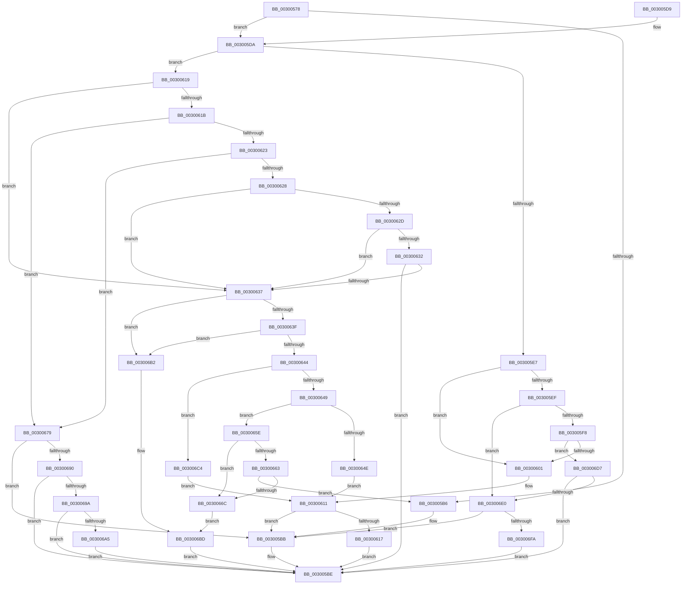

# AuthzBasepEvaluateExpression

- RVA: `0x00300578`–`0x003006FF` (길이 `391` bytes)
- VA: `0x0000000140300578`
- 실행 섹션: `.text`
- PDB 이름 있음: `예`; PDB Function 태그: `아니요`
- unwind 정보 RVA: `0x00073038`
- 디코드: `118`개 명령, `391/391` bytes 표시
- 미해석 바이트: `0` (있으면 어셈블리에 `.byte`로 보존)

> 이 문서는 커널 이미지의 기계어와 PDB 기호를 분석해 생성했습니다. 4번과 5번은 함수 원형과 자료형을 바이너리 사용 방식에서 추정한 C 해석이며 원본 소스 복구 결과는 아닙니다.

## 1. Dependencies

- 직접 호출 지점: **9**; 고유 호출 대상: **7**
- 직접 호출자로 확인된 함수: **1**
- RIP 상대 이미지 참조: **0**

### Outgoing calls
- `0x003005A4` → [AuthzBasepGetOperandTypeForEvaluation](AuthzBasepGetOperandTypeForEvaluation_function_003007C8.md) (function, `0x003007C8`)
- `0x003005AD` → [AuthzBasepOperandValueTypesCompatible](AuthzBasepOperandValueTypesCompatible_function_00300708.md) (function, `0x00300708`)
- `0x0030060C` → [AuthzBasepEvaluateSetRelationship](AuthzBasepEvaluateSetRelationship_function_003008F4.md) (function, `0x003008F4`)
- `0x00300657` → [AuthzBasepCompareFQBNOperands](AuthzBasepCompareFQBNOperands_function_00301444.md) (function, `0x00301444`)
- `0x00300672` → [AuthzBasepCompareOctetStringOperands](../4B/AuthzBasepCompareOctetStringOperands_function_004BD4A8.md) (function, `0x004BD4A8`)
- `0x00300681` → [AuthzBasepEvaluateSetRelationship](AuthzBasepEvaluateSetRelationship_function_003008F4.md) (function, `0x003008F4`)
- `0x003006B8` → [AuthzBasepCompareIntegerOperands](../69/AuthzBasepCompareIntegerOperands_function_0069D718.md) (function, `0x0069D718`)
- `0x003006CD` → [AuthzBasepCompareUnicodeStringOperands](../2F/AuthzBasepCompareUnicodeStringOperands_function_002FE26C.md) (function, `0x002FE26C`)
- `0x003006EB` → [AuthzBasepEvaluateSetRelationship](AuthzBasepEvaluateSetRelationship_function_003008F4.md) (function, `0x003008F4`)

### Direct callers
- [AuthzBasepEvaluateAceCondition](../2F/AuthzBasepEvaluateAceCondition_function_002FEBD0.md) at `0x002FF2D1`

### Static image references
- 디코드된 RIP-relative 메모리 참조가 없습니다.

## 2. Other-region calls and transfers

- 다른 실행 섹션으로 향하는 call: **0**
- 별도 외부 분기/꼬리 이동을 확인하지 못했습니다.

## 3. Assembly (complete function range)

```asm
00300578  48 89 5C 24 08                  mov qword ptr [rsp + 8], rbx
0030057D  48 89 6C 24 10                  mov qword ptr [rsp + 0x10], rbp
00300582  48 89 74 24 18                  mov qword ptr [rsp + 0x18], rsi
00300587  57                              push rdi
00300588  41 56                           push r14
0030058A  41 57                           push r15
0030058C  48 83 EC 20                     sub rsp, 0x20
00300590  33 F6                           xor esi, esi
00300592  44 0F B6 F1                     movzx r14d, cl
00300596  48 8B CA                        mov rcx, rdx
00300599  41 89 30                        mov dword ptr [r8], esi
0030059C  8B DE                           mov ebx, esi
0030059E  49 8B F8                        mov rdi, r8
003005A1  48 8B EA                        mov rbp, rdx
003005A4  E8 1F 02 00 00                  call 0x1403007c8
003005A9  44 0F B7 F8                     movzx r15d, ax
003005AD  E8 56 01 00 00                  call 0x140300708
003005B2  84 C0                           test al, al
003005B4  75 24                           jne 0x1403005da
003005B6  BB A2 01 00 C0                  mov ebx, 0xc00001a2
003005BB  83 0F FF                        or dword ptr [rdi], 0xffffffff
003005BE  48 8B 6C 24 48                  mov rbp, qword ptr [rsp + 0x48]
003005C3  8B C3                           mov eax, ebx
003005C5  48 8B 5C 24 40                  mov rbx, qword ptr [rsp + 0x40]
003005CA  48 8B 74 24 50                  mov rsi, qword ptr [rsp + 0x50]
003005CF  48 83 C4 20                     add rsp, 0x20
003005D3  41 5F                           pop r15
003005D5  41 5E                           pop r14
003005D7  5F                              pop rdi
003005D8  C3                              ret
003005D9  CC                              int3
003005DA  B8 85 00 00 00                  mov eax, 0x85
003005DF  41 8B CE                        mov ecx, r14d
003005E2  44 3B F0                        cmp r14d, eax
003005E5  76 32                           jbe 0x140300619
003005E7  81 E9 86 00 00 00               sub ecx, 0x86
003005ED  74 12                           je 0x140300601
003005EF  83 E9 02                        sub ecx, 2
003005F2  0F 84 E8 00 00 00               je 0x1403006e0
003005F8  83 E9 06                        sub ecx, 6
003005FB  0F 85 D6 00 00 00               jne 0x1403006d7
00300601  4C 8B C7                        mov r8, rdi
00300604  48 8B D5                        mov rdx, rbp
00300607  B9 01 00 00 00                  mov ecx, 1
0030060C  E8 E3 02 00 00                  call 0x1403008f4
00300611  8B D8                           mov ebx, eax
00300613  85 C0                           test eax, eax
00300615  78 A4                           js 0x1403005bb
00300617  EB A5                           jmp 0x1403005be
00300619  74 1C                           je 0x140300637
0030061B  81 E9 80 00 00 00               sub ecx, 0x80
00300621  74 56                           je 0x140300679
00300623  83 E9 01                        sub ecx, 1
00300626  74 51                           je 0x140300679
00300628  83 E9 01                        sub ecx, 1
0030062B  74 0A                           je 0x140300637
0030062D  83 E9 01                        sub ecx, 1
00300630  74 05                           je 0x140300637
00300632  83 F9 01                        cmp ecx, 1
00300635  75 87                           jne 0x1403005be
00300637  41 8B CF                        mov ecx, r15d
0030063A  83 E9 01                        sub ecx, 1
0030063D  74 73                           je 0x1403006b2
0030063F  83 E9 01                        sub ecx, 1
00300642  74 6E                           je 0x1403006b2
00300644  83 E9 01                        sub ecx, 1
00300647  74 7B                           je 0x1403006c4
00300649  83 E9 01                        sub ecx, 1
0030064C  75 10                           jne 0x14030065e
0030064E  4C 8B C7                        mov r8, rdi
00300651  48 8B D5                        mov rdx, rbp
00300654  41 8A CE                        mov cl, r14b
00300657  E8 E8 0D 00 00                  call 0x140301444
0030065C  EB B3                           jmp 0x140300611
0030065E  83 E9 01                        sub ecx, 1
00300661  74 09                           je 0x14030066c
00300663  83 F9 0B                        cmp ecx, 0xb
00300666  0F 85 4A FF FF FF               jne 0x1403005b6
0030066C  48 8B D5                        mov rdx, rbp
0030066F  41 8A CE                        mov cl, r14b
00300672  E8 31 CE 1B 00                  call 0x1404bd4a8
00300677  EB 44                           jmp 0x1403006bd
00300679  4C 8B C7                        mov r8, rdi
0030067C  48 8B D5                        mov rdx, rbp
0030067F  33 C9                           xor ecx, ecx
00300681  E8 6E 02 00 00                  call 0x1403008f4
00300686  8B D8                           mov ebx, eax
00300688  85 C0                           test eax, eax
0030068A  0F 88 2B FF FF FF               js 0x1403005bb
00300690  41 80 FE 81                     cmp r14b, 0x81
00300694  0F 85 24 FF FF FF               jne 0x1403005be
0030069A  8B 0F                           mov ecx, dword ptr [rdi]
0030069C  83 F9 FF                        cmp ecx, -1
0030069F  0F 84 19 FF FF FF               je 0x1403005be
003006A5  85 C9                           test ecx, ecx
003006A7  40 0F 94 C6                     sete sil
003006AB  89 37                           mov dword ptr [rdi], esi
003006AD  E9 0C FF FF FF                  jmp 0x1403005be
003006B2  48 8B D5                        mov rdx, rbp
003006B5  41 8A CE                        mov cl, r14b
003006B8  E8 5B D0 39 00                  call 0x14069d718
003006BD  89 07                           mov dword ptr [rdi], eax
003006BF  E9 FA FE FF FF                  jmp 0x1403005be
003006C4  4C 8B C7                        mov r8, rdi
003006C7  48 8B D5                        mov rdx, rbp
003006CA  41 8A CE                        mov cl, r14b
003006CD  E8 9A DB FF FF                  call 0x1402fe26c
003006D2  E9 3A FF FF FF                  jmp 0x140300611
003006D7  83 F9 01                        cmp ecx, 1
003006DA  0F 85 DE FE FF FF               jne 0x1403005be
003006E0  4C 8B C7                        mov r8, rdi
003006E3  48 8B D5                        mov rdx, rbp
003006E6  B9 02 00 00 00                  mov ecx, 2
003006EB  E8 04 02 00 00                  call 0x1403008f4
003006F0  8B D8                           mov ebx, eax
003006F2  85 C0                           test eax, eax
003006F4  0F 88 C1 FE FF FF               js 0x1403005bb
003006FA  E9 BF FE FF FF                  jmp 0x1403005be
```

## 4. C-style interpretation (structured pseudocode)

```c
__int64 __fastcall AuthzBasepEvaluateExpression(unsigned __int8 a1, __int64 a2, __int64 a3)
{
    __int64 result;
    __int64 v_rsi;
    __int64 v_rsp;
    unsigned __int64 v_stack_p10;
    unsigned __int64 v_stack_p18;
    unsigned __int64 v_stack_p8;

    v_stack_p8 = v_rbx;
    v_stack_p10 = v_rbp;
    v_stack_p18 = v_rsi;
    v_rsp = (v_rsp) - (32);
    v_rsi = 0;
    *(unsigned int *)(a3) = 0;
    result = AuthzBasepGetOperandTypeForEvaluation(a2, a2, a3, a4);
    result = AuthzBasepOperandValueTypesCompatible(a2, a2, a3, a4);
    if ((unsigned __int8)(result) != 0) goto loc_003005DA;
loc_003005B6:
loc_003005BB:
loc_003005BE:
    v_rsp = (v_rsp) + (32);
    return (unsigned int)((unsigned int)((unsigned int)(0xC00001A2ULL)));
loc_003005DA:
    if (a1 <= 133) goto loc_00300619;
    a1 = (unsigned int)(((unsigned int)(a1)) - (134));
    if (condition_is_equal) goto loc_00300601;
    a1 = (unsigned int)((a1) - (2));
    if (condition_is_equal) goto loc_003006E0;
    a1 = (unsigned int)((a1) - (6));
    if (condition_is_not_equal) goto loc_003006D7;
loc_00300601:
    result = AuthzBasepEvaluateSetRelationship(1, v_stack_p10, a3, a4);
loc_00300611:
    if (sign_flag) goto loc_003005BB;
    goto loc_003005BE;
loc_00300619:
    if ((unsigned int)(result) == 0) goto loc_00300637;
    a1 = (unsigned int)((1) - (128));
    if (condition_is_equal) goto loc_00300679;
    a1 = (unsigned int)((a1) - (1));
    if (condition_is_equal) goto loc_00300679;
    a1 = (unsigned int)((a1) - (1));
    if (condition_is_equal) goto loc_00300637;
    a1 = (unsigned int)((a1) - (1));
    if (condition_is_equal) goto loc_00300637;
    if (a1 != 1) goto loc_003005BE;
loc_00300637:
    a1 = (unsigned int)(((unsigned int)((unsigned int)((unsigned __int16)(result)))) - (1));
    if (condition_is_equal) goto loc_003006B2;
    a1 = (unsigned int)((a1) - (1));
    if (condition_is_equal) goto loc_003006B2;
    a1 = (unsigned int)((a1) - (1));
    if (condition_is_equal) goto loc_003006C4;
    a1 = (unsigned int)((a1) - (1));
    if (condition_is_not_equal) goto loc_0030065E;
    result = AuthzBasepCompareFQBNOperands(a1, v_stack_p10, a3, a4);
    goto loc_00300611;
loc_0030065E:
    a1 = (unsigned int)((a1) - (1));
    if (condition_is_equal) goto loc_0030066C;
    if (a1 != 11) goto loc_003005B6;
loc_0030066C:
    result = AuthzBasepCompareOctetStringOperands(a1, v_stack_p10, a3, a4);
    goto loc_003006BD;
loc_00300679:
    a1 = 0;
    result = AuthzBasepEvaluateSetRelationship(a1, v_stack_p10, a3, a4);
    if (sign_flag) goto loc_003005BB;
    if (0 != 129) goto loc_003005BE;
    if (((unsigned int)((unsigned int)(*(unsigned int *)(a3)))) == -1) goto loc_003005BE;
    v_rsi = ((unsigned int)((unsigned int)(*(unsigned int *)(a3))) == 0) ? 1 : 0;
    *(unsigned int *)(a3) = (unsigned int)(v_rsi);
    goto loc_003005BE;
loc_003006B2:
    result = AuthzBasepCompareIntegerOperands(0, v_stack_p10, a3, a4);
loc_003006BD:
    *(unsigned int *)(a3) = (unsigned int)(result);
    goto loc_003005BE;
loc_003006C4:
    result = AuthzBasepCompareUnicodeStringOperands(0, v_stack_p10, a3, a4);
    goto loc_00300611;
loc_003006D7:
    if (0 != 1) goto loc_003005BE;
loc_003006E0:
    result = AuthzBasepEvaluateSetRelationship(2, v_stack_p10, a3, a4);
    if (sign_flag) goto loc_003005BB;
    goto loc_003005BE;
}
```

## 5. (Beta) C Style

```c
int64_t AuthzBasepEvaluateExpression(uint8_t Arg1, int64_t Arg2, void *Arg3)
{
    uint8_t *arg3 = (uint8_t *)Arg3;

    int64_t result;
    int64_t local_rsi;
    int64_t local_rsp;
    uint64_t v_stack_p10;
    uint64_t v_stack_p18;
    uint64_t v_stack_p8;

    v_stack_p8 = local_rbx;
    v_stack_p10 = local_rbp;
    v_stack_p18 = local_rsi;
    local_rsp = (local_rsp) - (32);
    local_rsi = 0;
    *(uint32_t *)(arg3) = 0;
    result = AuthzBasepGetOperandTypeForEvaluation(Arg2, Arg2, Arg3, a4);
    result = AuthzBasepOperandValueTypesCompatible(Arg2, Arg2, Arg3, a4);
    if ((uint8_t)(result) != 0) goto loc_003005DA;
loc_003005B6:
loc_003005BB:
loc_003005BE:
    local_rsp = (local_rsp) + (32);
    return (uint32_t)((uint32_t)((uint32_t)(0xC00001A2ULL)));
loc_003005DA:
    if (Arg1 <= 133) goto loc_00300619;
    Arg1 = (uint32_t)(((uint32_t)(Arg1)) - (134));
    if (condition_is_equal) goto loc_00300601;
    Arg1 = (uint32_t)((Arg1) - (2));
    if (condition_is_equal) goto loc_003006E0;
    Arg1 = (uint32_t)((Arg1) - (6));
    if (condition_is_not_equal) goto loc_003006D7;
loc_00300601:
    result = AuthzBasepEvaluateSetRelationship(1, v_stack_p10, Arg3, a4);
loc_00300611:
    if (sign_flag) goto loc_003005BB;
    goto loc_003005BE;
loc_00300619:
    if ((uint32_t)(result) == 0) goto loc_00300637;
    Arg1 = (uint32_t)((1) - (128));
    if (condition_is_equal) goto loc_00300679;
    Arg1 = (uint32_t)((Arg1) - (1));
    if (condition_is_equal) goto loc_00300679;
    Arg1 = (uint32_t)((Arg1) - (1));
    if (condition_is_equal) goto loc_00300637;
    Arg1 = (uint32_t)((Arg1) - (1));
    if (condition_is_equal) goto loc_00300637;
    if (Arg1 != 1) goto loc_003005BE;
loc_00300637:
    Arg1 = (uint32_t)(((uint32_t)((uint32_t)((uint16_t)(result)))) - (1));
    if (condition_is_equal) goto loc_003006B2;
    Arg1 = (uint32_t)((Arg1) - (1));
    if (condition_is_equal) goto loc_003006B2;
    Arg1 = (uint32_t)((Arg1) - (1));
    if (condition_is_equal) goto loc_003006C4;
    Arg1 = (uint32_t)((Arg1) - (1));
    if (condition_is_not_equal) goto loc_0030065E;
    result = AuthzBasepCompareFQBNOperands(Arg1, v_stack_p10, Arg3, a4);
    goto loc_00300611;
loc_0030065E:
    Arg1 = (uint32_t)((Arg1) - (1));
    if (condition_is_equal) goto loc_0030066C;
    if (Arg1 != 11) goto loc_003005B6;
loc_0030066C:
    result = AuthzBasepCompareOctetStringOperands(Arg1, v_stack_p10, Arg3, a4);
    goto loc_003006BD;
loc_00300679:
    Arg1 = 0;
    result = AuthzBasepEvaluateSetRelationship(Arg1, v_stack_p10, Arg3, a4);
    if (sign_flag) goto loc_003005BB;
    if (0 != 129) goto loc_003005BE;
    if (((uint32_t)((uint32_t)(*(uint32_t *)(arg3)))) == -1) goto loc_003005BE;
    local_rsi = ((uint32_t)((uint32_t)(*(uint32_t *)(arg3))) == 0) ? 1 : 0;
    *(uint32_t *)(arg3) = (uint32_t)(local_rsi);
    goto loc_003005BE;
loc_003006B2:
    result = AuthzBasepCompareIntegerOperands(0, v_stack_p10, Arg3, a4);
loc_003006BD:
    *(uint32_t *)(arg3) = (uint32_t)(result);
    goto loc_003005BE;
loc_003006C4:
    result = AuthzBasepCompareUnicodeStringOperands(0, v_stack_p10, Arg3, a4);
    goto loc_00300611;
loc_003006D7:
    if (0 != 1) goto loc_003005BE;
loc_003006E0:
    result = AuthzBasepEvaluateSetRelationship(2, v_stack_p10, Arg3, a4);
    if (sign_flag) goto loc_003005BB;
    goto loc_003005BE;
}
```

### 관측된 메모리 오프셋

구조체 형식이 확인되지 않은 접근은 인자 기준의 오프셋으로만 기록했습니다.

| 기준 인자 | 오프셋 표현 | 폭 (bit) | 접근 |
|---|---:|---:|---|
| `Arg3` | `+ 0x0` | `32` | `R` |
| `Arg3` | `+ 0x0` | `32` | `R/W` |
| `Arg3` | `+ 0x0` | `32` | `W` |

## 6. Execution-region graph

[열기: 2D/3D 그래프와 함수 탐색 컨트롤 패널](../../../control-panel.html?section=text&rva=0x00300578&view=graph)

- 2D 그래프는 위에서 아래로 흐르고, 3D 그래프는 빈 공간을 드래그해 회전합니다. Shift+드래그는 이동, 휠은 확대·축소, 함수 노드 선택은 대상 보고서 이동입니다.

### Static fallback


