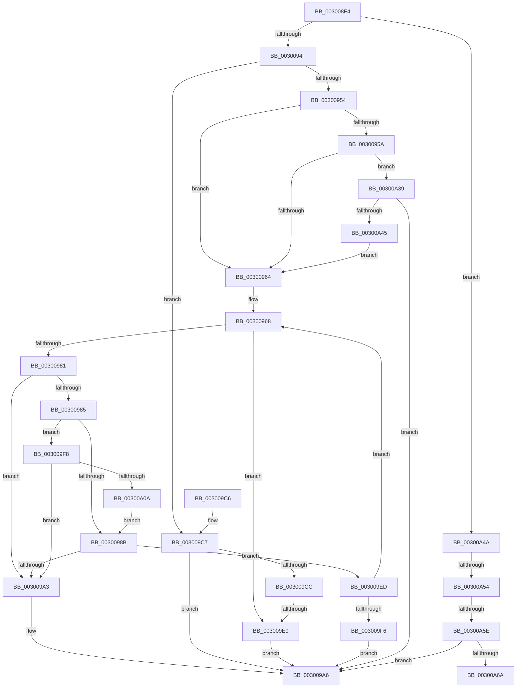

# AuthzBasepEvaluateSetRelationship

- RVA: `0x003008F4`–`0x00300A6F` (길이 `379` bytes)
- VA: `0x00000001403008F4`
- 실행 섹션: `.text`
- PDB 이름 있음: `예`; PDB Function 태그: `예`
- unwind 정보 RVA: `0x00073078`
- 디코드: `112`개 명령, `379/379` bytes 표시
- 미해석 바이트: `0` (있으면 어셈블리에 `.byte`로 보존)

> 이 문서는 커널 이미지의 기계어와 PDB 기호를 분석해 생성했습니다. 4번과 5번은 함수 원형과 자료형을 바이너리 사용 방식에서 추정한 C 해석이며 원본 소스 복구 결과는 아닙니다.

## 1. Dependencies

- 직접 호출 지점: **4**; 고유 호출 대상: **2**
- 직접 호출자로 확인된 함수: **1**
- RIP 상대 이미지 참조: **0**

### Outgoing calls
- `0x00300973` → [AuthzBasepGetNextValue](AuthzBasepGetNextValue_function_003007E0.md) (function, `0x003007E0`)
- `0x00300998` → [AuthzBasepValueInSet](../2F/AuthzBasepValueInSet_function_002FE9B0.md) (function, `0x002FE9B0`)
- `0x003009D7` → [AuthzBasepGetNextValue](AuthzBasepGetNextValue_function_003007E0.md) (function, `0x003007E0`)
- `0x003009FF` → [AuthzBasepGetNextValue](AuthzBasepGetNextValue_function_003007E0.md) (function, `0x003007E0`)

### Direct callers
- [AuthzBasepEvaluateExpression](AuthzBasepEvaluateExpression_function_00300578.md) at `0x0030060C`
- [AuthzBasepEvaluateExpression](AuthzBasepEvaluateExpression_function_00300578.md) at `0x00300681`
- [AuthzBasepEvaluateExpression](AuthzBasepEvaluateExpression_function_00300578.md) at `0x003006EB`

### Static image references
- 디코드된 RIP-relative 메모리 참조가 없습니다.

## 2. Other-region calls and transfers

- 다른 실행 섹션으로 향하는 call: **0**
- call이 아닌 외부 분기/꼬리 이동: **4**
  - `0x003009E3` → [sub_006DFF8E](../6D/Unknown_function_006DFF8E.md) (`tail-transfer`)
  - `0x00300A4E` → [sub_006DFF8E + 0x7A](../6D/Unknown_function_006DFF8E.md) (`tail-transfer`)
  - `0x00300A58` → [sub_006DFF8E + 0x7A](../6D/Unknown_function_006DFF8E.md) (`tail-transfer`)
  - `0x00300A6A` → [sub_006DFF8E + 0x7A](../6D/Unknown_function_006DFF8E.md) (`tail-transfer`)

## 3. Assembly (complete function range)

```asm
003008F4  48 8B C4                        mov rax, rsp
003008F7  48 89 58 08                     mov qword ptr [rax + 8], rbx
003008FB  48 89 70 10                     mov qword ptr [rax + 0x10], rsi
003008FF  48 89 78 18                     mov qword ptr [rax + 0x18], rdi
00300903  4C 89 60 20                     mov qword ptr [rax + 0x20], r12
00300907  55                              push rbp
00300908  41 55                           push r13
0030090A  41 57                           push r15
0030090C  48 8B EC                        mov rbp, rsp
0030090F  48 83 EC 70                     sub rsp, 0x70
00300913  33 C0                           xor eax, eax
00300915  0F 57 C0                        xorps xmm0, xmm0
00300918  41 21 00                        and dword ptr [r8], eax
0030091B  48 8B DA                        mov rbx, rdx
0030091E  33 D2                           xor edx, edx
00300920  89 45 D0                        mov dword ptr [rbp - 0x30], eax
00300923  45 33 E4                        xor r12d, r12d
00300926  66 89 45 D4                     mov word ptr [rbp - 0x2c], ax
0030092A  45 33 ED                        xor r13d, r13d
0030092D  89 45 F8                        mov dword ptr [rbp - 8], eax
00300930  66 89 45 FC                     mov word ptr [rbp - 4], ax
00300934  49 8B F8                        mov rdi, r8
00300937  0F 11 45 B0                     movups xmmword ptr [rbp - 0x50], xmm0
0030093B  0F 11 45 C0                     movups xmmword ptr [rbp - 0x40], xmm0
0030093F  0F 11 45 D8                     movups xmmword ptr [rbp - 0x28], xmm0
00300943  0F 11 45 E8                     movups xmmword ptr [rbp - 0x18], xmm0
00300947  85 C9                           test ecx, ecx
00300949  0F 84 FB 00 00 00               je 0x140300a4a
0030094F  83 E9 01                        sub ecx, 1
00300952  75 73                           jne 0x1403009c7
00300954  83 7B 0C 01                     cmp dword ptr [rbx + 0xc], 1
00300958  74 0A                           je 0x140300964
0030095A  83 7B 34 01                     cmp dword ptr [rbx + 0x34], 1
0030095E  0F 85 D5 00 00 00               jne 0x140300a39
00300964  48 8D 73 28                     lea rsi, [rbx + 0x28]
00300968  44 8B 7B 30                     mov r15d, dword ptr [rbx + 0x30]
0030096C  48 8D 55 B0                     lea rdx, [rbp - 0x50]
00300970  48 8B CE                        mov rcx, rsi
00300973  E8 68 FE FF FF                  call 0x1403007e0
00300978  8B D0                           mov edx, eax
0030097A  3D 1A 00 00 80                  cmp eax, 0x8000001a
0030097F  74 68                           je 0x1403009e9
00300981  85 C0                           test eax, eax
00300983  78 1E                           js 0x1403009a3
00300985  66 83 3B 04                     cmp word ptr [rbx], 4
00300989  74 6D                           je 0x1403009f8
0030098B  45 33 C9                        xor r9d, r9d
0030098E  48 8D 4D B0                     lea rcx, [rbp - 0x50]
00300992  4C 8B C7                        mov r8, rdi
00300995  48 8B D3                        mov rdx, rbx
00300998  E8 13 E0 FF FF                  call 0x1402fe9b0
0030099D  8B D0                           mov edx, eax
0030099F  85 C0                           test eax, eax
003009A1  79 4A                           jns 0x1403009ed
003009A3  83 0F FF                        or dword ptr [rdi], 0xffffffff
003009A6  4C 8D 5C 24 70                  lea r11, [rsp + 0x70]
003009AB  8B C2                           mov eax, edx
003009AD  49 8B 5B 20                     mov rbx, qword ptr [r11 + 0x20]
003009B1  49 8B 73 28                     mov rsi, qword ptr [r11 + 0x28]
003009B5  49 8B 7B 30                     mov rdi, qword ptr [r11 + 0x30]
003009B9  4D 8B 63 38                     mov r12, qword ptr [r11 + 0x38]
003009BD  49 8B E3                        mov rsp, r11
003009C0  41 5F                           pop r15
003009C2  41 5D                           pop r13
003009C4  5D                              pop rbp
003009C5  C3                              ret
003009C6  CC                              int3
003009C7  83 F9 01                        cmp ecx, 1
003009CA  75 DA                           jne 0x1403009a6
003009CC  44 8B 7B 08                     mov r15d, dword ptr [rbx + 8]
003009D0  48 8D 55 B0                     lea rdx, [rbp - 0x50]
003009D4  48 8B CB                        mov rcx, rbx
003009D7  E8 04 FE FF FF                  call 0x1403007e0
003009DC  8B D0                           mov edx, eax
003009DE  3D 1A 00 00 80                  cmp eax, 0x8000001a
003009E3  0F 85 A5 F5 3D 00               jne 0x1406dff8e
003009E9  33 D2                           xor edx, edx
003009EB  EB B9                           jmp 0x1403009a6
003009ED  83 3F 01                        cmp dword ptr [rdi], 1
003009F0  0F 84 72 FF FF FF               je 0x140300968
003009F6  EB AE                           jmp 0x1403009a6
003009F8  48 8D 55 D8                     lea rdx, [rbp - 0x28]
003009FC  48 8B CE                        mov rcx, rsi
003009FF  E8 DC FD FF FF                  call 0x1403007e0
00300A04  8B D0                           mov edx, eax
00300A06  85 C0                           test eax, eax
00300A08  78 99                           js 0x1403009a3
00300A0A  8A 43 2C                        mov al, byte ptr [rbx + 0x2c]
00300A0D  44 21 65 B8                     and dword ptr [rbp - 0x48], r12d
00300A11  88 45 B4                        mov byte ptr [rbp - 0x4c], al
00300A14  0F B7 06                        movzx eax, word ptr [rsi]
00300A17  66 89 45 B0                     mov word ptr [rbp - 0x50], ax
00300A1B  48 8B 43 38                     mov rax, qword ptr [rbx + 0x38]
00300A1F  48 89 45 C0                     mov qword ptr [rbp - 0x40], rax
00300A23  8B 43 30                        mov eax, dword ptr [rbx + 0x30]
00300A26  89 45 C8                        mov dword ptr [rbp - 0x38], eax
00300A29  49 8B C7                        mov rax, r15
00300A2C  48 03 43 48                     add rax, qword ptr [rbx + 0x48]
00300A30  48 89 45 D0                     mov qword ptr [rbp - 0x30], rax
00300A34  E9 52 FF FF FF                  jmp 0x14030098b
00300A39  8B 43 2C                        mov eax, dword ptr [rbx + 0x2c]
00300A3C  39 43 04                        cmp dword ptr [rbx + 4], eax
00300A3F  0F 82 61 FF FF FF               jb 0x1403009a6
00300A45  E9 1A FF FF FF                  jmp 0x140300964
00300A4A  83 7B 0C 01                     cmp dword ptr [rbx + 0xc], 1
00300A4E  0F 84 B4 F5 3D 00               je 0x1406e0008
00300A54  83 7B 34 01                     cmp dword ptr [rbx + 0x34], 1
00300A58  0F 84 AA F5 3D 00               je 0x1406e0008
00300A5E  8B 43 2C                        mov eax, dword ptr [rbx + 0x2c]
00300A61  39 43 04                        cmp dword ptr [rbx + 4], eax
00300A64  0F 85 3C FF FF FF               jne 0x1403009a6
00300A6A  E9 99 F5 3D 00                  jmp 0x1406e0008
```

## 4. C-style interpretation (structured pseudocode)

```c
__int64 __fastcall AuthzBasepEvaluateSetRelationship(int a1, __int64 a2, __int64 a3, int a4)
{
    __int64 result;
    __int64 v_r12;
    __int64 v_r13;
    __int64 v_rsp;
    unsigned __int64 v_stack_m18;
    unsigned __int16 v_stack_m1C;
    unsigned int v_stack_m20;
    unsigned __int64 v_stack_m30;
    unsigned __int64 v_stack_m40;
    unsigned __int16 v_stack_m44;
    unsigned int v_stack_m48;
    unsigned int v_stack_m50;
    unsigned __int64 v_stack_m58;
    unsigned int v_stack_m60;
    unsigned __int8 v_stack_m64;
    unsigned __int64 v_stack_m68;

    *(unsigned __int64 *)(v_rsp + 8) = v_rbx;
    *(unsigned __int64 *)(v_rsp + 16) = v_rsi;
    *(unsigned __int64 *)(v_rsp + 24) = v_rdi;
    *(unsigned __int64 *)(v_rsp + 32) = v_r12;
    v_rsp = (v_rsp) - (112);
    result = 0;
    a2 = 0;
    v_stack_m48 = 0;
    v_r12 = 0;
    v_stack_m44 = 0;
    v_r13 = 0;
    v_stack_m20 = 0;
    v_stack_m1C = 0;
    v_stack_m68 = v_xmm0;
    v_stack_m58 = v_xmm0;
    v_stack_m40 = v_xmm0;
    v_stack_m30 = v_xmm0;
    if (a1 == 0) goto loc_00300A4A;
    a1 = (unsigned int)((a1) - (1));
    if (condition_is_not_equal) goto loc_003009C7;
    if ((*(unsigned int *)(a2 + 12)) == 1) goto loc_00300964;
    if ((*(unsigned int *)(a2 + 52)) != 1) goto loc_00300A39;
loc_00300964:
loc_00300968:
    result = AuthzBasepGetNextValue(a2 + 40, v_stack_m68, a3, a4);
    if (((unsigned int)(result)) == 0x8000001AULL) goto loc_003009E9;
    if (sign_flag) goto loc_003009A3;
    if ((*(unsigned __int16 *)(a2)) == 4) goto loc_003009F8;
loc_0030098B:
    a4 = 0;
    result = AuthzBasepValueInSet(v_stack_m68, 0, a3, a4);
    if (!sign_flag) goto loc_003009ED;
loc_003009A3:
loc_003009A6:
    return (unsigned int)((unsigned int)((unsigned int)((unsigned int)(result))));
loc_003009C7:
    if (((unsigned int)(v_stack_m68)) != 1) goto loc_003009A6;
    result = AuthzBasepGetNextValue(*(unsigned __int64 *)(v_stack_m18 + 32), v_stack_m68, a3, a4);
loc_003009E9:
    a2 = 0;
    goto loc_003009A6;
loc_003009ED:
    if ((*(unsigned int *)(*(unsigned __int64 *)(v_stack_m18 + 48))) == 1) goto loc_00300968;
    goto loc_003009A6;
loc_003009F8:
    result = AuthzBasepGetNextValue(*(unsigned __int64 *)(v_stack_m18 + 40), v_stack_m40, a3, a4);
    if (sign_flag) goto loc_003009A3;
    v_stack_m64 = (unsigned __int8)(*(unsigned __int8 *)(*(unsigned __int64 *)(v_stack_m18 + 32) + 44));
    v_stack_m68 = (unsigned __int16)(*(unsigned __int16 *)(*(unsigned __int64 *)(v_stack_m18 + 40)));
    v_stack_m58 = *(unsigned __int64 *)(*(unsigned __int64 *)(v_stack_m18 + 32) + 56);
    v_stack_m50 = (unsigned int)((unsigned int)(*(unsigned int *)(*(unsigned __int64 *)(v_stack_m18 + 32) + 48)));
    result = ((unsigned int)(*(unsigned int *)(*(unsigned __int64 *)(v_stack_m18 + 32) + 8))) + (*(unsigned __int64 *)(*(unsigned __int64 *)(v_stack_m18 + 32) + 72));
    v_stack_m48 = result;
    goto loc_0030098B;
loc_00300A39:
    if ((*(unsigned int *)(*(unsigned __int64 *)(v_stack_m18 + 32) + 4)) < ((unsigned int)((unsigned int)(*(unsigned int *)(*(unsigned __int64 *)(v_stack_m18 + 32) + 44))))) goto loc_003009A6;
    goto loc_00300964;
loc_00300A4A:
    if ((*(unsigned int *)(*(unsigned __int64 *)(v_stack_m18 + 32) + 4)) != ((unsigned int)((unsigned int)(*(unsigned int *)(*(unsigned __int64 *)(v_stack_m18 + 32) + 44))))) goto loc_003009A6;
}
```

## 5. (Beta) C Style

```c
int64_t AuthzBasepEvaluateSetRelationship(int32_t Arg1, void *Arg2, void *Arg3, int32_t Arg4)
{
    uint8_t *arg2 = (uint8_t *)Arg2;
    uint8_t *arg3 = (uint8_t *)Arg3;

    int64_t result;
    int64_t local_r12;
    int64_t local_r13;
    int64_t local_rsp;
    uint64_t v_stack_m18;
    uint16_t v_stack_m1C;
    uint32_t v_stack_m20;
    uint64_t v_stack_m30;
    uint64_t v_stack_m40;
    uint16_t v_stack_m44;
    uint32_t v_stack_m48;
    uint32_t v_stack_m50;
    uint64_t v_stack_m58;
    uint32_t v_stack_m60;
    uint8_t v_stack_m64;
    uint64_t v_stack_m68;

    *(uint64_t *)(local_rsp + 0x8) = local_rbx;
    *(uint64_t *)(local_rsp + 0x10) = local_rsi;
    *(uint64_t *)(local_rsp + 0x18) = local_rdi;
    *(uint64_t *)(local_rsp + 0x20) = local_r12;
    local_rsp = (local_rsp) - (112);
    result = 0;
    Arg2 = 0;
    v_stack_m48 = 0;
    local_r12 = 0;
    v_stack_m44 = 0;
    local_r13 = 0;
    v_stack_m20 = 0;
    v_stack_m1C = 0;
    v_stack_m68 = v_xmm0;
    v_stack_m58 = v_xmm0;
    v_stack_m40 = v_xmm0;
    v_stack_m30 = v_xmm0;
    if (Arg1 == 0) goto loc_00300A4A;
    Arg1 = (uint32_t)((Arg1) - (1));
    if (condition_is_not_equal) goto loc_003009C7;
    if ((*(uint32_t *)(arg2 + 0xC)) == 1) goto loc_00300964;
    if ((*(uint32_t *)(arg2 + 0x34)) != 1) goto loc_00300A39;
loc_00300964:
loc_00300968:
    result = AuthzBasepGetNextValue(Arg2 + 40, v_stack_m68, Arg3, Arg4);
    if (((uint32_t)(result)) == 0x8000001AULL) goto loc_003009E9;
    if (sign_flag) goto loc_003009A3;
    if ((*(uint16_t *)(arg2)) == 4) goto loc_003009F8;
loc_0030098B:
    Arg4 = 0;
    result = AuthzBasepValueInSet(v_stack_m68, 0, Arg3, Arg4);
    if (!sign_flag) goto loc_003009ED;
loc_003009A3:
loc_003009A6:
    return (uint32_t)((uint32_t)((uint32_t)((uint32_t)(result))));
loc_003009C7:
    if (((uint32_t)(v_stack_m68)) != 1) goto loc_003009A6;
    result = AuthzBasepGetNextValue(*(uint64_t *)(v_stack_m18 + 0x20), v_stack_m68, Arg3, Arg4);
loc_003009E9:
    Arg2 = 0;
    goto loc_003009A6;
loc_003009ED:
    if ((*(uint32_t *)(*(uint64_t *)(v_stack_m18 + 0x30))) == 1) goto loc_00300968;
    goto loc_003009A6;
loc_003009F8:
    result = AuthzBasepGetNextValue(*(uint64_t *)(v_stack_m18 + 0x28), v_stack_m40, Arg3, Arg4);
    if (sign_flag) goto loc_003009A3;
    v_stack_m64 = (uint8_t)(*(uint8_t *)(*(uint64_t *)(v_stack_m18 + 0x20) + 0x2C));
    v_stack_m68 = (uint16_t)(*(uint16_t *)(*(uint64_t *)(v_stack_m18 + 0x28)));
    v_stack_m58 = *(uint64_t *)(*(uint64_t *)(v_stack_m18 + 0x20) + 0x38);
    v_stack_m50 = (uint32_t)((uint32_t)(*(uint32_t *)(*(uint64_t *)(v_stack_m18 + 0x20) + 0x30)));
    result = ((uint32_t)(*(uint32_t *)(*(uint64_t *)(v_stack_m18 + 0x20) + 0x8))) + (*(uint64_t *)(*(uint64_t *)(v_stack_m18 + 0x20) + 0x48));
    v_stack_m48 = result;
    goto loc_0030098B;
loc_00300A39:
    if ((*(uint32_t *)(*(uint64_t *)(v_stack_m18 + 0x20) + 0x4)) < ((uint32_t)((uint32_t)(*(uint32_t *)(*(uint64_t *)(v_stack_m18 + 0x20) + 0x2C))))) goto loc_003009A6;
    goto loc_00300964;
loc_00300A4A:
    if ((*(uint32_t *)(*(uint64_t *)(v_stack_m18 + 0x20) + 0x4)) != ((uint32_t)((uint32_t)(*(uint32_t *)(*(uint64_t *)(v_stack_m18 + 0x20) + 0x2C))))) goto loc_003009A6;
}
```

### 관측된 메모리 오프셋

구조체 형식이 확인되지 않은 접근은 인자 기준의 오프셋으로만 기록했습니다.

| 기준 인자 | 오프셋 표현 | 폭 (bit) | 접근 |
|---|---:|---:|---|
| `Arg2` | `+ 0x0` | `16` | `R` |
| `Arg2` | `+ 0x4` | `32` | `R` |
| `Arg2` | `+ 0x8` | `32` | `R` |
| `Arg2` | `+ 0xC` | `32` | `R` |
| `Arg2` | `+ 0x28` | `64` | `R` |
| `Arg2` | `+ 0x2C` | `8` | `R` |
| `Arg2` | `+ 0x2C` | `32` | `R` |
| `Arg2` | `+ 0x30` | `32` | `R` |
| `Arg2` | `+ 0x34` | `32` | `R` |
| `Arg2` | `+ 0x38` | `64` | `R` |
| `Arg2` | `+ 0x48` | `64` | `R` |
| `Arg3` | `+ 0x0` | `32` | `R` |
| `Arg3` | `+ 0x0` | `32` | `R/W` |

## 6. Execution-region graph

[열기: 2D/3D 그래프와 함수 탐색 컨트롤 패널](../../../control-panel.html?section=text&rva=0x003008F4&view=graph)

- 2D 그래프는 위에서 아래로 흐르고, 3D 그래프는 빈 공간을 드래그해 회전합니다. Shift+드래그는 이동, 휠은 확대·축소, 함수 노드 선택은 대상 보고서 이동입니다.

### Static fallback


