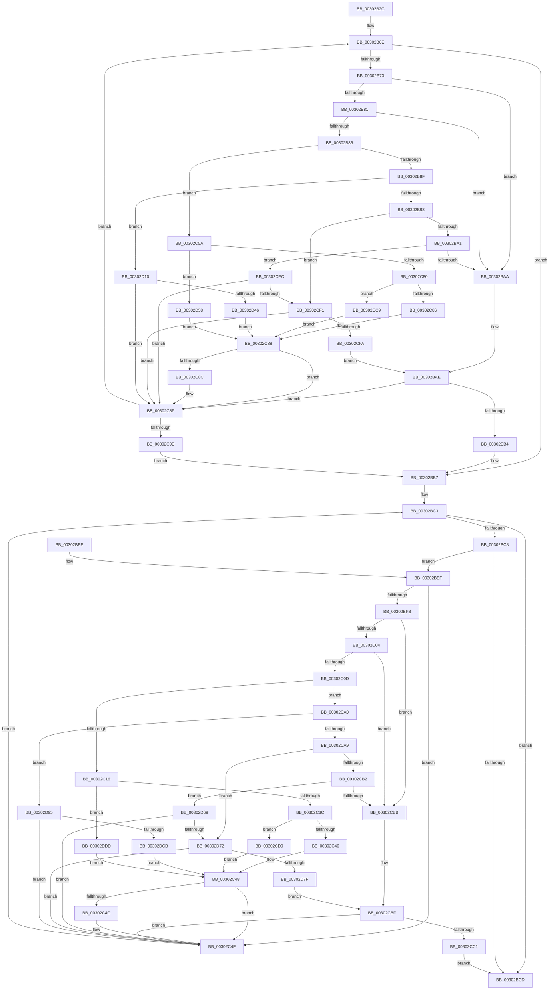

# AuthzBasepFindSecurityAttributeValue

- RVA: `0x00302B2C`–`0x00302DEE` (길이 `706` bytes)
- VA: `0x0000000140302B2C`
- 실행 섹션: `.text`
- PDB 이름 있음: `예`; PDB Function 태그: `아니요`
- unwind 정보 RVA: `0x00073378`
- 디코드: `194`개 명령, `706/706` bytes 표시
- 미해석 바이트: `0` (있으면 어셈블리에 `.byte`로 보존)

> 이 문서는 커널 이미지의 기계어와 PDB 기호를 분석해 생성했습니다. 4번과 5번은 함수 원형과 자료형을 바이너리 사용 방식에서 추정한 C 해석이며 원본 소스 복구 결과는 아닙니다.

## 1. Dependencies

- 직접 호출 지점: **8**; 고유 호출 대상: **3**
- 직접 호출자로 확인된 함수: **3**
- RIP 상대 이미지 참조: **0**

### Outgoing calls
- `0x00302CCD` → [memcmp](../6C/memcmp_function_006C6B10.md) (function, `0x006C6B10`)
- `0x00302CDD` → [memcmp](../6C/memcmp_function_006C6B10.md) (function, `0x006C6B10`)
- `0x00302D04` → [memcmp](../6C/memcmp_function_006C6B10.md) (function, `0x006C6B10`)
- `0x00302D4E` → [AuthzBasepEqualUnicodeString](../3A/AuthzBasepEqualUnicodeString_function_003A8A80.md) (function, `0x003A8A80`)
- `0x00302D5F` → [RtlEqualUnicodeString](../../page/93/RtlEqualUnicodeString_function_00932A20.md) (function, `0x00932A20`)
- `0x00302D89` → [memcmp](../6C/memcmp_function_006C6B10.md) (function, `0x006C6B10`)
- `0x00302DD3` → [AuthzBasepEqualUnicodeString](../3A/AuthzBasepEqualUnicodeString_function_003A8A80.md) (function, `0x003A8A80`)
- `0x00302DE4` → [RtlEqualUnicodeString](../../page/93/RtlEqualUnicodeString_function_00932A20.md) (function, `0x00932A20`)

### Direct callers
- [AuthzBasepAddSecurityAttributeValues](AuthzBasepAddSecurityAttributeValues_function_003020EC.md) at `0x00302167`
- [AuthzBasepAddSecurityAttributeValues](AuthzBasepAddSecurityAttributeValues_function_003020EC.md) at `0x0030234A`
- [AuthzBasepDeleteSecurityAttributeValues](../4F/AuthzBasepDeleteSecurityAttributeValues_function_004F9B00.md) at `0x004F9B9D`
- [AuthzBasepCompareSecurityAttribute](../../page/A6/AuthzBasepCompareSecurityAttribute_function_00A612A8.md) at `0x00A61326`

### Static image references
- 디코드된 RIP-relative 메모리 참조가 없습니다.

## 2. Other-region calls and transfers

- 다른 실행 섹션으로 향하는 call: **2**
  - `0x00302D5F` → [RtlEqualUnicodeString](../../page/93/RtlEqualUnicodeString_function_00932A20.md) (`.text` → `PAGE`)
  - `0x00302DE4` → [RtlEqualUnicodeString](../../page/93/RtlEqualUnicodeString_function_00932A20.md) (`.text` → `PAGE`)
- 별도 외부 분기/꼬리 이동을 확인하지 못했습니다.

## 3. Assembly (complete function range)

```asm
00302B2C  48 89 5C 24 10                  mov qword ptr [rsp + 0x10], rbx
00302B31  48 89 4C 24 08                  mov qword ptr [rsp + 8], rcx
00302B36  55                              push rbp
00302B37  56                              push rsi
00302B38  57                              push rdi
00302B39  41 54                           push r12
00302B3B  41 55                           push r13
00302B3D  41 56                           push r14
00302B3F  41 57                           push r15
00302B41  48 8B EC                        mov rbp, rsp
00302B44  48 83 EC 40                     sub rsp, 0x40
00302B48  45 0F B7 E8                     movzx r13d, r8w
00302B4C  4C 8D 61 48                     lea r12, [rcx + 0x48]
00302B50  4D 8B 34 24                     mov r14, qword ptr [r12]
00302B54  45 33 FF                        xor r15d, r15d
00302B57  0F 57 C0                        xorps xmm0, xmm0
00302B5A  0F 57 C9                        xorps xmm1, xmm1
00302B5D  0F 11 45 E0                     movups xmmword ptr [rbp - 0x20], xmm0
00302B61  40 32 FF                        xor dil, dil
00302B64  41 8B DD                        mov ebx, r13d
00302B67  0F 11 4D F0                     movups xmmword ptr [rbp - 0x10], xmm1
00302B6B  48 8B F2                        mov rsi, rdx
00302B6E  4D 3B F4                        cmp r14, r12
00302B71  74 44                           je 0x140302bb7
00302B73  41 8B CD                        mov ecx, r13d
00302B76  4D 8B FE                        mov r15, r14
00302B79  41 8B DD                        mov ebx, r13d
00302B7C  83 E9 01                        sub ecx, 1
00302B7F  74 29                           je 0x140302baa
00302B81  83 E9 01                        sub ecx, 1
00302B84  74 24                           je 0x140302baa
00302B86  83 E9 01                        sub ecx, 1
00302B89  0F 84 CB 00 00 00               je 0x140302c5a
00302B8F  83 E9 01                        sub ecx, 1
00302B92  0F 84 78 01 00 00               je 0x140302d10
00302B98  83 E9 01                        sub ecx, 1
00302B9B  0F 84 50 01 00 00               je 0x140302cf1
00302BA1  83 E9 01                        sub ecx, 1
00302BA4  0F 85 42 01 00 00               jne 0x140302cec
00302BAA  49 3B 76 28                     cmp rsi, qword ptr [r14 + 0x28]
00302BAE  0F 85 DB 00 00 00               jne 0x140302c8f
00302BB4  40 B7 01                        mov dil, 1
00302BB7  4C 8B 65 40                     mov r12, qword ptr [rbp + 0x40]
00302BBB  49 83 C4 60                     add r12, 0x60
00302BBF  4D 8B 34 24                     mov r14, qword ptr [r12]
00302BC3  40 84 FF                        test dil, dil
00302BC6  75 05                           jne 0x140302bcd
00302BC8  4D 3B F4                        cmp r14, r12
00302BCB  75 22                           jne 0x140302bef
00302BCD  48 8B 9C 24 88 00 00 00         mov rbx, qword ptr [rsp + 0x88]
00302BD5  40 F6 DF                        neg dil
00302BD8  48 1B C0                        sbb rax, rax
00302BDB  49 23 C7                        and rax, r15
00302BDE  48 83 C4 40                     add rsp, 0x40
00302BE2  41 5F                           pop r15
00302BE4  41 5E                           pop r14
00302BE6  41 5D                           pop r13
00302BE8  41 5C                           pop r12
00302BEA  5F                              pop rdi
00302BEB  5E                              pop rsi
00302BEC  5D                              pop rbp
00302BED  C3                              ret
00302BEE  CC                              int3
00302BEF  4D 8D 7E F0                     lea r15, [r14 - 0x10]
00302BF3  41 8B 47 20                     mov eax, dword ptr [r15 + 0x20]
00302BF7  A8 01                           test al, 1
00302BF9  75 54                           jne 0x140302c4f
00302BFB  83 EB 01                        sub ebx, 1
00302BFE  0F 84 B7 00 00 00               je 0x140302cbb
00302C04  83 EB 01                        sub ebx, 1
00302C07  0F 84 AE 00 00 00               je 0x140302cbb
00302C0D  83 EB 01                        sub ebx, 1
00302C10  0F 85 8A 00 00 00               jne 0x140302ca0
00302C16  44 0F B7 06                     movzx r8d, word ptr [rsi]
00302C1A  49 8D 57 28                     lea rdx, [r15 + 0x28]
00302C1E  48 8B 4E 08                     mov rcx, qword ptr [rsi + 8]
00302C22  66 44 89 45 E0                  mov word ptr [rbp - 0x20], r8w
00302C27  66 44 89 45 E2                  mov word ptr [rbp - 0x1e], r8w
00302C2C  48 89 4D E8                     mov qword ptr [rbp - 0x18], rcx
00302C30  44 0F 20 C0                     mov rax, cr8
00302C34  3C 02                           cmp al, 2
00302C36  0F 82 A1 01 00 00               jb 0x140302ddd
00302C3C  66 44 3B 02                     cmp r8w, word ptr [rdx]
00302C40  0F 84 93 00 00 00               je 0x140302cd9
00302C46  32 C0                           xor al, al
00302C48  84 C0                           test al, al
00302C4A  74 03                           je 0x140302c4f
00302C4C  40 B7 01                        mov dil, 1
00302C4F  4D 8B 36                        mov r14, qword ptr [r14]
00302C52  41 8B DD                        mov ebx, r13d
00302C55  E9 69 FF FF FF                  jmp 0x140302bc3
00302C5A  44 0F B7 06                     movzx r8d, word ptr [rsi]
00302C5E  49 8D 56 28                     lea rdx, [r14 + 0x28]
00302C62  48 8B 4E 08                     mov rcx, qword ptr [rsi + 8]
00302C66  66 44 89 45 E0                  mov word ptr [rbp - 0x20], r8w
00302C6B  66 44 89 45 E2                  mov word ptr [rbp - 0x1e], r8w
00302C70  48 89 4D E8                     mov qword ptr [rbp - 0x18], rcx
00302C74  44 0F 20 C0                     mov rax, cr8
00302C78  3C 02                           cmp al, 2
00302C7A  0F 82 D8 00 00 00               jb 0x140302d58
00302C80  66 44 3B 02                     cmp r8w, word ptr [rdx]
00302C84  74 43                           je 0x140302cc9
00302C86  32 C0                           xor al, al
00302C88  84 C0                           test al, al
00302C8A  74 03                           je 0x140302c8f
00302C8C  40 B7 01                        mov dil, 1
00302C8F  4D 8B 36                        mov r14, qword ptr [r14]
00302C92  40 84 FF                        test dil, dil
00302C95  0F 84 D3 FE FF FF               je 0x140302b6e
00302C9B  E9 17 FF FF FF                  jmp 0x140302bb7
00302CA0  83 EB 01                        sub ebx, 1
00302CA3  0F 84 EC 00 00 00               je 0x140302d95
00302CA9  83 EB 01                        sub ebx, 1
00302CAC  0F 84 C0 00 00 00               je 0x140302d72
00302CB2  83 EB 01                        sub ebx, 1
00302CB5  0F 85 AE 00 00 00               jne 0x140302d69
00302CBB  49 3B 77 28                     cmp rsi, qword ptr [r15 + 0x28]
00302CBF  75 8E                           jne 0x140302c4f
00302CC1  40 B7 01                        mov dil, 1
00302CC4  E9 04 FF FF FF                  jmp 0x140302bcd
00302CC9  48 8B 52 08                     mov rdx, qword ptr [rdx + 8]
00302CCD  E8 3E 3E 3C 00                  call 0x1406c6b10
00302CD2  85 C0                           test eax, eax
00302CD4  0F 94 C0                        sete al
00302CD7  EB AF                           jmp 0x140302c88
00302CD9  48 8B 52 08                     mov rdx, qword ptr [rdx + 8]
00302CDD  E8 2E 3E 3C 00                  call 0x1406c6b10
00302CE2  85 C0                           test eax, eax
00302CE4  0F 94 C0                        sete al
00302CE7  E9 5C FF FF FF                  jmp 0x140302c48
00302CEC  83 F9 0A                        cmp ecx, 0xa
00302CEF  75 9E                           jne 0x140302c8f
00302CF1  8B 46 08                        mov eax, dword ptr [rsi + 8]
00302CF4  41 3B 46 30                     cmp eax, dword ptr [r14 + 0x30]
00302CF8  75 95                           jne 0x140302c8f
00302CFA  49 8B 56 28                     mov rdx, qword ptr [r14 + 0x28]
00302CFE  44 8B C0                        mov r8d, eax
00302D01  48 8B 0E                        mov rcx, qword ptr [rsi]
00302D04  E8 07 3E 3C 00                  call 0x1406c6b10
00302D09  85 C0                           test eax, eax
00302D0B  E9 9E FE FF FF                  jmp 0x140302bae
00302D10  0F B7 46 08                     movzx eax, word ptr [rsi + 8]
00302D14  66 89 45 E0                     mov word ptr [rbp - 0x20], ax
00302D18  66 89 45 E2                     mov word ptr [rbp - 0x1e], ax
00302D1C  48 8B 46 10                     mov rax, qword ptr [rsi + 0x10]
00302D20  48 89 45 E8                     mov qword ptr [rbp - 0x18], rax
00302D24  41 0F B7 46 30                  movzx eax, word ptr [r14 + 0x30]
00302D29  66 89 45 F0                     mov word ptr [rbp - 0x10], ax
00302D2D  66 89 45 F2                     mov word ptr [rbp - 0xe], ax
00302D31  49 8B 46 38                     mov rax, qword ptr [r14 + 0x38]
00302D35  48 89 45 F8                     mov qword ptr [rbp - 8], rax
00302D39  49 8B 46 28                     mov rax, qword ptr [r14 + 0x28]
00302D3D  48 39 06                        cmp qword ptr [rsi], rax
00302D40  0F 85 49 FF FF FF               jne 0x140302c8f
00302D46  48 8D 55 F0                     lea rdx, [rbp - 0x10]
00302D4A  48 8D 4D E0                     lea rcx, [rbp - 0x20]
00302D4E  E8 2D 5D 0A 00                  call 0x1403a8a80
00302D53  E9 30 FF FF FF                  jmp 0x140302c88
00302D58  41 B0 01                        mov r8b, 1
00302D5B  48 8D 4D E0                     lea rcx, [rbp - 0x20]
00302D5F  E8 BC FC 62 00                  call 0x140932a20
00302D64  E9 1F FF FF FF                  jmp 0x140302c88
00302D69  83 FB 0A                        cmp ebx, 0xa
00302D6C  0F 85 DD FE FF FF               jne 0x140302c4f
00302D72  8B 46 08                        mov eax, dword ptr [rsi + 8]
00302D75  41 3B 47 30                     cmp eax, dword ptr [r15 + 0x30]
00302D79  0F 85 D0 FE FF FF               jne 0x140302c4f
00302D7F  49 8B 57 28                     mov rdx, qword ptr [r15 + 0x28]
00302D83  44 8B C0                        mov r8d, eax
00302D86  48 8B 0E                        mov rcx, qword ptr [rsi]
00302D89  E8 82 3D 3C 00                  call 0x1406c6b10
00302D8E  85 C0                           test eax, eax
00302D90  E9 2A FF FF FF                  jmp 0x140302cbf
00302D95  0F B7 46 08                     movzx eax, word ptr [rsi + 8]
00302D99  66 89 45 E0                     mov word ptr [rbp - 0x20], ax
00302D9D  66 89 45 E2                     mov word ptr [rbp - 0x1e], ax
00302DA1  48 8B 46 10                     mov rax, qword ptr [rsi + 0x10]
00302DA5  48 89 45 E8                     mov qword ptr [rbp - 0x18], rax
00302DA9  41 0F B7 47 30                  movzx eax, word ptr [r15 + 0x30]
00302DAE  66 89 45 F0                     mov word ptr [rbp - 0x10], ax
00302DB2  66 89 45 F2                     mov word ptr [rbp - 0xe], ax
00302DB6  49 8B 47 38                     mov rax, qword ptr [r15 + 0x38]
00302DBA  48 89 45 F8                     mov qword ptr [rbp - 8], rax
00302DBE  49 8B 47 28                     mov rax, qword ptr [r15 + 0x28]
00302DC2  48 39 06                        cmp qword ptr [rsi], rax
00302DC5  0F 85 84 FE FF FF               jne 0x140302c4f
00302DCB  48 8D 55 F0                     lea rdx, [rbp - 0x10]
00302DCF  48 8D 4D E0                     lea rcx, [rbp - 0x20]
00302DD3  E8 A8 5C 0A 00                  call 0x1403a8a80
00302DD8  E9 6B FE FF FF                  jmp 0x140302c48
00302DDD  41 B0 01                        mov r8b, 1
00302DE0  48 8D 4D E0                     lea rcx, [rbp - 0x20]
00302DE4  E8 37 FC 62 00                  call 0x140932a20
00302DE9  E9 5A FE FF FF                  jmp 0x140302c48
```

## 4. C-style interpretation (structured pseudocode)

```c
__int64 __fastcall AuthzBasepFindSecurityAttributeValue(__int64 a1, __int64 a2, unsigned __int16 a3)
{
    __int64 result;
    __int64 v_r12;
    __int64 v_r15;
    __int64 v_rbx;
    __int64 v_rdi;
    __int64 v_rsp;
    unsigned __int64 v_stack_m40;
    unsigned __int16 v_stack_m46;
    unsigned __int64 v_stack_m48;
    unsigned __int64 v_stack_m50;
    unsigned __int16 v_stack_m56;
    unsigned __int64 v_stack_m58;
    unsigned __int64 v_stack_p10;
    unsigned __int64 v_stack_p8;

    v_stack_p10 = v_rbx;
    v_stack_p8 = a1;
    v_rsp = (v_rsp) - (64);
    v_r15 = 0;
    v_stack_m58 = v_xmm0;
    v_rdi = 0;
    v_stack_m48 = v_xmm1;
loc_00302B6E:
    if ((*(unsigned __int64 *)(a1 + 72)) == (a1 + 72)) goto loc_00302BB7;
    a1 = (unsigned int)(((unsigned int)(a3)) - (1));
    if (condition_is_equal) goto loc_00302BAA;
    a1 = (unsigned int)((a1) - (1));
    if (condition_is_equal) goto loc_00302BAA;
    a1 = (unsigned int)((a1) - (1));
    if (condition_is_equal) goto loc_00302C5A;
    a1 = (unsigned int)((a1) - (1));
    if (condition_is_equal) goto loc_00302D10;
    a1 = (unsigned int)((a1) - (1));
    if (condition_is_equal) goto loc_00302CF1;
    a1 = (unsigned int)((a1) - (1));
    if (condition_is_not_equal) goto loc_00302CEC;
loc_00302BAA:
loc_00302BAE:
    if (a2 != (*(unsigned __int64 *)(*(unsigned __int64 *)(a1 + 72) + 40))) goto loc_00302C8F;
loc_00302BB7:
    v_r12 = (v_stack_p8) + (96);
loc_00302BC3:
    if (1 != 0) goto loc_00302BCD;
    if ((*(unsigned __int64 *)(v_r12)) != v_r12) goto loc_00302BEF;
loc_00302BCD:
    v_rdi = (unsigned __int8)(-(1));
    result = (result) & (*(unsigned __int64 *)(a1 + 72));
    v_rsp = (v_rsp) + (64);
    return result;
loc_00302BEF:
    if ((((unsigned __int8)((unsigned int)(*(unsigned int *)(*(unsigned __int64 *)(v_r12) - 16 + 32)))) & (1)) != 0) goto loc_00302C4F;
    v_rbx = (unsigned int)((v_stack_p10) - (1));
    if (condition_is_equal) goto loc_00302CBB;
    v_rbx = (unsigned int)((v_rbx) - (1));
    if (condition_is_equal) goto loc_00302CBB;
    v_rbx = (unsigned int)((v_rbx) - (1));
    if (condition_is_not_equal) goto loc_00302CA0;
    v_stack_m58 = (unsigned __int16)(*(unsigned __int16 *)(a2));
    v_stack_m56 = (unsigned __int16)(*(unsigned __int16 *)(a2));
    v_stack_m50 = *(unsigned __int64 *)(a2 + 8);
    if (((unsigned __int8)(v_cr8)) < 2) goto loc_00302DDD;
    if (((unsigned __int16)(*(unsigned __int16 *)(a2))) == (*(unsigned __int16 *)(*(unsigned __int64 *)(v_r12) - 16 + 40))) goto loc_00302CD9;
    result = 0;
loc_00302C48:
    if (0 != 0) {
        v_rdi = 1;
    }
    goto loc_00302BC3;
loc_00302C5A:
    v_stack_m58 = (unsigned __int16)(*(unsigned __int16 *)(a2));
    v_stack_m56 = (unsigned __int16)(*(unsigned __int16 *)(a2));
    v_stack_m50 = *(unsigned __int64 *)(a2 + 8);
    if (((unsigned __int8)(v_cr8)) < 2) goto loc_00302D58;
    if (((unsigned __int16)(*(unsigned __int16 *)(a2))) == (*(unsigned __int16 *)(*(unsigned __int64 *)(*(unsigned __int64 *)(v_r12)) + 40))) goto loc_00302CC9;
    result = 0;
loc_00302C88:
    if (0 != 0) {
        v_rdi = 1;
    }
    if ((unsigned __int8)(v_rdi) == 0) goto loc_00302B6E;
    goto loc_00302BB7;
loc_00302CA0:
    v_rbx = (unsigned int)(((unsigned int)(a3)) - (1));
    if (condition_is_equal) goto loc_00302D95;
    v_rbx = (unsigned int)((v_rbx) - (1));
    if (condition_is_equal) goto loc_00302D72;
    v_rbx = (unsigned int)((v_rbx) - (1));
    if (condition_is_not_equal) goto loc_00302D69;
loc_00302CBB:
loc_00302CBF:
    if (a2 != (*(unsigned __int64 *)(*(unsigned __int64 *)(v_r12) - 16 + 40))) goto loc_00302C4F;
    goto loc_00302BCD;
loc_00302CC9:
    result = memcmp(*(unsigned __int64 *)(a2 + 8), *(unsigned __int64 *)(*(unsigned __int64 *)(*(unsigned __int64 *)(v_r12)) + 40 + 8), *(unsigned __int16 *)(a2), a4);
    result = ((unsigned int)(result) == 0) ? 1 : 0;
    goto loc_00302C88;
loc_00302CD9:
    result = memcmp(*(unsigned __int64 *)(a2 + 8), *(unsigned __int64 *)(*(unsigned __int64 *)(*(unsigned __int64 *)(*(unsigned __int64 *)(v_r12)) + 40 + 8) + 8), *(unsigned __int16 *)(a2), a4);
    result = ((unsigned int)(result) == 0) ? 1 : 0;
    goto loc_00302C48;
loc_00302CEC:
    if (((unsigned int)(*(unsigned __int64 *)(a2 + 8))) != 10) goto loc_00302C8F;
loc_00302CF1:
    if (((unsigned int)((unsigned int)(*(unsigned int *)(a2 + 8)))) != (*(unsigned int *)(*(unsigned __int64 *)(*(unsigned __int64 *)(*(unsigned __int64 *)(v_r12))) + 48))) goto loc_00302C8F;
    result = memcmp(*(unsigned __int64 *)(a2), *(unsigned __int64 *)(*(unsigned __int64 *)(*(unsigned __int64 *)(*(unsigned __int64 *)(v_r12))) + 40), (unsigned int)((unsigned int)((unsigned int)(*(unsigned int *)(a2 + 8)))), a4);
    goto loc_00302BAE;
loc_00302D10:
    v_stack_m58 = (unsigned __int16)(*(unsigned __int16 *)(a2 + 8));
    v_stack_m56 = (unsigned __int16)(*(unsigned __int16 *)(a2 + 8));
    v_stack_m50 = *(unsigned __int64 *)(a2 + 16);
    v_stack_m48 = (unsigned __int16)(*(unsigned __int16 *)(*(unsigned __int64 *)(*(unsigned __int64 *)(*(unsigned __int64 *)(v_r12))) + 48));
    v_stack_m46 = (unsigned __int16)(*(unsigned __int16 *)(*(unsigned __int64 *)(*(unsigned __int64 *)(*(unsigned __int64 *)(v_r12))) + 48));
    v_stack_m40 = *(unsigned __int64 *)(*(unsigned __int64 *)(*(unsigned __int64 *)(*(unsigned __int64 *)(v_r12))) + 56);
    if ((*(unsigned __int64 *)(a2)) != (*(unsigned __int64 *)(*(unsigned __int64 *)(*(unsigned __int64 *)(*(unsigned __int64 *)(v_r12))) + 40))) goto loc_00302C8F;
    result = AuthzBasepEqualUnicodeString(v_stack_m58, v_stack_m48, (unsigned int)((unsigned int)((unsigned int)(*(unsigned int *)(a2 + 8)))), a4);
    goto loc_00302C88;
loc_00302D58:
    result = RtlEqualUnicodeString(v_stack_m58, v_stack_m48, 1, a4);
    goto loc_00302C88;
loc_00302D69:
    if (((unsigned int)(v_rbx)) != 10) goto loc_00302C4F;
loc_00302D72:
    if (((unsigned int)((unsigned int)(*(unsigned int *)(a2 + 8)))) != (*(unsigned int *)(*(unsigned __int64 *)(v_r12) - 16 + 48))) goto loc_00302C4F;
    result = memcmp(*(unsigned __int64 *)(a2), *(unsigned __int64 *)(*(unsigned __int64 *)(v_r12) - 16 + 40), (unsigned int)((unsigned int)((unsigned int)(*(unsigned int *)(a2 + 8)))), a4);
    goto loc_00302CBF;
loc_00302D95:
    v_stack_m58 = (unsigned __int16)(*(unsigned __int16 *)(a2 + 8));
    v_stack_m56 = (unsigned __int16)(*(unsigned __int16 *)(a2 + 8));
    v_stack_m50 = *(unsigned __int64 *)(a2 + 16);
    v_stack_m48 = (unsigned __int16)(*(unsigned __int16 *)(*(unsigned __int64 *)(v_r12) - 16 + 48));
    v_stack_m46 = (unsigned __int16)(*(unsigned __int16 *)(*(unsigned __int64 *)(v_r12) - 16 + 48));
    v_stack_m40 = *(unsigned __int64 *)(*(unsigned __int64 *)(v_r12) - 16 + 56);
    if ((*(unsigned __int64 *)(a2)) != (*(unsigned __int64 *)(*(unsigned __int64 *)(v_r12) - 16 + 40))) goto loc_00302C4F;
    result = AuthzBasepEqualUnicodeString(v_stack_m58, v_stack_m48, (unsigned int)((unsigned int)((unsigned int)(*(unsigned int *)(a2 + 8)))), a4);
    goto loc_00302C48;
loc_00302DDD:
    result = RtlEqualUnicodeString(v_stack_m58, v_stack_m48, 1, a4);
    goto loc_00302C48;
}
```

## 5. (Beta) C Style

```c
int64_t AuthzBasepFindSecurityAttributeValue(void *Arg1, int64_t Arg2, uint16_t Arg3)
{
    uint8_t *arg1 = (uint8_t *)Arg1;

    int64_t result;
    int64_t local_r12;
    int64_t local_r15;
    int64_t local_rbx;
    int64_t local_rdi;
    int64_t local_rsp;
    uint64_t v_stack_m40;
    uint16_t v_stack_m46;
    uint64_t v_stack_m48;
    uint64_t v_stack_m50;
    uint16_t v_stack_m56;
    uint64_t v_stack_m58;
    uint64_t v_stack_p10;
    uint64_t v_stack_p8;

    v_stack_p10 = local_rbx;
    v_stack_p8 = Arg1;
    local_rsp = (local_rsp) - (64);
    local_r15 = 0;
    v_stack_m58 = v_xmm0;
    local_rdi = 0;
    v_stack_m48 = v_xmm1;
loc_00302B6E:
    if ((*(uint64_t *)(arg1 + 0x48)) == (Arg1 + 72)) goto loc_00302BB7;
    Arg1 = (uint32_t)(((uint32_t)(Arg3)) - (1));
    if (condition_is_equal) goto loc_00302BAA;
    Arg1 = (uint32_t)((Arg1) - (1));
    if (condition_is_equal) goto loc_00302BAA;
    Arg1 = (uint32_t)((Arg1) - (1));
    if (condition_is_equal) goto loc_00302C5A;
    Arg1 = (uint32_t)((Arg1) - (1));
    if (condition_is_equal) goto loc_00302D10;
    Arg1 = (uint32_t)((Arg1) - (1));
    if (condition_is_equal) goto loc_00302CF1;
    Arg1 = (uint32_t)((Arg1) - (1));
    if (condition_is_not_equal) goto loc_00302CEC;
loc_00302BAA:
loc_00302BAE:
    if (Arg2 != (*(uint64_t *)(*(uint64_t *)(arg1 + 0x48) + 0x28))) goto loc_00302C8F;
loc_00302BB7:
    local_r12 = (v_stack_p8) + (96);
loc_00302BC3:
    if (1 != 0) goto loc_00302BCD;
    if ((*(uint64_t *)(local_r12)) != local_r12) goto loc_00302BEF;
loc_00302BCD:
    local_rdi = (uint8_t)(-(1));
    result = (result) & (*(uint64_t *)(arg1 + 0x48));
    local_rsp = (local_rsp) + (64);
    return result;
loc_00302BEF:
    if ((((uint8_t)((uint32_t)(*(uint32_t *)(*(uint64_t *)(local_r12) - 0x10 + 0x20)))) & (1)) != 0) goto loc_00302C4F;
    local_rbx = (uint32_t)((v_stack_p10) - (1));
    if (condition_is_equal) goto loc_00302CBB;
    local_rbx = (uint32_t)((local_rbx) - (1));
    if (condition_is_equal) goto loc_00302CBB;
    local_rbx = (uint32_t)((local_rbx) - (1));
    if (condition_is_not_equal) goto loc_00302CA0;
    v_stack_m58 = (uint16_t)(*(uint16_t *)(Arg2));
    v_stack_m56 = (uint16_t)(*(uint16_t *)(Arg2));
    v_stack_m50 = *(uint64_t *)(Arg2 + 0x8);
    if (((uint8_t)(v_cr8)) < 2) goto loc_00302DDD;
    if (((uint16_t)(*(uint16_t *)(Arg2))) == (*(uint16_t *)(*(uint64_t *)(local_r12) - 0x10 + 0x28))) goto loc_00302CD9;
    result = 0;
loc_00302C48:
    if (0 != 0) {
        local_rdi = 1;
    }
    goto loc_00302BC3;
loc_00302C5A:
    v_stack_m58 = (uint16_t)(*(uint16_t *)(Arg2));
    v_stack_m56 = (uint16_t)(*(uint16_t *)(Arg2));
    v_stack_m50 = *(uint64_t *)(Arg2 + 0x8);
    if (((uint8_t)(v_cr8)) < 2) goto loc_00302D58;
    if (((uint16_t)(*(uint16_t *)(Arg2))) == (*(uint16_t *)(*(uint64_t *)(*(uint64_t *)(local_r12)) + 0x28))) goto loc_00302CC9;
    result = 0;
loc_00302C88:
    if (0 != 0) {
        local_rdi = 1;
    }
    if ((uint8_t)(local_rdi) == 0) goto loc_00302B6E;
    goto loc_00302BB7;
loc_00302CA0:
    local_rbx = (uint32_t)(((uint32_t)(Arg3)) - (1));
    if (condition_is_equal) goto loc_00302D95;
    local_rbx = (uint32_t)((local_rbx) - (1));
    if (condition_is_equal) goto loc_00302D72;
    local_rbx = (uint32_t)((local_rbx) - (1));
    if (condition_is_not_equal) goto loc_00302D69;
loc_00302CBB:
loc_00302CBF:
    if (Arg2 != (*(uint64_t *)(*(uint64_t *)(local_r12) - 0x10 + 0x28))) goto loc_00302C4F;
    goto loc_00302BCD;
loc_00302CC9:
    result = memcmp(*(uint64_t *)(Arg2 + 0x8), *(uint64_t *)(*(uint64_t *)(*(uint64_t *)(local_r12)) + 0x28 + 0x8), *(uint16_t *)(Arg2), a4);
    result = ((uint32_t)(result) == 0) ? 1 : 0;
    goto loc_00302C88;
loc_00302CD9:
    result = memcmp(*(uint64_t *)(Arg2 + 0x8), *(uint64_t *)(*(uint64_t *)(*(uint64_t *)(*(uint64_t *)(local_r12)) + 0x28 + 0x8) + 0x8), *(uint16_t *)(Arg2), a4);
    result = ((uint32_t)(result) == 0) ? 1 : 0;
    goto loc_00302C48;
loc_00302CEC:
    if (((uint32_t)(*(uint64_t *)(Arg2 + 0x8))) != 10) goto loc_00302C8F;
loc_00302CF1:
    if (((uint32_t)((uint32_t)(*(uint32_t *)(Arg2 + 0x8)))) != (*(uint32_t *)(*(uint64_t *)(*(uint64_t *)(*(uint64_t *)(local_r12))) + 0x30))) goto loc_00302C8F;
    result = memcmp(*(uint64_t *)(Arg2), *(uint64_t *)(*(uint64_t *)(*(uint64_t *)(*(uint64_t *)(local_r12))) + 0x28), (uint32_t)((uint32_t)((uint32_t)(*(uint32_t *)(Arg2 + 0x8)))), a4);
    goto loc_00302BAE;
loc_00302D10:
    v_stack_m58 = (uint16_t)(*(uint16_t *)(Arg2 + 0x8));
    v_stack_m56 = (uint16_t)(*(uint16_t *)(Arg2 + 0x8));
    v_stack_m50 = *(uint64_t *)(Arg2 + 0x10);
    v_stack_m48 = (uint16_t)(*(uint16_t *)(*(uint64_t *)(*(uint64_t *)(*(uint64_t *)(local_r12))) + 0x30));
    v_stack_m46 = (uint16_t)(*(uint16_t *)(*(uint64_t *)(*(uint64_t *)(*(uint64_t *)(local_r12))) + 0x30));
    v_stack_m40 = *(uint64_t *)(*(uint64_t *)(*(uint64_t *)(*(uint64_t *)(local_r12))) + 0x38);
    if ((*(uint64_t *)(Arg2)) != (*(uint64_t *)(*(uint64_t *)(*(uint64_t *)(*(uint64_t *)(local_r12))) + 0x28))) goto loc_00302C8F;
    result = AuthzBasepEqualUnicodeString(v_stack_m58, v_stack_m48, (uint32_t)((uint32_t)((uint32_t)(*(uint32_t *)(Arg2 + 0x8)))), a4);
    goto loc_00302C88;
loc_00302D58:
    result = RtlEqualUnicodeString(v_stack_m58, v_stack_m48, 1, a4);
    goto loc_00302C88;
loc_00302D69:
    if (((uint32_t)(local_rbx)) != 10) goto loc_00302C4F;
loc_00302D72:
    if (((uint32_t)((uint32_t)(*(uint32_t *)(Arg2 + 0x8)))) != (*(uint32_t *)(*(uint64_t *)(local_r12) - 0x10 + 0x30))) goto loc_00302C4F;
    result = memcmp(*(uint64_t *)(Arg2), *(uint64_t *)(*(uint64_t *)(local_r12) - 0x10 + 0x28), (uint32_t)((uint32_t)((uint32_t)(*(uint32_t *)(Arg2 + 0x8)))), a4);
    goto loc_00302CBF;
loc_00302D95:
    v_stack_m58 = (uint16_t)(*(uint16_t *)(Arg2 + 0x8));
    v_stack_m56 = (uint16_t)(*(uint16_t *)(Arg2 + 0x8));
    v_stack_m50 = *(uint64_t *)(Arg2 + 0x10);
    v_stack_m48 = (uint16_t)(*(uint16_t *)(*(uint64_t *)(local_r12) - 0x10 + 0x30));
    v_stack_m46 = (uint16_t)(*(uint16_t *)(*(uint64_t *)(local_r12) - 0x10 + 0x30));
    v_stack_m40 = *(uint64_t *)(*(uint64_t *)(local_r12) - 0x10 + 0x38);
    if ((*(uint64_t *)(Arg2)) != (*(uint64_t *)(*(uint64_t *)(local_r12) - 0x10 + 0x28))) goto loc_00302C4F;
    result = AuthzBasepEqualUnicodeString(v_stack_m58, v_stack_m48, (uint32_t)((uint32_t)((uint32_t)(*(uint32_t *)(Arg2 + 0x8)))), a4);
    goto loc_00302C48;
loc_00302DDD:
    result = RtlEqualUnicodeString(v_stack_m58, v_stack_m48, 1, a4);
    goto loc_00302C48;
}
```

### 관측된 메모리 오프셋

구조체 형식이 확인되지 않은 접근은 인자 기준의 오프셋으로만 기록했습니다.

| 기준 인자 | 오프셋 표현 | 폭 (bit) | 접근 |
|---|---:|---:|---|
| `Arg1` | `+ 0x0` | `64` | `R` |
| `Arg1` | `+ 0x48` | `64` | `R` |

## 6. Execution-region graph

[열기: 2D/3D 그래프와 함수 탐색 컨트롤 패널](../../../control-panel.html?section=text&rva=0x00302B2C&view=graph)

- 2D 그래프는 위에서 아래로 흐르고, 3D 그래프는 빈 공간을 드래그해 회전합니다. Shift+드래그는 이동, 휠은 확대·축소, 함수 노드 선택은 대상 보고서 이동입니다.

### Static fallback


